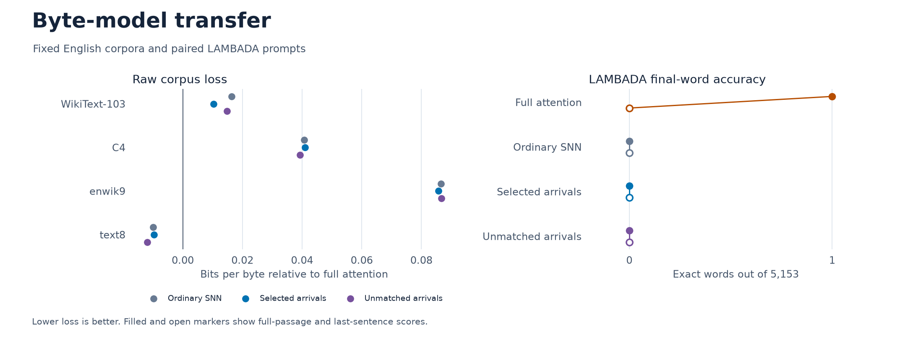

# ShuntFormer

ShuntFormer is an integer spiking byte language model. The v9
checkpoint has **14.07M parameters**, 11 spiking blocks and
**28,584 bytes of persistent tensor state** per stream. Within each
block, fixed axons route signed spike counts and local charge holds
their history. When an arrival and the held read overlap on the same
sign rail, their coincident spikes cancel out of the new branch. The
remaining arrival pulses drive the block's residual neuron through
learned synapses. A tagged forecast-error bank provides a second
source of current for the vocabulary neurons.

[Model card and circuit diagram](models/spiking-byte-lm-v9/README.md) ·
[Research handoff](docs/V9_HANDOFF.md) · [Checkpoint release](https://github.com/DanielTea/transformer-snn/releases/tag/spiking-byte-lm-v9)


## Run the bundled model

From the repository root, set up Python 3.12 and run greedy
generation with the native CPU integer decoder.

```bash
python3.12 -m venv .venv
source .venv/bin/activate
python -m pip install -r requirements.txt
python experiments/generate_event_lm.py models/spiking-byte-lm-v9/weights.pt \
  --prompt 'The first chapter' --bytes 128
```

## Matched benchmark

Every row below saw **121,241,600 cumulative enwik8 training
targets** in 512-byte windows. The continuation used seed 9349.
The two arrival variants and the widened full-attention control
have about 14.07M parameters. The original-width SNN control has
12.80M. Each column gives bits per byte on the full enwik8 test
split or 16 pinned PG-19 test books. PG-19 temperatures are fitted
on eight separate validation books.

<!-- event-lm-leaderboard:start -->

| Model | enwik8 | PG-19 calibrated | PG-19 raw | State |
|---|---:|---:|---:|---:|
| Ordinary SNN | 1.79102 | 2.75679 | 2.84618 | 28,584 B |
| Selected arrivals | 1.79114 | **2.75550** | **2.84606** | 28,584 B |
| Unmatched arrivals | 1.79163 | 2.76087 | 2.85319 | 28,584 B |
| Full attention | **1.70963** | 2.88426 | 3.08064 | 6 MiB |

<!-- event-lm-leaderboard:end -->

At predictions 17–32 after reset, both arrival variants improve
on the ordinary SNN by about 0.00394 bpb on 1,535 paired enwik8
test windows. Full attention leads both variants by 0.0281 bpb
over that interval. The two arrival variants are within 0.00001 bpb
of each other there. The fixed-weight mute result spans zero.

State counts persistent tensors per stream. The full-attention
reference uses a 512-byte evaluation context. The paired enwik8
cold-start probe scores the same first 32 predictions under
every model and gives window-resampled intervals.
[Arrival experiments](docs/FIXED_ARRIVALS.md) · [All results](docs/LEADERBOARD.md) ·
[Browser report](docs/report.html#spiking-byte-lm)

## Byte transfer benchmarks

Each release from v9 includes raw bits per byte on WikiText-103,
C4 validation, enwik9 beyond byte 100 million, and text8. Every
model scores the same windows. The Wikipedia results include
an overlap screen against the enwik8 training text and scores
on zero-hit windows. LAMBADA scores final-word loss and greedy
exact match with all 5,153 words under full-passage and
last-sentence prompts. On text8, unmatched arrivals score
2.13885 bpb and full attention scores 2.15081. Full attention
leads on WikiText-103, C4, enwik9 and LAMBADA answer-byte loss.



[Transfer scores](docs/LEADERBOARD.md#byte-transfer-at-the-same-training-exposure) ·
[Data, overlap audit and replay](docs/BYTE_TRANSFER.md)

## Resume the research

Restore the v9 archive for the exact four continuation
checkpoints and their two parents. The manifest links all weights
to checksums and training arguments. The handoff gives commands
to replay a training run, rerun the full test corpora and prepare
the five transfer benchmarks from their sources.
[Restore and replay](docs/V9_HANDOFF.md#restore-and-run) ·
[Exact manifest](models/spiking-byte-lm-v9/manifest.json) ·
[Result file guide](results/README.md)

Regenerate the leaderboards, scientific figures and browser report
from the checked-in records.

```bash
python experiments/plot_event_lm_study.py
python experiments/plot_depth_inhibition.py
python experiments/make_report.py docs/report.html
```

[Source map](docs/V9_HANDOFF.md#source-map) ·
[v8 research handoff](docs/V8_HANDOFF.md) ·
[Historical ShuntFormer and Dendrite experiments](docs/SHUNTFORMER_HISTORY.md)
