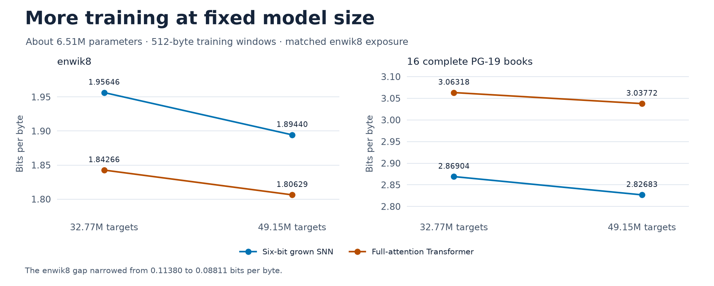

# ShuntFormer

ShuntFormer v5 is a seven-block spiking byte language model with
**6,514,176 learned parameters** and **19,536 bytes of persistent
tensor state** per stream. Its integer CPU decoder maps byte events to
signed vocabulary spike counts. A shared inhibitory pool regulates
firing, steering spikes route charge through fixed axons and local
memory, and an error bank checks learned context tags before delivering
correction spikes.



## Run the model

Use Python 3.11 or 3.12 from the repository root. The checkout includes
the reference weights. Greedy generation runs on CPU.

```bash
python -m venv .venv
source .venv/bin/activate
python -m pip install -r requirements.txt
python experiments/generate_event_lm.py models/spiking-byte-lm-v5/weights.pt \
  --prompt 'The first chapter' --bytes 128
```

| Where to start | What it contains |
|---|---|
| [v5 model card](models/spiking-byte-lm-v5/README.md) | Circuit diagram, firing and memory rules, training configuration, and the stream state layout |
| [Research handoff](docs/HANDOFF.md) | Dataset checksums, checkpoint restore, exact replay commands, and the next runs |
| [Ranked results](docs/LEADERBOARD.md) and [browser report](docs/report.html#spiking-byte-lm) | Matched comparisons, raw and calibrated loss, pulse counts, and charts |
| [Checkpoint release](https://github.com/DanielTea/transformer-snn/releases/tag/spiking-byte-lm-v5) and [manifest](models/spiking-byte-lm-v5/manifest.json) | Reference weights, variants, Transformer baselines, parents, and SHA-256 digests |

## Current benchmark

The two 6.51M models each saw **65,536,000 cumulative enwik8 training
targets** in 512-byte windows, with seed 2503 for the final continuation.
Scores are bits per byte on the full enwik8 test split and 16 pinned
PG-19 test books. PG-19 temperatures are fitted on eight separate books.

<!-- event-lm-leaderboard:start -->

| Model | enwik8 | PG-19 | State |
|---|---:|---:|---:|
| Six-bit grown SNN | 1.86525 | **2.81231** | 19,536 B |
| Grown full-attention Transformer | **1.77728** | 2.98071 | 4 MiB |

<!-- event-lm-leaderboard:end -->

The bundled SNN leads on all 16 PG-19 books. Full attention leads
on enwik8 by 0.08798 bits per byte. The comparison uses one
continuation seed. The state column measures persistent tensors
per stream.
[Per-book scores and native pulse audit](results/event_lm/scale_6510k_next_data) ·
[Evaluation protocol](docs/HANDOFF.md#score-checkpoints)

## Continue the research

Widening the residual stream from 768 to 1,536 reduced PG-19 loss
while keeping 19,536 bytes of persistent state. The matched wider
Transformer led on enwik8. Follow-up studies test whether stored
tags can pick better reads and whether feedback can redirect
bypass pulses within a byte.
[13.03M comparison](docs/GROWN_RESIDUAL.md#double-the-residual-stream-at-fixed-persistent-state) ·
[Tag read competition](docs/TAG_READ_COMPETITION.md) · [Late steering](docs/LATE_STEERING.md) ·
[Training exposure](docs/GROWN_RESIDUAL.md#extend-training-exposure) ·
[Expansion study](docs/EXPANSION_GROWTH.md) ·
[Write confirmation](docs/TRACE_WRITE_CONFIRM.md) ·
[Inhibition study](docs/INHIBITION_REDISTRIBUTION.md)

Regenerate the leaderboards and figures from the checked-in results.

```bash
python experiments/plot_event_lm_study.py
python experiments/plot_depth_inhibition.py
python experiments/make_report.py docs/report.html
```

[Source map](docs/HANDOFF.md#source-and-release-map) ·
[Historical ShuntFormer and Dendrite experiments](docs/SHUNTFORMER_HISTORY.md) ·
[Result file guide](results/README.md)
