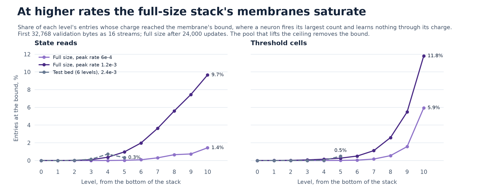
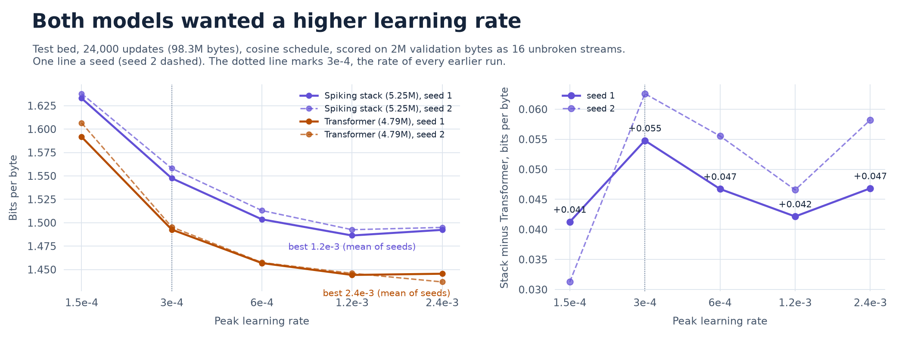
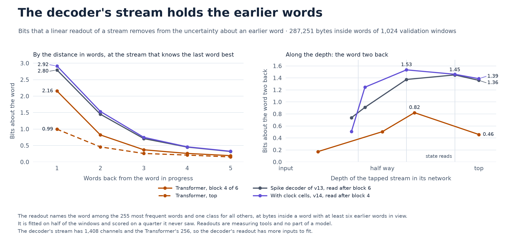
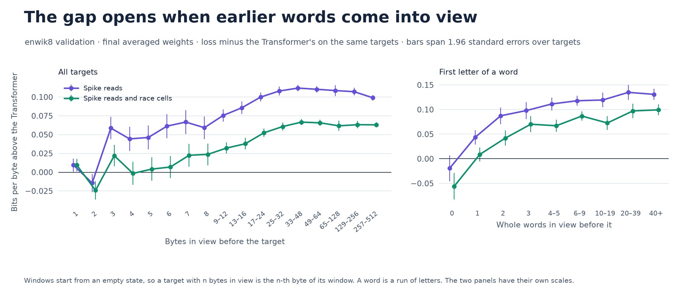
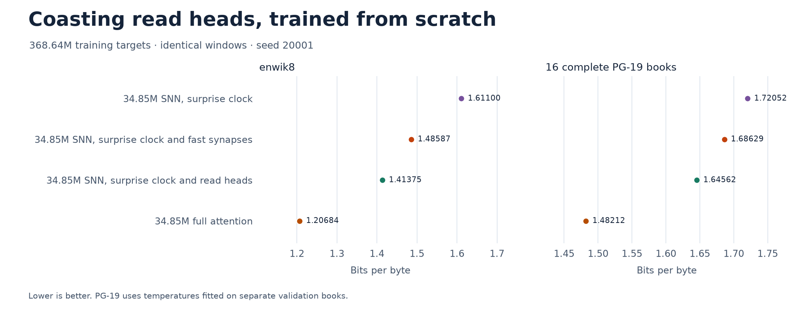
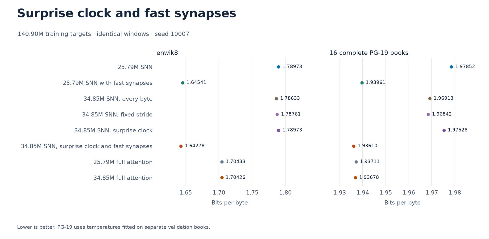
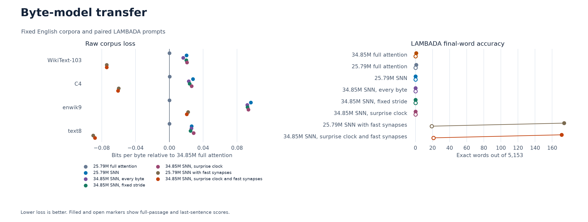

# Volley

Volley (formerly ShuntFormer) is an integer spiking byte
language model. Its neurons exchange signed spike counts over
fixed axons, and local charge holds history. It reads text as
one unbroken stream, byte by byte, and its memory is a race of
spikes over what it has read. Every release is measured against
a full-attention Transformer of the same size and training.

The name comes from the volley principle of neuroscience: groups
of neurons that fire in turn carry together what no single neuron
can. In the game, a volley answers the ball before it bounces, as
the model answers each byte when it comes. Releases up to v17 were
published as ShuntFormer; their tags and files keep that name.

The newest release, **v18**, finds what caps the spike-only stack
when it learns faster, and removes it. At full size (34.8M
parameters) the stack's membranes saturate at higher learning
rates: at a peak rate of 1.2e-3, up to 12% of its top level's
neurons sit at their bound, where a neuron fires its largest count
whatever more it hears and stops learning through its charge. That
is why, at full size, the Transformer gains more from a higher
rate than the stack. A pool that divides the charge before the
bound, built in v15 and never released, removes the saturation
entirely at the same energy and is worth 0.035 bits per byte at
1.2e-3. What remains is knowledge: with each model at its best
rate, the full-size gap is 0.036 in 24,000-update runs, and it
sits on new contexts. On the test bed, two seeds show that the
stack's flattening with data is not an artefact of the learning
rate. Word heads at full size give the best spike-only stack so
far, **1.116 bits per byte** on the enwik8 test: 0.0009 ahead of
v17, less than their own pre-registered mark of 0.003. It is
0.0095 behind the Transformer as it reads the test, and 0.013
behind the Transformer with taught output synapses. Neither of two
spike-only forms of a better unit closes the gap at full size:
gated cells lose badly, and noisy thresholds train level. The v18
weights are release assets, and the model that runs from a clone
is v11.



| Release | Adds | enwik8 test | Transformer | Scored in |
|---|---|---:|---:|---|
| [v18](#v18-membranes-that-saturate-and-a-ceiling-that-lifts) | Word heads, the learning rate at full size, membranes that saturate and the ceiling that lifts | 1.116 | **1.107** | Unbroken streams; windows of 2,048 bytes |
| [v17](#v17-the-knowledge-gap) | Knowledge cells in the race, training on streams, where the gap is | 1.117 | **1.107** | Unbroken streams; windows of 2,048 bytes |
| [v16](#v16-long-streams) | Transformers on the stack's window lengths, forgetting slopes, fast synapses trained in the loop | 1.120 | **1.107** | Unbroken streams; windows of 2,048 bytes |
| [v15](#v15-a-stack-that-reads-a-stream) | A stack of state reads and threshold cells that reads a stream | **1.141** | 1.144 | Unbroken streams |
| [v14](#v14-read-clocks-and-the-address-rate) | A faster address rate and clock cells for the read heads | 1.244 | 1.182 | 512-byte windows |
| [v13](#v13-state-reads-and-race-cells) | State reads and race cells on delayed fibres | 1.262 | 1.182 | 512-byte windows |
| [v12](#v12-coasting-read-heads) | Read heads on a tape of the stream | 1.414 | 1.182 | One continuous stream |
| [v11](#v11-surprise-clock-and-fast-synapses) | Fast synapses written by error spikes | 1.645 | 1.704 | One continuous stream |

Each Transformer has the size and the training of its row. The
Transformers of v18, v17 and v16 trained on windows of 2,048 bytes
from 24,000 updates, as their stacks did, and read 2,048; every
other one reads 512 bytes. The stacks of v18 and v17 have 36.26M
parameters, 4.2% more than their Transformer, for their knowledge
cells; v18's word heads add 352 more. v16 to v12 have
about 34.8M parameters and
368.64M training targets from random weights. The Transformer of
v15 has the standard shape and trained under the rotated
optimizer of the spiking models. It reads a stream in windows of
496 bytes of history before 16 scored ones, and in the windows
of v13 and v14, 256 before 256, it scores 1.156. The rows of v14
to v12 name the Transformer of the standard shape that v14
trained with AdamW. The 256-wide Transformer that v12 and v13
published scores 1.207. In the windows of v13 and v14 the v12
decoder scores 1.467, because it gives up the stream it carries.
v11 has 25.79M parameters and 140.90M targets. Its fast synapses
carry the whole stream, and with the same synapses on its output
the v11 Transformer scores 1.578. Every arm is one seed.

[Knowledge-gap study](docs/KNOWLEDGE_GAP.md) ·
[Roadmap](docs/ROADMAP.md) ·
[Scaling-law study](docs/SCALING_LAW.md) ·
[Model card](models/spiking-byte-lm-v18/README.md) ·
[Leaderboard](docs/LEADERBOARD.md) ·
[Research handoff](docs/V18_HANDOFF.md) ·
[Latest release](https://github.com/DanielTea/transformer-snn/releases/tag/spiking-byte-lm-v18)

## v18: membranes that saturate, and a ceiling that lifts

v17 found that the stack's gap to the Transformer is knowledge,
and that on the test bed it reopens with more data. v18 asks
whether the stack was held back by the learning rate every earlier
release used, 3e-4, and finds what caps it at full size. Every
test was recorded before its runs
(`results/event_lm/knowledge_gap/`); the study is
[docs/SCALING_LAW.md](docs/SCALING_LAW.md).

**The test bed wanted a higher rate, but the flattening is not its
artefact.** At five peak rates and two seeds, both models do
better than at 3e-4: the stack at 1.2e-3, the Transformer at
2.4e-3. From 3e-4 to its best rate the stack gains 0.063 and the
Transformer 0.053. The difference, 0.010, is under the 0.020 that
the study set for calling the flattening an artefact of the rate.
At each model's best rate the gap is 0.048, and it is on new
contexts on both seeds (`learning_rate_with_data.json`).



**At full size the Transformer gains more from a higher rate.** In
complete 24,000-update runs the stack is best at 6e-4 and the
Transformer at 1.2e-3, and the gap at their best rates is 0.044,
wider than the 0.036 at 3e-4 (`full_size_rate_pilot.json`). On new
contexts the two gain alike from their best rates; the
Transformer's extra gain is on bytes it can copy.

**Because the stack's membranes saturate.** A membrane holds the
charge of a neuron's largest count at its resting threshold.
Charge beyond that is cut, so the neuron fires its largest count
whatever more it hears and learns nothing through its charge. At
1.2e-3, 2.7% of the full-size stack's read entries and 2.0% of its
cells' sit at the bound, up to 9.7% and 11.8% at the top level; at
3e-4 almost none do. The test bed barely saturates even at 2.4e-3,
which is why it never showed this
(`experiments/membrane_saturation.py`,
`membrane_saturation.json`).

**The pool that lifts the ceiling removes it.** v15 built a pool
that divides the charge before the membrane bounds it, so a neuron
fires up to its largest count at every threshold. No release used
it, because all trained at 3e-4. At full size it removes the
saturation entirely, at the same energy (about 308,000 pulses a
byte in training), and turns the stack's loss at 1.2e-3 into a
level result with 6e-4 (1.3126 against 1.3134; the plain stack
scores 1.3475 at 1.2e-3). With each model at its best rate the
lifted stack is 0.036 behind, as at 3e-4: lifting removes the
widening that higher rates brought, and the gap that remains is
knowledge (`full_size_lifted_ceiling_pilot.json`).


**Ruled out on the way.** The pulse budget does not hold the stack
back: its price falls to 0.00 to 0.02 by the end of every run at
both depths, where a budget that binds runs at 0.10 to 0.24. Nor
do noisy late weights, nor a code that grows denser with data: at
3e-4, 35% to 56% of a level's cells fire at a byte at 6,000 and
24,000 updates alike (`experiments/cell_activity.py`). Depth 22 saturates
no more than depth 11.

**Word heads at full size.** One word head in every read, a head
that reaches only the present word's cells and weighs each by its
place in the word, gains 0.0009 on test (paired 95% interval
0.0004 to 0.0013) and 0.0006 on validation (0.0001 to 0.0010) over
v17's stack. That is under the 0.003 its record asked, so word
heads do not join the design. The run is still the best spike-only
stack so far: 1.11615 on test and 1.14908 on validation, read as a
stream reaching 8,192 cells with taught output synapses
(`full_size_word_heads.json`, [model
card](models/spiking-byte-lm-v18/README.md)). Its gap to the
Transformer keeps v17's shape: better on bytes it can copy, by
0.10 within 2 KB and 0.40 from 2 to 8 KB back, and 0.057 behind on
new contexts.

**The unit, in spikes.** The largest step that v15's walk from the
Transformer to the stack priced was the unit: plain rectifying
units in place of gated ones cost 0.025. Two spike-only answers
were tested at full size: gated threshold cells, in which a gate
dendrite lets in a share of what a value dendrite collects (built
for an earlier pilot), and noisy thresholds, new in v18, in which
a cell's membrane carries logistic noise while training, so that
its average count is a smooth curve and the cell learns from that
curve's true slope; scoring stays exact. At full size, in one 24,000-update run each against the
plain stack at 6e-4 (`full_size_unit_screen.json`), gated cells at
equal parameters lose by 0.118, worse on every kind of context;
their gate dendrites sit at their bound a fifth of the time, so
the gate opens fully and the cell loses its range. Noisy
thresholds are 0.004 better at the same energy, all of it on near
copies and none on new contexts. The self-gated arm runs next, and
the test bed screens both forms by their slope over data.

**Still running** for v19: the full-size pair, each model at its
best rate (90,000 updates); the data-scaling curves from 6,000 to
96,000 updates at each model's best rate; quantal release and
stochastic firing at two rates; the test bed's screens of gated
cells and noisy thresholds by their slope; gated cells under the
lifted ceiling; and depth by recurrence, with the energy it takes
as an arm of its own.

**In since the release:** the full size's cell shape passes at four
seeds. After 24,000 updates it is 0.015 ahead of the test bed's own
shape and 0.020 better on new contexts, at every seed
(`cell_shape_with_data.json`).

## v17: the knowledge gap

The v17 study asks where the stack's gap to the Transformer lies,
and what moves it.

| Trained from scratch, 368.64M targets | Reads the text as | enwik8 test | enwik8 validation |
|---|---|---:|---:|
| 36.26M SNN stack, v16's with 128 knowledge cells a head, trained on streams | A stream, as trained | 1.13571 | 1.16518 |
| | A stream reaching 8,192 cells | 1.12097 | 1.15148 |
| | The same, with taught output synapses | **1.11702** | **1.14963** |
| 34.81M SNN stack, v16's release | A stream reaching 8,192 cells, taught output synapses | 1.11994 | 1.15138 |
| 34.75M full attention, windows of 2,048 bytes | Windows, 2,032 bytes of history before 16 scored | **1.10669** | **1.13033** |
| 69.36M SNN stack, 22 levels, the same pulse budget | A stream reaching 8,192 cells, taught output synapses | 1.09257 | 1.12302 |
| 69.37M full attention, 22 layers | Windows, 2,032 bytes of history before 16 scored | **1.07042** | **1.09299** |

The stack is 0.0103 behind on test (paired 95% interval 0.0092 to
0.0114) and 0.0193 behind on validation (0.0182 to 0.0205). The
knowledge cells missed their own mark, recorded before the run: at
the trained reach they gain 0.001 over v16's stack, where 0.005
was asked; with the longer reach and the fast synapses the gain is
0.003. At depth 22 the stack gains 0.027 over depth 11 and the
Transformer 0.036. At equal energy for the stack, the gap widens
with size, to 0.022 on test and 0.030 on validation.

| What a byte's context offers | Share of bytes | Stack minus Transformer, test | validation |
|---|---:|---:|---:|
| Copyable from the last 2 KB | 13 to 17% | **−0.091** | **−0.087** |
| Copyable only from 2 to 8 KB back | 4% | **−0.324** | **−0.307** |
| Seen before, another byte followed | 5% | −0.004 | −0.092 |
| New context | 74 to 77% | **+0.057** | **+0.066** |

`experiments/gap_by_piece.py` pairs two scorings of the same
streams piece by piece. From how the kinds of byte mix in each
piece, it fits the gap of each kind. A target's kind is what its
context offers: whether the eight bytes before it ran earlier in
the stream, how far back, and whether the byte that followed them
then is the target. The split above is v16's stack against its
Transformer.


On the test bed, 5.25M parameters scored over 2 million validation
bytes as unbroken streams, the delayed stack trained on streams is
0.047 ahead of its Transformer after 6,000 updates. After 24,000
updates, with four times the data, it is 0.054 behind. Delayed
fibres, training on streams and knowledge cells all helped most
early.

A single knowledge cell a head copies random letters better at
all four seeds, by 1.37 bits a byte on average, and it is 0.017
better over long streams. The base's seeds copy at 2.60 to 4.04
bits a byte on the second showing; the sink's at 1.61 to 2.44.

These failed, each under its recorded rule:
- myelinated fibres that learn their delays: the delays move toward the present;
- a cerebellar sheet of four times the cells;
- word heads, which gain memory that fades with data;
- kept cells;
- fast synapses keyed by knowledge cells;
- branching dendrites, apical bursts and racing experts.

The full size's cell shape, a fibre for every channel's present
byte and one delayed copy, is better than the test bed's own at
6,000 updates on two devices, including on new contexts, and
still 0.016 better at 24,000.

[Knowledge-gap study](docs/KNOWLEDGE_GAP.md) ·
[Roadmap](docs/ROADMAP.md) ·
[Leaderboard](docs/LEADERBOARD.md) ·
[Model card](models/spiking-byte-lm-v17/README.md) ·
[Research handoff](docs/V17_HANDOFF.md) ·
[Checkpoint release](https://github.com/DanielTea/transformer-snn/releases/tag/spiking-byte-lm-v17)

## v16: long streams

The v16 study asks what v15's level score was worth. Its
Transformers train exactly as its stacks do, on windows of 512
bytes for 24,000 updates and on windows of 1,024 or 2,048 bytes
for the remaining 66,000, and read the test in windows of their
training length.

| Trained from scratch, 368.64M targets | Reads the text as | enwik8 test | enwik8 validation |
|---|---|---:|---:|
| 34.81M SNN stack, windows of 2,048 bytes | A stream, as trained | 1.13903 | 1.16870 |
| | A stream reaching 8,192 cells at levels 4 to 7, with taught output synapses | 1.13472 | 1.16660 |
| 34.75M full attention, windows of 2,048 bytes | Windows, 2,032 bytes of history before 16 scored | **1.10669** | **1.13033** |
| | With taught output synapses | 1.10321 | 1.12901 |
| 34.81M SNN stack, windows of 1,024 bytes (v15) | A stream, as trained | 1.15359 | 1.18278 |
| 34.75M full attention, windows of 1,024 bytes | Windows, 1,008 bytes of history before 16 scored | 1.11820 | 1.14104 |
| 34.81M SNN stack, windows of 2,048 bytes, slopes that learn | A stream, as trained | 1.13667 | 1.16624 |
| | A stream reaching 8,192 cells | 1.12349 | 1.15368 |
| | The same, with taught output synapses | **1.11994** | **1.15138** |
| | Second seed, reaching 8,192 cells | 1.12048 | 1.15193 |
| 34.75M full attention, windows of 2,048 bytes, second seed | Windows, 2,032 bytes of history before 16 scored | 1.10366 | 1.12873 |


Each read as it trained, the stack is 0.0323 behind on the test
at 2,048 bytes, with a paired 95% interval of 0.0314 to 0.0333,
and 0.0384 behind on validation (0.0374 to 0.0394). A stream lets
the stack read further than it trained at no cost. The stack whose
slopes stayed at zero gains nothing from it at 2,048 bytes; the one
whose slopes learned does: reaching 8,192 cells back with its fast
synapses learning, it is 0.0133 behind the Transformer on test, and
0.0167 when the Transformer has fast synapses too. Second seeds of
both models are each about 0.003 better and keep the gap; every
other row is one seed.


Every head of a read now has a **forgetting slope**: a cell
beyond the window loses charge for every doubling of its age, so
its share of the read falls as a power of its age. Set at
scoring on v15's released stack, a slope of −1 at a reach of
16,384 cells gains 0.008 on both splits; learned in training,
79 of the 88 heads settle below −0.69, which bounds the far past,
at a median of −1.3. On 16 PG-19 books, the
gain of v15's fast output synapses grows from 0.004 bits per
byte in the first 8 KB to 0.028 after 128 to 256 KB, as the
square root of the text read; on enwik8 it stays level. Squared
and gated cells that multiply charges collapsed in training. A
study of fast synapses trained in the loop passed its go/no-go:
cells trained with a decaying rule make better keys for v15's
rule, by 0.013 bits per byte on the test bed, and the full-size
run is queued for the next release.


Along every axis that the weekend's runs measure, the
Transformer's curve is at least as steep as the stack's. The
stack leads for the first 7,500 updates and then falls behind;
doubling the depth gains the Transformer about 0.04 bits per
byte and the stack 0.02, though the deeper stack kept the same
budget of pulses per byte, so each level fired half as much. On
the small test bed that costs little: twelve levels gain 0.130
over six at the same budget and 0.152 with it doubled, while more
pulses alone make the stack worse, and a loop of tied levels is
worth about a third of a level of its own. Scaling this design
will not close the gap, and the next step has to change the
stack.
[How the two models scale](docs/LONG_STREAMS.md#how-the-two-models-scale)

Three ideas were tested this weekend under rules recorded before
their runs, and none holds. Fast synapses that consolidate into
slower stages forget the far past and did worse than v15's rule
([consolidating synapses](docs/CASCADE_SYNAPSES.md)). Shunting
gates that divide charges were stable but their gain did not
survive a second seed. Echoes of the output's error in place of
the backward pass failed, and on the way showed that the stack's
credit runs back in time along its reads
([echo learning](docs/ECHO_LEARNING.md)).

[Long-streams study](docs/LONG_STREAMS.md) ·
[Trained plasticity](docs/TRAINED_PLASTICITY.md) ·
[Leaderboard](docs/LEADERBOARD.md) ·
[Model card](models/spiking-byte-lm-v16/README.md) ·
[Research handoff](docs/V16_HANDOFF.md) ·
[Checkpoint release](https://github.com/DanielTea/transformer-snn/releases/tag/spiking-byte-lm-v16)

## v15: a stack that reads a stream

The v15 study drops the blocks of the decoders. Its **stack**
keeps the two parts that v13 and v14 added, state reads and
threshold cells, and gives them the layout of a Transformer: a
stream of 512 channels runs through eleven levels, each a state
read of 8 heads and then a layer of 1,188 threshold cells, and
both write their spikes back into the stream. A **pool** cell at
every level divides what a neuron hears by how loud the stream
is, in spikes, and takes the place of a normalisation. The cells
and the tags of the reads hear every channel now and once more
after one to three bytes. The stack has 34.81M parameters.


The stack reads a **stream**. It carries the tags and payloads
of its reads and the last bytes of its fibres from piece to
piece, and a stream cut anywhere fires exactly the spikes of one
pass over the whole of it. In a stream the reads can reach
further back than in training at no cost in synapses, and fast
output synapses that every arriving byte teaches learn the text
as it is read.

| Trained from scratch, 368.64M targets | Reads the text as | enwik8 test | enwik8 validation | PG-19 |
|---|---|---:|---:|---:|
| 34.81M SNN stack, long windows | A stream, the reads after levels 5 to 7 reach 4,096 cells | **1.14058** | 1.16936 | **1.42490** |
| | A stream, as trained | 1.15359 | 1.18278 | 1.44559 |
| 34.81M SNN stack, windows of 512 bytes | A stream, the reads after levels 4 to 7 reach 2,048 cells | 1.17095 | 1.19872 | 1.46178 |
| | A stream, as trained | 1.18518 | 1.20930 | 1.47610 |
| 34.75M full attention, standard shape | Windows, 496 bytes of history before 16 scored | 1.14388 | **1.16289** | 1.42649 |
| | 448 before 64 | 1.14533 | 1.16416 | 1.42786 |

The stack on long windows is 0.0033 bpb below the Transformer on
the test, with a paired 95% interval of −0.0048 to −0.0018, and
0.0065 above it on the validation split (+0.0050 to +0.0079).
With fast output synapses on both sides it scores 1.1339 on the
test against the Transformer's 1.1344, and 1.1649 against 1.1574
on validation. Every row is one seed, and the rows received
identical windows from random weights up to 24,000 updates.


In windows from an empty state the stack trained on windows of
512 bytes follows the Transformer at about 0.048 bits per byte
to the end of training. What closes that distance is the stream.
The same weights of the released stack score 0.041 better as a
stream than in the warmed windows of v14, and a reach of 4,096
cells gains another 0.013. The long windows count as well: the
stack that read windows of 1,024 bytes from 24,000 updates is
0.030 ahead of the one that stayed on 512.


A walk from the Transformer to the spiking stack, one change per
run, places the rest of the distance. Whole spikes and synapses
on the 8-bit grid cost 0.0008, and age offsets in place of
rotary phases cost nothing. The plain units that threshold cells
compute in place of the Transformer's gated ones cost most,
0.025. Gated cells, the spike form of that unit, were built in
four variants and stalled. Training on streams with the state
handed on did not beat training on windows.
[Next pilots](docs/V15_HANDOFF.md#next-pilots)

[Stream-form study](docs/STREAM_FORM.md) ·
[Every training arm](docs/STREAM_FORM_ARMS.md) ·
[Leaderboard](docs/LEADERBOARD.md) ·
[Model card](models/spiking-byte-lm-v15/README.md) ·
[Research handoff](docs/V15_HANDOFF.md) ·
[Checkpoint release](https://github.com/DanielTea/transformer-snn/releases/tag/spiking-byte-lm-v15)

## v14: read clocks and the address rate

The v14 study changes how the read heads of the v13 decoder
learn where to look. A head addresses the earlier bytes with
charges: a gain on the match of probe and tag, and an offset for
every age. One unit of charge multiplies a cell's rate in the
race by e, so an address has to move much further than a synapse
does. With an **address rate** of 8 the stored charges count
eight times, and one update moves an address eight times as far.
The decoder keeps its 34.82M parameters.

The study also gives a head a second kind of age. Every head has
a **clock cell** whose spike is a beat, and the head counts the
beats that fell after each earlier byte. In a made-up language
whose words depend on the word before last, clock cells learn to
beat on the spaces, and a read then finds that word whatever the
lengths of the words between. At full size the clock cells did
not find the words. The decoder with them is the one released
because it scores best, but its lead of 0.0013 bpb is less than
a second run moves a decoder.


| Trained from scratch, 368.64M targets | Optimizer | enwik8 | PG-19 |
|---|---|---:|---:|
| 34.82M SNN, clock cells and address rate | Rotated, averaged | 1.24445 | 1.53378 |
| 34.82M SNN, address rate | Rotated, averaged | 1.24570 | 1.53600 |
| 34.82M SNN, spike reads and race cells | Rotated, averaged | 1.26226 | 1.55162 |
| 34.85M full attention, 256 wide | AdamW | 1.20684 | 1.48212 |
| 34.85M full attention, 256 wide | Rotated, averaged | 1.20407 | 1.48204 |
| 34.75M full attention, standard shape | AdamW, averaged | **1.18215** | **1.45701** |

Both Transformers are ahead. The released decoder is 0.038 bpb
behind the 256-wide one on enwik8 and 0.052 on 16 PG-19 books.
The Transformer of the standard shape is 512 wide with 11
layers, was trained for this study and is 0.062 and 0.077 ahead.
Every score in the table is in windows of 512 bytes that start
from an empty state, with 256 unscored bytes before the 256
scored ones. The six rows received identical windows from random
weights, and every arm is one seed. The decoders run in such
windows only. A window generator that is new in v14 writes text
with them, at one window per byte. The v14 weights are release
assets, and the model that runs from a clone is v11.


The faster addresses show from 6,000 updates on. The decoders
lead the 256-wide Transformer up to 9,000 updates. Both
Transformers take their lead by 30,000 updates, and it changes
little after that.


On bytes that an earlier match in the window offers for copying,
the decoders are ahead of the Transformer. They are behind on
the other bytes, and furthest where four or more words are in
view. A linear readout finds more of the earlier words in the
decoder's stream than in the Transformer's, though that stream
is five and a half times as wide. The decoder holds the words
and makes less of them.



Beside its three decoders the study trained 43 pilots of other
layouts, and it counts none of them as a gain. Cells that answer
a byte with many of their number, on relay neurons that hear the
whole stream, were closing in on the race cells when the pilots
ended. They are the next step.
[Next pilots](docs/V14_HANDOFF.md#next-pilots)

[Read-clock study](docs/READ_CLOCKS.md) ·
[Every training arm](docs/READ_CLOCKS_ARMS.md) ·
[Leaderboard](docs/LEADERBOARD.md) ·
[Model card](models/spiking-byte-lm-v14/README.md) ·
[Research handoff](docs/V14_HANDOFF.md) ·
[Checkpoint release](https://github.com/DanielTea/transformer-snn/releases/tag/spiking-byte-lm-v14)

## v13: state reads and race cells

The v13 study trains a 34.82M-parameter spike-only decoder from
random weights for 368.64M targets. Three parts are new. A
**state read** lets the present byte address the stream's own
earlier states by what they hold. The states of the last 512
bytes race for a budget of spikes, and the ones that fire pass
their payload on. **Race cells** are clusters of 350 cells that
compete for 64 spikes per byte. They listen on **delayed
fibres** that bring the stream as it was up to three bytes ago.
All three are built from spike counts and trained by gradient
descent with the decoder.


| Trained from scratch, 368.64M targets | Optimizer | enwik8 | PG-19 |
|---|---|---:|---:|
| 34.82M SNN, spike reads and race cells | Rotated, averaged | 1.26226 | 1.55162 |
| 34.65M SNN, spike reads | Rotated, averaged | 1.29908 | 1.57978 |
| 34.65M hybrid, soft reads | AdamW | 1.31975 | — |
| 34.85M SNN, surprise clock and read heads | AdamW | 1.46686 | — |
| 34.85M SNN, surprise clock | AdamW | 1.59726 | — |
| 34.85M full attention | AdamW | 1.20684 | 1.48212 |
| 34.85M full attention | Rotated, averaged | **1.20407** | **1.48204** |

The Transformer is still ahead, by 0.055 bpb on enwik8 and by
0.070 on 16 PG-19 books. Every score in this table is in windows
of 512 bytes that start from an empty state, with 256 unscored
bytes before the 256 scored ones. A dash marks a score that was
not measured. The v13 decoder runs in such windows only. It has
no stream form yet, so it has no streaming score, no native
integer run and no pulse audit. The seven rows
received identical windows from random weights. The rows marked
rotated were trained with a rotated optimizer, which runs Adam
in the eigenbasis of each weight matrix's gradient moments, and
are scored at the running average of their weights. Every arm
is one seed. The v13 weights are release assets, and the model
that runs from a clone is v11.


For the first 6,000 updates the decoder learns faster than the
Transformer. At 9,000 the two are level, and from 12,000 on the
Transformer is ahead. At 84,000 updates the decoder is ahead on
bytes that an earlier match in the window offers for copying
and behind on the others. The first letter of a word shows
where the rest comes from. With one earlier word in view the
decoder predicts it as well as the Transformer, and with three
it is 0.070 bpb behind. The Transformer's lead is the use it
makes of the second to fifth word back.



The study ran 89 training arms in one night. Its page gives the
circuit, the controls, the probes behind each statement and the
changes that did not help.


The next step that v13 named was fibres whose delay counts
words where a delayed fibre counts bytes. v14 ran them at full
size in pilots of 3,000 to 6,000 updates, and they did not help.
[v14](#v14-read-clocks-and-the-address-rate)

[State-read study](docs/STATE_READS.md) ·
[Every training arm](docs/STATE_READS_ARMS.md) ·
[Leaderboard](docs/LEADERBOARD.md) ·
[Model card](models/spiking-byte-lm-v13/README.md) ·
[Research handoff](docs/V13_HANDOFF.md) ·
[Checkpoint release](https://github.com/DanielTea/transformer-snn/releases/tag/spiking-byte-lm-v13)

## v12: coasting read heads

The v12 study trains the 34.85M decoder from random weights
beside **read heads on a tape of the stream**. A head follows a
passage one byte at a time, gains charge with every confirmed
byte and is removed by the first wrong one. With its heads the
decoder scores **1.414 bits per byte** on the full enwik8 test
split and 1.646 on 16 PG-19 books. The bundled v11 model scores
1.645 and 1.940.



| Trained from scratch, 368.64M targets | enwik8 | PG-19 | State | Pulses per byte |
|---|---:|---:|---:|---:|
| 34.85M SNN, surprise clock | 1.61100 | 1.72052 | 43,796 B | 311,540 |
| 34.85M SNN, surprise clock and fast synapses | 1.48587 | 1.68629 | 68,388 B | 318,451 |
| 34.85M SNN, surprise clock and read heads | 1.41375 | 1.64562 | 179,028 B | 309,469 |
| 34.85M full attention | **1.20684** | **1.48212** | 6 MiB | — |

Full attention is far ahead at this training budget. The four
rows received identical windows from random weights. Every
score comes from the streaming evaluator, which carries the
tape, the key synapses and the heads from chunk to chunk. They
add 135,232 bytes of state per stream, and the head decoder
holds a 35th of the state full attention keeps for its 512-byte
context. Pulses are counted in the native integer decoder on
the first 4,096 bytes of the enwik8 test split, and 241 of the
head decoder's 309,469 are in the head circuit. Every arm is
one seed. The v12 weights are release assets, and the model
that runs from a clone is v11.


The study first scored the heads in a replay over each
decoder's recorded outputs, with strengths refitted on enwik8
validation. The stream confirms it. With refitted strengths the
head decoder scores 1.41385 bpb both ways. The figure below is
that replay for nine decoders, each alone, with the v11 fast
synapses and with read heads.


[Coasting-head study](docs/COASTING_HEADS.md) ·
[Leaderboard](docs/LEADERBOARD.md) ·
[Model card](models/spiking-byte-lm-v12/README.md) ·
[Research handoff](docs/V12_HANDOFF.md) ·
[Checkpoint release](https://github.com/DanielTea/transformer-snn/releases/tag/spiking-byte-lm-v12)

## v11: surprise clock and fast synapses

The model that runs from a clone is v11. Its checkpoint has
**25.79M parameters**, 11 spiking blocks and **53,432 bytes of
persistent tensor state per stream**. A population of forecast
neurons predicts every byte, and the spikes it gets wrong write
**fast synapses** that recall the byte which last followed the
same context. They lower held-out enwik8 loss from 1.790 to
**1.645 bits per byte** without a gradient step. The same error
spikes also clocked four added blocks. That clock did not lower
held-out loss and is published as a negative result with its
controls.



[Model card and circuit diagram](models/spiking-byte-lm-v11/README.md) ·
[Research handoff](docs/V11_HANDOFF.md) ·
[Checkpoint release](https://github.com/DanielTea/transformer-snn/releases/tag/spiking-byte-lm-v11)

## Run the bundled model

From the repository root, set up Python 3.12 and run greedy
generation with the native CPU integer decoder.

```bash
python3.12 -m venv .venv
source .venv/bin/activate
python -m pip install -r requirements.txt
python experiments/generate_event_lm.py models/spiking-byte-lm-v11/weights.pt \
  --prompt 'The first chapter' --bytes 128
```

## Matched benchmark

Every row saw **140,902,400 cumulative training targets**.
The six trained models received identical 512-byte windows for
their final 9,830,400 targets. The two rows with fast synapses
add 24 fitted strengths to a trained decoder and change no
weight. The table shows bits per byte on the full enwik8 test
split and 16 pinned PG-19 test books. PG-19 temperatures are
fitted on eight separate calibration books.

<!-- event-lm-leaderboard:start -->

| Model | enwik8 | PG-19 calibrated | PG-19 raw | State |
|---|---:|---:|---:|---:|
| 25.79M SNN | 1.78973 | 1.97852 | 1.97852 | 28,584 B |
| 25.79M SNN with fast synapses | 1.64541 | 1.93961 | 1.93961 | 53,432 B |
| 34.85M SNN, every byte | 1.78633 | 1.96913 | 1.96913 | 40,714 B |
| 34.85M SNN, fixed stride | 1.78761 | 1.96842 | 1.96842 | 43,796 B |
| 34.85M SNN, surprise clock | 1.78973 | 1.97528 | 1.97528 | 43,796 B |
| 34.85M SNN, surprise clock and fast synapses | **1.64278** | **1.93610** | **1.93610** | 68,388 B |
| 25.79M full attention | 1.70433 | 1.93711 | 1.93711 | 6 MiB |
| 34.85M full attention | 1.70426 | 1.93678 | 1.93678 | 6 MiB |

<!-- event-lm-leaderboard:end -->

With fast synapses the 25.79M spiking decoder scores **1.64541
bpb** on enwik8, 0.0589 below the size-matched Transformer, and
1.93961 on PG-19, 0.0025 above it. Full attention reads 512
bytes and the synapses carry the whole stream. With the same
synapses on its output the Transformer scores 1.57753 on enwik8,
so the like-for-like gap is 0.0679 bpb. Without synapses it is
0.0854. The surprise clock scores 1.78973 on enwik8. The same
blocks score 1.78761 on a fixed stride and 1.78633 on every
byte. With fast synapses the three score 1.64278, 1.64281 and
1.64164, so the clock does not earn the lowest row of the table.
The study uses one continuation seed.

State counts persistent tensors per stream. The synapse strengths
are fitted on enwik8 validation and used unchanged on PG-19.
[Surprise study, controls and limits](docs/SURPRISE_CLOCK.md) ·
[Full leaderboard](docs/LEADERBOARD.md) ·
[Browser report](docs/report.html#surprise-clock)

## Byte transfer benchmarks

The fixed suite reports raw bits per byte on WikiText-103,
C4 validation, enwik9 beyond byte 100 million, and text8.
LAMBADA scores answer-byte loss and greedy word accuracy for
5,153 full passages and last-sentence prompts. Evaluations use
the same scoring windows. The preparation checks training text
for overlap, and the report also gives scores for Wikipedia
windows with zero hits. C4 validation and PG-19 test are
held-out in-domain evaluations for the mixed runs.

Every window starts from an empty stream, so the fast synapses
hold only what the window contains. With them the 25.79M SNN is
below its Transformer by 0.0743 bpb on WikiText-103, 0.0601 on
C4 and 0.0902 on text8, and 0.0221 above it on enwik9. From the
full LAMBADA passage it completes 174 of 5,153 final words.
Each Transformer completes one.



[Transfer scores](docs/LEADERBOARD.md#byte-transfer-at-the-same-training-exposure) ·
[Data, overlap audit and replay](docs/BYTE_TRANSFER.md)

## Resume the research

The v11 archive holds the eight study endpoints and both v10
parents. The manifest links weights, checksums, training
records, synapse fits and the exact training windows. The
handoff includes commands to replay each step of the study.
[Restore and replay](docs/V11_HANDOFF.md#restore-the-checkpoints) ·
[Exact manifest](models/spiking-byte-lm-v11/manifest.json) ·
[Result file guide](results/README.md)

The v12 archives hold the 21 checkpoints of the coasting-head
study. Its handoff has the restore commands, the launcher, the
streaming evaluation of a head decoder and the replay that fits
its strengths.
[Restore and replay](docs/V12_HANDOFF.md#restore-the-checkpoints) ·
[Exact manifest](models/spiking-byte-lm-v12/manifest.json)

The v13 archives hold the seven checkpoints of the state-read
study. Its handoff has the restore commands, the scoring in
warmed windows, the probes that run on the released files and
the next pilots.
[Restore and rescore](docs/V13_HANDOFF.md#restore-the-checkpoints) ·
[Exact manifest](models/spiking-byte-lm-v13/manifest.json)

The v14 archives hold the six checkpoints of the read-clock
study. Its handoff has the restore commands, the scoring in
warmed windows, the window generator, the diagnostics that run
on the released files and the next pilots.
[Restore and rescore](docs/V14_HANDOFF.md#restore-the-checkpoints) ·
[Exact manifest](models/spiking-byte-lm-v14/manifest.json)

The v15 archives hold the six checkpoints of the stream-form
study, and a fourth asset holds the bits of every scored piece.
Its handoff has the restore commands, the stream scorer, the
Transformer along the same streams, the paired intervals, the
stream generator and the next pilots.
[Restore and rescore](docs/V15_HANDOFF.md#restore-the-checkpoints) ·
[Exact manifest](models/spiking-byte-lm-v15/manifest.json)

The v16 archives hold the four checkpoints of the long-streams
study: the stack trained on windows of 2,048 bytes with
forgetting slopes that learn, the same stack with its slopes
held at zero, and the Transformers trained on windows of 2,048
and 1,024 bytes. A fifth asset holds the bits of every scored
piece. Its handoff has the restore commands, the scoring with a
longer reach, fixed slopes and fast synapses, and the forks that
trained the long windows.
[Restore and rescore](docs/V16_HANDOFF.md#restore-the-checkpoints) ·
[Exact manifest](models/spiking-byte-lm-v16/manifest.json)

The v17 archives hold the best spike-only stack so far, v16's with
128 knowledge cells a head and trained on streams, and the depth-22
pair. A fourth asset holds the bits of every scored piece. Its
handoff has the restore commands, the split of a gap by what each
byte's context offers, the test bed's recipe with every new flag,
and what not to try again.
[Restore and rescore](docs/V17_HANDOFF.md#restore-the-checkpoints) ·
[Exact manifest](models/spiking-byte-lm-v17/manifest.json)

The v18 archives hold the best spike-only stack so far, v17's with
a word head in every read, and the full-size stack of the
learning-rate pilots with the pool that lifts the ceiling. A third
asset holds the bits of every scored piece, the full-size pilots'
included. Its handoff has the restore commands, the probe of
membrane saturation, and the flags of the lifted ceiling, noisy
thresholds and gated cells.
[Restore and rescore](docs/V18_HANDOFF.md#restore-the-checkpoints) ·
[Exact manifest](models/spiking-byte-lm-v18/manifest.json)

Regenerate the leaderboards, scientific figures and browser report
from the checked-in records.

```bash
python experiments/plot_event_lm_study.py
python experiments/plot_depth_inhibition.py
python experiments/plot_coasting_heads.py
python experiments/plot_state_reads.py
python experiments/plot_read_clocks.py
python experiments/plot_stream_form.py
python experiments/plot_saturation.py
python experiments/plot_full_size_rate.py
python experiments/make_report.py docs/report.html
```

[v10 research handoff](docs/V10_HANDOFF.md) ·
[Historical ShuntFormer and Dendrite experiments](docs/SHUNTFORMER_HISTORY.md)

## License

Copyright 2026 control-f and Daniel Tremer. The code, documentation, figures,
results and released model weights are licensed under the
[GNU Affero General Public License, version 3 only](LICENSE) (AGPL-3.0-only).
You may use, study, change and share them, also commercially. Anyone who
distributes a changed version, or offers it to others over a network, must make
the full source of that version available under the same license and keep the
[NOTICE](NOTICE).

**Commercial licenses** that allow use without the AGPL's conditions, for
example inside closed-source products or services, are available from control-f.

Outside contributions are welcome under a contributor license agreement with
control-f, so that the work can still be licensed both ways. The datasets used to
train and evaluate the models (enwik8, PG-19 and C4) are not part of this work and
keep their own terms.
