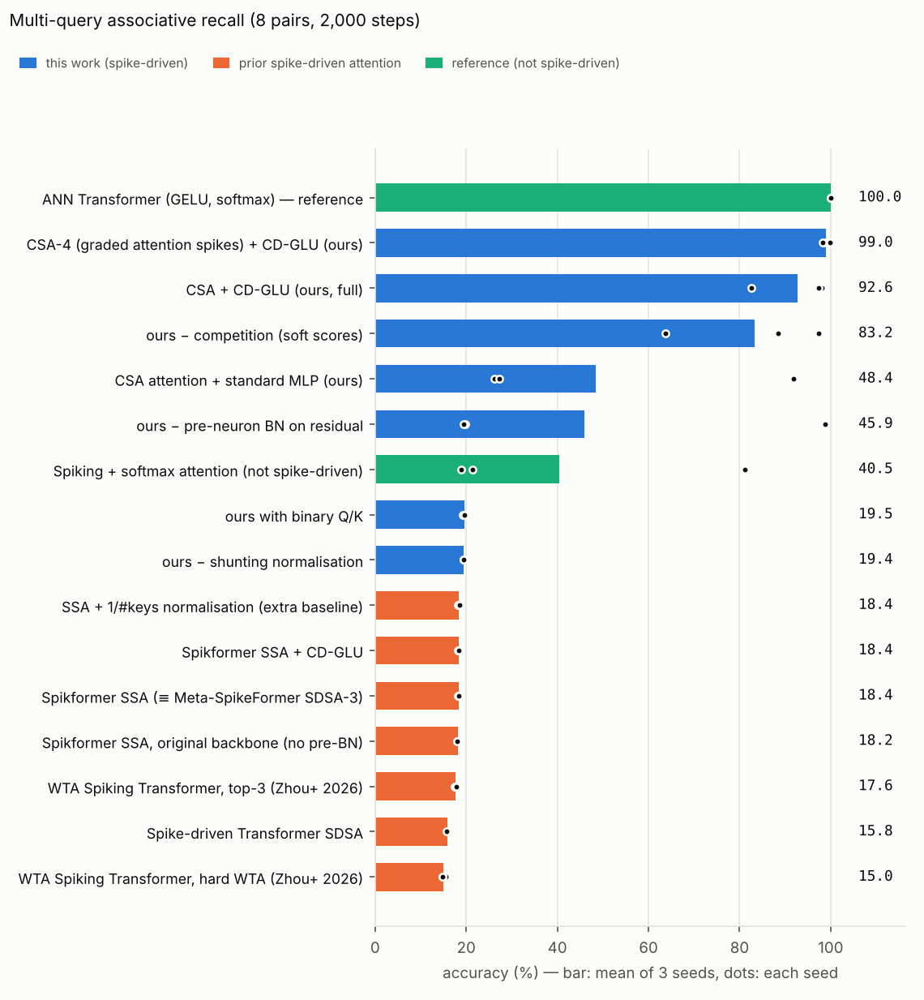
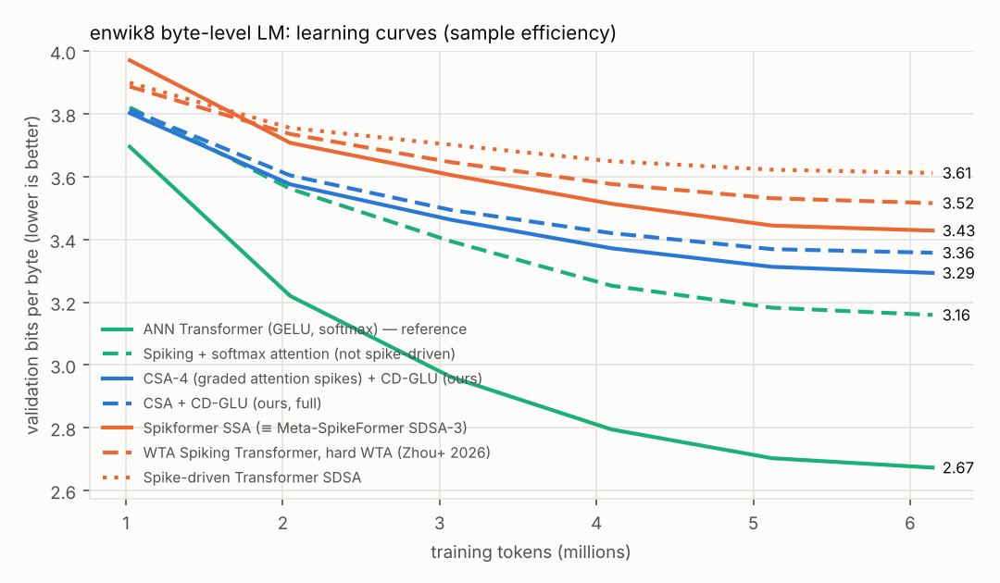
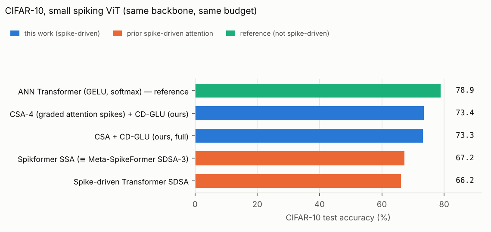

# ShuntFormer — a spike-driven transformer with competitive, shunting-normalised attention

ShuntFormer is a spiking transformer in the Spikformer / Meta-SpikeFormer
lineage. Its attention replaces softmax with two cortical inhibition motifs,
using only accumulates and comparisons:

* **Lateral inhibition.** Each query's firing threshold tracks the mean
  excitation it receives (`θ_i = γ·q_i·k̄ + b`, O(N·d)). Only keys that beat
  this threshold fire, so the number of winners adapts per query.
* **Shunting inhibition.** The attended values are divided by the number of
  winners. On neuromorphic hardware this is done by scaling the output
  neuron's threshold, not by a division.

Because the output is bounded for every query and every sequence length, the
same block runs bidirectionally (vision) and causally (language modelling).
**ShuntFormer-4** lets the attention map itself emit graded spikes: each key
fires once more per step δ its score clears the threshold, up to 4 times.

Design notes: [`docs/ARCHITECTURE.md`](docs/ARCHITECTURE.md).
How the residual-saturation failure was found:
[`docs/DIAGNOSTICS.md`](docs/DIAGNOSTICS.md).

## Results

Everything was trained from scratch on a 4-core CPU with no GPU, so the
models are small (0.1–0.9M parameters) and the budgets short. **Every variant
uses the same backbone:** integer LIF neurons (T=1, up to D=4 spikes), a
membrane-shortcut residual with pre-neuron BN, and the same widths, depth,
data, steps and seeds. Only the attention changes; ablations also swap the
MLP or remove one component. Baselines are re-implemented in
`snnformer/attention.py`.

### 1. Associative recall: can a spike-driven attention select one token?



Multi-query associative recall (MQAR), 8 key–value pairs, 2-layer causal model
(≈112k parameters), 3 seeds. "Solved" means >90%. Guessing any value present in
the context gives 15–20%.

| attention | spike-driven | 2,000 steps: mean (solved) | 4,000 steps: solved |
|---|---|---|---|
| ANN transformer (GELU, softmax) | – | 100.0 (3/3) | |
| softmax over spike Q/K/V | no | 40.5 (0/3) | 3/3 |
| Spikformer SSA (≡ Meta-SpikeFormer SDSA-3) | yes | 18.4 (0/3) | 0/3 |
| SSA ÷ #keys | yes | 18.4 (0/3) | |
| Spike-driven Transformer SDSA | yes | 15.8 (0/3) | |
| WTA-Spikingformer, hard WTA (2026) | yes | 15.0 (0/3) | 0/3 |
| WTA-Spikingformer, top-3 (2026) | yes | 17.6 (0/3) | |
| **ShuntFormer-4 (CSA-4 + CD-GLU)** | yes | **99.0 (3/3)** | |
| **ShuntFormer (CSA + CD-GLU)** | yes | **92.6 (2/3)** | 3/3 |
| CSA + plain MLP | yes | 48.4 (1/3) | 3/3 |
| − competition (score-weighted, normalised) | yes | 83.2 (1/3) | 3/3 |
| − shunting normalisation | yes | 19.4 (0/3) | |
| binary Q/K | yes | 19.5 (0/3) | |
| − pre-neuron BN on the residual | yes | 45.9 (1/3) | |

**Findings**
- Every prior spike-driven attention stays at guessing level, even with twice
  the budget.
- CSA is the only spike-driven attention that learns the task.
- The part that cannot be removed is per-query shunting normalisation. Dividing
  every query by the same constant (SSA ÷ #keys) does not work.
- Competition and graded attention spikes make learning faster and more
  reliable.

### 2. enwik8 byte-level language modelling (causal, from scratch)



4 layers, d = 128, context 128, ≈0.88M parameters, 1,500 steps (6.1M tokens),
standard 90M/5M/5M split, one seed.

| model | spike-driven | val bpb | test bpb | tokens to reach 3.5 bpb | firing rate | est. energy / token |
|---|---|---|---|---|---|---|
| ANN transformer | – | 2.647 | 2.633 | 1.44M | – | 4.37 µJ |
| softmax over spikes | no | 3.145 | 3.138 | 2.42M | 0.14 | 0.47 µJ |
| **ShuntFormer-4 (CSA-4)** | yes | **3.276** | **3.273** | **2.73M** | 0.17 | 0.42 µJ |
| ShuntFormer (CSA) | yes | 3.341 | 3.334 | 3.01M | 0.16 | 0.41 µJ |
| Spikformer SSA | yes | 3.412 | 3.409 | 4.30M | 0.16 | 0.49 µJ |
| WTA-Spikingformer (2026) | yes | 3.501 | 3.500 | not reached | 0.12 | 0.37 µJ |
| Spike-driven SDSA | yes | 3.601 | 3.596 | not reached | 0.15 | 0.33 µJ |

ShuntFormer-4 has the lowest spike-driven loss at every evaluation point.
Spiking costs ≈0.5 bpb against the ANN at this scale (ANN 2.647 vs softmax over
spikes 3.145). Making the attention spike-driven costs another 0.13 bpb with
CSA-4, against 0.27 with Spikformer SSA and 0.36 with WTA.

### 3. CIFAR-10



Small spiking ViT (d = 96, 4 blocks, 64 tokens, ≈0.59M parameters), 5 epochs,
one seed. Absolute numbers are far below the literature's 300–400-epoch
results with 9M-parameter models. Only the comparison between rows is
meaningful.

| model | spike-driven | test acc. | accuracy by epoch | firing rate | est. energy / image |
|---|---|---|---|---|---|
| ANN transformer | – | 78.9 | 53.3 → 67.6 → 72.9 → 78.0 → 78.9 | – | 197 µJ |
| **ShuntFormer-4 (CSA-4)** | yes | **73.4** | 50.4 → 62.5 → 67.1 → 71.9 → 73.4 | 0.13 | 17.2 µJ |
| ShuntFormer (CSA) | yes | 73.3 | 53.2 → 62.0 → 67.8 → 72.3 → 73.3 | 0.13 | 16.8 µJ |
| Spikformer SSA | yes | 67.2 | 35.3 → 51.0 → 60.5 → 65.3 → 67.2 | 0.14 | 21.6 µJ |
| Spike-driven SDSA | yes | 66.2 | 43.4 → 53.5 → 61.2 → 64.8 → 66.2 | 0.10 | 16.7 µJ |

### 4. Are spiking transformers sample-efficient?

**Not compared with ANNs.** Every spiking model here needed at least 1.9× the
ANN's training tokens to reach the same enwik8 loss.

**The attention design matters a lot within spiking models:**
- ShuntFormer-4 reaches 3.5 bpb with 1.6× fewer tokens than Spikformer SSA.
- WTA and SDSA do not reach 3.5 bpb within the budget.
- On CIFAR-10, ShuntFormer passes Spikformer's final accuracy after 3 of its
  5 epochs.

The case for spiking networks remains inference energy on neuromorphic
hardware. These estimates put it at roughly 10× below the ANN, but they leave
out memory traffic.

### What these results do not show

- **No ImageNet or large-LM results.** Nothing here supports an ImageNet claim.
  The published spiking-transformer leaders sit at 82–87% ImageNet top-1, with
  the caveats listed [below](#context-published-state-of-the-art). Rankings
  can change with scale.
- **Seeds.** Language and vision use one seed. Small gaps (for example,
  binary CSA vs CSA-4 on CIFAR-10) are within run-to-run noise.
- **Energy is an estimate.** It uses the field's standard 45 nm
  operation-count method (4.6 pJ per MAC, 0.9 pJ per AC, Horowitz 2014) and
  ignores memory traffic.
- **Complexity.** CSA is O(N²) in comparisons, like SSA. Only its inhibition
  term is O(N·d).

## Context: published state of the art

Numbers were checked against the papers by a literature survey (November 2026).

| model | ImageNet top-1 | caveat |
|---|---|---|
| TDFormer (arXiv 2025) | 86.83 (384² test) | fine-tuned from the QKFormer checkpoint |
| SpiLiFormer (ICCV 2025) | 86.66 (384²) | its code carries QKFormer's LIF-across-batch bug, which QKFormer's authors say inflates ImageNet |
| E-SpikeFormer / SDT-V3 (TPAMI 2025) | 86.2 (173M, 1×8, 384²) | evaluated in integer mode; PT-SSA (2026) reports a 28-point drop under true spike-by-spike attention for an 8-192 model |
| QKFormer (NeurIPS 2024) | 85.65 (384²) | the bug above |
| Max-Former (NeurIPS 2025) | 82.39 (224²) | best result with code stated bug-free and fully binary |
| Meta-SpikeFormer / SDT-V2 (ICLR 2024) | 80.0 | the backbone family used here |

Language is further behind. SpikeGPT (RWKV-based) reaches 1.283 bpc on enwik8
against 1.137 for a matched transformer. The large spiking LLMs (SpikingBrain,
SDLLM) are converted from pretrained ANNs. The closest from-scratch causal
spiking transformer is WTA-Spikingformer (2026, arXiv 2604.11321), which is
re-implemented here as a baseline.

## Repository layout

```
snnformer/            the library
  neurons.py          binary LIF and integer LIF (I-LIF) neurons with surrogate / STE gradients
  attention.py        CSA (ours) + baselines: Spikformer SSA, SSA-norm, Spike-driven SDSA,
                      WTA (Zhou et al. 2026), softmax-on-spikes
  mlp.py              coincidence-gated spiking MLP (CD-GLU) and the standard spiking MLP
  config.py           SNNConfig, neuron factory, residual-reading InputNeuron (pre-BN)
  models.py           SpikingViT (32x32 images) and SpikingLM (causal, byte level)
  ops.py              synaptic-operation counter and 45 nm energy estimate
experiments/
  common.py           the variant registry (every model compared in this README)
  recall.py           multi-query associative recall (MQAR)
  train_lm.py         enwik8 byte-level LM (90M/5M/5M split), bits per byte, learning curves
  train_vision.py     CIFAR-10
  summarize.py        results/*.json -> markdown tables;  plots.py -> results/figures
  make_report.py      results -> docs/report.html (interactive report)
  run_all.sh          every run reported here
tests/                52 tests: causality, spike-driven inputs to every weight layer, CSA properties,
                      finite gradients
results/              JSON for every run reported here (args, config, curves, energy)
```

## Reproduce

```bash
pip install -r requirements.txt
python -m pytest -q tests

cd experiments
python recall.py      --variant ours --steps 2000 --pairs 8 --keys 32 --queries 8 --lr 3e-3 --seed 0
python train_lm.py    --variant ours --steps 1500 --eval-every 250 --lr 2e-3      # needs enwik8 in /home/user/data
python train_vision.py --variant ours --dim 96 --depth 4 --heads 4 --epochs 5 --lr 2e-3   # needs CIFAR-10 python pickles
python summarize.py && python plots.py
./run_all.sh          # everything (≈10 CPU-hours)
```

`--variant` is one of `ours_k4, ours, csa, ours_nocomp, ours_nonorm, ours_binqk,
ours_nopbn, spikformer, spikformer_nopbn, spikformer_cdglu, ssa_norm, sdt, wta,
wta3, spk_softmax, ann` (see `experiments/common.py`). The `--neuron lif --T 4`
flags switch to binary multi-step LIF neurons.
