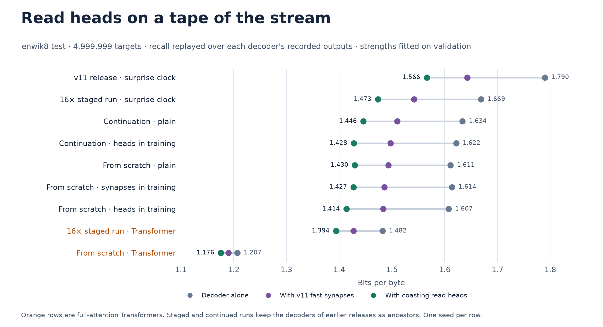

# ShuntFormer

ShuntFormer is an integer spiking byte language model. The v11
checkpoint has **25.79M parameters**, 11 spiking blocks and
**53,432 bytes of persistent tensor state per stream**. Its fixed
axons carry signed spike counts. Their local charge holds history,
and a tagged error bank drives a correction into the vocabulary
neurons. In v11 a population of forecast neurons predicts every
byte, and the spikes it gets wrong write **fast synapses** that
recall the byte which last followed the same context. They lower
held-out enwik8 loss from 1.790 to **1.645 bits per byte** without
a gradient step. The same error spikes also clocked four added
blocks. That clock did not lower held-out loss and is published
as a negative result with its controls.

[Model card and circuit diagram](models/spiking-byte-lm-v11/README.md) ·
[Research handoff](docs/V11_HANDOFF.md) ·
[Checkpoint release](https://github.com/DanielTea/transformer-snn/releases/tag/spiking-byte-lm-v11)


## v13: state reads and race cells

The v13 study trains a spike-only decoder from random weights
that scores **1.262 bits per byte** on the full enwik8 test
split. The full-attention Transformer of the same size and
training scores 1.207. Under the same scoring the v12 decoder
with read heads scores 1.467, so the distance to the Transformer
fell from 0.260 to 0.055 bpb.


Three parts are new. A **state read** lets the present byte
address the stream's own earlier states by what they hold. The
states of the last 512 bytes race for a budget of spikes, and
the ones that fire pass their payload on. **Race cells** are
clusters of 350 cells that compete for 64 spikes per byte. They
listen on **delayed fibres** that bring the stream as it was up
to three bytes ago. All three are built from spike counts and
trained by gradient descent with the decoder.


| Trained from scratch, 368.64M targets | Optimizer | enwik8 | PG-19 |
|---|---|---:|---:|
| 34.82M SNN, spike reads and race cells | Rotated, averaged | 1.26226 | 1.55162 |
| 34.65M SNN, spike reads | Rotated, averaged | 1.29908 | 1.57978 |
| 34.65M hybrid, soft reads | AdamW | 1.31975 | — |
| 34.85M SNN, surprise clock and read heads | AdamW | 1.46686 | — |
| 34.85M SNN, surprise clock | AdamW | 1.59726 | — |
| 34.85M full attention | AdamW | 1.20684 | 1.48212 |
| 34.85M full attention | Rotated, averaged | **1.20407** | **1.48204** |

The Transformer is still ahead, by 0.055 bpb on enwik8 and by
0.070 on 16 PG-19 books. Every score in this table is in windows
of 512 bytes that start from an empty state, with 256 unscored
bytes before the 256 scored ones. A dash marks a score that was
not measured. The new decoder runs in such windows only. It has
no stream form yet, so it has no streaming score, no native
integer run, no pulse audit and no generator. The seven rows
received identical windows from random weights. The rows marked
rotated were trained with a rotated optimizer and are scored at
the running average of their weights. Every arm is one seed.
The v13 weights are release assets, and the model that runs
from a clone is v11.


For the first 6,000 updates the decoder learns faster than the
Transformer. At 9,000 the two are level, and from 12,000 on the
Transformer is ahead. At 84,000 updates the decoder is ahead on
bytes that an earlier match in the window offers for copying
and behind on the others. The first letter of a word shows
where the rest comes from. With one earlier word in view the
decoder predicts it as well as the Transformer, and with three
it is 0.070 bpb behind. The Transformer's lead is the use it
makes of the second to fifth word back.

The study ran 89 training arms in one night. Its page gives the
circuit, the controls, the probes behind each statement and the
changes that did not help.

[State-read study](docs/STATE_READS.md) ·
[Every training arm](docs/STATE_READS_ARMS.md) ·
[Leaderboard](docs/LEADERBOARD.md) ·
[Model card](models/spiking-byte-lm-v13/README.md) ·
[Research handoff](docs/V13_HANDOFF.md) ·
[Checkpoint release](https://github.com/DanielTea/transformer-snn/releases/tag/spiking-byte-lm-v13)

## v12: coasting read heads

The v12 study trains the 34.85M decoder from random weights
beside **read heads on a tape of the stream**. A head follows a
passage one byte at a time, gains charge with every confirmed
byte and is removed by the first wrong one. With its heads the
decoder scores **1.414 bits per byte** on the full enwik8 test
split and 1.646 on 16 PG-19 books. The bundled v11 model scores
1.645 and 1.940.


| Trained from scratch, 368.64M targets | enwik8 | PG-19 | State | Pulses per byte |
|---|---:|---:|---:|---:|
| 34.85M SNN, surprise clock | 1.61100 | 1.72052 | 43,796 B | 311,540 |
| 34.85M SNN, surprise clock and fast synapses | 1.48587 | 1.68629 | 68,388 B | 318,451 |
| 34.85M SNN, surprise clock and read heads | 1.41375 | 1.64562 | 179,028 B | 309,469 |
| 34.85M full attention | **1.20684** | **1.48212** | 6 MiB | — |

Full attention is far ahead at this training budget. The four
rows received identical windows from random weights. Every
score comes from the streaming evaluator, which carries the
tape, the key synapses and the heads from chunk to chunk. They
add 135,232 bytes of state per stream, and the head decoder
holds a 35th of the state full attention keeps for its 512-byte
context. Pulses are counted in the native integer decoder on
the first 4,096 bytes of the enwik8 test split, and 241 of the
head decoder's 309,469 are in the head circuit. Every arm is
one seed. The v12 weights are release assets, and the model
that runs from a clone is v11.


The study first scored the heads in a replay over each
decoder's recorded outputs, with strengths refitted on enwik8
validation. The stream confirms it. With refitted strengths the
head decoder scores 1.41385 bpb both ways. The figure below is
that replay for nine decoders, each alone, with the v11 fast
synapses and with read heads.



[Coasting-head study](docs/COASTING_HEADS.md) ·
[Leaderboard](docs/LEADERBOARD.md) ·
[Model card](models/spiking-byte-lm-v12/README.md) ·
[Research handoff](docs/V12_HANDOFF.md) ·
[Checkpoint release](https://github.com/DanielTea/transformer-snn/releases/tag/spiking-byte-lm-v12)

## Run the bundled model

From the repository root, set up Python 3.12 and run greedy
generation with the native CPU integer decoder.

```bash
python3.12 -m venv .venv
source .venv/bin/activate
python -m pip install -r requirements.txt
python experiments/generate_event_lm.py models/spiking-byte-lm-v11/weights.pt \
  --prompt 'The first chapter' --bytes 128
```

## Matched benchmark

Every row saw **140,902,400 cumulative training targets**.
The six trained models received identical 512-byte windows for
their final 9,830,400 targets. The two rows with fast synapses
add 24 fitted strengths to a trained decoder and change no
weight. The table shows bits per byte on the full enwik8 test
split and 16 pinned PG-19 test books. PG-19 temperatures are
fitted on eight separate calibration books.

<!-- event-lm-leaderboard:start -->

| Model | enwik8 | PG-19 calibrated | PG-19 raw | State |
|---|---:|---:|---:|---:|
| 25.79M SNN | 1.78973 | 1.97852 | 1.97852 | 28,584 B |
| 25.79M SNN with fast synapses | 1.64541 | 1.93961 | 1.93961 | 53,432 B |
| 34.85M SNN, every byte | 1.78633 | 1.96913 | 1.96913 | 40,714 B |
| 34.85M SNN, fixed stride | 1.78761 | 1.96842 | 1.96842 | 43,796 B |
| 34.85M SNN, surprise clock | 1.78973 | 1.97528 | 1.97528 | 43,796 B |
| 34.85M SNN, surprise clock and fast synapses | **1.64278** | **1.93610** | **1.93610** | 68,388 B |
| 25.79M full attention | 1.70433 | 1.93711 | 1.93711 | 6 MiB |
| 34.85M full attention | 1.70426 | 1.93678 | 1.93678 | 6 MiB |

<!-- event-lm-leaderboard:end -->

With fast synapses the 25.79M spiking decoder scores **1.64541
bpb** on enwik8, 0.0589 below the size-matched Transformer, and
1.93961 on PG-19, 0.0025 above it. Full attention reads 512
bytes and the synapses carry the whole stream. With the same
synapses on its output the Transformer scores 1.57753 on enwik8,
so the like-for-like gap is 0.0679 bpb. Without synapses it is
0.0854. The surprise clock scores 1.78973 on enwik8. The same
blocks score 1.78761 on a fixed stride and 1.78633 on every
byte. With fast synapses the three score 1.64278, 1.64281 and
1.64164, so the clock does not earn the lowest row of the table.
The study uses one continuation seed.

State counts persistent tensors per stream. The synapse strengths
are fitted on enwik8 validation and used unchanged on PG-19.
[Surprise study, controls and limits](docs/SURPRISE_CLOCK.md) ·
[Full leaderboard](docs/LEADERBOARD.md) ·
[Browser report](docs/report.html#surprise-clock)

## Byte transfer benchmarks

The fixed suite reports raw bits per byte on WikiText-103,
C4 validation, enwik9 beyond byte 100 million, and text8.
LAMBADA scores answer-byte loss and greedy word accuracy for
5,153 full passages and last-sentence prompts. Evaluations use
the same scoring windows. The preparation checks training text
for overlap, and the report also gives scores for Wikipedia
windows with zero hits. C4 validation and PG-19 test are
held-out in-domain evaluations for the mixed runs.

Every window starts from an empty stream, so the fast synapses
hold only what the window contains. With them the 25.79M SNN is
below its Transformer by 0.0743 bpb on WikiText-103, 0.0601 on
C4 and 0.0902 on text8, and 0.0221 above it on enwik9. From the
full LAMBADA passage it completes 174 of 5,153 final words.
Each Transformer completes one.


[Transfer scores](docs/LEADERBOARD.md#byte-transfer-at-the-same-training-exposure) ·
[Data, overlap audit and replay](docs/BYTE_TRANSFER.md)

## Resume the research

The v11 archive holds the eight study endpoints and both v10
parents. The manifest links weights, checksums, training
records, synapse fits and the exact training windows. The
handoff includes commands to replay each step of the study.
[Restore and replay](docs/V11_HANDOFF.md#restore-the-checkpoints) ·
[Exact manifest](models/spiking-byte-lm-v11/manifest.json) ·
[Result file guide](results/README.md)

The v12 archives hold the 21 checkpoints of the coasting-head
study. Its handoff has the restore commands, the launcher, the
streaming evaluation of a head decoder and the replay that fits
its strengths.
[Restore and replay](docs/V12_HANDOFF.md#restore-the-checkpoints) ·
[Exact manifest](models/spiking-byte-lm-v12/manifest.json)

The v13 archives hold the seven checkpoints of the state-read
study. Its handoff has the restore commands, the scoring in
warmed windows, the probes that run on the released files and
the next pilots.
[Restore and rescore](docs/V13_HANDOFF.md#restore-the-checkpoints) ·
[Exact manifest](models/spiking-byte-lm-v13/manifest.json)

Regenerate the leaderboards, scientific figures and browser report
from the checked-in records.

```bash
python experiments/plot_event_lm_study.py
python experiments/plot_depth_inhibition.py
python experiments/plot_coasting_heads.py
python experiments/plot_state_reads.py
python experiments/make_report.py docs/report.html
```

[v10 research handoff](docs/V10_HANDOFF.md) ·
[Historical ShuntFormer and Dendrite experiments](docs/SHUNTFORMER_HISTORY.md)
