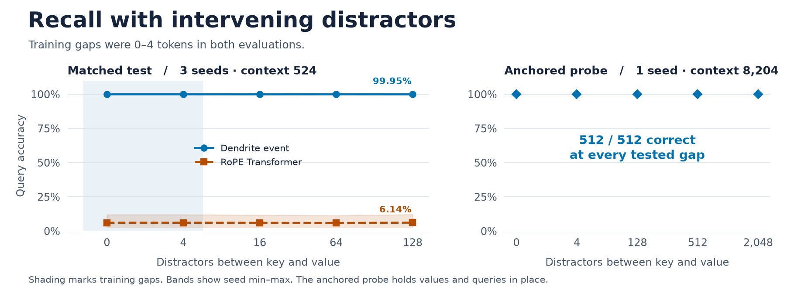
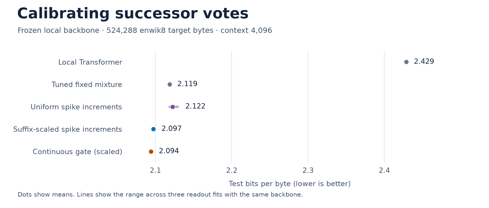

# Dendrite benchmark report

Dendrite is a series of experiments on bounded memory for causal models.
The event memory learns when to bind a value to an earlier key. The
successor model uses verified byte suffixes to predict repeated text.
The [architecture report](DENDRITE.md) describes the mechanisms, early
experiments and ablations. The [reproduction guide](REPRODUCE_DENDRITE.md)
lists the commands and source files for the results below.

## Recall across intervening tokens

The event model learned to capture a spike address and hold it until a
later spike commits the value. After training with zero to four
distractors between keys and values, it averaged **99.95%** accuracy at
a gap of 128 across three seeds. Full RoPE attention averaged **6.14%**
under the same 1,200-step protocol. The task uses distinct token groups
for keys, values and distractors, and presents one pending binding at a
time. Matched tests use four bindings and four queries in 524-token
sequences. [Matched runs](../results/recall_distance)

In a separate seed-0 probe, each value and query stayed at the same
position in an 8,204-token sequence. Moving the keys to set gaps of 0,
4, 128, 512 and 2,048 distractors gave **512 of 512 correct queries at
each gap**. This probe measures distance on the same typed task.
[Anchored probe](../results/recall_distance/dendrite_event_s0_anchored_extrapolation.json)

## Next-byte language modeling

The successor model stores the byte that followed a suffix. It verifies
the exact suffix before reading a record and learns how much probability
each matching record should contribute. Each suffix order uses a fixed
table. The readout emits graded spike counts and the local Transformer
backbone remains analog.

| Continuous test stream | Target bytes | Local Transformer | Successor readout on frozen backbone | Successor model trained from scratch |
|---|---:|---:|---:|---:|
| enwik8 test split | 4,999,999 | 2.457 | 2.074 | **2.025** |
| Eight PG-19 test excerpts | 1,048,568 | 3.416 | 3.052 | **2.965** |

Scores are bits per byte, with lower values better. The from-scratch
comparison uses one seed, the same 4.096 million enwik8 training bytes
and optimizer schedule, and 357,696 versus 357,937 learned parameters.
The continuous evaluator preserves memory across processing chunks.
Each PG-19 excerpt starts from an empty state, and neither readout was
fit on the books. The [excerpt manifest](../results/lm_successor/pg19_test_excerpt_manifest.json)
records the selection rule, byte offsets and checksums.
[Frozen-backbone scores](../results/lm_successor/scaled_v2_continuous.json) ·
[From-scratch scores](../results/lm_successor/end_to_end_continuous.json)

Using only cache records whose successors were observed at least 94
bytes earlier lowered enwik8 loss to **2.212** on the frozen backbone.
Those records are beyond the local Transformer's receptive field.
The test measures reuse of repeated text in compact byte models.
General language capabilities and hardware energy were outside the
evaluation.

## Readout calibration

On a separate 524,288-byte enwik8 sample, suffix-scaled spike increments
scored **2.097 bpb** across three readout seeds. A fixed mixture fitted
on validation scored **2.119** and a learned continuous readout scored
**2.094**. These scores use the same frozen backbone and the same cache
capacity. With the independently trained context-256 backbone, the fixed
mixture scored 2.090 and the scaled readout scored 2.094.
[Calibration runs](../results/lm_successor) ·
[Architecture and ablations](DENDRITE.md)
