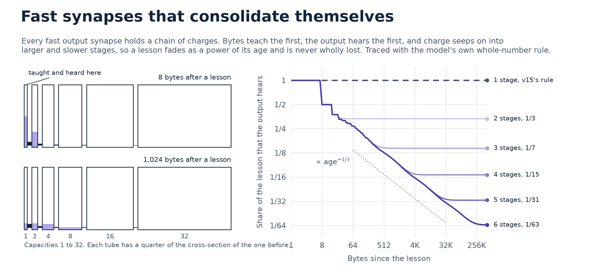

# Fast synapses that consolidate themselves

Fast output synapses whose charge seeps from the stage that the output hears into larger and slower stages, so that
what a byte taught fades as a power of its age and is never wholly lost. The rule runs while a stream is read, in
whole numbers, and nothing in it is trained. A pilot on the small test bed was recorded before any of its scorings.

<!-- SUMMARY: the pilot's result in two sentences -->

## Limits

- The base stack is trained by gradient descent, without fast synapses. The stages belong to the rule that runs while
  a stream is read: in whole numbers, from every arriving byte, after that byte was predicted. Nothing takes a
  gradient on validation or test text.
- The pilot runs on the small test bed (6 levels, 256 channels, 4.86 million parameters, trained on windows of 256
  bytes; `results/event_lm/stream_form/small_test_bed.json`). It decides whether the idea earns a full-size scoring.
  It does not say what the cascade gains on the released stack.
- One setting is tested: six stages. Its threshold is picked on the first million validation bytes, as v15's
  threshold was, and the whole validation split is then scored. No test text is scored with stages.

## The question

v15 gave the stack fast output synapses that every arriving byte teaches (`EventLM.teach`). They keep every lesson at
the same weight for the rest of the stream: the 300,000th byte of a stream counts what the first byte taught as much
as what the last one did. Synapses in the brain do not work like that. A fast trace hands its charge on to slower and
larger stores. Benna and Fusi (2016) modelled such a synapse as a chain of communicating vessels of growing width,
joined by ever narrower tubes, and showed that synapses built that way store far more memories than synapses with a
single strength: their capacity grows almost linearly with the number of synapses, not as its square root. Does a
stream rule with such a chain predict text better than one that weighs every lesson alike?

## The rule

Every fast synapse holds a chain of `K` whole charges `q_0 ... q_(K-1)` (`--teach-cascade K`, from 1 to 6). Stage `k`
has a capacity of `2^k`, and its level is `q_k / 2^k`.

- A byte teaches `q_0` exactly as v15's rule teaches its synapse, and the output neurons hear `q_0` only.
- Every `2^(k+3)` bytes, `(2 q_k - q_(k+1)) / 4^(k+1)` of charge, rounded to the nearest whole charge, flows from stage
  `k` to stage `k+1`: half the difference between the two levels for the first pair, and a fourfold smaller share
  for every pair after it. The slow stages exchange charge on a slow clock, so the whole chain costs about 0.6 times
  as much again as v15's rule.
- All flows of a step are found from the charges before it. Each moves a level at most part of the way to its
  neighbour's, so no level ever leaves the range of levels that teaching set, and the charge of a synapse is kept
  exactly. A stage is clamped at its capacity times the bound of a synapse, which the sums never reach.
- `K = 1` is v15's rule.

One lesson that fills `q_0` stays whole for 7 bytes and is halved at the 8th. Then it spreads: the first stage keeps
0.27 of it after 64 bytes, 0.10 after a kilobyte and 0.038 after 16 kilobytes, a share that falls as about the cube
root of its age, until it settles at `1 / (2^K - 1)`: 1/3, 1/7, 1/15, 1/31 or 1/63. The last stage gives nothing
away, so a lesson never fades below that share (`results/event_lm/cascade_synapses/lesson_trace.json`). With
capacities that double and conductances that fall fourfold, each stage takes about eight times as long to fill as the
one before, while the lesson's share halves with every stage it reaches: hence the cube root.

Every quantity is a whole number below `2^53` in 64-bit floats, and the clock of every stage follows the bytes of the
stream. A stream cut anywhere therefore fires the same spikes, byte for byte, as one read in a single pass, and
charges of either sign consolidate alike (`tests/test_cascade_synapses.py`).

## The pilot

Recorded at 11:55:06 UTC on 2026-11-21, before any threshold was scanned
(`results/event_lm/cascade_synapses/preregistered.json`).

- **Base.** Arm a of the trained-plasticity test bed: trained without fast synapses. The fast synapses hear the cells
  after all six levels (6,132 fibres), with 256 teaching spikes a byte.
- **b.** v15's rule at its picked threshold of 2^22: 1.81412 bits per byte on validation streams.
- **c6.** Six stages, at the power of two out of 2^19 to 2^22 with the lowest bits on the first million validation
  bytes, extended past an end of that range if the lowest lies there.
- **Scoring.** The whole enwik8 validation split as 16 unbroken streams with a lead of 8,192 bytes, paired against
  b piece by piece; and the 8 PG-19 validation excerpts of 131,072 bytes, one stream a book.
- **Pass mark.** All of: c6 ahead of b by at least 0.005 on validation streams with the lower end of the paired 95%
  interval above zero; no quarter of the streams behind b; not behind b by more than 0.002 on the PG-19 excerpts.
- **Seen before recording.** The lesson's trace above, and a smoke test of the scorer on the first 32,000
  validation bytes at b's threshold, before any threshold was picked: 1.8353 with six stages, 1.8200 with one.

## Results

<!-- results: threshold scans, whole split paired, quarters, PG-19 excerpts, decision -->

## Reproduce

<!-- commands -->
