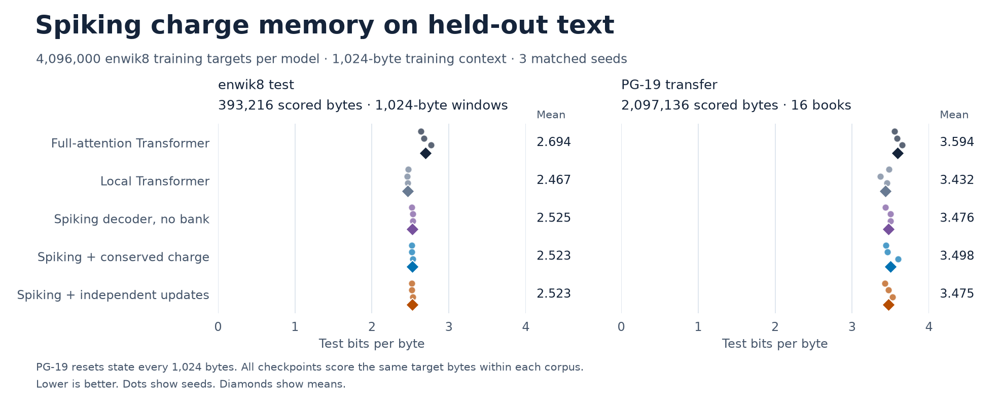

# Charge transfer memory on real text

This experiment uses learned spike transfers between pairs of membrane
cells. Each pair has two read views. A coarse read uses the pair's total
charge, and a fine read uses the difference. A fine write can change the
difference while preserving the total exactly. A separate coarse write
can replace the total. The bank sits in the final decoder block, where
its read spikes contribute to the next-byte logits.

Each cell holds integer charge in the range 0–255. For a pair with
total \(g\), the left cell can stay between \(\max(0,g-255)\) and
\(\min(255,g)\). Clipping a proposed transfer against that interval
keeps both cells in range. The right cell receives the opposite of the
realized transfer. A coarse write sets both cells to a learned integer
between 64 and 191. The eight pairs repeat four coarse-write intervals,
64, 128, 256 and 512 bytes. Fine drives remain active between coarse
writes. Each query reads the prior charge before that byte's update.

The two read views each emit one timed spike through the four-pulse
mechanism. The charge scans reproduce the sequential clipped updates
in a batch. Training uses straight-through gradients at rounding and a
surrogate for the hard spike gates. [Charge memory source](../snnformer/charge_memory.py)
· [Four-pulse reads](PULSE_ITERATION.md#what-changed)

## Data and controls

Training uses the canonical enwik8 training split and byte tokenizer.
Each seed uses the same 4,096,000 sampled target bytes and 1,024-byte
contexts across five models. The three references are a spiking decoder
without a bank, a conventional Transformer with a 32-byte local window,
and a full-context Transformer. The two bank models use the same
projection sizes and readout. The control applies its two fine drives
independently, so a fine write can change the total. The model with
charge conservation applies equal and opposite transfers. All arms are
within 0.08% of the 378,144-parameter bank models.

The enwik8 test scores 393,216 bytes per seed. The paired history probe
uses the same 131,072 targets as the [prior study](PULSE_ITERATION.md).
For the bank variants, it also measures what happens when the coarse
read sees neutral charge at least 128 bytes after its last coarse write.
It retains the probe timing and fine read while applying that
intervention.

The transfer test scores 16 PG-19 test excerpts that were outside the
training protocol. The evaluator verifies each excerpt's checksum,
starts a fresh state at each 1,024-byte window, and scores 2,097,136
target bytes per model and seed. These are reset-window measurements.
[Excerpt manifest](../results/lm_scaling/pg19_test16_manifest.json)
· [Evaluator](../experiments/eval_stream_lm.py)

## Held-out results

Mean bits per byte across seeds 0, 1 and 2. Lower is better.

| Model | Parameters | enwik8 test | PG-19 excerpts |
| --- | ---: | ---: | ---: |
| Full-context Transformer | 378,432 | 2.6935 | 3.5939 |
| Local Transformer | 378,432 | **2.4666** | **3.4318** |
| Spiking decoder without a bank | 378,402 | 2.5255 | 3.4760 |
| Spiking decoder with charge transfer | 378,144 | 2.5231 | 3.4978 |
| Spiking decoder with independent writes | 378,144 | 2.5231 | 3.4752 |

The charge-transfer model scored better than the full-context reference
in all three seeds on both corpora. The local Transformer had the best
mean loss on both. Conservation gave the same mean enwik8 loss to
four decimals as independent writes and higher loss on PG-19.
[Training runs](../results/lm) · [PG-19 seed 0](../results/charge_text/pg19_seed0.json)
· [Seed 1](../results/charge_text/pg19_seed1.json)
· [Seed 2](../results/charge_text/pg19_seed2.json)



In the paired enwik8 probe, the conserving model applied 14,994,388
fine updates across all three seeds, with zero changes to protected
totals. Independent fine writes changed the total in 21,531,140 of
25,627,002 applied updates. Substituting neutral charge changed the
timing bin on 384,263 coarse reads in the conserving model, including
both history and scored positions. It increased mean loss by
0.000009 bpb over all scored bytes and 0.000012 bpb over the 11,871
remote-prefix targets. Those measurements show negligible prediction
benefit from the preserved old charge on this test.
[Intervention seed 0](../results/charge_text/enwik8_seed0.json)
· [Seed 1](../results/charge_text/enwik8_seed1.json)
· [Seed 2](../results/charge_text/enwik8_seed2.json)

The seed-0 conserving checkpoint produced identical batched and
streaming logits for a 639-byte enwik8 excerpt within both CPU and
Metal execution. Its streaming state used 96,512 bytes at the first
and final token.

## Reproduce

```bash
export ENWIK8_PATH=/absolute/path/to/enwik8

python experiments/prepare_pg19.py \
  --manifest results/lm_scaling/pg19_test16_manifest.json \
  --output data/pg19-test16-scaling

for seed in 0 1 2; do
  for variant in transformer transformer_local temporal_spike_reset \
                 temporal_charge temporal_charge_independent; do
    case "$variant" in
      transformer*) ratio=4.375 ;;
      temporal_spike_reset) ratio=4.28125 ;;
      *) ratio=4 ;;
    esac
    python experiments/train_lm.py --variant "$variant" --mlp-ratio "$ratio" \
      --device mps --levels 32 --dim 96 --depth 3 --heads 4 --ctx 1024 --bs 4 \
      --steps 1000 --warmup 100 --eval-every 250 --eval-bs 8 --eval-batches 8 \
      --final-eval-batches 48 --lr 0.003 --seed "$seed" --tag charge_text_v1 \
      --checkpoint "checkpoints/${variant}_charge_text_v1_s${seed}.pt"
  done
  python experiments/eval_stream_lm.py --device mps --context 1024 --batch-size 12 \
    --books-dir data/pg19-test16-scaling \
    --checkpoint "checkpoints/transformer_charge_text_v1_s${seed}.pt" \
      "checkpoints/transformer_local_charge_text_v1_s${seed}.pt" \
      "checkpoints/temporal_spike_reset_charge_text_v1_s${seed}.pt" \
      "checkpoints/temporal_charge_charge_text_v1_s${seed}.pt" \
      "checkpoints/temporal_charge_independent_charge_text_v1_s${seed}.pt" \
    --json "results/charge_text/pg19_seed${seed}.json"
  python experiments/eval_pulse_lm.py --device mps --old-phase-age 128 \
    --checkpoint "checkpoints/temporal_charge_charge_text_v1_s${seed}.pt" \
      "checkpoints/temporal_charge_independent_charge_text_v1_s${seed}.pt" \
    --json "results/charge_text/enwik8_seed${seed}.json"
done

python experiments/plot_charge_text.py
```
