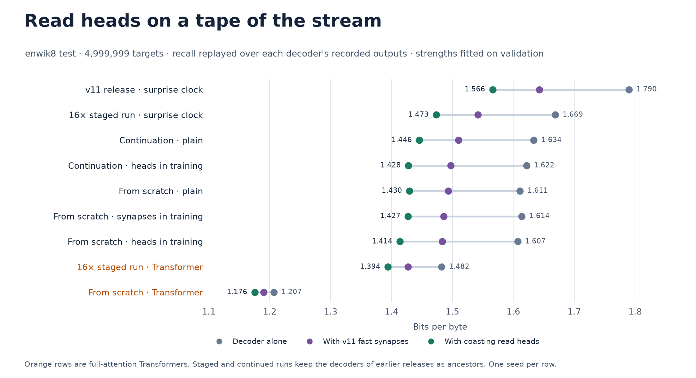
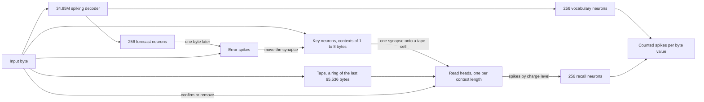
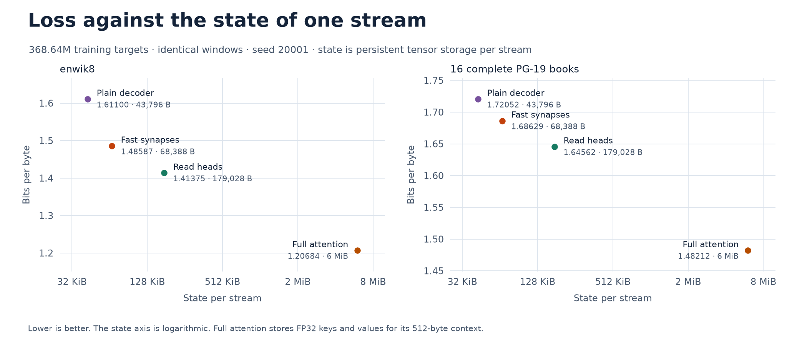
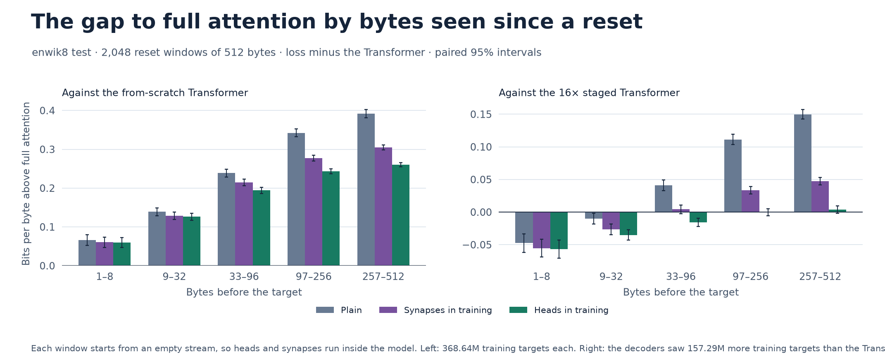
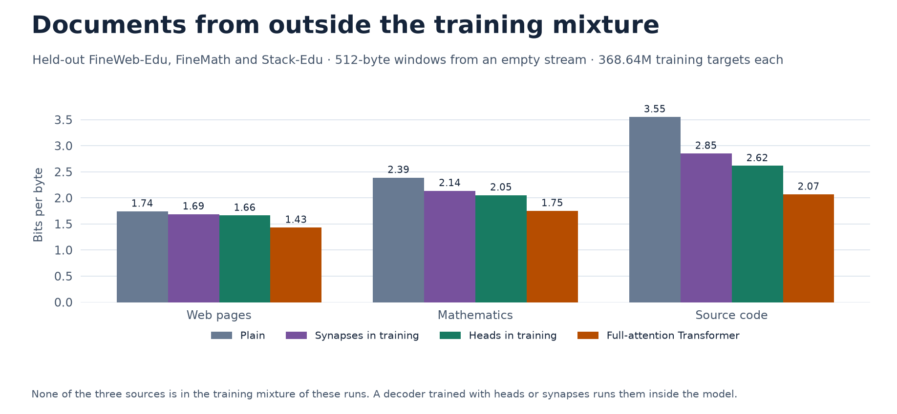

# Coasting read heads

## Complete enwik8 test

A spiking decoder trained from scratch beside coasting read heads
scores **1.4138 bits per byte** on 4,999,999 held-out enwik8
predictions. The bundled v11 decoder with fast synapses scores
1.6454. Of the 0.232 bpb between them, 0.160 comes from a longer
run from random weights: the 34.85M decoder trained that way
beside the v11 synapses scores 1.4857. The heads replacing the
synapses account for the other 0.072.

A read head is one neuron on a tape of the stream's last bytes.
It moves one cell per byte and fires the recall neuron of the
byte stored there. A confirmed byte adds charge and a wrong byte
removes the head. Nothing in the heads is trained by gradient
descent.

| Decoder, 368.64M training targets from scratch | Alone | With v11 fast synapses | With read heads |
|---|---:|---:|---:|
| 34.85M SNN | 1.6110 | 1.4933 | 1.4297 |
| 34.85M SNN trained beside fast synapses | 1.6139 | 1.4857 | 1.4272 |
| 34.85M SNN trained beside read heads | 1.6073 | 1.4831 | **1.4138** |
| 34.85M full attention | 1.2068 | 1.1899 | 1.1756 |

Every cell is one decoder with recall circuits replayed over its
recorded outputs, and with strengths refitted on enwik8
validation. The four decoders received identical 512-byte
windows. Every decoder is one seed.

The head decoder also runs in the stream by itself. The
streaming evaluator gives 1.41385 bpb with the refitted
strengths, which is the replay's score, and 1.41375 with the
strengths the decoder was trained beside. On 16 PG-19 books it
scores 1.6456, against 1.7205 for the plain decoder and 1.4821
for the Transformer.
[In the stream](#in-the-stream)

Two limits come first.

**Full attention is far ahead at this budget.** The Transformer
of the same size scores 1.2068 bpb without any recall circuit.
In v11, after 140.9M staged targets, the spiking decoder with
fast synapses was 0.059 bpb below its Transformer. With more
training that order reverses. The best spiking score here is
0.207 bpb above the Transformer alone and 0.238 above the
Transformer with the same heads.

**Most head scores are replays.** The decoder's outputs and
error spikes are recorded over the continuous stream, and the
heads are replayed over that record. Head spikes only add to the
output counts, so the replay gives the counts the complete model
would produce. The from-scratch head decoder is the one decoder
whose replay was checked in the stream. It is also the only head
decoder with PG-19 scores, a pulse count and a row on the
[leaderboard](LEADERBOARD.md). Inside 512-byte windows the heads
run in the model itself. The history split and the held-out
documents below are measured that way.



[Records](../results/event_lm/coasting_heads) ·
[Checkpoint checksums](../results/event_lm/coasting_heads_checkpoints.sha256) ·
[Restore and replay](V12_HANDOFF.md)

## The circuit



The decoder, its forecast neurons and its error spikes are the
v11 circuit with four blocks on the surprise clock.
[v11 circuit](SURPRISE_CLOCK.md#one-signal-for-two-circuits)

**Tape.** A ring of 65,536 cells holds the last bytes of the
stream, one byte per cell.

**Key neurons.** Each of the eight heads owns 4,096 key neurons.
The key neuron of a context is selected by a hash of its last 1
to 8 bytes, as in v11. A key neuron keeps one synapse onto a tape
cell. When a byte arrives with at least one error spike, the key
neuron of the context before it moves its synapse onto that
byte's cell. A predicted byte moves nothing.

**Heads.** While a head is alive it sits on a cell. Every byte it
compares the byte that arrived with the byte in its cell. A match
adds one unit of charge and moves the head one cell on. A
mismatch removes the head. Whenever a head's place is empty, the
key neuron of the current context puts a new head on the cell its
synapse reaches, with no charge.

**Recall.** A live head fires the recall neuron of the byte in
its cell. The number of spikes depends on its charge: 13 levels
for 0, 1, 2, 3, 4–5, 6–7, 8–11, 12–15, 16–23, 24–31, 32–63,
64–127 and 128 or more confirmed bytes. The 8 × 13 integer
strengths are fitted on enwik8 validation by the convex fit that
v11 uses for its 24 synapse strengths. Recall spikes are counted
with the vocabulary neurons' spikes.

The fast synapses of v11 are the special case in which every
head is removed after one byte and a synapse reaches a recall
neuron instead of a cell. What the heads add is the charge. A
synapse knows that a context was seen before. A head knows how
many bytes it has just predicted correctly, and a head that has
followed a passage for 128 bytes is right 98.5% of the time.

| Head context | Share of targets with a live head | Correct when live | Correct when just placed | Correct after 128 confirmed bytes |
|---|---:|---:|---:|---:|
| 1 byte | 99.97% | 22.0% | 10.0% | 98.3% |
| 2 bytes | 99.41% | 30.7% | 13.7% | 98.4% |
| 4 bytes | 99.65% | 24.1% | 8.9% | 98.6% |
| 8 bytes | 99.73% | 13.5% | 5.1% | 98.5% |

The table is the replay over the enwik8 test split beside the
from-scratch head decoder.
[Record](../results/event_lm/coasting_heads/recall_scratch-heads.json) ·
[Circuit](../snnformer/coasting_heads.py) ·
[Compiled replay](../snnformer/coasting_heads.c)

## Measured first on the frozen v11 decoder

Before any training, the heads were fitted on the released 25.79M
v11 decoder. Strengths are fitted on the first half of enwik8
validation. The gain is measured on the second half, where the
decoder alone scores 1.7905 bpb.

| Recall circuit on the frozen decoder | Gain, bpb |
|---|---:|
| v11 fast synapses, contexts 3, 4, 6, 8, 12, 16 | 0.1107 |
| v11 fast synapses, contexts 1, 2, 3, 4, 6, 8, 12, 16 | 0.1231 |
| Heads on those eight contexts, removed after one byte | 0.1125 |
| Heads on those eight contexts, coasting | 0.1806 |
| Heads on contexts 1 to 8, coasting | **0.1822** |
| Heads on contexts 1 to 8 with the v11 synapses | 0.1892 |

Coasting is what helps. Heads that are removed after one byte add
what the synapses add. On the complete test split the heads lower
the released clock decoder from 1.7897 to 1.5661 bpb and the
released control from 1.7897 to 1.5669. The fast synapses reach
1.6428 and 1.6454.

The other settings were swept with six contexts and a tape of
8,192 cells, where the gain is 0.1394 bpb.

| Change | Gain, bpb |
|---|---:|
| Tape of 512 cells | 0.0960 |
| Tape of 2,048 cells | 0.1226 |
| Tape of 65,536 cells | 0.1510 |
| Unbounded tape | 0.1516 |
| 1,024 key neurons per head | 0.1378 |
| 16,384 key neurons per head | 0.1383 |
| A wrong byte halves the charge instead of removing the head | 0.1285 |
| A head is placed only on an error spike | 0.1161 |
| A synapse moves on every byte | 0.1265 |
| An error spike replaces a head with less than 2 charge | 0.1033 |

The tape length matters up to 65,536 cells. The number of key
neurons does not between 1,024 and 65,536. A head that survives
errors, a gate on placing heads and a replacement rule do not
help.
The error gate on moving synapses is worth 0.013 bpb here. In v11
the same gate only saved writes.
[Sweep records](../results/event_lm/coasting_heads/fit_only)

## From scratch

Four models were trained from random weights for 90,000 updates
of eight 512-byte windows, 368,640,000 targets, with a learning
rate of 3e-4, 1,000 warm-up updates and seed 20001. All four
received identical windows from the enwik8, C4 and PG-19 mixture
of v10.

The plain arm is the 34.85M v11 decoder with the surprise clock.
The synapse arm trains the same decoder beside the 24 fixed v11
synapse strengths. The head arm trains it beside the 104 head
strengths fitted on the released v11 clock decoder. In both, the
recall spikes enter the loss and the strengths stay fixed. The
decoder learns what the recall circuit does not already give.

Training beside the heads is worth 0.016 bpb over fitting the
same heads to the plain decoder afterwards, 1.4138 against
1.4297. The decoder alone is also not worse for it, 1.6073
against 1.6110.

[Training records](../results/event_lm/coasting_heads/scratch-study) ·
[Head run](../results/event_lm/coasting_heads/v12-scratch/event_correction_code_s20001_v12_heads.json)

## In the stream

The streaming evaluator feeds each test corpus to a decoder as
one continuous stream and keeps a bounded state between chunks.
For the heads that state is the tape, the key synapses and the
heads themselves.

| State per stream | Bytes |
|---|---:|
| Decoder: delay lines, held charge, error bank and clock | 43,796 |
| Tape, one byte per cell | 65,536 |
| Key synapses, 8 × 4,096 of 16 bits | 65,536 |
| One mark per key neuron that has a synapse | 4,096 |
| Eight heads, a tape cell and a charge each | 64 |
| Total, measured by the streaming evaluator | 179,028 |

A head is never further behind the stream than the tape is long.
A ring of 65,536 bytes therefore holds every byte a head reads,
and a synapse names its cell in 16 bits. The tests compare the
program that advances this state with the replay over streams
many times longer than the tape, and the decoder's batched pass
with its chunked pass and its single-byte integer step. All
agree exactly.
[Tests](../tests/test_coasting_heads.py)

| Trained from scratch, 368.64M targets | enwik8 | PG-19 | State per stream | Pulses per byte |
|---|---:|---:|---:|---:|
| Plain | 1.61100 | 1.72052 | 43,796 B | 311,540 |
| Beside fast synapses | 1.48587 | 1.68629 | 68,388 B | 318,451 |
| Beside read heads | 1.41375 | 1.64562 | 179,028 B | 309,469 |
| Beside read heads, strengths refitted | 1.41385 | 1.64401 | 179,028 B | 309,470 |
| Full attention | 1.20684 | 1.48212 | 6 MiB | |

The synapse row and the first head row use the strengths their
decoders were trained beside, as the released checkpoints hold
them. The refitted row attaches the strengths that the replay
fitted to the head decoder itself. It scores 1.4138457 bpb in
the stream and 1.4138457 in the replay, 2e-8 apart. Refitting
the strengths to the trained decoder does not help on enwik8 and
is worth 0.0016 bpb on PG-19. The plain arm's stream score is
its replay score without a recall circuit, 1.61100. The synapse
arm's replay with refitted strengths gives 1.48573.

On PG-19 the head arm is 0.075 bpb below the plain arm and the
synapse arm 0.034. On enwik8 the two differences are 0.197 and
0.125. The Transformer is 0.164 bpb below the head arm on PG-19
and 0.207 on enwik8. The PG-19 temperature fitted on the
validation books is 1.0 in every row.

Each recall circuit lowers the loss and adds state. The head
arm's 179,028 bytes are a 35th of what full attention stores
for its 512-byte context.



The pulse audit runs the native integer decoder over the first
4,096 bytes of the enwik8 test split. The head circuit fires 241
of the 309,469 pulses per byte there: 8 key spikes, 3 spikes of
the tape cells under live heads and 230 recall spikes. The tape
is almost empty that early, and a head is alive on 39% of its
bytes. Over the whole test stream a head is alive on 99.7% of
its bytes, and the head circuit fires 513 spikes per byte: 8 key
spikes, 8 tape spikes and 497 recall spikes. The leaderboard
uses the audit's sample for every row.

The enwik8 scores of the plain arm, the synapse arm and the
Transformer were measured on the training machine. The head
arm's scores, every PG-19 score and the pulse audits were
measured on an Apple M3 Max. Spike counts are integers, and the
audit checks that the native counts equal the accelerated ones
on its sample.
[Stream records of the head arm](../results/event_lm/coasting_heads/v12-scratch) ·
[Stream records of the other arms](../results/event_lm/coasting_heads/scratch-study) ·
[Refitted strengths](../results/event_lm/coasting_heads/readout/scratch-heads/heads_0.json)

## Staged training

The v11 arms were first trained 16 times longer from their v10
parents, 38,400 updates and 157,286,400 more targets.

| Model after 288.36M cumulative targets | Parameters | State per stream | enwik8 (bpb) | PG-19 (bpb) |
|---|---:|---:|---:|---:|
| 34.85M SNN, added blocks on every byte | 34,845,184 | 40,714 B | 1.67156 | 1.77957 |
| 34.85M SNN, added blocks on a fixed stride | 34,845,184 | 43,796 B | 1.67144 | 1.77989 |
| 34.85M SNN, added blocks on the surprise clock | 34,845,184 | 43,796 B | 1.66867 | 1.78062 |
| 25.79M full attention | 25,790,976 | 6 MiB | 1.48824 | 1.71692 |
| 34.85M full attention | 34,845,696 | 6 MiB | 1.48200 | 1.71149 |

The three ways of running the added blocks stay within 0.003 bpb
of each other, as in v11. The gap between the clock decoder and
its Transformer grows from 0.085 bpb in v11 to 0.187. The 25.79M
spiking control of v11 has no run at this length.
[Records](../results/event_lm/coasting_heads/long16-study)

The clock decoder was then continued three ways for another
38,400 updates on identical windows, with seed 30001 and a
learning rate of 1.2e-4.

| Continuation of the 16× clock decoder | Alone | With v11 fast synapses | With read heads |
|---|---:|---:|---:|
| 16× clock decoder before the continuation | 1.6687 | 1.5416 | 1.4735 |
| Plain | 1.6336 | 1.5098 | 1.4459 |
| Beside fast synapses | 1.6261 | 1.4965 | 1.4376 |
| Beside read heads | 1.6217 | 1.4971 | **1.4277** |
| 16× Transformer, 157.29M fewer targets | 1.4820 | 1.4274 | 1.3941 |

Training beside the heads is worth 0.018 bpb over the plain
continuation with heads fitted afterwards. A second pair with
seed 30003 and 18,240 updates gives 1.4495 against 1.4668, a
difference of 0.017. The three pairs agree, and each pair is one
seed.

The from-scratch runs end lower than the staged ones with fewer
targets, 368.64M against 445.64M.

### A second round

The head continuation was trained for 24,000 more updates with
seed 30002, once beside the same strengths and once beside
strengths refitted to its own decoder. The two end at 1.4205 and
1.4220 bpb, from 1.4277 before the round. Refitting the
strengths between rounds does not help.

## Where the gap to full attention is

Each model scores the same 2,048 windows of 512 bytes from an
empty stream. The table is the loss of a spiking decoder minus
the loss of the Transformer, by the number of bytes before the
target.

| From scratch, against the from-scratch Transformer | 1–8 | 9–32 | 33–96 | 97–256 | 257–512 | All |
|---|---:|---:|---:|---:|---:|---:|
| Plain | +0.066 | +0.139 | +0.239 | +0.342 | +0.392 | +0.340 |
| Beside fast synapses | +0.061 | +0.129 | +0.215 | +0.278 | +0.305 | +0.273 |
| Beside read heads | +0.059 | +0.127 | +0.194 | +0.243 | +0.260 | +0.237 |

The heads remove a third of the gap after 256 bytes and little
before 32 bytes. A gap of 0.13 bpb is already there with 9 to 32
bytes of history, where there is almost nothing to recall. What
remains is not exact recall.

| Continuations, against the 16× Transformer | 1–8 | 9–32 | 33–96 | 97–256 | 257–512 | All |
|---|---:|---:|---:|---:|---:|---:|
| Plain | −0.048 | −0.010 | +0.041 | +0.111 | +0.150 | +0.114 |
| Beside fast synapses | −0.056 | −0.026 | +0.004 | +0.033 | +0.047 | +0.033 |
| Beside read heads | −0.057 | −0.035 | −0.016 | −0.000 | +0.004 | −0.003 |

The head continuation matches this Transformer inside the window.
That comparison flatters it. The continuations have 157.29M more
training targets than the Transformer they are compared with, and
the Transformer comes from the weaker staged recipe.



[From scratch](../results/event_lm/coasting_heads/history_gap_scratch.json) ·
[Continuations](../results/event_lm/coasting_heads/history_gap_long.json)

## The same heads on full attention

Heads fitted to the Transformers' outputs help them less. The
from-scratch Transformer gains 0.031 bpb and the 16× Transformer
0.088. The from-scratch spiking decoders gain 0.18 to 0.19. Full
attention already reads the last 512 bytes itself.

The synapses add little once the heads are there. On the 16×
clock decoder both together score 1.4653 against 1.4735 for the
heads alone, and on the from-scratch Transformer 1.1732 against
1.1756.

## Documents from outside the training mixture

The models score held-out web pages, mathematics and source code
from FineWeb-Edu, FineMath and Stack-Edu in 512-byte windows.
None of the three sources is in the v1 training mixture.

| From scratch on the v1 mixture | Web pages | Mathematics | Source code |
|---|---:|---:|---:|
| Plain | 1.7442 | 2.3897 | 3.5534 |
| Beside fast synapses | 1.6901 | 2.1385 | 2.8530 |
| Beside read heads | 1.6644 | 2.0541 | 2.6160 |
| Full attention | 1.4336 | 1.7534 | 2.0689 |

The heads help most where the text is furthest from the training
data. On source code they remove 0.94 bpb of the plain decoder's
loss. The continuations show the same order.
[From scratch](../results/event_lm/coasting_heads/heldout_scratch.json) ·
[Continuations](../results/event_lm/coasting_heads/heldout_long.json)



### A second training mixture

A second mixture adds FineWeb-Edu, FineMath and Stack-Edu
training text to the first.
[Sources](../results/event_lm/training_mixture/sources_v2.json) ·
[Catalogue](../results/event_lm/training_mixture/prepared_v2.json)

Two from-scratch runs on it were stopped early when the study
turned to the heads, a spiking decoder with fast synapses after
30,000 of 90,000 updates and a Transformer after 66,000. Their
last saved weights are in the release as they are.

The stopped spiking decoder was continued for 19,200 updates on
the second mixture with seed 40001, once beside fast synapses and
once beside heads.

| Continued on the second mixture | enwik8 with heads | Web pages | Mathematics | Source code |
|---|---:|---:|---:|---:|
| Beside fast synapses | 1.4860 | 1.6984 | 1.7996 | 1.6115 |
| Beside read heads | 1.4816 | 1.6759 | 1.7409 | 1.4997 |
| Stopped Transformer, 66,000 updates | | 1.4218 | 1.4285 | 1.0672 |

The heads are ahead on all three held-out sources and by 0.004
bpb on enwik8. Both decoders have 201.52M targets and are far
from the from-scratch runs on enwik8. The pair shows that the
order of heads and synapses holds on other text. It is not a
finished run on the second mixture.
[Pair](../results/event_lm/coasting_heads/heldout_v2pair.json) ·
[Stopped runs](../results/event_lm/coasting_heads/heldout_partials.json)

## Limits

Every arm is one seed. The advantage of training beside the heads
is 0.016 to 0.018 bpb in three pairs, and the pairs are not
repeats of one experiment.

Only the from-scratch head decoder has streaming scores, PG-19
scores and a pulse count. The continuations, the second pair,
round 2 and the second mixture are scored by replay. No head
decoder has the fixed transfer suite.

The head state is 135,232 bytes per stream. The v11 synapses
hold 24,592 and the decoder under the heads 43,796. A stream
with heads keeps 4.1 times the state of the plain decoder.

In training every window starts from an empty tape, so a head
never follows a passage for more than 512 bytes there. On the
continuous test stream the tape holds 65,536 bytes.

The strengths are fitted on enwik8 validation. The test scores
use strengths fitted on all of validation, and the fit sees no
test text. A fit on another corpus would give other strengths.
The held-out documents use the strengths each decoder was trained
beside.

The key neuron of a context is computed as a hash of its bytes,
as in v11. The tape, the key synapses and the heads are advanced
by a compiled integer program and are not simulated as
membranes. Their pulse count is the number of spikes that
circuit would fire: one key neuron per head and byte, the tape
cell under each live head, and the recall spikes.

The comparison with full attention is against one Transformer
per recipe, with one seed and a 512-byte window.

Eight checkpoints stored absolute paths of the training machine,
or the hash of a checkpoint that did. They were written again
with repository-relative paths. Every tensor is bit-identical,
and the records name the released files.
[Recorded and released hashes](../results/event_lm/coasting_heads/resaved_checkpoints.json)

## Reproduce

Restore the checkpoints or train them again as the
[v12 handoff](V12_HANDOFF.md#replay-and-rescore) describes. One
launcher runs the study in order and keeps each checkpoint and
record that already exists.

```bash
bash experiments/run_coasting_heads.sh checkpoints
```

The launcher writes its replay records to
`checkpoints/coasting-heads-results` and the streaming scores
and pulse audits beside each checkpoint. The committed copies
are in
[`results/event_lm/coasting_heads`](../results/event_lm/coasting_heads).
The figures and the tables on this page come from
`python experiments/plot_coasting_heads.py` and
`python experiments/plot_coasting_heads.py --tables`.
[Launcher](../experiments/run_coasting_heads.sh) ·
[Training windows](../results/event_lm/coasting_heads/training_windows.json)

## Earlier work

[Surprise clock and fast synapses, v11](SURPRISE_CLOCK.md) ·
[Leaderboards](LEADERBOARD.md)
