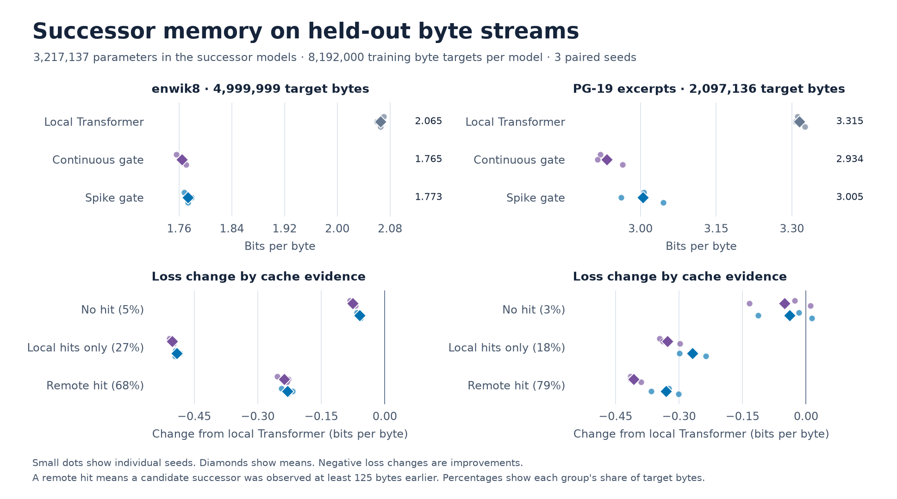

# Dendrite at 3.22 million parameters

The comparison tests a conventional local Transformer, the same Transformer with
an exact suffix cache and a continuous readout, and the same cache
with Dendrite's 0–16 spike readout. The two cache models start from
the same weights within each seed and differ only in readout
quantization. The plain model starts from the same backbone weights.

| Shared setting | Value |
|---|---|
| Architecture | Width 256, four layers, eight heads, 32-byte local window |
| Learned parameters | 3,216,896 plain, 3,217,137 for each cache model |
| Training | 2,000 updates, 4 × 1,024 bytes per update, 8,192,000 sampled training targets per model |
| Seeds | 0, 1, 2, with identical sampled byte windows across models within each seed |
| Cache | Orders 2, 3, 4, 5 and 7, with 2,048 verified slots per order |
| Training device | Apple M3 Max, PyTorch MPS, float32 |

The full enwik8 test stream predicts every byte after the first.
The transfer test uses the central 131,072 bytes of each of the next
16 qualifying books in the PG-19 test split, excluding the eight
books from the earlier study. The evaluator resets state between
books and scores identical bytes for all three models. The
[excerpt manifest](../results/lm_scaling/pg19_test16_manifest.json)
records the selection rule and checksums.
[PG-19 dataset](https://github.com/google-deepmind/pg19)

The evaluator reports loss in bits per byte for three groups. A miss
has no verified candidate. A local-only hit has a candidate less than
125 bytes old. A remote hit has at least one candidate 125 bytes old
or older, beyond the local model's receptive field. The groups are
defined once from the input bytes and shared by all models. A remote
hit describes an available record and does not assert which candidate
the model favored.

## Held-out loss

| Dataset | Targets per seed | Local Transformer | Continuous gate | Spike gate |
|---|---:|---:|---:|---:|
| Full enwik8 test stream | 4,999,999 | 2.065 | **1.765** | 1.773 |
| 16 PG-19 excerpts | 2,097,136 | 3.315 | **2.934** | 3.005 |

Values are means across the three seeds in bits per byte. The spike
model lowered enwik8 loss by 14.1% and PG-19 loss by 9.4% relative to
the plain model. Both caches improved every PG-19 excerpt for every
seed. Continuous readout had lower aggregate loss on both datasets
in all three seeds. Its average lead over spikes was 0.009 bits per
byte on enwik8 and 0.071 on the book excerpts.



On the 3,419,946 enwik8 targets with a remote hit, average loss was
2.041 for the plain Transformer, 1.803 for the continuous gate and
1.811 for the spike gate. On the 1,655,864 PG-19 remote-hit targets,
the respective means were 3.291, 2.885 and 2.961.
[Seed 0](../results/lm_scaling/seed0.json) ·
[Seed 1](../results/lm_scaling/seed1.json) ·
[Seed 2](../results/lm_scaling/seed2.json)

## CPU decoding

Seed-0 checkpoints decoded greedily at batch size one on a single
M3 Max CPU thread in float32. Each model started from the same prefix
for each prompt length and generated 128 bytes per trial. The latency
columns are median milliseconds per generated byte over five trials,
excluding prompt ingestion. A fresh process benchmarked each model.

| Model | 32-byte prompt | 512-byte prompt | 1,024-byte prompt | Persistent state | Peak process RSS |
|---|---:|---:|---:|---:|---:|
| Local Transformer | 0.368 | 0.360 | 0.361 | 256 KiB | 232.2 MiB |
| Continuous gate | 0.496 | 0.497 | 0.500 | 496.1 KiB | 235.5 MiB |
| Spike gate | 0.505 | 0.527 | 0.500 | 496.1 KiB | 234.6 MiB |

Persistent tensor state stayed fixed across prompt lengths and
decode steps. Peak RSS also includes the runtime, model weights and
temporary allocations. Both cache models took longer to decode than
the plain local Transformer. Quantizing the readout gave no consistent
latency advantage over the continuous gate in this PyTorch CPU run,
and the cache state used the same number of bytes.
[Timing samples and memory](../results/lm_scaling/decode_cpu_seed0.json)

## Reproduce

Use the Python environment and raw enwik8 corpus from the
[reproduction guide](REPRODUCE_DENDRITE.md). The examples below use
Bash arrays and assume `ENWIK8_PATH` points to the raw corpus. Start in
the repository root.

```bash
python experiments/prepare_pg19.py \
  --manifest results/lm_scaling/pg19_test16_manifest.json \
  --output data/pg19-test16-scaling

for seed in 0 1 2; do
  for variant in transformer_local transformer_successor_continuous transformer_successor; do
    python experiments/train_lm.py --variant "$variant" --seed "$seed" --tag reproduce_scale3m \
      --device mps --threads 2 --dim 256 --depth 4 --heads 8 --local-window 32 \
      --ctx 1024 --bs 4 --steps 2000 --warmup 150 --lr 0.002 \
      --eval-every 500 --eval-bs 4 --eval-batches 10 --final-eval-batches 64 \
      --checkpoint "checkpoints/repro-scale3m-$variant-s$seed.pt"
  done
  python experiments/eval_scaling.py --device mps --threads 4 --chunk 16384 \
    --local "checkpoints/repro-scale3m-transformer_local-s$seed.pt" \
    --continuous "checkpoints/repro-scale3m-transformer_successor_continuous-s$seed.pt" \
    --spike "checkpoints/repro-scale3m-transformer_successor-s$seed.pt" \
    --raw data/pg19-test16-scaling/*.txt --json "results/lm_scaling/reproduce_seed$seed.json"
done
```

```bash
python experiments/plot_scaling.py

python experiments/benchmark_decode.py --device cpu --threads 1 \
  --checkpoint checkpoints/repro-scale3m-transformer_local-s0.pt \
    checkpoints/repro-scale3m-transformer_successor_continuous-s0.pt \
    checkpoints/repro-scale3m-transformer_successor-s0.pt \
  --prompt-file "$ENWIK8_PATH" --prompt-offset 95000000 \
  --contexts 32 512 1024 --steps 128 --warmups 2 --repeats 5 \
  --json results/lm_scaling/reproduce_decode.json
```

The plotting command reads the saved run files by default. To regenerate
the chart from the reproduced runs, copy the three evaluation outputs
to a separate directory as `seed0.json`, `seed1.json` and `seed2.json` and
point `--results-dir` to that directory. Use `--device cpu` for training and
evaluation on machines without MPS. Small numerical differences can
arise across backends.
