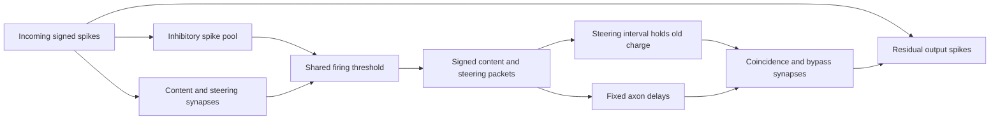
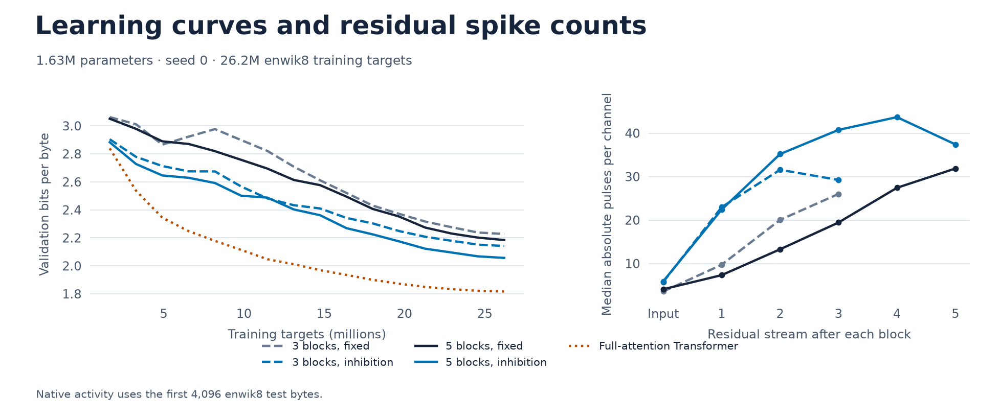

# Activity-dependent firing and causal charge traces

Doubling the three-block router's width and training exposure left enwik8 loss near 2.244 bits per byte. The matched full-attention Transformer scored 1.814. The depth study increases the number of causal blocks and tests two ways to make their spike packets carry more useful context. [Width comparison](LOCAL_SPIKE_ROUTING.md#scaling-membrane-width)

## A shared inhibitory threshold

Each incoming spike on either sign rail contributes one charge tick to a single inhibitory integrate-and-fire pool. If the stream has width \(D\) and resolution \(R\), the pool threshold is the smallest power of two at least \(DR/4\). After the pool emits \(h_t\) impulses, each downstream content and steering neuron fires at

\[
\theta_t=\theta_0\frac{4+h_t}{4}.
\]

Each inhibitory impulse raises both thresholds by one quarter of their base value. The same integer charge pitch applies to content and steering, so coincidence still compares pulse slots in the same units. Every emitted pulse keeps its usual synaptic charge. The direct residual carries the original spike stream and uses its existing output threshold. The pool resets every byte and gains zero parameters or persistent state. Surrogate gradients train the synapses through the shared threshold. [Decoder](../snnformer/event_lm.py) · [Division through spiking populations](https://proceedings.mlr.press/v306/yuan26e.html)

## Charge held by steering spikes

For each expansion channel, the local trace reads the charge \(m_t\) that arrived from prior bytes. It emits the first \(s_t\) occupied spike slots of that signed charge on the coincidence path. The delayed packet from the fixed tap still supplies the bypass path. After the read, the current content count \(p_t\) proposes an interval whose radius is the current steering count \(s_t\).

\[
m_{t+1}=\operatorname{clip}(m_t,\;p_t-s_t,\;p_t+s_t).
\]

The bounds stay within the physical firing cap. If the old charge falls outside the interval, signed correction spikes move it to the nearest boundary. A big steering burst admits more read spikes and tolerates a wider range of incoming changes. A channel can retain the same charge across any number of intervening bytes while its successive intervals continue to contain it. Each channel uses one fixed-width integer cell. The existing interval scan composes those updates for batched training, and the CPU step applies them in time order. Chunked decoding carries both charge and axon packets across boundaries. [Interval scan](../snnformer/correction_memory.py) · [Decoder and state](../snnformer/event_lm.py)



## Matched runs

The five-block router uses a 264-channel residual stream and 185 expansion channels per block. Its 1,630,992 parameters lie within 0.04% of the three-block control and both Transformer references. The three-block geometry uses 384 residual and 201 expansion channels. With fixed delays, the five blocks can see 49 preceding bytes through the local path. The trace adds an older recurrent path and uses 3,700 extra bytes for one stream. Every spiking arm uses a 310,000-pulse training target. The accounting includes inhibitory impulses and charge reads and corrections.

The wide fixed router and the two Transformer references were trained in the [width study](LOCAL_SPIKE_ROUTING.md#scaling-membrane-width). The new runs use the same seed-0 enwik8 training windows and 26,214,400 target bytes. They add a wide inhibited router, a deeper fixed control, a deeper inhibited router, and a deeper inhibited router with held charge. The enwik8 scores cover the complete split. The PG-19 scores cover the same 16 full books with per-checkpoint temperatures chosen on eight separate validation books.

### Seed-0 results

| Model | enwik8 bits/byte | PG-19 bits/byte | Streaming state | Native pulses/byte |
| --- | ---: | ---: | ---: | ---: |
| Three-block SNN, fixed threshold | 2.24386 | 3.19752 | 14,556 B | 305,600 |
| Three-block SNN, activity inhibition | 2.16389 | 3.11971 | 14,556 B | 304,525 |
| Five-block SNN, fixed threshold | 2.19441 | 3.13879 | 17,620 B | 307,566 |
| Five-block SNN, activity inhibition | 2.07523 | **3.02885** | 17,620 B | 303,469 |
| Local Transformer | 1.89056 | 3.17881 | 64,512 B | — |
| Full-attention Transformer | **1.81449** | 3.11725 | 3 MiB | — |

The inhibited five-block model had lower calibrated PG-19 loss than the full-attention Transformer on all 16 books in seed 0. Their uncalibrated means were 3.15903 and 3.35489. On enwik8, the SNN gained across all five prefix-age groups over the five-block fixed control. Its largest remaining gap to full attention was 0.39753 bits per byte for prefixes recurring after 32 to 127 bytes. [Inhibited enwik8](../results/event_lm/depth_inhibition/enwik8_deep_inhibited.json) · [Inhibited PG-19](../results/event_lm/depth_inhibition/pg19_deep_inhibited.json) · [Full attention](../results/event_lm/scale_1630k/pg19_transformer.json)

Freezing the inhibitory spike count at each block's median raised loss from 2.00626 to 2.02840 bits per byte for the five-block model on 65,536 enwik8 validation targets. The corresponding three-block score rose from 2.08273 to 2.10050. Native inference on 4,096 test bytes matched MPS counts for all four spiking models. The trained five-block model with inhibition reached a higher median final residual count than its fixed control, 37.42 versus 31.86 per channel. Total emissions fell by 1.33%. [Five-block ablation](../results/event_lm/depth_inhibition/probe_deep_inhibited.json) · [Three-block ablation](../results/event_lm/depth_inhibition/probe_wide_inhibited.json) · [Native activity](../results/event_lm/depth_inhibition/native_deep_inhibited.json)

The full charge-trace run and the seed-1 and seed-2 matched Transformer comparisons are underway.



## Reproduce and inspect

The [model card](../models/spiking-byte-lm/README.md) gives the corpus setup. The recorded training configurations include the exact batch geometry, optimizer settings, and seed. Replay a run or probe its byte-level state from the repository root.

```bash
python experiments/generate_event_lm.py checkpoints/depth-inhibition-study/inhibited_s0.pt \
  --prompt 'The first chapter' --bytes 128

PYTORCH_ENABLE_MPS_FALLBACK=0 python experiments/replay_event_run.py \
  results/event_lm/depth_inhibition/event_correction_code_s0_deep_inhibited.json \
  --enwik8 data/enwik8 --device mps --output-dir checkpoints/replayed-inhibition

PYTORCH_ENABLE_MPS_FALLBACK=0 python experiments/probe_event_state.py \
  --checkpoint checkpoints/depth-inhibition-study/trace_s0.pt --enwik8 data/enwik8 \
  --device mps --targets 32768 --chunk-size 64 --json checkpoints/replayed-trace-probe.json
```

The diagnostic fixes the inhibitory pool at its observed median count per block, or clears only the local held charge every 64 bytes. Both interventions preserve the trained synapses. Resetting the local trace preserves the axon packets and the post-router correction bank.

Regenerate the figure with `python experiments/plot_depth_inhibition.py`. Pass `--include-trace` after the trace training record and native audit are present. Each learning-curve point scores the same 32,768 enwik8 validation targets. [Local checkpoint digests](../results/event_lm/depth_inhibition/checkpoints.sha256)
