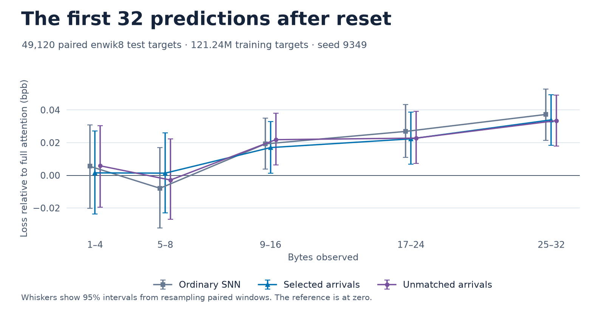

# Unmatched spikes from fixed axon arrivals

The ordinary v8 model and its full-attention reference predicted
the first 32 target bytes after reset at 1,535 paired enwik8
validation positions. Full attention led by 0.048004 bits per byte
at predictions 17–32. In the two shortest groups, 41.7% of the
pulses selected by steering in this interval had no corresponding
pulse on the same sign rail of the held read. The existing residual
projection receives the held read and the arrival's bypass.
[Parent cold-start audit](../results/event_lm/trace_arrival/parent_arrival_profile.json)

## Route the part that arrived

Let $d$ be the scheduled arriving spike count and $s$ the
steering count. The ordinary split gives the selected count
$a=\operatorname{clip}(d,-s,s)$ and the bypass $d-a$.
The local trace reads the pre-write charge as $r$.
Its state stores the effect of preceding interval writes.

Take the overlap between $a$ and $r$ on each sign rail,
using $[x]_+=\max(x,0)$.

$$
c(a,r)=\min([a]_+,[r]_+) - \min([-a]_+,[-r]_+),
\qquad u=a-c(a,r).
$$

The branch forwards $u$ to a learned projection into the block's
residual current. The selected-arrival control feeds $a$ into the
same geometry. Five positive arrival pulses and two matching held
pulses forward three. Opposite signs give zero coincidence, and
full overlap gives zero residual input. The branch uses existing
arrivals and sign-rail coincidence before residual firing.
The added synapses account for extra synaptic work. Emission audits
count the firing neurons and report routed inputs separately.
[Implementation](../snnformer/event_lm.py) ·
[Prior work on spike-based error coding](https://doi.org/10.1371/journal.pcbi.1003258)

## Matched experiment

Both variants add 1,267,200 zero-initialized synapses from
the first two delay groups across all eleven blocks. Every
parent output and the total emission count agree on 4,096
enwik8 validation bytes before training. Both networks use
28,584 persistent bytes. The ordinary continuation uses
12,799,488 parameters. The arrival variants have 14,066,688,
and the full-attention reference has 14,068,224 after adding
275 SwiGLU units per block.
[Unmatched warm audit](../results/event_lm/trace_arrival/warm_unmatched.json) ·
[Selected warm audit](../results/event_lm/trace_arrival/warm_selected.json) ·
[Transformer warm audit](../results/event_lm/trace_arrival/warm_transformer.json)

All arms add 4,915,200 enwik8 targets to the 116,326,400-target
parents. The launcher uses seed 9349, 1,200 updates, eight 512-byte
windows per update, 48 warmup updates and a peak learning rate
of 0.00008. Both arrival arms and the ordinary SNN use the same
310,000-pulse soft budget.

For the early-context comparison, the first prediction follows
one observed byte after each reset. We score 32 targets per window
and pair models on the same positions. The primary interval
covers predictions 17–32. Confidence intervals resample complete
windows from a single continuation seed. Muting the new projection
measures its effect at fixed weights. Full enwik8, PG-19 and the
byte transfer suite measure wider behavior.
[Early-context probe](../experiments/probe_early_context.py) ·
[Transfer protocol](BYTE_TRANSFER.md) · [All results](LEADERBOARD.md)

## The first 32 predictions after reset

The test probe used 49,120 enwik8 targets across 1,535 paired
windows. Both arrival branches improved predictions 17–32 by
about 0.00394 bpb against the ordinary continuation.

| Model | Predictions 1–32 (bpb) | Predictions 17–32 (bpb) | Gap to full attention at 17–32 (bpb) |
|---|---:|---:|---:|
| Full attention | 2.044831 | 1.820517 | 0 |
| Ordinary SNN | 2.065371 | 1.852582 | +0.032065 |
| Selected arrivals | 2.063495 | 1.848647 | +0.028130 |
| Unmatched arrivals | 2.064718 | 1.848641 | +0.028124 |

The paired 95% interval for unmatched arrivals minus the ordinary
SNN was [−0.00723, −0.00066] bpb. The gap to the selected-arrival
control was −0.000006 bpb, with an interval of [−0.00314, +0.00319].
Muting the unmatched projection changed the test loss by −0.00001
bpb, with an interval of [−0.00104, +0.00101]. On validation, both
arrival arms' changes relative to the ordinary control had intervals
spanning zero. The similar losses and small mute effect leave the
coincidence rule's specific contribution unresolved at this seed.
[Paired test](../results/event_lm/trace_arrival/early_context_test.json) ·
[Paired validation](../results/event_lm/trace_arrival/early_context_val.json)

## Native pulse counts

The CPU integer audit scores the same 4,096-byte enwik8 test
sample for each SNN. It verifies the output counts against Metal.

| Model | Persistent bytes per stream | Emitted pulses per byte | Pulses routed to the new synapses per byte |
|---|---:|---:|---:|
| Ordinary SNN | 28,584 | 309,983 | — |
| Selected arrivals | 28,584 | 308,644 | 3,614 |
| Unmatched arrivals | 28,584 | 310,042 | 1,423 |

The unmatched branch receives 39.4% as many input pulses as
the selected branch on this sample. The branch input
counts describe where existing pulses go. Network-wide emissions
include the downstream response to the learned projection.
[Ordinary audit](../results/event_lm/trace_arrival/native_control_s9349.json) ·
[Selected audit](../results/event_lm/trace_arrival/native_selected_s9349.json) ·
[Unmatched audit](../results/event_lm/trace_arrival/native_unmatched_s9349.json)

## Complete corpus and transfer scores

On the complete enwik8 test set, the ordinary SNN scored 1.79102
bpb, selected arrivals scored 1.79114, and unmatched arrivals
scored 1.79163. The full-attention reference scored 1.70963.
On PG-19, the calibrated scores are 2.75550 for selected arrivals,
2.75679 for the ordinary SNN, 2.76087 for unmatched arrivals and
2.88426 for full attention.
On the continuous 65,536-target validation probe, muting the
unmatched branch lowered loss by 0.00059 bpb.
[Full corpus ledger](LEADERBOARD.md) ·
[Continuous validation intervention](../results/event_lm/trace_arrival/probe_unmatched_s9349.json)

On text8, unmatched arrivals scored 2.13885 bpb and full attention
scored 2.15081. On windows with zero overlap hits, those scores
were 2.13948 and 2.15132. Full attention led on WikiText-103, C4,
enwik9 and LAMBADA answer-byte loss. Full passages improved
LAMBADA answer loss for every arm. Only the full-attention
reference predicted a complete word, with one correct full-passage
answer out of 5,153.
[Transfer tables](LEADERBOARD.md#byte-transfer-at-the-same-training-exposure) ·
[Raw transfer record](../results/event_lm/byte_transfer/trace_arrival_s9349.json)
