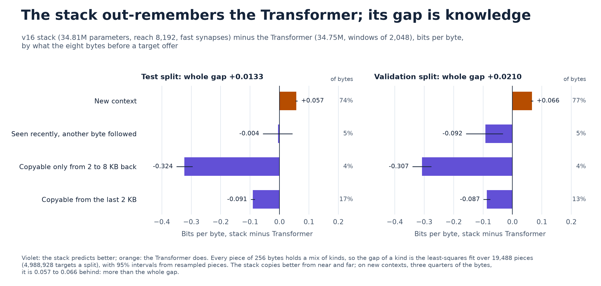
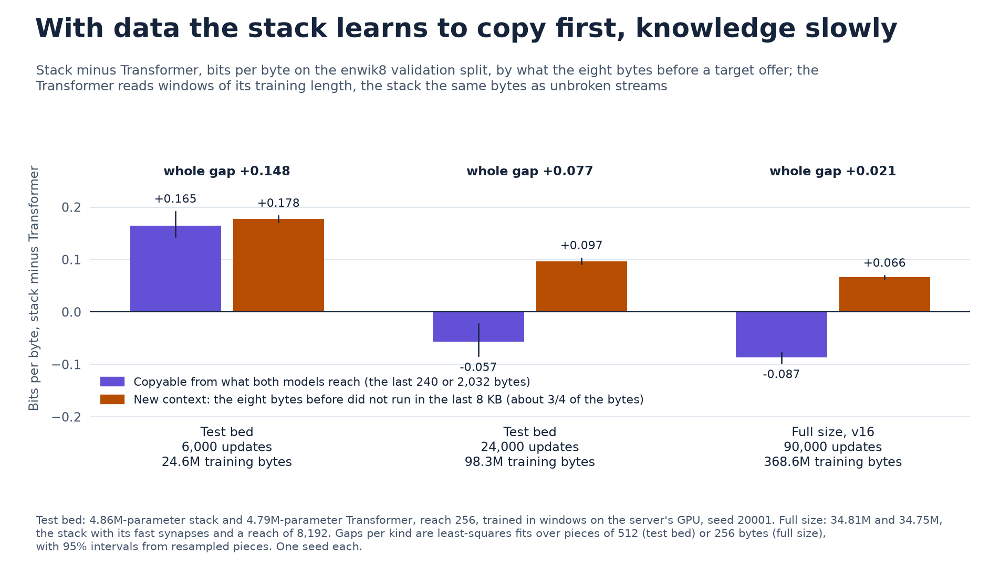
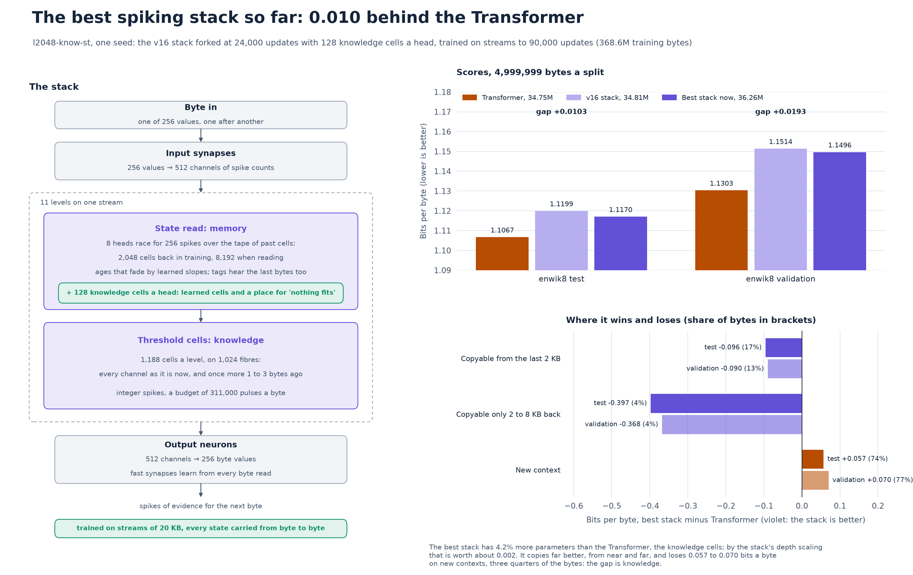

# The knowledge gap

v16 left the spiking stack 0.013 bits per byte behind a Transformer of its size on the enwik8 test split. This release
finds where that gap lies, tries fifteen ways to close it, and finds what moves it.

- **The stack remembers better than the Transformer; the whole gap is knowledge.** Split by what each byte's context
  offers, the stack is far ahead wherever the bytes before a target can be copied, and behind on new contexts,
  three quarters of the bytes.
- **The best spiking stack scores 1.1170 on test and 1.1496 on validation**, 0.010 and 0.019 behind the Transformer
  (v16: 1.1199 and 1.1514). It is v16's stack with 128 knowledge cells a head, trained on streams.
- **Knowledge cells are an attention sink.** One learned cell a head gives more than the whole copying gain of 128:
  the gain is a place for a head to put its spikes when nothing in its reach fits.
- **What helps knowledge helps early.** At 6,000 updates the test bed's best stack is level with its Transformer on new
  contexts and 0.047 ahead in all; with four times the data it is 0.054 behind. Every part that helped knowledge,
  delayed fibres, training on streams, knowledge cells, helped early and did not change the slope of the learning
  curve.
- **The learning rate matters, for both models.** On the test bed both models score better at higher peak rates than
  the 3e-4 every run used so far, and the stack gains more (one seed, still running). Every comparison after this
  release takes each model at its best rate, and the full size is next (`learning_rate_with_data.json`,
  `full_size_rate_pilot.json`).

Every test with a pass mark was recorded before its first result, in `results/event_lm/knowledge_gap/`, and every
verdict below is that record's; the diagnostics made after the fact say so in their records.

## Where the gap is

`experiments/gap_by_piece.py` pairs two scorings of the same streams piece by piece and fits the gap of each kind of
byte from how the kinds mix in each piece. A target's kind is what its context offers: whether the eight bytes before
it ran earlier in the stream, how far back, and whether the byte that followed them then is the target.

| Context | Share of bytes | v16 stack minus Transformer, test | validation |
|---|---|---|---|
| Copyable from the last 2 KB | 13 to 17% | **-0.091** | **-0.087** |
| Copyable only from 2 to 8 KB back | 4% | **-0.324** | **-0.307** |
| Seen, another byte followed | 5% | -0.004 | -0.092 |
| New context | 74 to 77% | **+0.057** | **+0.066** |

The stack copies better than the Transformer from the window both reach, and far better from beyond the
Transformer's window. On new contexts, where a byte must be predicted from what the model learned, it is behind, by
more than the whole gap. Of the places in a word only one is fitted steadily: from a word's fourth letter on, the
stack is behind by 0.05 on test and 0.10 on validation, completing words it has not seen lately.

Records: `gap_by_piece_test.json`, `gap_by_piece_validation.json`.

For v20's looped stack against the Transformer at its best rate the same fit by kind of byte puts the gap in letters
and markup: letters, 72% of the bytes, are 0.036 behind on test and 0.075 on validation, wiki and XML markup (6%)
0.075 and 0.137, and the bytes of multi-byte characters (0.6%) 0.24 and 0.17, while the stack is far ahead on
punctuation (0.25 and 0.30) and line breaks (0.66 and 0.69). Letters and spaces rise and fall together from piece to
piece, so only the narrow intervals are read; the loop's own gain over the plain stack is mostly in letters (0.012
on test). What the stack lacks is the knowledge of how words and markup go on, which its memory cannot copy.

## What was tried

All test-bed arms have the test bed's parameters (about 5.25 million) within a few hundred, train on streams unless
said otherwise, and are scored over the first 2,000,000 validation bytes as 16 unbroken streams.

| Idea | What it is | Verdict | What it taught | Record |
|---|---|---|---|---|
| Knowledge cells | 128 learned cells a head race beside the stream's own | **Pass** on the test bed, four seeds, mean 0.021 | They help a read copy (0.036 on copyable bytes) and add no knowledge | `preregistered.json` |
| Branching dendrites | a cell's fan split into branches, each past its own threshold | Fail, behind at all four seeds (0.010) | Splitting one dense fan does not add capacity | `preregistered.json` |
| Apical bursts | a tuft that multiplies a cell's spikes | Fail, every seed diverged | Products of learned charges are unstable | `preregistered.json` |
| Racing experts | groups of cells behind router cells that race | Fail, 0.037 to 0.104 behind | A lookup answers with too few cells | `preregistered.json` |
| A shared library | one set of knowledge cells for all levels | Level with per-level cells | A tidy equal, not a gain | `laptop_screen_2.json` |
| More knowledge cells | 256 a head, or a library of 1,536 | 0.026 to 0.031 behind | Paid with threshold cells, where knowledge is held | `laptop_screen_2.json` |
| Kept cells | heads keep cells that won after they leave the reach | Fail over long streams (0.012, 0.014) | Help in the first 8 KB, cost more the longer a stream runs | `kept_cells.json` |
| Keyed fast synapses | fast synapses also hear which knowledge cells won | Fail at all four seeds (0.006) | The keys swamp the pool they share | `knowledge_keyed_synapses.json` |
| Trained plasticity with knowledge cells | both in one stack | They get in each other's way (0.011) | Parts that help the same bytes compete | `knowledge_and_plasticity.json` |
| Eight fixed delays | cells hear eight bytes side by side | Fail (0.032, 0.097) | A thinner share of the same fibres | `more_delays.json` |
| Narrower reads, more cells | reads of 128 with 1,342 cells | Fail (0.070), worse on new contexts too | Knowledge needs the reads as much as the cells | `memory_for_knowledge.json` |
| Myelinated fibres | every fibre learns its delay, up to 31 bytes | Fail on both cell shapes and both devices (0.0045, 0.013; 0.020 on the server) | The delays move toward the present: better copies, less knowledge | `myelin_and_sheet.json`, `full_size_shape_bed.json` |
| A cerebellar sheet | four times the cells, each on a quarter of the stream | Fail (0.050) | A cell must hear the whole present | `myelin_and_sheet.json` |
| Word heads | a head reads the present word by its places | 0.023 and 0.017 ahead, all of it memory; with four times the data 0.005 (fades) | See below | `word_rhythm.json`, `full_size_shape_bed.json`, `word_heads_with_data.json` |
| The full size's cell shape | every channel's present byte and one delayed, 681 cells | **0.020 and 0.016 ahead** on two devices, and on new contexts (0.009, 0.017); 0.016 at 24,000 updates | The test bed's own shape was the weaker one | `word_rhythm.json` |

## Knowledge cells are an attention sink

A head of a state read races the cells it reaches for a budget of spikes. With no other cell to go to, it gives its
spikes to some cell even when none fits, and passes on that cell's payload. One learned, ageless cell a head gives it
a place to put them.

| Copy probe, second showing of random letters (bits a byte) | |
|---|---|
| The bed | 3.268 |
| 128 knowledge cells a head | 2.708 |
| **One knowledge cell a head** | **2.485** |

One cell gives 140% of the copying gain of 128, as attention sinks and registers do in Transformers. Over long streams
it gains 0.005 on the bed, all of it on copyable bytes. Four seeds on the server's CPU confirm it: at every seed
the sink copies random letters better on their second showing, by 1.37 bits a byte on average (0.15 to 2.28), and over
long streams it is 0.017 better on average, at three of four seeds. It takes away the seed lottery of copying: the
bed's seeds copy at 2.60 to 4.04 bits a byte on the second showing, the sink's at 1.61 to 2.44. Records:
`knowledge_and_plasticity.json`, `attention_sink.json`.

## The gap with data

| The test bed, same 2 million bytes | 6,000 updates | 24,000 updates |
|---|---|---|
| Delayed stack trained on streams | 1.7724 | 1.5468 |
| Its Transformer | 1.8190 | 1.4927 |
| **Gap** | **0.047 ahead** | **0.054 behind** |
| ...on copyable bytes | 0.880 ahead | 0.175 ahead |
| ...on new contexts | level (+0.009) | 0.083 behind |

From 6,000 to 24,000 updates the Transformer gains 0.326 bits a byte, the plain bed trained in windows 0.396, and the
delayed bed trained on streams 0.225: the best stack learns fastest early and flattens first. Knowledge cells keep a
lead of about 0.014 over its own bed at 24,000 updates, but within the run their lead falls from 0.022 at 6,000
updates to 0.011, and their fitted exponent is smaller than the bed's (0.64 against 0.81): they help early and do not
change the slope (`knowledge_data_scaling.json`). Every cell of the trained stack fires, on 40 to 55% of bytes, with a
median of 4 to 7 spikes; neither silent cells nor binary cells explain the flattening.

## Brain mechanisms

Three ways the brain holds knowledge were built for the stack, each spiking and streaming, each exact under any cut of a
stream (`tests/test_myelin.py`, `tests/test_word_heads.py`).

- **Myelinated fibres.** Activity-dependent myelination tunes how late an axon delivers its spikes. Every fibre of a
  cell layer learns which earlier byte it brings, up to 31 back, one number a fibre; its spikes stay exact, its delay
  learns through a straight-through slope that never looks past the present. Given the choice, the fibres move toward
  the present byte. They copy better and know less, on both cell shapes.
- **A cerebellar sheet.** The granule layer of the cerebellum holds a vast number of cells, each on a few inputs.
  Four times the cells, each on a quarter of the stream, at equal parameters, lose everywhere but on copies.
- **Word heads.** In the brain a word is a cycle of a slow rhythm that every word onset resets, its letters in the
  cycle's successive slots. A letter neuron and an onset neuron with fixed synapses mark where a word begins, and a word
  head reaches only the present word's cells, weighing each by its place in the word, so a prefix is one pattern
  however far into its word the reading stands. On the test bed word heads gain 0.023 (the bed's cell shape) and
  0.017 (the full size's), all of it memory: they help the stack recognise and copy a word it has seen, not complete
  one it has not. With four times the data the gain falls to 0.005, and what is left is on new contexts
  (`word_heads_with_data.json`).

## Full size

| enwik8, bits per byte | Test | Validation | Parameters |
|---|---|---|---|
| Transformer (windows of 2,048) | 1.1067 | 1.1303 | 34.75M |
| v16 stack | 1.1199 | 1.1514 | 34.81M |
| **Knowledge cells, trained on streams** | **1.1170** | **1.1496** | 36.26M |
| Trained plasticity (fast synapses trained in the loop) | within 0.001 of its reference | | 34.81M |
| Word heads with knowledge cells, trained on streams | 1.1162 (0.0009 ahead of knowledge cells; fails its mark of 0.003) | 1.1491 | 36.26M |
| Depth 22 (twice the levels, the same pulse budget) | 1.0926 | 1.1230 | 69.36M |
| Transformer at depth 22 | 1.0704 | 1.0930 | 69.37M |

The stacks read 8,192 cells back with v15's fast synapses on all levels at 2^24; the Transformers read windows of
their training length with 16 bytes scored after the rest. Knowledge cells missed their own mark (0.005 at the trained
reach; they gained 0.001 there), and they add 4.2% of parameters, worth about 0.002 by the stack's depth scaling; the
arm also trained on streams where v16 trained in windows. Trained plasticity missed its mark (0.005). At depth 22 the
stack gains 0.027 over depth 11 and the Transformer 0.036: the gap widens with size, at equal energy for the stack
(0.022 on test, 0.030 on validation).

The full-size word-head run finished after this release. It scores 1.11615 on test and 1.14908 on validation, the
best spiking score so far, and is ahead of knowledge cells alone by 0.0009 on test (paired interval 0.0004 to 0.0013)
and 0.0006 on validation. The rule recorded before it started asked for 0.003 on test, so word heads fail their mark
and do not join the design (`full_size_word_heads.json`). The run is the model of the v18 release.

v19 trained the pair again, each model at the learning rate where it trains best at full size
(`full_size_best_rate_pair.json`). The knowledge-cell stack at 6e-4 scores 1.1129 on test and 1.1473 on validation,
the best spiking score so far, and the Transformer at 1.2e-3 scores 1.0790 and 1.1048. The faster rate pays the
Transformer 0.028 and the stack 0.004, so the gap grows to 0.034 on test. It is still knowledge: the stack is 0.074
ahead on near copies and 0.41 ahead on copies only its reach finds, and 0.090 behind on new contexts, three quarters
of the bytes. The study of that release is [SCALING_LAW.md](SCALING_LAW.md).

v20 trained the same stack with its levels 2 to 8 run twice through the same synapses, beside that pair
(`full_size_loop_run.json`). It scores 1.1039 on test and 1.1387 on validation, 0.0090 and 0.0086 better than v19's
stack, and nine tenths of that gain is on new contexts: 0.0116 better there on test. Against the Transformer the
distance on new contexts falls from 0.090 to 0.078 and the whole gap from 0.034 to 0.025. Depth by recurrence is the
first part to narrow the knowledge gap at full length; it fires 1.63 times the pulses and adds no parameters.

Records: `full_size.json`, `full_size_word_heads.json`, `full_size_best_rate_pair.json`, `full_size_loop_run.json`,
`results/event_lm/trained_plasticity/arms.json`.

## What this means

The stack's memory is better than the Transformer's at every distance tried, and its knowledge is worse, more so the
more it learns. Parts beside the cells, delays, cells in the race, kept cells, more or fewer cells, rhythms of words,
change memory or help early; none changes how the stack goes on learning what is not in its context. The next step is
there: how synapses learn through spikes late in training. See `docs/ROADMAP.md`.

## Limits

- One seed at full size; four seeds on the test bed only for knowledge cells, keyed synapses and the attention sink.
- The test bed reaches 256 cells back where the full size reaches 2,048 to 8,192: knowledge cells helped the test bed
  and did nothing at full size.
- The per-piece fit cannot separate kinds of byte whose shares move together, as the first letters of words do; only
  kinds with narrow intervals are read.
- The test bed's Transformer at 24,000 updates trained in windows on a GPU; the stack it is compared with trained on
  streams on the laptop's GPU.
