# Spiking byte model leaderboards

Lower bits per byte rank higher. Every row in a comparison has the same number of training targets and scores 4,999,999 enwik8 targets and 8,404,368 targets from 16 complete PG-19 books. A dash marks a score that was not measured.

State is persistent tensor storage for one stream. Full attention reports FP32 key and value storage at the context length in each comparison. Pulse counts use a native 4,096-byte enwik8 test sample. Each PG-19 temperature is fitted on eight separate validation books. The teacher-guided SNN uses additional training compute from a frozen Transformer.

<!-- hand-written:start -->
## The lifted loop at full length · 368,640,000 training targets · seed 20001

| Model | Parameters | Reads the test as | enwik8 | Rank | PG-19 | Rank |
|---|---:|---|---:|---:|---:|---:|
| 36.26M SNN stack, levels 2 to 8 run twice under the lifting pool, trained on streams at 6e-4 | 36,263,956 | Stream, reach 8,192, taught output synapses | 1.08175 | 3 | — | — |
| 36.26M SNN stack, levels 2 to 8 run twice under the lifting pool, trained on streams at 6e-4 | 36,263,956 | Stream, reach 8,192 | 1.08266 | 4 | — | — |
| 36.26M SNN stack, levels 2 to 8 run twice under the lifting pool, trained on streams at 6e-4 | 36,263,956 | Stream, as trained | 1.09830 | 5 | — | — |
| 36.26M SNN stack, levels 2 to 8 run twice, trained on streams at 6e-4 (v20) | 36,263,956 | Stream, reach 8,192, taught output synapses | 1.10391 | 6 | — | — |
| 34.75M full attention, windows of 2,048 bytes, at 1.2e-3 | 34,752,000 | Windows with 2,032 bytes of history, taught output synapses | **1.07714** | 1 | — | — |
| 34.75M full attention, windows of 2,048 bytes, at 1.2e-3 | 34,752,000 | Windows with 2,032 bytes of history | 1.07899 | 2 | — | — |

v20's looped stack with every population's pool dividing a neuron's charge before its membrane bounds it
(`--pool-lifts-ceiling`) and nothing else changed: the same parameters, pulses (1.63 times v19's) and training time.
It is the best spike-only stack so far, 0.0222 ahead of v20's on test (paired 95% interval 0.0216 to 0.0228) and
0.0251 on validation, more than all of it on new contexts. The Transformer is ahead by 0.0028 on test (0.0017 to
0.0038) and 0.0088 on validation (0.0077 to 0.0098), where it was ahead of v20's stack by 0.0249 and 0.0339
(`results/event_lm/knowledge_gap/full_size_lifted_loop_run.json`).
[Model card](../models/spiking-byte-lm-v21/README.md) · [Scaling-law study](SCALING_LAW.md)

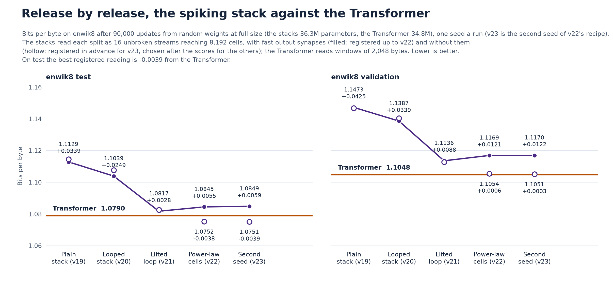
<!-- hand-written:end -->

<!-- hand-written:start -->
## The looped stack at full length · 368,640,000 training targets · seed 20001

| Model | Parameters | Reads the test as | enwik8 | Rank | PG-19 | Rank |
|---|---:|---|---:|---:|---:|---:|
| 36.26M SNN stack, levels 2 to 8 run twice, trained on streams at 6e-4 | 36,263,956 | Stream, reach 8,192, taught output synapses | 1.10391 | 3 | — | — |
| 36.26M SNN stack, levels 2 to 8 run twice, trained on streams at 6e-4 | 36,263,956 | Stream, reach 8,192 | 1.10762 | 4 | — | — |
| 36.26M SNN stack, knowledge cells, trained on streams at 6e-4 (v19) | 36,263,956 | Stream, reach 8,192, taught output synapses | 1.11287 | 5 | — | — |
| 36.26M SNN stack, levels 2 to 8 run twice, trained on streams at 6e-4 | 36,263,956 | Stream, as trained | 1.12595 | 6 | — | — |
| 34.75M full attention, windows of 2,048 bytes, at 1.2e-3 | 34,752,000 | Windows with 2,032 bytes of history, taught output synapses | **1.07714** | 1 | — | — |
| 34.75M full attention, windows of 2,048 bytes, at 1.2e-3 | 34,752,000 | Windows with 2,032 bytes of history | 1.07899 | 2 | — | — |

v19's stack with its levels 2 to 8 run twice through the same synapses, 18 level passes on the synapses of 11, and
the pulse budget scaled to 507,000 a byte (1.63 times v19's). It is the best spike-only stack so far, 0.0090 ahead
of v19's on test (paired 95% interval 0.0084 to 0.0095) and 0.0086 on validation, nine tenths of it on new
contexts. The Transformer is ahead by 0.0249 on test (0.0238 to 0.0261) and 0.0339 on validation, where it was ahead
of v19's stack by 0.0339 and 0.0425 (`results/event_lm/knowledge_gap/full_size_loop_run.json`).
[Model card](../models/spiking-byte-lm-v20/README.md) · [Scaling-law study](SCALING_LAW.md)

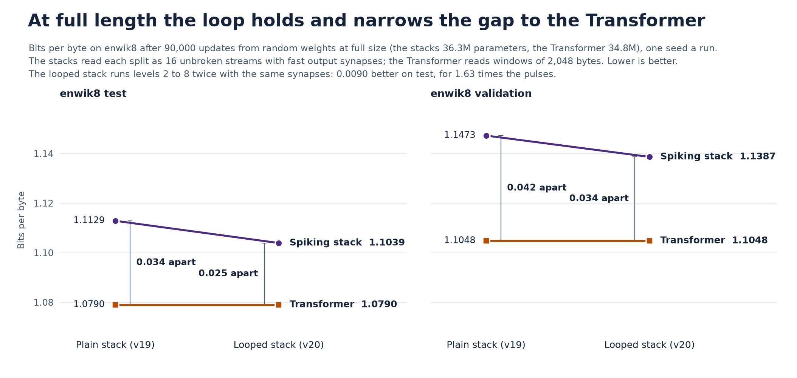
<!-- hand-written:end -->

<!-- hand-written:start -->
## Each model at its best rate · 368,640,000 training targets · seed 20001

| Model | Parameters | Reads the test as | enwik8 | Rank | PG-19 | Rank |
|---|---:|---|---:|---:|---:|---:|
| 36.26M SNN stack, knowledge cells, trained on streams at 6e-4 | 36,263,956 | Stream, reach 8,192, taught output synapses | 1.11287 | 3 | — | — |
| 36.26M SNN stack, knowledge cells, trained on streams at 6e-4 | 36,263,956 | Stream, reach 8,192 | 1.11460 | 4 | — | — |
| 36.26M SNN stack, knowledge cells, trained on streams at 6e-4 | 36,263,956 | Stream, as trained | 1.13021 | 6 | — | — |
| 36.26M SNN stack, knowledge cells and word heads, at 3e-4 (v18) | 36,264,308 | Stream, reach 8,192, taught output synapses | 1.11615 | 5 | — | — |
| 34.75M full attention, windows of 2,048 bytes, at 1.2e-3 | 34,752,000 | Windows with 2,032 bytes of history, taught output synapses | **1.07714** | 1 | — | — |
| 34.75M full attention, windows of 2,048 bytes, at 1.2e-3 | 34,752,000 | Windows with 2,032 bytes of history | 1.07899 | 2 | — | — |

Both models trained as v17's pair did, each at the peak learning rate where it trained best in the full-size pilots
of 24,000 updates: the stack at 6e-4, the Transformer at 1.2e-3. The stack is the best spike-only stack so far,
0.0042 ahead of v17's on test (paired 95% interval 0.0036 to 0.0047). The Transformer gains 0.0277 from its rate,
so at each model's best rate the stack is 0.0339 behind on test (0.0328 to 0.0351) and 0.0425 on validation,
against 0.0103 and 0.0193 at 3e-4 (`results/event_lm/knowledge_gap/full_size_best_rate_pair.json`).

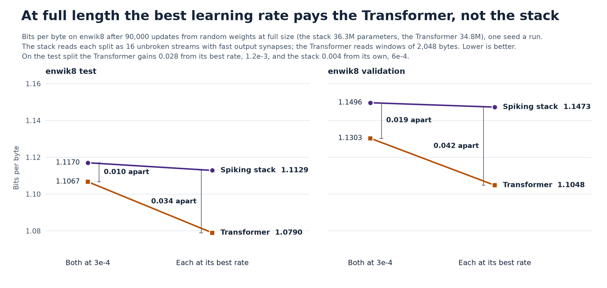
<!-- hand-written:end -->

<!-- hand-written:start -->
## Word heads, trained on streams · 368,640,000 training targets · seed 20001

| Model | Parameters | Reads the test as | enwik8 | Rank | PG-19 | Rank |
|---|---:|---|---:|---:|---:|---:|
| 36.26M SNN stack, knowledge cells and word heads, trained on streams | 36,264,308 | Stream, reach 8,192, taught output synapses | 1.11615 | 3 | — | — |
| 36.26M SNN stack, knowledge cells, trained on streams (v17) | 36,263,956 | Stream, reach 8,192, taught output synapses | 1.11702 | 4 | — | — |
| 34.75M full attention, windows of 2,048 bytes | 34,752,000 | Windows with 2,032 bytes of history, taught output synapses | **1.10321** | 1 | — | — |
| 34.75M full attention, windows of 2,048 bytes | 34,752,000 | Windows with 2,032 bytes of history | 1.10669 | 2 | — | — |

The word-head stack is v17's with one word head in every read: a head that reaches only the present word's cells and weighs each by its place in the word. It is the best spike-only stack so far, 0.0009 ahead of v17's on test (paired 95% interval 0.0004 to 0.0013), less than the 0.003 its record asked (`results/event_lm/knowledge_gap/full_size_word_heads.json`). [Model card](../models/spiking-byte-lm-v18/README.md) · [Scaling-law study](SCALING_LAW.md)
<!-- hand-written:end -->

## Knowledge cells trained on streams · 368,640,000 training targets · seed 20001

| Model | Parameters | Reads the test as | enwik8 | Rank | PG-19 | Rank |
|---|---:|---|---:|---:|---:|---:|
| 36.26M SNN stack, knowledge cells, trained on streams | 36,263,956 | Stream, reach 8,192, taught output synapses | 1.11702 | 3 | — | — |
| 36.26M SNN stack, knowledge cells, trained on streams | 36,263,956 | Stream, reach 8,192 | 1.12097 | 5 | — | — |
| 36.26M SNN stack, knowledge cells, trained on streams | 36,263,956 | Stream, as trained | 1.13571 | 6 | — | — |
| 34.81M SNN stack, windows of 2,048 bytes, forgetting slopes (v16) | 34,810,900 | Stream, chosen reach, taught output synapses | 1.11994 | 4 | — | — |
| 34.75M full attention, windows of 2,048 bytes | 34,752,000 | Windows with 2,032 bytes of history, taught output synapses | **1.10321** | 1 | — | — |
| 34.75M full attention, windows of 2,048 bytes | 34,752,000 | Windows with 2,032 bytes of history | 1.10669 | 2 | — | — |

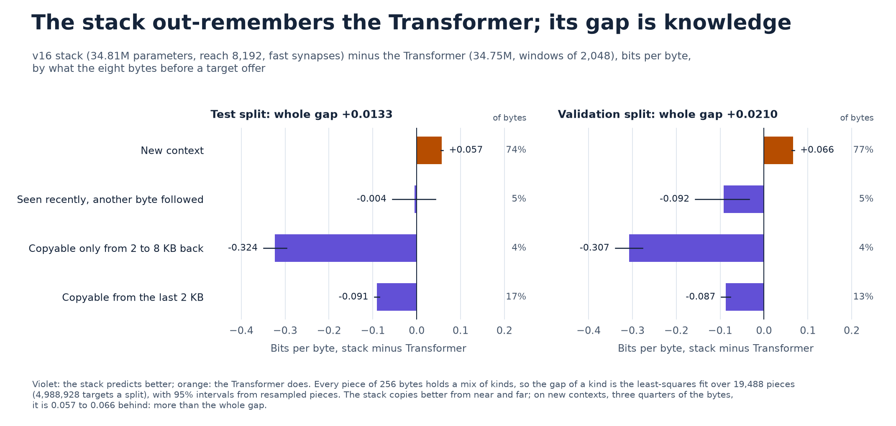

[Where the gap is, what was tried, and what moves it](KNOWLEDGE_GAP.md) · [Roadmap](ROADMAP.md)

The knowledge-cell stack is v16's stack with 128 learned, ageless cells in every read head's race. It trained on windows of 512 bytes for 24,000 updates and then on unbroken streams of windows of 2,048 bytes, the state handed on from window to window. Read at its best, with a reach of 8,192 cells and taught output synapses, it is 0.0103 bpb behind the Transformer on the enwik8 test (paired 95% interval 0.0092 to 0.0114) and 0.0193 on validation. Every row is one seed.

### Depth 22 at the same pulse budget

| Model | Parameters | Reads the test as | enwik8 | Rank | PG-19 | Rank |
|---|---:|---|---:|---:|---:|---:|
| 69.36M SNN stack, 22 levels, the same pulse budget | 69,359,656 | Stream, reach 8,192, taught output synapses | 1.09257 | 2 | — | — |
| 69.37M full attention, 22 layers, windows of 2,048 bytes | 69,371,904 | Windows with 2,032 bytes of history | **1.07042** | 1 | — | — |

Twice the levels at the same pulse budget gain the stack 0.027 bpb on test and the Transformer 0.036: the gap widens with size, at equal energy for the stack.

## Long streams at equal training context · 368,640,000 training targets · seed 20001

| Model | Parameters | Reads the test as | enwik8 | Rank | PG-19 | Rank |
|---|---:|---|---:|---:|---:|---:|
| 34.81M SNN stack, windows of 2,048 bytes, forgetting slopes | 34,810,900 | Stream, chosen reach, taught output synapses | 1.11994 | 4 | — | — |
| 34.81M SNN stack, windows of 2,048 bytes, forgetting slopes | 34,810,900 | Stream, chosen reach | 1.12349 | 5 | — | — |
| 34.81M SNN stack, windows of 2,048 bytes, forgetting slopes | 34,810,900 | Stream, as trained | 1.13667 | 7 | — | — |
| 34.81M SNN stack, windows of 2,048 bytes | 34,810,900 | Stream, chosen reach, taught output synapses | 1.13472 | 6 | 1.40030 | 2 |
| 34.81M SNN stack, windows of 2,048 bytes | 34,810,900 | Stream, chosen reach | 1.14038 | 9 | 1.41574 | 3 |
| 34.81M SNN stack, windows of 2,048 bytes | 34,810,900 | Stream, as trained | 1.13903 | 8 | — | — |
| 34.75M full attention, windows of 2,048 bytes | 34,752,000 | Windows with 2,032 bytes of history, taught output synapses | **1.10321** | 1 | — | — |
| 34.75M full attention, windows of 2,048 bytes | 34,752,000 | Windows with 2,032 bytes of history | 1.10669 | 2 | — | — |
| 34.75M full attention, windows of 1,024 bytes | 34,752,000 | Windows with 1,008 bytes of history | 1.11820 | 3 | **1.39800** | 1 |

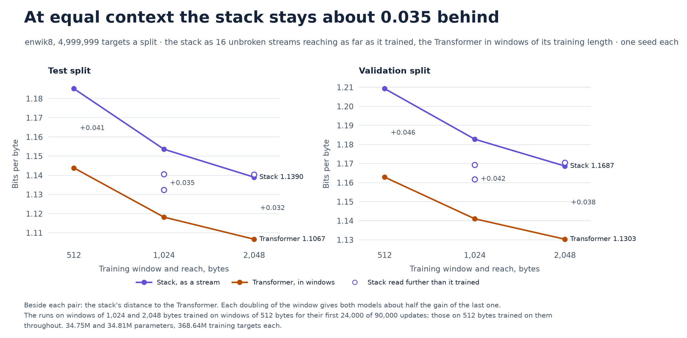

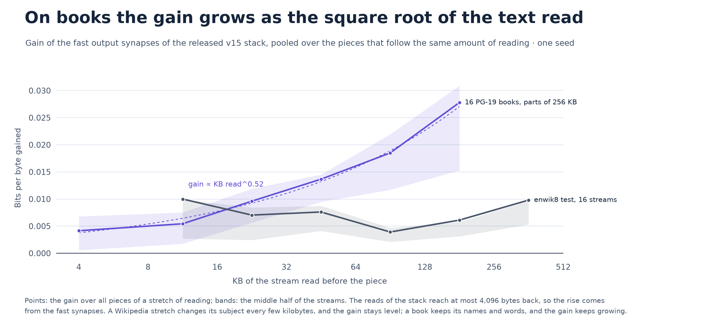

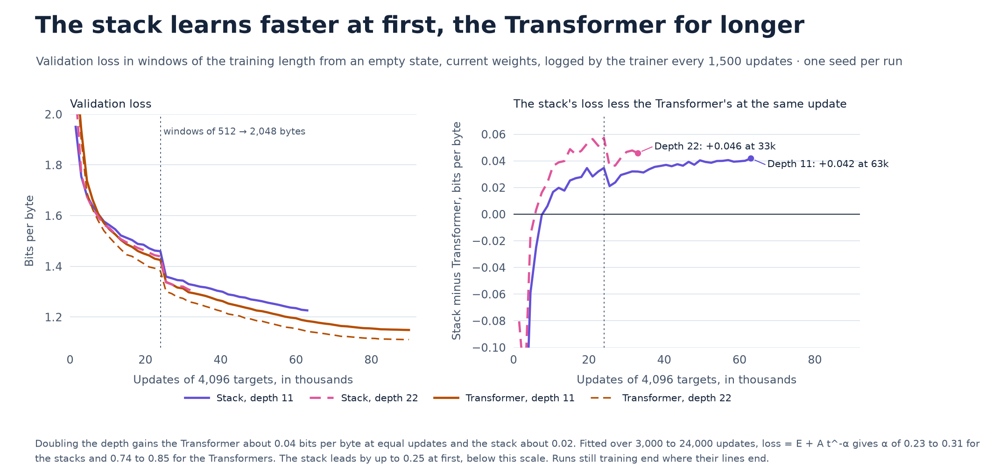

[Measurements, forgetting slopes and limits](LONG_STREAMS.md) · [Trained plasticity](TRAINED_PLASTICITY.md)

Every model of this comparison trained on windows of 512 bytes for 24,000 updates and on windows of 2,048 bytes for the remaining 66,000, from random weights, or on windows of 1,024 bytes where named. A stack reads the test as 16 unbroken streams; a chosen reach is the reach that scored best on the first million validation bytes. A Transformer reads the same streams in windows of its training length, 16 scored bytes after the rest as history. Taught output synapses start at zero in every stream and learn from each byte after it was predicted.

At equal context, each read as it trained, the stack is 0.0323 bpb behind the Transformer on the enwik8 test. Read at its best, with slopes that learn, a chosen reach and taught output synapses, it is 0.0132 behind. The level score of the comparison below came from a stack that trained on longer windows than its Transformer read. Every row is one seed.

## A stack that reads a stream, trained from scratch · 368,640,000 training targets · seed 20001

| Model | Parameters | Reads the test as | enwik8 | Rank | PG-19 | Rank |
|---|---:|---|---:|---:|---:|---:|
| 34.81M SNN stack, long windows | 34,810,812 | Stream, longer reach, taught output synapses | **1.13394** | 1 | **1.40469** | 1 |
| 34.81M SNN stack, long windows | 34,810,812 | Stream, longer reach | 1.14058 | 3 | 1.42490 | 2 |
| 34.81M SNN stack, long windows | 34,810,812 | Stream | 1.15359 | 6 | 1.44559 | 5 |
| 34.81M SNN stack, windows of 512 bytes | 34,810,812 | Stream, longer reach, taught output synapses | 1.16034 | 8 | — | — |
| 34.81M SNN stack, windows of 512 bytes | 34,810,812 | Stream, longer reach | 1.17095 | 9 | 1.46178 | 6 |
| 34.81M SNN stack, windows of 512 bytes | 34,810,812 | Stream | 1.18518 | 10 | 1.47610 | 7 |
| 34.75M full attention, standard shape | 34,752,000 | Windows with 496 bytes of history, taught output synapses | 1.13440 | 2 | — | — |
| 34.75M full attention, standard shape | 34,752,000 | Windows with 496 bytes of history | 1.14388 | 4 | 1.42649 | 3 |
| 34.75M full attention, standard shape | 34,752,000 | Windows with 448 bytes of history | 1.14539 | 5 | 1.42786 | 4 |
| 34.75M full attention, standard shape | 34,752,000 | Windows with 256 bytes of history | 1.15646 | 7 | — | — |

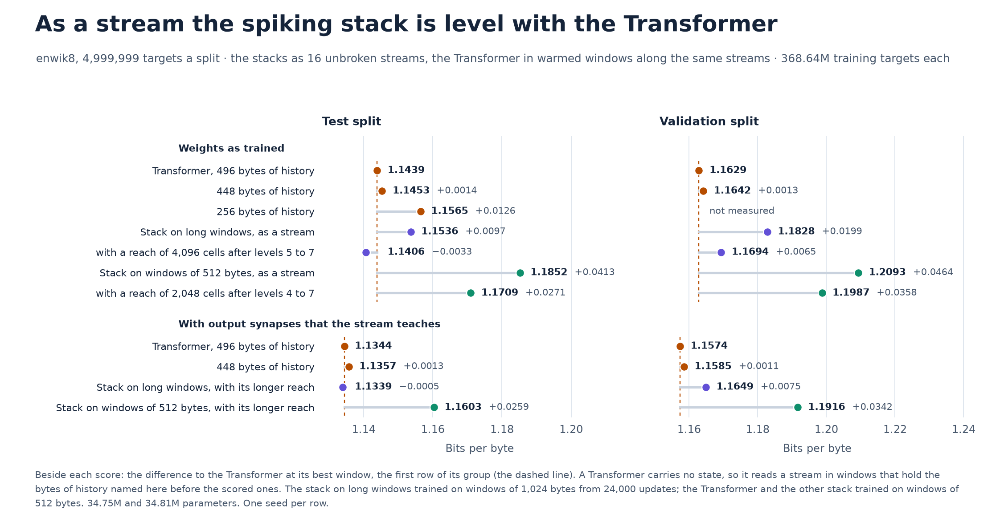

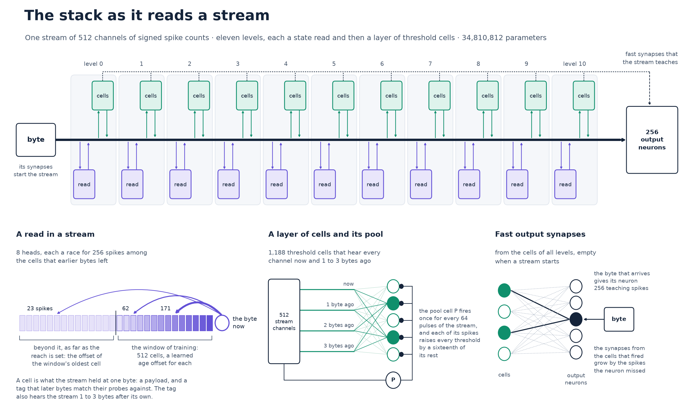

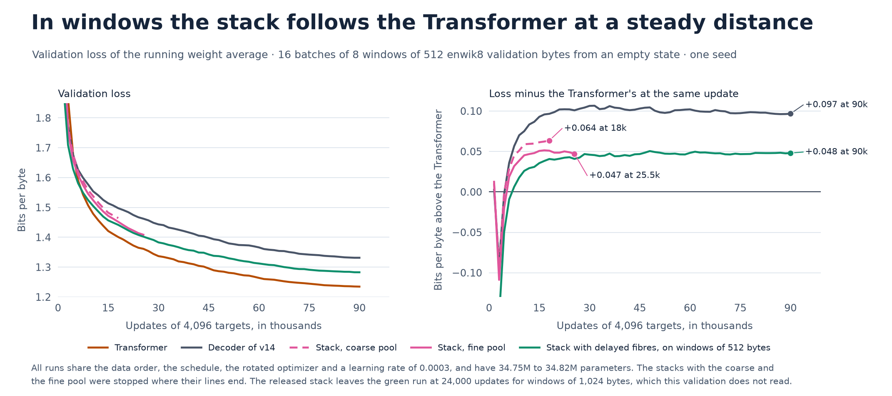

[Measurements, circuit and limits](STREAM_FORM.md) · [Every training arm](STREAM_FORM_ARMS.md)

This comparison reads the test as a stream. A stack carries its state through 16 unbroken parts of the enwik8 test split and through every PG-19 book. The Transformer carries no state and reads the same texts in windows that hold the named bytes of history before the scored ones. A longer reach lets the reads of a stack reach cells beyond its window of training, which adds no synapse. Taught output synapses start at zero in every stream and learn from each byte after it was predicted, and the Transformer gets the same rule on its last layer as a control.

On the enwik8 test the stack on long windows with its longer reach is 0.0033 bpb below the Transformer at its best window. On the validation split it is 0.0065 above it (1.1694 against 1.1629), so the two are level. That stack trained on windows of 1,024 bytes from 24,000 updates, and the Transformer and the other stack on windows of 512 bytes. The Transformer trained on windows of 1,024 bytes, the control, is in the comparison above: against it the stack is behind. The three models received identical windows from random weights up to 24,000 updates. Every row is one seed.

## Read clocks and the address rate, trained from scratch · 368,640,000 training targets · seed 20001

| Model | Parameters | Optimizer | enwik8 | Rank | PG-19 calibrated | Rank | PG-19 raw |
|---|---:|---|---:|---:|---:|---:|---:|
| 34.82M SNN, clock cells and address rate | 34,822,736 | Rotated, averaged | 1.24445 | 4 | 1.53378 | 4 | 1.53378 |
| 34.82M SNN, address rate | 34,819,544 | Rotated, averaged | 1.24570 | 5 | 1.53600 | 5 | 1.53600 |
| 34.82M SNN, spike reads and race cells | 34,819,544 | Rotated, averaged | 1.26226 | 6 | 1.55162 | 6 | 1.55162 |
| 34.85M full attention, 256 wide | 34,845,696 | AdamW | 1.20684 | 3 | 1.48212 | 3 | 1.48212 |
| 34.85M full attention, 256 wide | 34,845,696 | Rotated, averaged | 1.20407 | 2 | 1.48204 | 2 | 1.48204 |
| 34.75M full attention, standard shape | 34,752,000 | AdamW, averaged | **1.18215** | 1 | **1.45701** | 1 | **1.45701** |

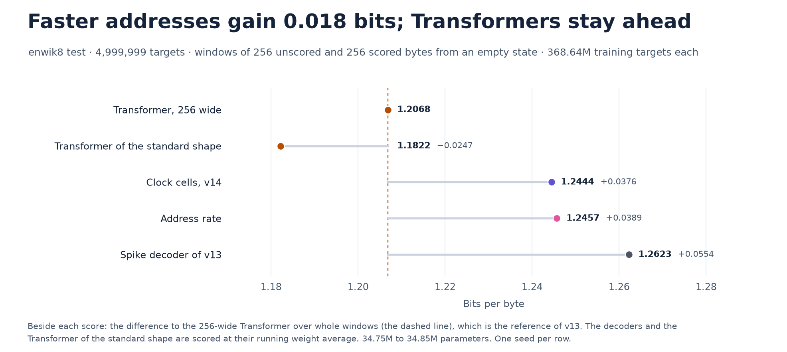

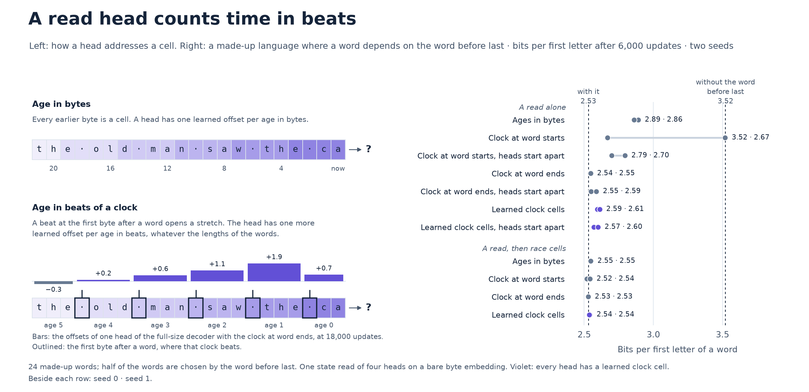

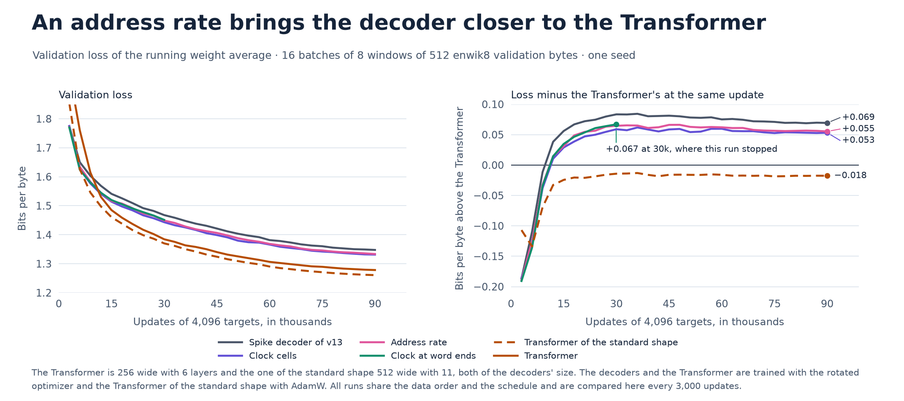

[Measurements, pilots and limits](READ_CLOCKS.md) · [Every training arm](READ_CLOCKS_ARMS.md)

This comparison is scored in windows as the one below it: every window starts from an empty state and holds 256 unscored bytes before its 256 scored ones. The two new decoders are the v13 decoder with an address rate of 8 for its read heads, and one of them has a clock cell for every head as well. They are 0.0013 bpb apart on enwik8, which is less than a second run moves a decoder, so the gain over v13 is the address rate's. Neither decoder has a stream form or a native pulse count, and both write text only by running a whole window for every byte.

The Transformer of the standard shape is 512 wide with 11 layers, 8 heads and an MLP of 4 times its width. It was trained for this study with AdamW and is scored at the running average of its weights. The 256-wide Transformer has 6 layers and an MLP of 42 times its width and is the reference of every earlier comparison. The six models received identical windows from random weights. Every row is one seed.

## State reads and race cells, trained from scratch · 368,640,000 training targets · seed 20001

| Model | Parameters | Optimizer | enwik8 | Rank | PG-19 calibrated | Rank | PG-19 raw |
|---|---:|---|---:|---:|---:|---:|---:|
| 34.82M SNN, spike reads and race cells | 34,819,544 | Rotated, averaged | 1.26226 | 3 | 1.55162 | 3 | 1.55162 |
| 34.65M SNN, spike reads | 34,648,600 | Rotated, averaged | 1.29908 | 4 | 1.57978 | 4 | 1.57978 |
| 34.65M hybrid, soft reads | 34,648,588 | AdamW | 1.31975 | 5 | — | — | — |
| 34.85M SNN, surprise clock and read heads | 34,845,184 | AdamW | 1.46686 | 6 | — | — | — |
| 34.85M SNN, surprise clock | 34,845,184 | AdamW | 1.59726 | 7 | — | — | — |
| 34.85M full attention | 34,845,696 | AdamW | 1.20684 | 2 | 1.48212 | 2 | 1.48212 |
| 34.85M full attention | 34,845,696 | Rotated, averaged | **1.20407** | 1 | **1.48204** | 1 | **1.48204** |

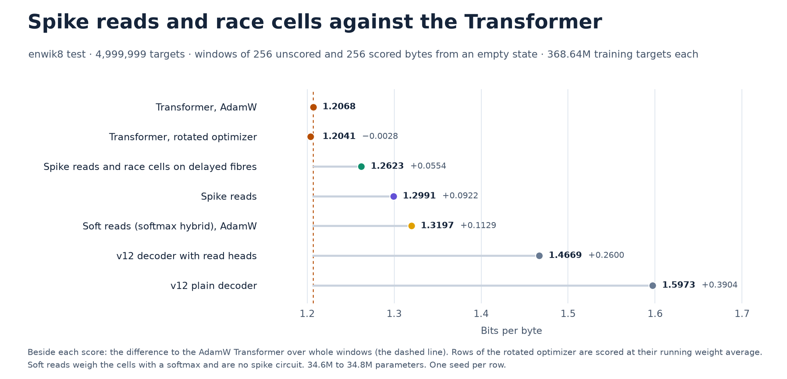

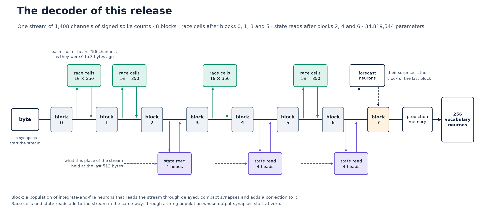

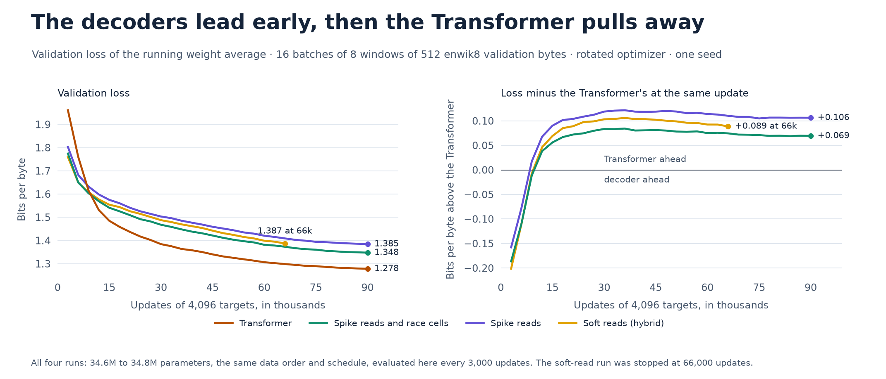

[Circuit, controls, probes and limits](STATE_READS.md) · [Every training arm](STATE_READS_ARMS.md)

This comparison is scored in windows, not in a stream. Every window starts from an empty state and holds 256 unscored bytes before its 256 scored ones, which is how full attention is scored in every comparison. The decoders with state reads and race cells run in windows only. They have no stream state and no native pulse count, so the table has neither column. The two v12 decoders are the checkpoints of the comparison below, where they carry their state through one stream and score 1.41375 and 1.61100 on enwik8.

The seven models received identical windows from random weights. Rows marked rotated were trained with the rotated optimizer and are scored at the running average of their weights. PG-19 was scored for four rows, and its ranks count those rows only. Every row is one seed.

## Coasting read heads, trained from scratch · 368,640,000 training targets · seed 20001

| Model | Parameters | State | enwik8 | Rank | PG-19 calibrated | Rank | PG-19 raw | Pulses/byte |
|---|---:|---:|---:|---:|---:|---:|---:|---:|
| 34.85M SNN, surprise clock | 34,845,184 | 43,796 B | 1.61100 | 4 | 1.72052 | 4 | 1.72052 | 311,540 |
| 34.85M SNN, surprise clock and fast synapses | 34,845,184 | 68,388 B | 1.48587 | 3 | 1.68629 | 3 | 1.68629 | 318,451 |
| 34.85M SNN, surprise clock and read heads | 34,845,184 | 179,028 B | 1.41375 | 2 | 1.64562 | 2 | 1.64562 | 309,469 |
| 34.85M full attention | 34,845,696 | 6 MiB | **1.20684** | 1 | **1.48212** | 1 | **1.48212** | — |

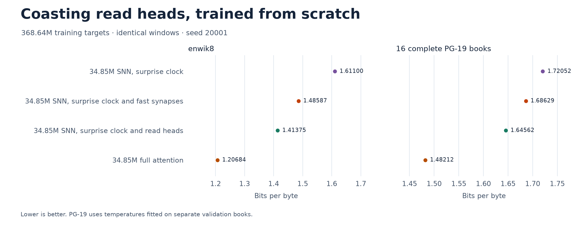

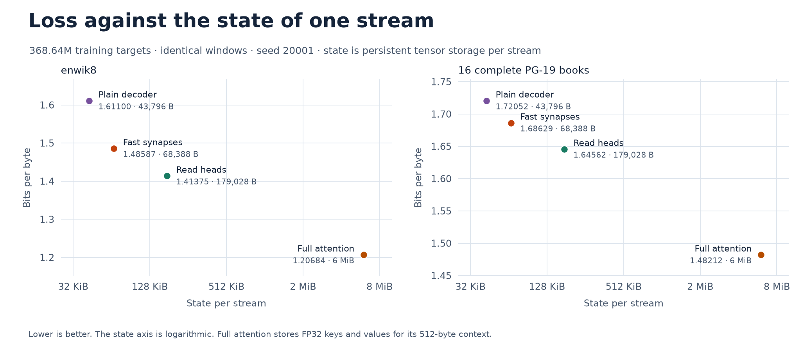

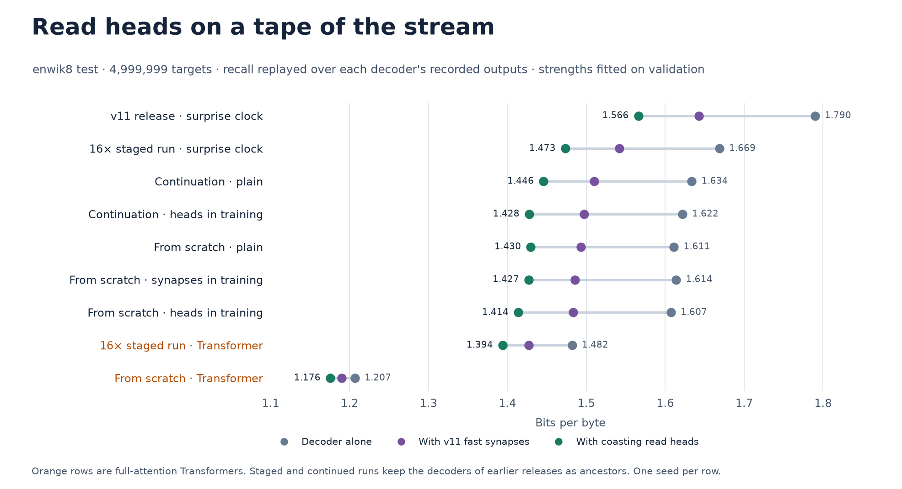

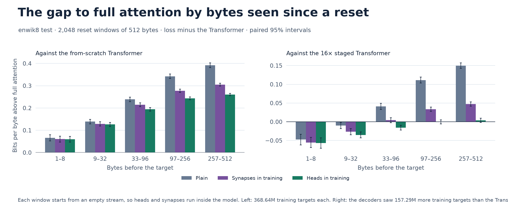

[Head circuit, controls and limits](COASTING_HEADS.md)

The four models received identical windows from random weights. The read heads and the fast synapses carry one stream of any length. Full attention reads 512 bytes. Each recall circuit uses the strengths its decoder was trained beside. They were fitted on enwik8 validation with the released v11 decoder, and no row trains on test text.

## Surprise clock and fast synapses · 140,902,400 training targets · seed 10007

| Model | Parameters | State | enwik8 | Rank | PG-19 calibrated | Rank | PG-19 raw | Pulses/byte |
|---|---:|---:|---:|---:|---:|---:|---:|---:|
| 25.79M SNN | 25,788,928 | 28,584 B | 1.78973 | 8 | 1.97852 | 8 | 1.97852 | 313,700 |
| 25.79M SNN with fast synapses | 25,788,928 | 53,432 B | 1.64541 | 2 | 1.93961 | 4 | 1.93961 | 321,971 |
| 34.85M SNN, every byte | 34,845,184 | 40,714 B | 1.78633 | 5 | 1.96913 | 6 | 1.96913 | 306,647 |
| 34.85M SNN, fixed stride | 34,845,184 | 43,796 B | 1.78761 | 6 | 1.96842 | 5 | 1.96842 | 312,966 |
| 34.85M SNN, surprise clock | 34,845,184 | 43,796 B | 1.78973 | 7 | 1.97528 | 7 | 1.97528 | 314,668 |
| 34.85M SNN, surprise clock and fast synapses | 34,845,184 | 68,388 B | **1.64278** | 1 | **1.93610** | 1 | **1.93610** | 314,852 |
| 25.79M full attention | 25,790,976 | 6 MiB | 1.70433 | 4 | 1.93711 | 3 | 1.93711 | — |
| 34.85M full attention | 34,845,696 | 6 MiB | 1.70426 | 3 | 1.93678 | 2 | 1.93678 | — |

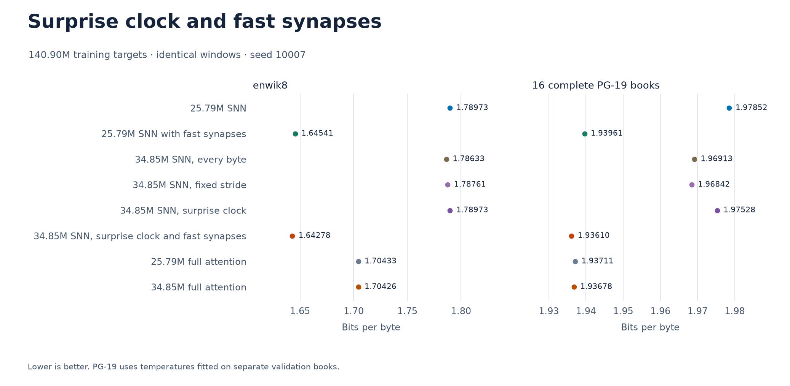

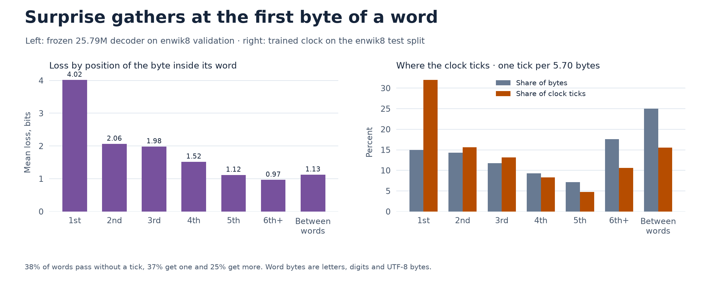

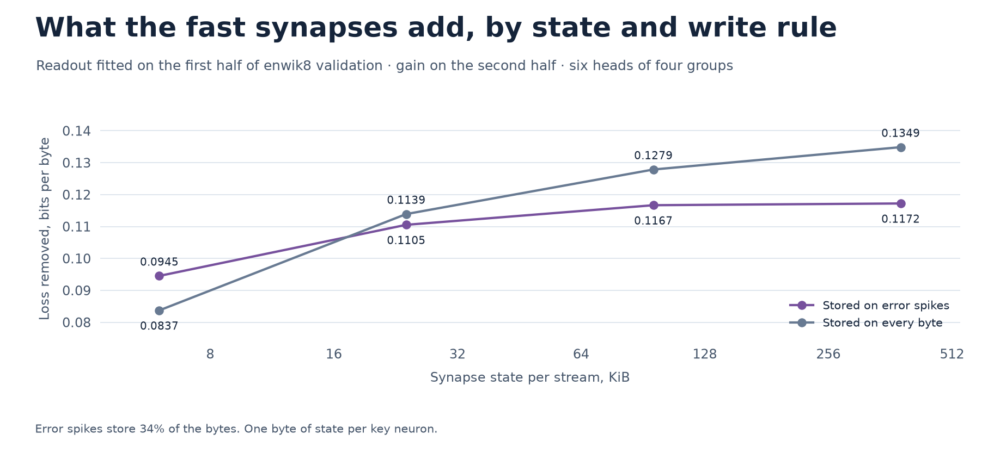

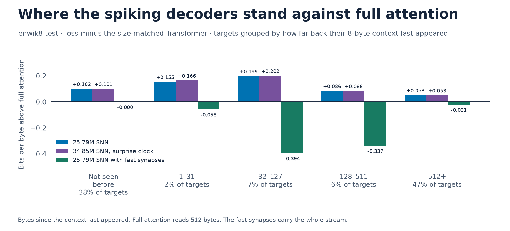

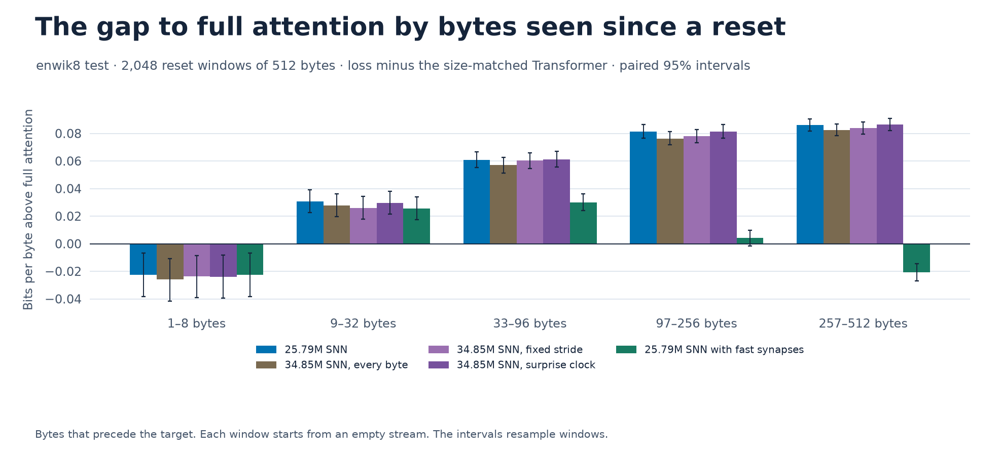

[Surprise measurements, circuits, controls and replay](SURPRISE_CLOCK.md)

Fast synapses carry one stream of any length. Full attention rows read 512 bytes. The synapse strengths are fitted on enwik8 validation and no row trains on test text.

### Byte transfer at the same training exposure

Raw corpus loss in bits per byte uses identical 512-byte windows.

| Model | WikiText-103 | C4 | enwik9 | text8 |
|---|---:|---:|---:|---:|
| 34.85M full attention | 2.28963 | 2.00954 | 1.67524 | 2.10989 |
| 25.79M full attention | 2.28971 | 2.00978 | 1.67531 | 2.10996 |
| 25.79M SNN | 2.30999 | 2.03742 | 1.77154 | 2.13618 |
| 34.85M SNN, every byte | 2.30601 | 2.03239 | 1.76726 | 2.13582 |
| 34.85M SNN, fixed stride | 2.30950 | 2.03350 | 1.76755 | 2.13497 |
| 34.85M SNN, surprise clock | 2.31033 | 2.03587 | 1.76867 | 2.13854 |
| 25.79M SNN with fast synapses | 2.21540 | 1.94965 | 1.69739 | 2.01978 |
| 34.85M SNN, surprise clock and fast synapses | 2.21538 | 1.94873 | 1.69564 | 2.02194 |

Wikipedia windows with zero hits under the training-overlap screen.

| Model | WikiText-103 | enwik9 | text8 |
|---|---:|---:|---:|
| 34.85M full attention | 2.28986 | 1.73887 | 2.11034 |
| 25.79M full attention | 2.28995 | 1.73894 | 2.11041 |
| 25.79M SNN | 2.31023 | 1.83336 | 2.13684 |
| 34.85M SNN, every byte | 2.30626 | 1.82944 | 2.13643 |
| 34.85M SNN, fixed stride | 2.30972 | 1.82958 | 2.13561 |
| 34.85M SNN, surprise clock | 2.31055 | 1.83077 | 2.13915 |
| 25.79M SNN with fast synapses | 2.21558 | 1.75790 | 2.02020 |
| 34.85M SNN, surprise clock and fast synapses | 2.21555 | 1.75661 | 2.02226 |

LAMBADA scores the same final words under both conditioning lengths. Exact match requires a word boundary. The gold-length columns score predictions through the last answer byte.

| Model | Passage bpb | Last sentence bpb | Passage exact | Last sentence exact | Passage at gold length | Last sentence at gold length |
|---|---:|---:|---:|---:|---:|---:|
| 34.85M full attention | 3.30493 | 3.37476 | 0.02% | 0.00% | 0.02% | 0.00% |
| 25.79M full attention | 3.30510 | 3.37480 | 0.02% | 0.00% | 0.02% | 0.00% |
| 25.79M SNN | 3.44139 | 3.44977 | 0.00% | 0.00% | 0.00% | 0.00% |
| 34.85M SNN, every byte | 3.44382 | 3.45402 | 0.00% | 0.00% | 0.00% | 0.00% |
| 34.85M SNN, fixed stride | 3.43027 | 3.44224 | 0.00% | 0.00% | 0.00% | 0.00% |
| 34.85M SNN, surprise clock | 3.43838 | 3.45019 | 0.00% | 0.00% | 0.00% | 0.00% |
| 25.79M SNN with fast synapses | 2.62609 | 3.38565 | 3.38% | 0.37% | 3.71% | 0.39% |
| 34.85M SNN, surprise clock and fast synapses | 2.62199 | 3.38665 | 3.32% | 0.41% | 3.51% | 0.43% |

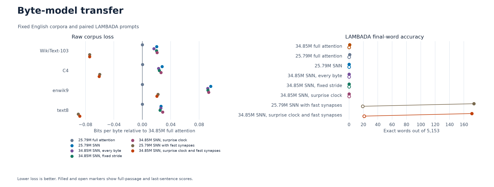

[Protocol, provenance, and overlap counts](BYTE_TRANSFER.md) · [Exact score records](../results/event_lm/byte_transfer/surprise_clock_140902k.json)

## Residual width on expanded training data · 131,072,000 training targets · seed 9631

| Model | Parameters | State | enwik8 | Rank | PG-19 calibrated | Rank | PG-19 raw | Pulses/byte |
|---|---:|---:|---:|---:|---:|---:|---:|---:|
| 14.07M SNN | 14,066,688 | 28,584 B | 1.79789 | 5 | 2.04156 | 4 | 2.04156 | 312,618 |
| 25.79M SNN | 25,788,928 | 28,584 B | 1.79787 | 4 | 2.02699 | 3 | 2.02699 | 313,142 |
| 25.79M SNN, enwik8 only | 25,788,928 | 28,584 B | 1.78054 | 3 | 2.73942 | 5 | 2.83176 | 309,020 |
| 14.07M full attention | 14,068,224 | 6 MiB | 1.71414 | 2 | 1.98073 | 2 | 1.98073 | — |
| 25.79M full attention | 25,790,976 | 6 MiB | **1.71379** | 1 | **1.97644** | 1 | **1.97644** | — |

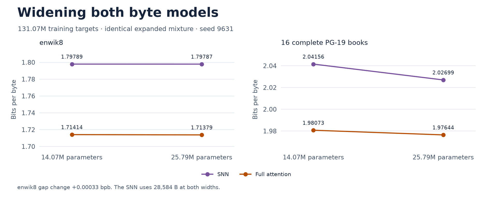

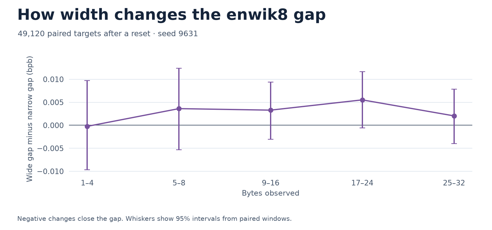

[Width experiment, corpus preparation and replay](RESIDUAL_SCALE.md)

The enwik8 SNN minus Transformer gap is +0.08375 bpb at 14.07M and +0.08408 bpb at 25.79M. The change is +0.00033 bpb.

The enwik8-only control uses the same number of targets and the wide SNN geometry. The other four arms received identical windows from the new mixture.

### Byte transfer at the same training exposure

Raw corpus loss in bits per byte uses identical 512-byte windows.

| Model | WikiText-103 | C4 | enwik9 | text8 |
|---|---:|---:|---:|---:|
| 25.79M full attention | 2.29074 | 2.03541 | 1.68575 | 2.12108 |
| 14.07M full attention | 2.28977 | 2.03688 | 1.68597 | 2.12029 |
| 14.07M SNN | 2.31564 | 2.07191 | 1.77591 | 2.14140 |
| 25.79M SNN | 2.31560 | 2.06397 | 1.77908 | 2.14096 |
| 25.79M SNN, enwik8 only | 2.33948 | 2.20845 | 1.75987 | 2.13790 |

Wikipedia windows with zero hits under the training-overlap screen.

| Model | WikiText-103 | enwik9 | text8 |
|---|---:|---:|---:|
| 25.79M full attention | 2.29097 | 1.74967 | 2.12155 |
| 14.07M full attention | 2.29001 | 1.74991 | 2.12076 |
| 14.07M SNN | 2.31585 | 1.83836 | 2.14203 |
| 25.79M SNN | 2.31582 | 1.84141 | 2.14155 |
| 25.79M SNN, enwik8 only | 2.33972 | 1.82446 | 2.13848 |

LAMBADA scores the same final words under both conditioning lengths. Exact match requires a word boundary. The gold-length columns score predictions through the last answer byte.

| Model | Passage bpb | Last sentence bpb | Passage exact | Last sentence exact | Passage at gold length | Last sentence at gold length |
|---|---:|---:|---:|---:|---:|---:|
| 25.79M full attention | 3.31987 | 3.37001 | 0.02% | 0.02% | 0.02% | 0.02% |
| 14.07M full attention | 3.31851 | 3.36985 | 0.02% | 0.02% | 0.02% | 0.02% |
| 14.07M SNN | 3.43877 | 3.44861 | 0.00% | 0.00% | 0.00% | 0.00% |
| 25.79M SNN | 3.42301 | 3.43326 | 0.00% | 0.00% | 0.00% | 0.00% |
| 25.79M SNN, enwik8 only | 3.52373 | 3.53761 | 0.00% | 0.00% | 0.00% | 0.00% |

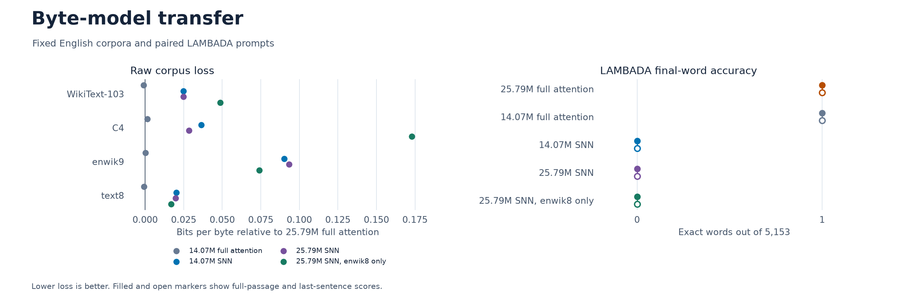

[Protocol, provenance, and overlap counts](BYTE_TRANSFER.md) · [Exact score records](../results/event_lm/byte_transfer/residual_scale_131072k.json)

## Scheduled spike arrivals · 121,241,600 training targets · seed 9349

| Model | Parameters | State | enwik8 | Rank | PG-19 calibrated | Rank | PG-19 raw | Pulses/byte |
|---|---:|---:|---:|---:|---:|---:|---:|---:|
| Ordinary SNN | 12,799,488 | 28,584 B | 1.79102 | 2 | 2.75679 | 2 | 2.84618 | 309,983 |
| Selected arrivals | 14,066,688 | 28,584 B | 1.79114 | 3 | **2.75550** | 1 | **2.84606** | 308,644 |
| Unmatched arrivals | 14,066,688 | 28,584 B | 1.79163 | 4 | 2.76087 | 3 | 2.85319 | 310,042 |
| Full attention | 14,068,224 | 6 MiB | **1.70963** | 1 | 2.88426 | 4 | 3.08064 | — |

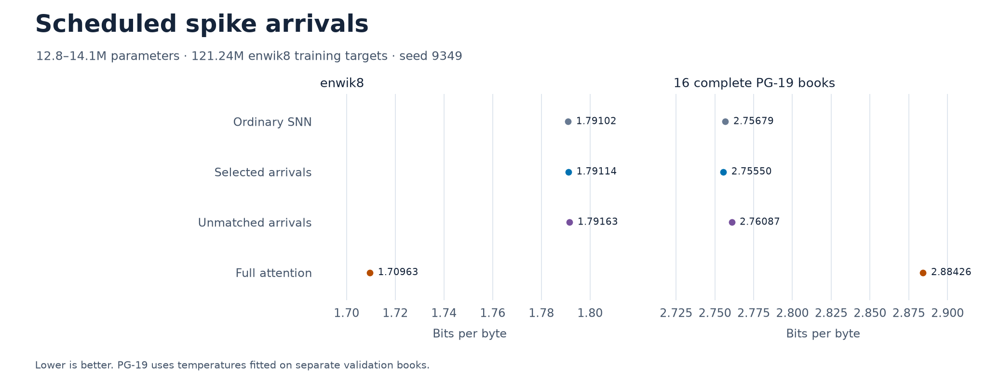

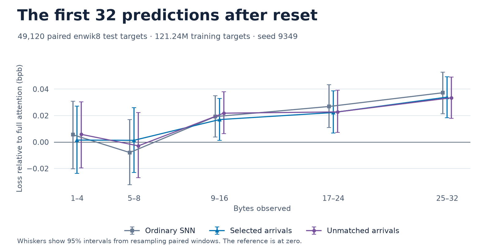

[Arrival circuit, ablations and replay](FIXED_ARRIVALS.md)

### Byte transfer at the same training exposure

Raw corpus loss in bits per byte uses identical 512-byte windows.

| Model | WikiText-103 | C4 | enwik9 | text8 |
|---|---:|---:|---:|---:|
| Full attention | 2.33027 | 2.17533 | 1.68158 | 2.15081 |
| Ordinary SNN | 2.34669 | 2.21600 | 1.76809 | 2.14090 |
| Selected arrivals | 2.34061 | 2.21631 | 1.76730 | 2.14122 |
| Unmatched arrivals | 2.34510 | 2.21464 | 1.76823 | 2.13885 |

Wikipedia windows with zero hits under the training-overlap screen.

| Model | WikiText-103 | enwik9 | text8 |
|---|---:|---:|---:|
| Full attention | 2.33054 | 1.74645 | 2.15132 |
| Ordinary SNN | 2.34695 | 1.83274 | 2.14155 |
| Selected arrivals | 2.34086 | 1.83168 | 2.14188 |
| Unmatched arrivals | 2.34536 | 1.83257 | 2.13948 |

LAMBADA scores the same final words under both conditioning lengths. Exact match requires a word boundary. The gold-length columns score predictions through the last answer byte.

| Model | Passage bpb | Last sentence bpb | Passage exact | Last sentence exact | Passage at gold length | Last sentence at gold length |
|---|---:|---:|---:|---:|---:|---:|
| Full attention | 3.39187 | 3.44267 | 0.02% | 0.00% | 0.02% | 0.00% |
| Ordinary SNN | 3.53325 | 3.55381 | 0.00% | 0.00% | 0.00% | 0.00% |
| Selected arrivals | 3.53435 | 3.55570 | 0.00% | 0.00% | 0.00% | 0.00% |
| Unmatched arrivals | 3.52955 | 3.54842 | 0.00% | 0.00% | 0.00% | 0.00% |

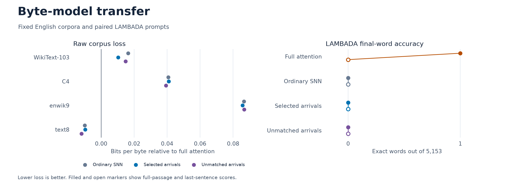

[Protocol, provenance, and overlap counts](BYTE_TRANSFER.md) · [Exact score records](../results/event_lm/byte_transfer/trace_arrival_s9349.json)

## Driven held-charge reads · 116,326,400 training targets · seed 8237

| Model | Parameters | State | enwik8 | Rank | PG-19 calibrated | Rank | PG-19 raw | Pulses/byte |
|---|---:|---:|---:|---:|---:|---:|---:|---:|
| Original held-charge read | 12,799,488 | 28,584 B | 1.79577 | 9 | 2.75495 | 3 | 2.84136 | 309,354 |
| Write input, six-bit reset | 12,802,161 | 28,584 B | 1.79582 | 10 | 2.75706 | 6 | 2.84654 | 309,554 |
| Present input, six-bit reset | 12,802,161 | 28,584 B | 1.79466 | 4 | 2.75747 | 8 | 2.84860 | 308,018 |
| Write input, eight-bit reset | 12,802,161 | 28,584 B | 1.79449 | 2 | **2.75314** | 1 | 2.84192 | 309,399 |
| Write input, eight-bit carry | 12,802,161 | 31,257 B | 1.79533 | 6 | 2.75724 | 7 | 2.84850 | 309,331 |
| Present input, eight-bit carry | 12,802,161 | 31,257 B | 1.79525 | 5 | 2.75638 | 5 | 2.84361 | 309,031 |
| Write input, shared steering | 12,802,161 | 31,257 B | 1.79561 | 7 | 2.76102 | 9 | 2.85001 | 309,010 |
| Two write rails, shared steering | 12,804,834 | 31,257 B | 1.79464 | 3 | 2.75590 | 4 | 2.84506 | 308,742 |
| Present input, shared steering | 12,802,161 | 31,257 B | 1.79572 | 8 | 2.75322 | 2 | **2.84069** | 309,261 |
| Full attention | 12,801,024 | 6 MiB | **1.71363** | 1 | 2.88478 | 10 | 3.08081 | — |

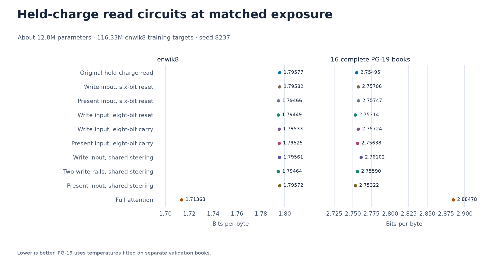

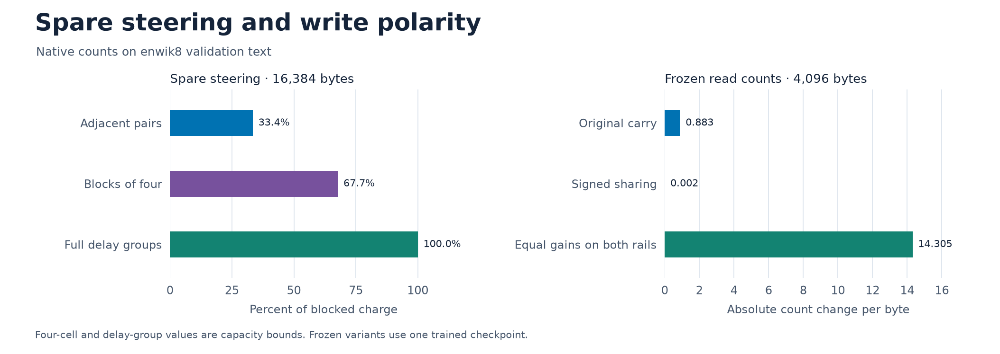

[Circuit, native activity, and matched controls](TRACE_READ_DRIVE.md)

## Packed width and steering transfers · 111,411,200 training targets · seed 7907

| Model | Parameters | State | enwik8 | Rank | PG-19 calibrated | Rank | PG-19 raw | Pulses/byte |
|---|---:|---:|---:|---:|---:|---:|---:|---:|
| 187-channel SNN | 9,960,960 | 29,674 B | 1.80153 | 4 | 2.77445 | 5 | 2.86922 | 309,773 |
| 243-channel SNN | 12,799,488 | 32,616 B | 1.80080 | 3 | 2.76563 | 3 | 2.85588 | 308,415 |
| Original full attention | 9,962,496 | 6 MiB | 1.71789 | 2 | 2.88474 | 6 | 3.08009 | — |
| Wider full attention | 12,801,024 | 6 MiB | **1.71786** | 1 | 2.88475 | 7 | 3.08010 | — |
| Delayed steering transfers | 12,879,678 | 32,616 B | 1.80187 | 5 | 2.76241 | 2 | 2.85741 | 308,085 |
| Growth in shortest groups | 12,799,488 | 28,584 B | 1.80256 | 6 | **2.76153** | 1 | **2.85249** | 309,698 |
| Present steering transfers | 12,879,678 | 32,616 B | 1.80400 | 7 | 2.77171 | 4 | 2.86885 | 310,478 |

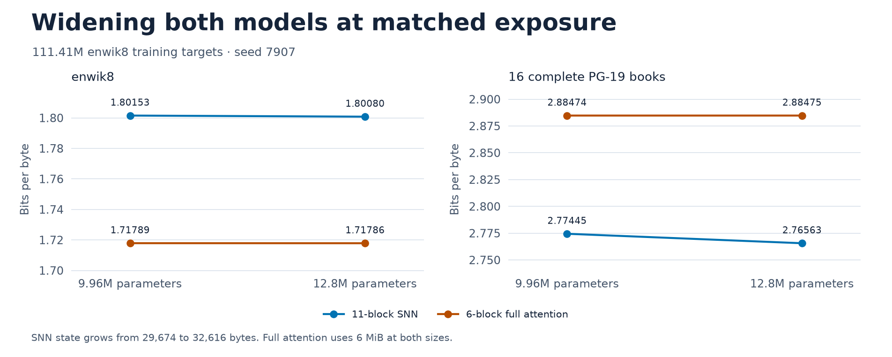

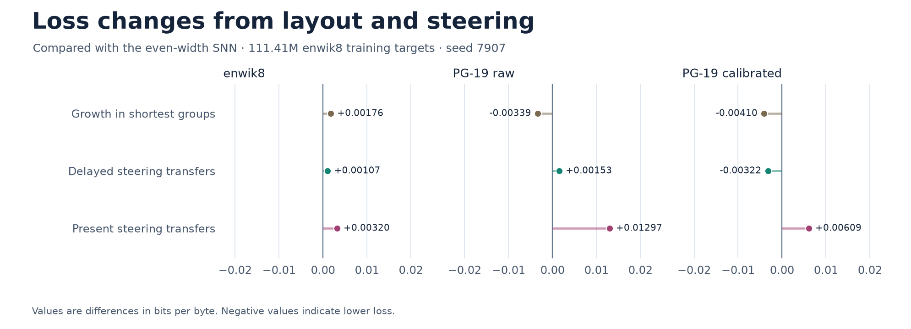

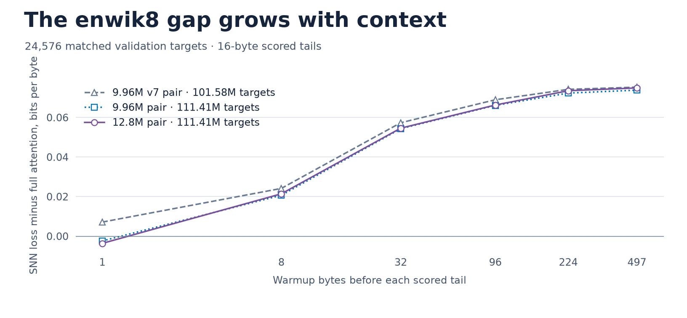

[Width, state budget, and steering circuit](PACKED_WIDTH.md)

## 9.96M axon tap reads · 101,580,800 training targets · seed 6899

| Model | Parameters | State | enwik8 | Rank | PG-19 calibrated | Rank | PG-19 raw | Pulses/byte |
|---|---:|---:|---:|---:|---:|---:|---:|---:|
| Continued SNN | 9,960,960 | 29,674 B | 1.81319 | 2 | **2.77756** | 1 | **2.87524** | 309,354 |
| Shortest eligible tap | 9,962,312 | 29,674 B | 1.81655 | 4 | 2.78455 | 2 | 2.88665 | 308,210 |
| Held spike race | 9,962,312 | 29,674 B | 1.81473 | 3 | 2.78521 | 3 | 2.88687 | 309,582 |
| 6-block full attention | 9,962,496 | 6 MiB | **1.73380** | 1 | 2.89702 | 4 | 3.09548 | — |

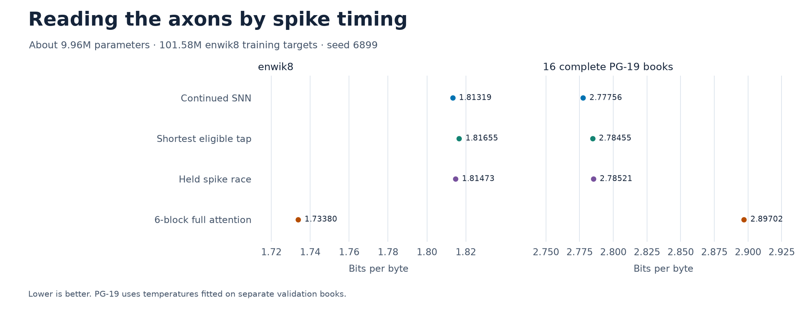

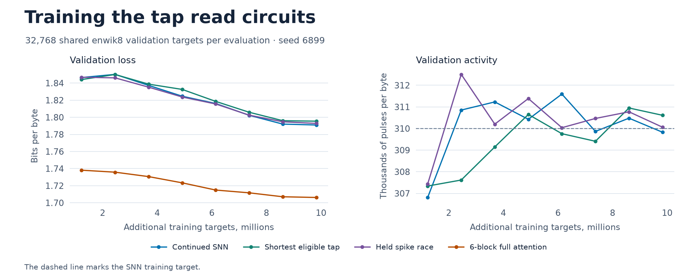

[Timing circuit and interventions](TRACE_TAP_READ.md)

## 9.96M trace inputs and group thresholds · 91,750,400 training targets · seed 5801

| Model | Parameters | State | enwik8 | Rank | PG-19 calibrated | Rank | PG-19 raw | Pulses/byte |
|---|---:|---:|---:|---:|---:|---:|---:|---:|
| Continued v6 SNN | 9,960,960 | 29,674 B | 1.82999 | 5 | **2.78446** | 1 | **2.88327** | 307,913 |
| Learned trace input spikes | 9,965,074 | 29,674 B | 1.82956 | 4 | 2.78972 | 3 | 2.89110 | 309,390 |
| Coarse group thresholds | 9,961,004 | 29,674 B | 1.82918 | 2 | 2.78697 | 2 | 2.88461 | 308,616 |
| One-tick group thresholds | 9,961,004 | 29,674 B | 1.82929 | 3 | 2.79350 | 4 | 2.89740 | 308,741 |
| 6-block full attention | 9,962,496 | 6 MiB | **1.74475** | 1 | 2.90840 | 5 | 3.10229 | — |

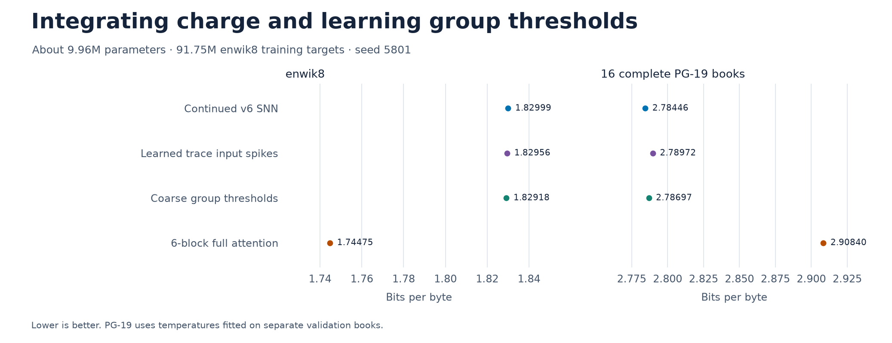

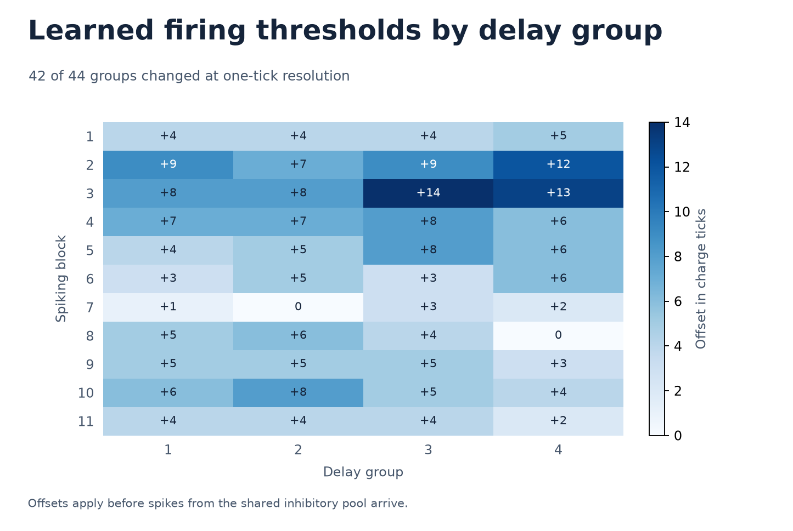

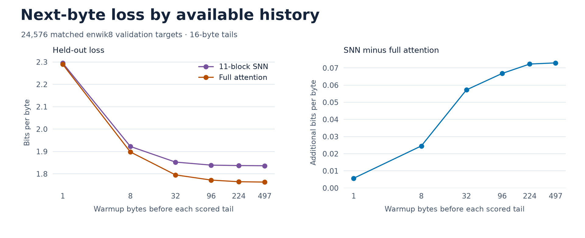

[Circuit and interventions](TRACE_INTEGRATION.md)

## 9.96M depth and width growth · 81,920,000 training targets · seed 4603

| Model | Parameters | State | enwik8 | Rank | PG-19 calibrated | Rank | PG-19 raw | Pulses/byte |
|---|---:|---:|---:|---:|---:|---:|---:|---:|
| 11-block SNN | 9,960,960 | 29,674 B | 1.84288 | 2 | **2.79854** | 1 | **2.90068** | 309,059 |
| 7-block wider SNN | 9,957,868 | 19,536 B | 1.84496 | 3 | 2.80299 | 2 | 2.90845 | 307,543 |
| 6-block full attention | 9,962,496 | 6 MiB | **1.75713** | 1 | 2.93008 | 3 | 3.12422 | — |

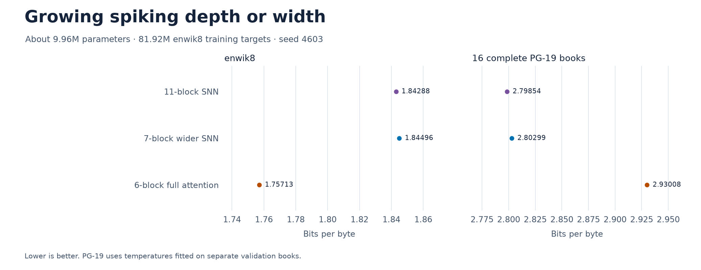

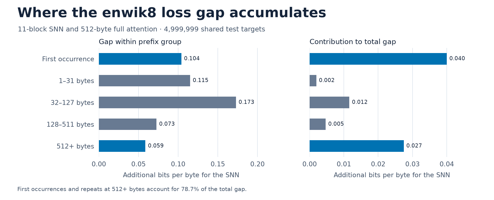

## 6.51M signed residual output · 81,920,000 training targets · seed 4603

| Model | Parameters | State | enwik8 | Rank | PG-19 calibrated | Rank | PG-19 raw | Pulses/byte |
|---|---:|---:|---:|---:|---:|---:|---:|---:|
| 7-block SNN, ordinary output | 6,514,176 | 19,536 B | 1.84466 | 3 | **2.80932** | 1 | **2.91443** | 309,030 |
| 7-block SNN, correction output | 6,514,176 | 19,536 B | 1.84464 | 2 | 2.86794 | 2 | 2.99541 | 305,045 |
| 4-block full attention | 6,513,152 | 4 MiB | **1.75773** | 1 | 2.93346 | 3 | 3.12986 | — |

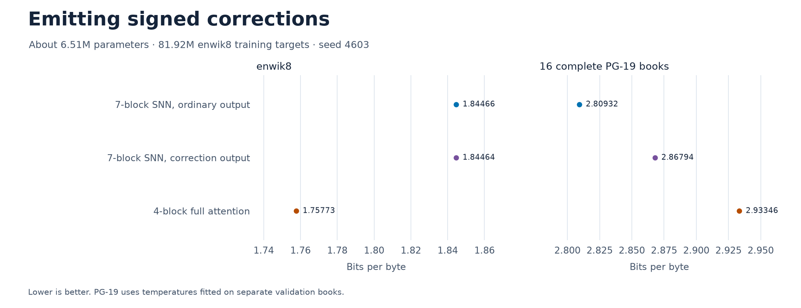

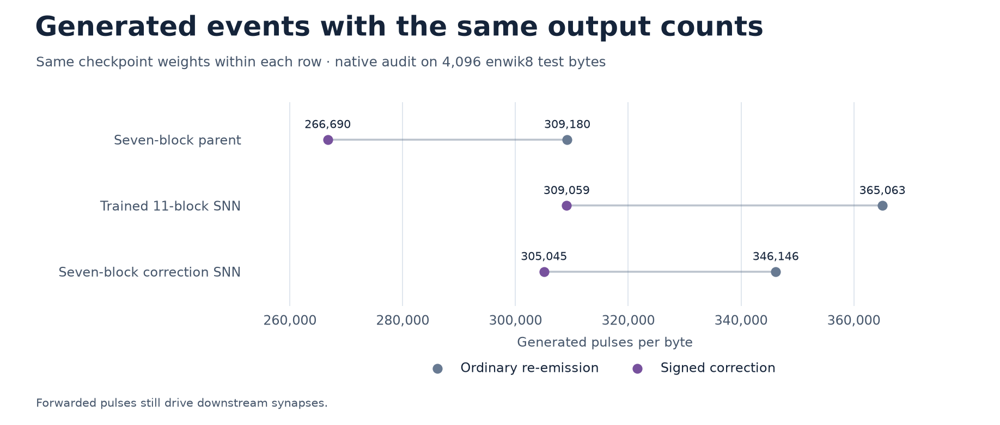

## 13.03M residual growth and original-width controls · 72,089,600 training targets · seed 3307

| Model | Parameters | State | enwik8 | Rank | PG-19 calibrated | Rank | PG-19 raw | Pulses/byte |
|---|---:|---:|---:|---:|---:|---:|---:|---:|
| Wider residual SNN | 13,028,352 | 19,536 B | 1.87451 | 4 | **2.79672** | 1 | **2.88959** | 308,111 |
| Wider full-attention Transformer | 13,028,864 | 4 MiB | **1.77285** | 1 | 2.95990 | 3 | 3.16073 | — |
| Original-width held-charge SNN | 6,514,176 | 19,536 B | 1.87259 | 3 | 2.81227 | 2 | 2.90738 | 309,048 |
| Original-width full-attention Transformer | 6,513,152 | 4 MiB | 1.77292 | 2 | 2.95995 | 4 | 3.16079 | — |

## 6.51M spike circuit and charge comparisons · 72,089,600 training targets · seed 3307

| Model | Parameters | State | enwik8 | Rank | PG-19 calibrated | Rank | PG-19 raw | Pulses/byte |
|---|---:|---:|---:|---:|---:|---:|---:|---:|
| Original-width held-charge SNN | 6,514,176 | 19,536 B | 1.87259 | 4 | **2.81227** | 1 | **2.90738** | 309,048 |
| Eight-bit router charge | 6,514,176 | 19,536 B | 1.86770 | 2 | 2.82082 | 5 | 2.92020 | 309,180 |
| Tag read competition, zero start | 6,514,180 | 19,536 B | 1.87077 | 3 | 2.81844 | 3 | 2.91860 | 309,523 |
| Tag read competition, active start | 6,514,180 | 19,536 B | 1.87409 | 6 | 2.81635 | 2 | 2.91291 | 309,599 |
| Tag reads with forecast-error ranking | 6,514,180 | 19,536 B | 1.87620 | 7 | 2.83214 | 6 | 2.93471 | 309,582 |
| Late steering | 6,514,204 | 19,536 B | 1.87323 | 5 | 2.82081 | 4 | 2.92053 | 308,536 |
| Original-width full-attention Transformer | 6,513,152 | 4 MiB | **1.77292** | 1 | 2.95995 | 7 | 3.16079 | — |

## 6.51M at 65.54M observed targets · 65,536,000 training targets · seed 2503

| Model | Parameters | State | enwik8 | Rank | PG-19 calibrated | Rank | PG-19 raw | Pulses/byte |
|---|---:|---:|---:|---:|---:|---:|---:|---:|
| Six-bit grown SNN | 6,514,176 | 19,536 B | 1.86525 | 2 | **2.81231** | 1 | **2.90664** | 308,230 |
| Grown full-attention Transformer | 6,513,152 | 4 MiB | **1.77728** | 1 | 2.98071 | 2 | 3.18604 | — |

## 8.74M expansion and original-width control · 55,705,600 training targets · seed 1801

| Model | Parameters | State | enwik8 | Rank | PG-19 calibrated | Rank | PG-19 raw | Pulses/byte |
|---|---:|---:|---:|---:|---:|---:|---:|---:|
| Expanded held-charge SNN | 8,739,840 | 26,080 B | 1.88812 | 2 | 2.83753 | 2 | 2.94075 | 309,457 |
| Expanded SNN with active steering | 8,739,840 | 26,080 B | 1.89312 | 4 | **2.82986** | 1 | **2.92630** | 308,645 |
| Grown full-attention Transformer | 8,740,352 | 4 MiB | **1.79731** | 1 | 3.01533 | 4 | 3.22392 | — |
| Original-width held-charge SNN | 6,514,176 | 19,536 B | 1.89057 | 3 | 2.84072 | 3 | 2.94263 | 309,545 |

## 6.52M redistribution of inhibition · 55,705,600 training targets · seed 1801

| Model | Parameters | State | enwik8 | Rank | PG-19 calibrated | Rank | PG-19 raw | Pulses/byte |
|---|---:|---:|---:|---:|---:|---:|---:|---:|
| Original-width held-charge SNN | 6,514,176 | 19,536 B | 1.89057 | 2 | 2.84072 | 2 | 2.94263 | 309,545 |
| Redistribution of inhibition | 6,524,928 | 19,536 B | **1.88938** | 1 | **2.83881** | 1 | **2.94020** | 308,919 |

## 6.51M frozen teacher guidance and unguided control · 55,705,600 training targets · seed 1801

| Model | Parameters | State | enwik8 | Rank | PG-19 calibrated | Rank | PG-19 raw | Pulses/byte |
|---|---:|---:|---:|---:|---:|---:|---:|---:|
| Original-width held-charge SNN | 6,514,176 | 19,536 B | **1.89057** | 1 | **2.84072** | 1 | **2.94263** | 309,545 |
| Held-charge SNN with frozen teacher | 6,514,176 | 19,536 B | 1.89537 | 2 | 2.84787 | 2 | 2.96148 | 308,918 |

## 6.51M delayed write confirmation · 55,705,600 training targets · seed 1801

| Model | Parameters | State | enwik8 | Rank | PG-19 calibrated | Rank | PG-19 raw | Pulses/byte |
|---|---:|---:|---:|---:|---:|---:|---:|---:|
| Original-width held-charge SNN | 6,514,176 | 19,536 B | **1.89057** | 1 | 2.84072 | 2 | 2.94263 | 309,545 |
| Delayed write confirmation | 6,514,204 | 19,536 B | 1.89069 | 2 | **2.83683** | 1 | **2.93664** | 309,026 |

## 6.51M with more training data · 49,152,000 training targets · seed 1109

| Model | Parameters | State | enwik8 | Rank | PG-19 calibrated | Rank | PG-19 raw | Pulses/byte |
|---|---:|---:|---:|---:|---:|---:|---:|---:|
| Six-bit grown SNN | 6,514,176 | 19,536 B | 1.89440 | 2 | **2.82683** | 1 | **2.91901** | 309,688 |
| Grown full-attention Transformer | 6,513,152 | 4 MiB | **1.80629** | 1 | 3.03772 | 2 | 3.24647 | — |

## 6.51M growth · 512-byte continuations · 32,768,000 training targets · seed 711

| Model | Parameters | State | enwik8 | Rank | PG-19 calibrated | Rank | PG-19 raw | Pulses/byte |
|---|---:|---:|---:|---:|---:|---:|---:|---:|
| Grown SNN, finer charge | 6,514,176 | 19,536 B | 1.95110 | 2 | **2.85083** | 1 | **2.93341** | 309,505 |
| Grown SNN, six-bit charge | 6,514,176 | 19,536 B | 1.95646 | 3 | 2.86904 | 2 | 2.95290 | 306,923 |
| Grown full-attention Transformer | 6,513,152 | 4 MiB | **1.84266** | 1 | 3.06318 | 3 | 3.26549 | — |

## 6.51M trace coincidence · 32,768,000 training targets · seed 711

| Model | Parameters | State | enwik8 | Rank | PG-19 calibrated | Rank | PG-19 raw | Pulses/byte |
|---|---:|---:|---:|---:|---:|---:|---:|---:|
| Grown SNN, six-bit charge | 6,514,176 | 19,536 B | 1.95646 | 2 | **2.86904** | 1 | **2.95290** | 306,923 |
| Three-way coincidence | 6,514,176 | 19,536 B | 1.95911 | 3 | 2.87132 | 2 | 2.95721 | 307,297 |
| Grown full-attention Transformer | 6,513,152 | 4 MiB | **1.84266** | 1 | 3.06318 | 3 | 3.26549 | — |

## 3.26M · 512-byte continuations · 32,768,000 training targets · seed 711

| Model | Parameters | State | enwik8 | Rank | PG-19 calibrated | Rank | PG-19 raw | Pulses/byte |
|---|---:|---:|---:|---:|---:|---:|---:|---:|
| Held charge | 3,257,088 | 31,692 B | 1.96430 | 2 | **2.88668** | 1 | **2.98308** | 308,067 |
| Signed residual membrane | 3,257,088 | 22,224 B | 1.96628 | 3 | 2.89838 | 2 | 2.99574 | 309,629 |
| Four address phases | 3,257,088 | 25,584 B | 1.99725 | 4 | 2.90730 | 3 | 2.99722 | 311,699 |
| Four phases, corrected forecast loss | 3,257,088 | 25,584 B | 2.00335 | 5 | 2.90802 | 4 | 2.99318 | 310,105 |
| Full-attention Transformer | 3,256,832 | 4 MiB | **1.84280** | 1 | 3.06325 | 5 | 3.26568 | — |

## 3.26M · 2,048-byte continuations · 32,768,000 training targets · seed 711

| Model | Parameters | State | enwik8 | Rank | PG-19 calibrated | Rank | PG-19 raw | Pulses/byte |
|---|---:|---:|---:|---:|---:|---:|---:|---:|
| Held charge | 3,257,088 | 31,692 B | 1.97126 | 2 | **2.87693** | 1 | **2.96339** | 306,441 |
| Full-attention Transformer | 3,256,832 | 16 MiB | **1.85459** | 1 | 3.05282 | 2 | 3.24905 | — |

## 6.51M trained from scratch · 26,214,400 training targets · seed 0

| Model | Parameters | State | enwik8 | Rank | PG-19 calibrated | Rank | PG-19 raw | Pulses/byte |
|---|---:|---:|---:|---:|---:|---:|---:|---:|
| Wide held-charge SNN | 6,514,176 | 19,536 B | 2.06640 | 2 | **2.98527** | 1 | **3.09220** | 313,057 |
| Full-attention Transformer | 6,514,944 | 6 MiB | **2.03855** | 1 | 3.28561 | 2 | 3.57094 | — |

## 512-byte continuations · 32,768,000 training targets · seed 711

| Model | Parameters | State | enwik8 | Rank | PG-19 calibrated | Rank | PG-19 raw | Pulses/byte |
|---|---:|---:|---:|---:|---:|---:|---:|---:|
| Held-charge control | 1,630,992 | 21,320 B | 1.98564 | 4 | 2.98490 | 3 | 3.10338 | 307,730 |
| Opponent steering | 1,631,917 | 21,320 B | 1.98533 | 3 | **2.97309** | 1 | **3.09454** | 308,471 |
| Chronological write credit | 1,630,992 | 21,320 B | 1.98691 | 6 | 2.99097 | 5 | 3.10893 | 307,270 |
| Trace read veto | 1,631,012 | 21,320 B | 1.98405 | 2 | 2.98763 | 4 | 3.11449 | 307,412 |
| Spread coincidence | 1,631,012 | 21,320 B | 1.98644 | 5 | 2.98129 | 2 | 3.10337 | 306,624 |
| Full-attention Transformer | 1,630,848 | 3 MiB | **1.79625** | 1 | 3.11887 | 6 | 3.35801 | — |

## 2,048-byte continuations · 32,768,000 training targets · seed 711

| Model | Parameters | State | enwik8 | Rank | PG-19 calibrated | Rank | PG-19 raw | Pulses/byte |
|---|---:|---:|---:|---:|---:|---:|---:|---:|
| Held charge with write credit | 1,630,992 | 21,320 B | 1.98884 | 2 | **2.96180** | 1 | **3.07240** | 304,447 |
| Full-attention Transformer | 1,630,848 | 12 MiB | **1.81712** | 1 | 3.11395 | 2 | 3.33558 | — |

## 3.26M parameter comparison · 26,214,400 training targets · seed 0

| Model | Parameters | State | enwik8 | Rank | PG-19 calibrated | Rank | PG-19 raw | Pulses/byte |
|---|---:|---:|---:|---:|---:|---:|---:|---:|
| Seven-block held charge | 3,257,088 | 31,692 B | 1.99402 | 2 | **2.89822** | 1 | **2.98142** | 308,389 |
| Full-attention Transformer | 3,256,832 | 4 MiB | **1.86093** | 1 | 3.05929 | 2 | 3.25745 | — |

## Held-charge replication · 26,214,400 training targets per seed · seeds 0–2

| Model | Parameters | State | enwik8 | Rank | PG-19 calibrated | Rank | PG-19 raw | Pulses/byte |
|---|---:|---:|---:|---:|---:|---:|---:|---:|
| Held-charge SNN | 1,630,992 | 21,320 B | 2.00633 | 2 | **2.98979** | 1 | **3.10037** | 307,013 |
| Full-attention Transformer | 1,630,848 | 3 MiB | **1.82812** | 1 | 3.09559 | 2 | 3.29465 | — |

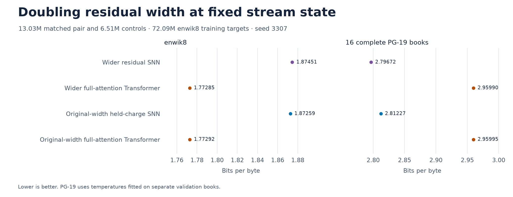

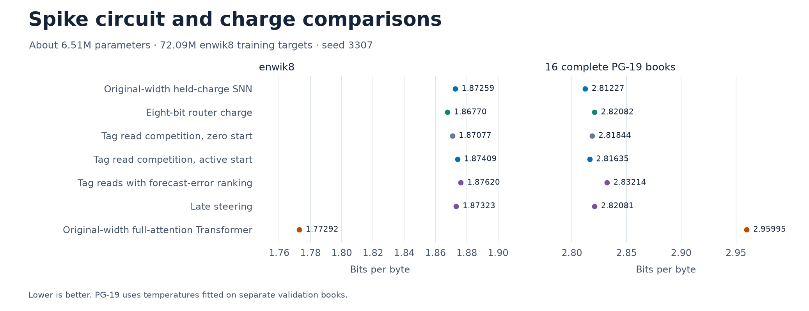

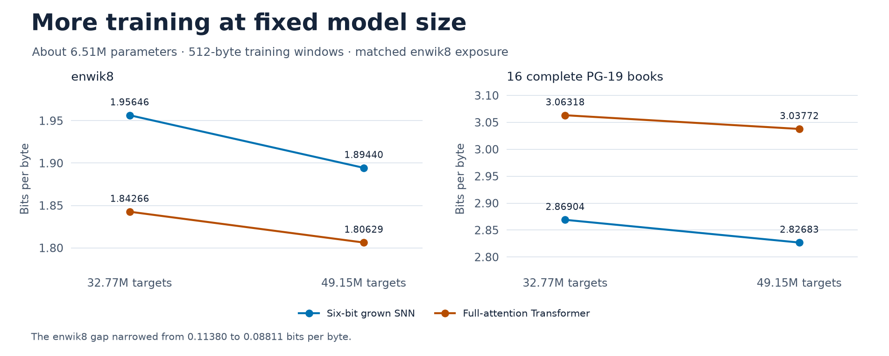

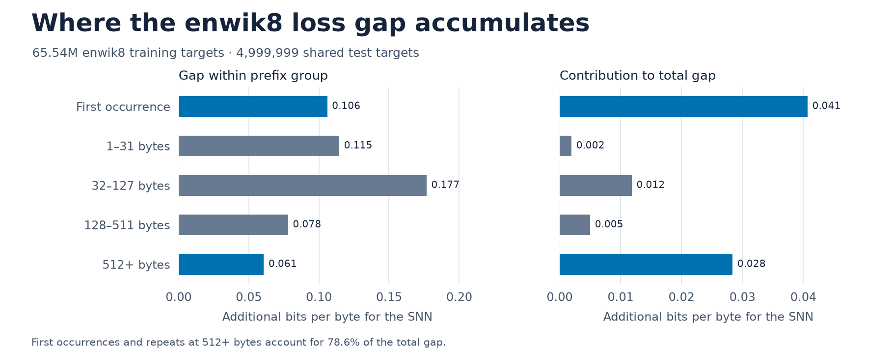

[Growth study](GROWN_RESIDUAL.md) · [Width from scratch](SCALE_6510K_WIDTH.md) · [Current model card](../models/spiking-byte-lm-v9/README.md) · [Depth growth study](DEPTH_GROWTH.md)

[Continuation and scale source records](../results/event_lm/continuation_leaderboard.json) · [Held-charge replication](HELD_CHARGE_REPLICATION.md)

## Depth and activity inhibition · 26,214,400 training targets · seed 0

| Model | Parameters | State | enwik8 | Rank | PG-19 | Rank | Pulses/byte |
|---|---:|---:|---:|---:|---:|---:|---:|
| Three-block SNN, fixed threshold | 1,630,464 | 14,556 B | 2.24386 | 7 | 3.19752 | 7 | 305,600 |
| Three-block SNN, activity inhibition | 1,630,464 | 14,556 B | 2.16389 | 5 | 3.11971 | 4 | 304,525 |
| Five-block SNN, fixed threshold | 1,630,992 | 17,620 B | 2.19441 | 6 | 3.13879 | 5 | 307,566 |
| Five-block SNN, activity inhibition | 1,630,992 | 17,620 B | 2.07523 | 4 | 3.02885 | 2 | 303,469 |
| Five-block SNN, inhibition + held charge | 1,630,992 | 21,320 B | 2.00577 | 3 | **2.98022** | 1 | 308,178 |
| Local Transformer | 1,630,848 | 64,512 B | 1.89056 | 2 | 3.17881 | 6 | — |
| Full-attention Transformer | 1,630,848 | 3 MiB | **1.81449** | 1 | 3.11725 | 3 | — |

[Evaluation records and ranks](../results/event_lm/depth_inhibition_leaderboard.json) · [Depth study and ablations](DEPTH_INHIBITION.md) · [Replication](DEPTH_INHIBITION.md#full-attention-replication) · [v2 model card](../models/spiking-byte-lm-v2/README.md)

## Earlier context-tag and threshold study

Each score below is a mean over three seeds. Each group has its own training exposure.

### Small comparison · 6,553,600 training targets per seed

| Model | Parameters | State | enwik8 | Rank | PG-19 | Rank | Pulses/byte |
|---|---:|---:|---:|---:|---:|---:|---:|
| Always-read spiking bank | 407,616 | 32,696 B | 2.39550 | 3 | 3.36437 | 3 | 298,515 |
| Forecast-keyed spiking bank | 407,616 | 32,696 B | 2.43130 | 6 | 3.37224 | 5 | 294,613 |
| Context tags, fixed thresholds | 407,616 | 32,696 B | 2.43025 | 5 | 3.36729 | 4 | 296,319 |
| Context tags, learned thresholds | 407,628 | 32,696 B | 2.42716 | 4 | 3.38277 | 6 | 303,374 |
| Local Transformer | 407,808 | 31,488 B | **2.24107** | 1 | 3.34604 | 2 | — |
| Full-attention Transformer | 407,808 | 1.125 MiB | 2.28026 | 2 | **3.29995** | 1 | — |

### Large comparison · 13,107,200 training targets per seed

| Model | Parameters | State | enwik8 | Rank | PG-19 | Rank | Pulses/byte |
|---|---:|---:|---:|---:|---:|---:|---:|
| Context tags, fixed thresholds | 815,232 | 32,696 B | 2.24015 | 3 | **3.25043** | 1 | 303,952 |
| Context tags, learned thresholds | 815,244 | 32,696 B | 2.25351 | 4 | 3.25233 | 2 | 303,493 |
| Local Transformer | 815,232 | 32,768 B | 2.04457 | 2 | 3.26187 | 3 | — |
| Full-attention Transformer | 815,232 | 1.5 MiB | **2.01841** | 1 | 3.29072 | 4 | — |

[Per-seed scores and source paths](../results/event_lm/threshold_scale_leaderboard.json) · [Interventions and research notes](SPIKE_CODE_FORECAST.md#learned-context-keys-and-firing-thresholds) · [Model and reproduction guide](../models/spiking-byte-lm/README.md)

Regenerate this page and its figures with `python experiments/plot_event_lm_study.py`.
