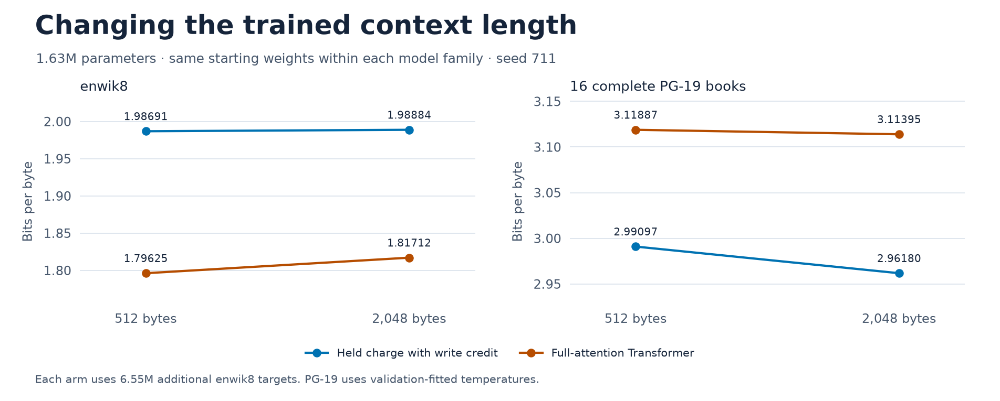
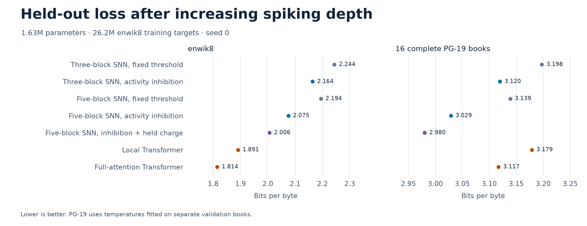
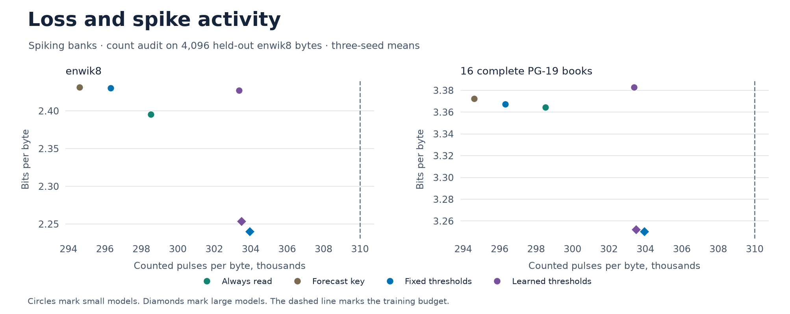

# Spiking byte model leaderboards

Lower bits per byte rank higher. Every row in a comparison uses the same enwik8 training exposure and scores 4,999,999 enwik8 targets and 8,404,368 targets from 16 complete PG-19 books.

State is persistent tensor storage for one stream. Full attention reports FP32 key and value storage at the context length in each comparison. Pulse counts use a native 4,096-byte enwik8 test sample. Each PG-19 temperature is fitted on eight separate validation books.

## 512-byte continuations · 32,768,000 training targets · seed 711

| Model | Parameters | State | enwik8 | Rank | PG-19 | Rank | PG-19 raw | Pulses/byte |
|---|---:|---:|---:|---:|---:|---:|---:|---:|
| Held-charge control | 1,630,992 | 21,320 B | 1.98564 | 4 | 2.98490 | 3 | 3.10338 | 307,730 |
| Opponent steering | 1,631,917 | 21,320 B | 1.98533 | 3 | **2.97309** | 1 | 3.09454 | 308,471 |
| Chronological write credit | 1,630,992 | 21,320 B | 1.98691 | 6 | 2.99097 | 5 | 3.10893 | 307,270 |
| Trace read veto | 1,631,012 | 21,320 B | 1.98405 | 2 | 2.98763 | 4 | 3.11449 | 307,412 |
| Spread coincidence | 1,631,012 | 21,320 B | 1.98644 | 5 | 2.98129 | 2 | 3.10337 | 306,624 |
| Full-attention Transformer | 1,630,848 | 3 MiB | **1.79625** | 1 | 3.11887 | 6 | 3.35801 | — |

## 2,048-byte continuations · 32,768,000 training targets · seed 711

| Model | Parameters | State | enwik8 | Rank | PG-19 | Rank | PG-19 raw | Pulses/byte |
|---|---:|---:|---:|---:|---:|---:|---:|---:|
| Held charge with write credit | 1,630,992 | 21,320 B | 1.98884 | 2 | **2.96180** | 1 | 3.07240 | 304,447 |
| Full-attention Transformer | 1,630,848 | 12 MiB | **1.81712** | 1 | 3.11395 | 2 | 3.33558 | — |

## 3.26M parameter comparison · 26,214,400 training targets · seed 0

| Model | Parameters | State | enwik8 | Rank | PG-19 | Rank | PG-19 raw | Pulses/byte |
|---|---:|---:|---:|---:|---:|---:|---:|---:|
| Seven-block held charge | 3,257,088 | 31,692 B | 1.99402 | 2 | **2.89822** | 1 | 2.98142 | 308,389 |
| Full-attention Transformer | 3,256,832 | 4 MiB | **1.86093** | 1 | 3.05929 | 2 | 3.25745 | — |

[Continuation and scale source records](../results/event_lm/continuation_leaderboard.json) · [Held-charge replication](HELD_CHARGE_REPLICATION.md) · [Current model card](../models/spiking-byte-lm-v3/README.md)

## Depth and activity inhibition · 26,214,400 training targets · seed 0

| Model | Parameters | State | enwik8 | Rank | PG-19 | Rank | Pulses/byte |
|---|---:|---:|---:|---:|---:|---:|---:|
| Three-block SNN, fixed threshold | 1,630,464 | 14,556 B | 2.24386 | 7 | 3.19752 | 7 | 305,600 |
| Three-block SNN, activity inhibition | 1,630,464 | 14,556 B | 2.16389 | 5 | 3.11971 | 4 | 304,525 |
| Five-block SNN, fixed threshold | 1,630,992 | 17,620 B | 2.19441 | 6 | 3.13879 | 5 | 307,566 |
| Five-block SNN, activity inhibition | 1,630,992 | 17,620 B | 2.07523 | 4 | 3.02885 | 2 | 303,469 |
| Five-block SNN, inhibition + held charge | 1,630,992 | 21,320 B | 2.00577 | 3 | **2.98022** | 1 | 308,178 |
| Local Transformer | 1,630,848 | 64,512 B | 1.89056 | 2 | 3.17881 | 6 | — |
| Full-attention Transformer | 1,630,848 | 3 MiB | **1.81449** | 1 | 3.11725 | 3 | — |

[Evaluation records and ranks](../results/event_lm/depth_inhibition_leaderboard.json) · [Depth study and ablations](DEPTH_INHIBITION.md) · [Replication](DEPTH_INHIBITION.md#full-attention-replication) · [v2 model card](../models/spiking-byte-lm-v2/README.md)

## Earlier context-tag and threshold study

Each score below is a mean over three seeds. Each group has its own training exposure.

### Small comparison · 6,553,600 training targets per seed

| Model | Parameters | State | enwik8 | Rank | PG-19 | Rank | Pulses/byte |
|---|---:|---:|---:|---:|---:|---:|---:|
| Always-read spiking bank | 407,616 | 32,696 B | 2.39550 | 3 | 3.36437 | 3 | 298,515 |
| Forecast-keyed spiking bank | 407,616 | 32,696 B | 2.43130 | 6 | 3.37224 | 5 | 294,613 |
| Context tags, fixed thresholds | 407,616 | 32,696 B | 2.43025 | 5 | 3.36729 | 4 | 296,319 |
| Context tags, learned thresholds | 407,628 | 32,696 B | 2.42716 | 4 | 3.38277 | 6 | 303,374 |
| Local Transformer | 407,808 | 31,488 B | **2.24107** | 1 | 3.34604 | 2 | — |
| Full-attention Transformer | 407,808 | 1.125 MiB | 2.28026 | 2 | **3.29995** | 1 | — |

### Large comparison · 13,107,200 training targets per seed

| Model | Parameters | State | enwik8 | Rank | PG-19 | Rank | Pulses/byte |
|---|---:|---:|---:|---:|---:|---:|---:|
| Context tags, fixed thresholds | 815,232 | 32,696 B | 2.24015 | 3 | **3.25043** | 1 | 303,952 |
| Context tags, learned thresholds | 815,244 | 32,696 B | 2.25351 | 4 | 3.25233 | 2 | 303,493 |
| Local Transformer | 815,232 | 32,768 B | 2.04457 | 2 | 3.26187 | 3 | — |
| Full-attention Transformer | 815,232 | 1.5 MiB | **2.01841** | 1 | 3.29072 | 4 | — |

[Per-seed scores and source paths](../results/event_lm/threshold_scale_leaderboard.json) · [Interventions and research notes](SPIKE_CODE_FORECAST.md#learned-context-keys-and-firing-thresholds) · [Model and reproduction guide](../models/spiking-byte-lm/README.md)

Regenerate this page and its figures with `python experiments/plot_event_lm_study.py`.
