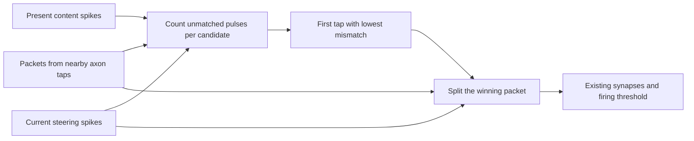

# Short-context routing and scale in the spiking byte model

The released router dedicates groups of neurons to fixed delays. The largest temperature-calibrated PG-19 model does well against the matched Transformer references, while the enwik8 gap persists even on the first occurrence of an eight-byte prefix. These experiments test short-context routing, precision within a synapse, and a larger fixed-delay model. [Release comparison](LEADERBOARD.md) · [Prefix-age results](SPIKE_ROUTER_FOLLOWUP.md#next-architecture-test)

## Matching recent packets with the existing steering spikes

Every channel emits a signed content packet and a nonnegative steering count. The steering count \(a_c\) exposes the first \(a_c\) slots of either sign rail. Let \(p_{t,c}\) be the present content and let \(p_{t-d,c}\) be a candidate arriving from delay \(d\). For one group the mismatch is

\[
E_d = \sum_c \left| \operatorname{clip}(p_{t,c},-a_c,a_c)
                    - \operatorname{clip}(p_{t-d,c},-a_c,a_c) \right|.
\]

The distance counts unmatched pulses in the slots the current steering train opens. It penalizes disagreement across the sign rails. In an equivalent spike race, each unmatched pulse delays its candidate by one tick. The implementation selects the earliest by taking the integer minimum. The winning packet passes through the original two-way steering split. A tie selects the available tap closest to the group's original anchor. A candidate competes only after its packet could have arrived.



Each group may read its normal tap or up to three shorter taps already present in its compact ring. It holds the same number of pulse counts and has the same trainable projections as the fixed-delay circuit. The forward pass makes the same hard selection in training and integer inference. A soft surrogate supplies gradients to the comparisons during training. This tests a content-dependent read from existing axons with the same steering train for comparison and routing. Learnable spiking delays and competitive spikes in sequence prediction have prior work. [Event-based delay learning](https://doi.org/10.1038/s41467-025-65394-8) · [Sequence prediction with competitive spiking populations](https://pmc.ncbi.nlm.nih.gov/articles/PMC9273101/)

The fixed and matching candidates each train from scratch on 6,553,600 enwik8 targets per seed at 407,616 parameters. The three seed pairs use the same input windows, pulse budget, initialization, and optimizer settings. Both use 16× pulse resolution and the prior training objective before the optional output-reference export.

Applying whole-packet matching to the unchanged released weights raised mean loss on the same 16,384 enwik8 validation targets per model from 2.40328 to 3.06778 at the small size and from 2.22257 to 3.03887 at the large size. The learned projections depend on the original delay assignment. [Checkpoint intervention](../results/event_lm/router_charge/parent_interventions_validation.json)

The trained seed-0 matching model scored 2.48487 bits per byte on the same validation diagnostic. Switching that checkpoint back to its original anchors raised loss to 2.72779. Fixing each group to its most frequently selected tap on those validation positions raised it to 2.77206. The from-scratch fixed model is the primary accuracy comparison. [Tap counts and validation intervention](../results/event_lm/delay_matching/lag_choice_validation.json)

### Matching delays as a spike correction

Keep the original packet's two-way split. Compare the exposed spikes at the anchor with the exposed spikes at the winning nearby tap. A shared synapse per group converts that difference into signed charge and a reset-per-byte integrate-and-fire neuron emits the correction. It adds those pulses to the existing coincidence path. The anchor's bypass pulses still follow their usual synapse. The gain is quantized in steps of 1/64 and constrained to the interval from zero to one. Gain zero exactly reproduces the fixed router, and gain one replaces only the coincident pulses.

The correction reuses the compact delay ring, steering populations, and projection weights. It adds twelve synaptic gains and starts silent. On 4,096 real validation bytes, the new circuit at gain zero reproduced every vocabulary count of the released checkpoint while using 14,556 bytes of stream storage. The paired continuation starts from that 815,232-parameter checkpoint and uses the same additional 819,200 enwik8 targets and a fresh AdamW optimizer with peak learning rate 0.0003. [Integer initialization audit](../results/event_lm/delay_correction/zero_gain_native_parity.json)

The first continuation hit a zero derivative at the clamp's lower bound and left all gains at zero. The training implementation now passes a derivative through that point while the forward circuit uses the bounded integer gain. In the rerun, one group in the second block and one group in the third block reached a gain of 1/64. [Initial gradients on real enwik8 training bytes](../results/event_lm/delay_correction/zero_gain_gradient.json)

| Seed-0 continuation | enwik8 test bits/byte | PG-19 test bits/byte | State | Pulses per byte |
| --- | ---: | ---: | ---: | ---: |
| Fixed-delay control | 2.24811 | 3.24018 | 14,556 B | 301,577 |
| Learned delay correction | 2.24763 | 3.23635 | 14,556 B | 297,869 |

The original parent scored 2.24396 on enwik8 and 3.23276 on PG-19. The continuation used one seed and the pulse counts come from a native 4,096-byte enwik8 test audit. [enwik8 control](../results/event_lm/delay_correction/enwik8_fixed.json) · [enwik8 correction](../results/event_lm/delay_correction/enwik8_trainable.json) · [PG-19 control](../results/event_lm/delay_correction/pg19_fixed.json) · [PG-19 correction](../results/event_lm/delay_correction/pg19_trainable.json) · [Integer audit](../results/event_lm/delay_correction/native_trainable.json)

Setting the gains back to zero in the trained correction checkpoint changed its loss on 98,304 validation targets from 2.293736 to 2.293704. The learned correction itself had a negligible effect in this run. [Gain ablation](../results/event_lm/delay_correction/validation_gain_ablation.json)

## Finer synaptic charge at the same firing resolution

On seed 0 of the released large model, 8.0% to 12.0% of local projection weights round to zero at the original charge precision. The rounding error in those matrices is 5.5% to 8.2% of the RMS weight. The finer circuit replaces each router's 1/64-weight charge tick with a 1/256-weight tick and multiplies its firing threshold by four. It operates on the same signed pulse counts, delay rings, and physical weight range. Input, memory, and vocabulary synapses keep their original precision. Integer accumulator checks use the actual quantized row sums.

A weight on the original grid contributes the same fraction of a firing threshold in either circuit. The new ticks let training represent intermediate weights without increasing firing resolution. The seed-0 small pilot uses the fixed delays and the same training windows as the small fixed-delay control. [Implementation](../snnformer/event_lm.py) · [Training entry point](../experiments/train_event_lm.py)

At identical released weights, finer charge changed the 16,384-target validation loss from 2.40328 to 2.40530 at the small size and from 2.22257 to 2.22446 at the large size. Training on the finer grid is the primary comparison. The seed-0 run scored 2.42273 on 196,608 validation targets, versus 2.48476 for the small fixed-delay control. This led to runs using the other two small seeds and the same scaled geometry at 1.63 million parameters. [Checkpoint intervention](../results/event_lm/router_charge/parent_interventions_validation.json)

| Small model | Seed 0 validation | Seed 1 validation | Seed 2 validation | Mean bits/byte | Mean pulses per byte |
| --- | ---: | ---: | ---: | ---: | ---: |
| Fixed delays, 6 charge bits | 2.48476 | 2.45191 | 2.44784 | 2.46150 | 303,726 |
| Matching delays, 6 charge bits | 2.54268 | 2.53135 | 2.58595 | 2.55332 | 304,289 |
| Fixed delays, 8 charge bits | 2.42273 | 2.43024 | 2.45410 | **2.43569** | 305,404 |

Finer charge improved two seeds and lowered the mean by 0.02581 bits per byte at 0.55% more observed validation pulses. Switching the whole delayed packet raised validation loss in all three seeds. The candidates and control shared the 310,000-pulse training target.

| Small model | enwik8 test bits/byte | PG-19 test bits/byte | State | Native pulses per byte |
| --- | ---: | ---: | ---: | ---: |
| Fixed delays, 6 charge bits | 2.42498 | **3.36461** | 14,556 B | 295,484 |
| Matching delays, 6 charge bits | 2.52241 | 3.47966 | 14,556 B | 300,429 |
| Fixed delays, 8 charge bits | **2.39634** | 3.36616 | 14,556 B | 298,230 |

The test means use three seeds. Finer charge lowered enwik8 loss by 0.02865 bits per byte. On PG-19 it increased mean loss by 0.00155, with one seed improving. Native CPU counts matched MPS on the same 4,096 enwik8 test bytes across all nine checkpoints. The matched small local Transformer in the release scored 2.24107 on enwik8 and 3.34604 on PG-19. [Small release comparison](LEADERBOARD.md#small-comparison--6553600-training-targets-per-seed) · [Finer enwik8](../results/event_lm/router_charge/enwik8_fine.json) · [Finer PG-19](../results/event_lm/router_charge/pg19_fine.json) · [Integer audit](../results/event_lm/delay_matching/native_comparison.json)

## Scaling membrane width

The scaled router doubles the residual spike population from 192 to 384 channels and keeps the three block schedules, 201 expansion channels, and the prediction bank. It has 1,630,464 trainable weights. The state needed for one stream is still the 14,556-byte compact layout. Each seed-0 model sees 26,214,400 sampled enwik8 training targets on this Mac.

The two Transformer references have 1,630,848 parameters, four blocks, and 192 residual channels. The local reference sees up to 39 bytes including the current byte. The full-attention reference sees up to the 512-byte training context during evaluation. Their training windows, target counts, and enwik8 and PG-19 scoring protocols match those of the spike models. The two spiking arms differ by the local charge tick. The one seed is a scaling pilot.

| Scaled model | enwik8 test bits/byte | PG-19 test bits/byte | State |
| --- | ---: | ---: | ---: |
| Fixed-delay SNN, 6 charge bits | 2.24386 | 3.19752 | 14,556 B |
| Fixed-delay SNN, 8 charge bits | 2.24317 | 3.23713 | 14,556 B |
| Local Transformer | 1.89056 | 3.17881 | 64,512 B |
| Full-attention Transformer | **1.81449** | **3.11725** | 3 MiB |

The state figures count persistent backing tensors per stream and FP32 keys and values at 512 bytes for full attention. In the native test audit the six-bit router emitted 305,600 pulses per byte and the eight-bit router emitted 303,668. Compared with the released seed-0 model, doubling width and training targets changed the six-bit enwik8 loss by 0.00011 bits per byte and improved PG-19 by 0.03524. Finer charge changed the scaled enwik8 score by 0.00069 and raised PG-19 loss by 0.03961. [Six-bit enwik8](../results/event_lm/scale_1630k/enwik8_fixed.json) · [Six-bit PG-19](../results/event_lm/scale_1630k/pg19_fixed.json) · [Eight-bit enwik8](../results/event_lm/scale_1630k/enwik8_fine.json) · [Eight-bit PG-19](../results/event_lm/scale_1630k/pg19_fine.json) · [Local enwik8](../results/event_lm/scale_1630k/enwik8_transformer_local.json) · [Local PG-19](../results/event_lm/scale_1630k/pg19_transformer_local.json) · [Full enwik8](../results/event_lm/scale_1630k/enwik8_transformer.json) · [Full PG-19](../results/event_lm/scale_1630k/pg19_transformer.json)

## Next comparison

Allocate the next 1.63M-parameter budget across more causal delay blocks with a narrower residual stream. In the released large seed-0 model, the median per-byte mean magnitude grows from 7.36 input pulses per channel to 33.55 after the third block. A separate circuit can test whether that growth limits a deeper network. A pooled inhibitory population raises the shared firing threshold of a block according to incoming activity, with the residual spike path intact. Compare the deeper router with and without this control before increasing the width or training budget again. [Validation activation audit](../results/event_lm/router_charge/activation_probe.json)

## Scoring and replay

The enwik8 test is the full 4,999,999-target split. Full PG-19 scores use 8,404,368 targets across the same 16 books as the release. Temperatures use the eight separate PG-19 validation books. The local models score chunks with up to 256 preceding bytes, and the correction bank carries across each text. The full-attention evaluator uses 256 scored targets and up to 256 preceding bytes per window. Training and scoring ran on Apple MPS with CPU fallback disabled. [Data preparation and scoring](../models/spiking-byte-lm/README.md)

The small-model evaluator uses 8,192-byte chunks for the spiking models. An audit on 65,536 real validation bytes reproduced every vocabulary count with 2,048- and 8,192-byte chunks. [Chunk parity](../results/event_lm/delay_matching/eval_chunk_parity.json)

From the repository root, replay the seed-0 finer-charge model with the saved training settings.

```bash
PYTORCH_ENABLE_MPS_FALLBACK=0 python experiments/replay_event_run.py \
  results/event_lm/router_charge/event_correction_code_s0_fine_router_charge.json \
  --enwik8 data/enwik8 --device mps --output-dir checkpoints/replayed-router-charge
```
