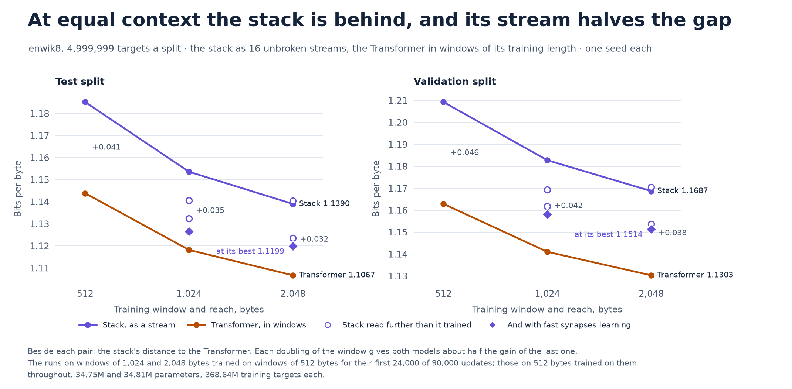
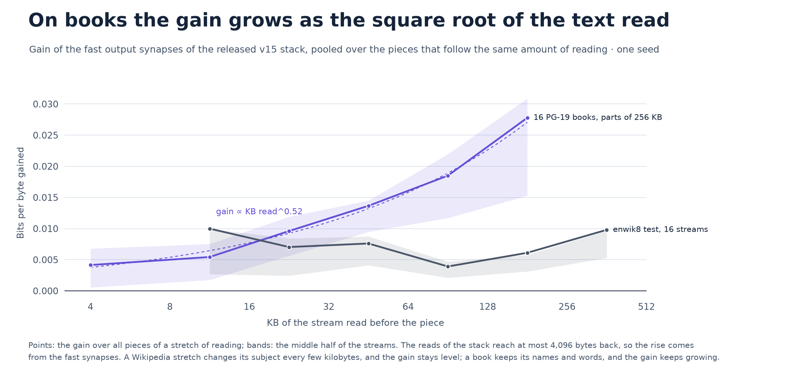
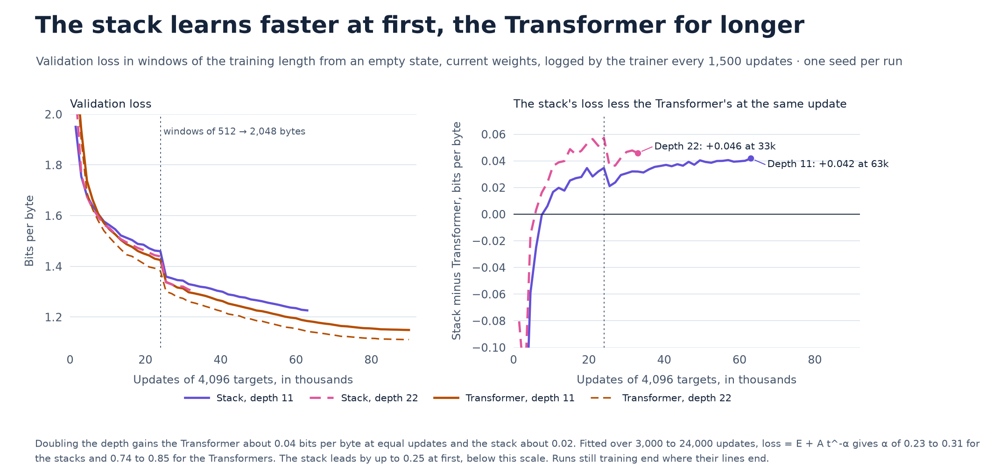
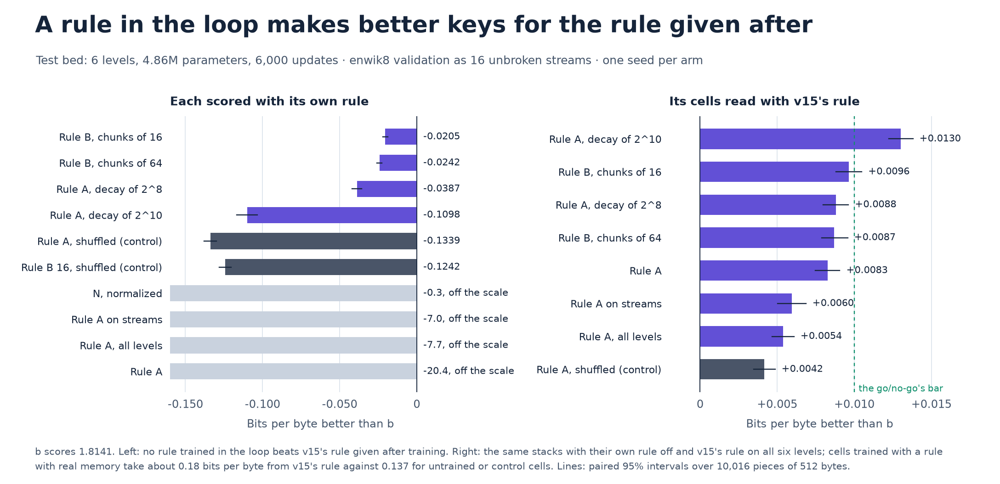

# Long streams

v15 left the spiking stack level with a Transformer: ahead on
the enwik8 test split, behind on validation. That Transformer
read 512 bytes, while the stack trained on windows of 1,024
bytes and read up to 4,096 cells back. This release trains
Transformers on the stack's own window lengths. **At equal
training context the stack is behind**: by 0.035 bits per byte
on the test split at 1,024 bytes and by 0.032 at 2,048, and by
0.042 and 0.038 on validation, each read as it trained. Longer
windows help both models alike, and the gap narrows by less
than 0.006 a doubling.

Read with what only a stream has, the stack closes half of that.
The stack trained on windows of 2,048 bytes with forgetting slopes
of its own (`l2048-forget`) scores **1.1199** on the test split
when its reads reach 8,192 cells back and its fast output synapses
learn along the stream: 0.021 better than v15's release, 0.0017
behind the Transformer trained on windows of 1,024 bytes, and
0.013 behind the one trained on 2,048 (0.017 with that
Transformer's own fast synapses). Second seeds of both models move
each by about 0.003 and keep the gap.



The rest of this page, in short:

- **Forgetting by a power of age.** A read's charge for a cell
  beyond its window falls by a slope per doubling of the cell's
  age. Set at −1 on v15's released stack it gains 0.008 on both
  splits; learned in training, 79 of 88 heads choose a slope that
  bounds the far past, with a median of −1.3.
- **Learning while reading.** The gain of the fast synapses on
  books grows as the square root of the text read.
- **Cells that multiply.** Squared and gated cells that multiply
  charges collapsed; shunting gates that divide them were stable
  but gained nothing that held over two seeds.
- **How the models scale.** On every axis measured, the
  Transformer's curve is at least as steep as the stack's. On the
  small test bed, depth carries the stack's gains and more pulses
  alone do not; a loop of tied levels is worth about a third of
  real depth.
- **Learning without the backward pass.** Echoes of the output's
  error in place of the backward pass failed, and showed that the
  stack's credit runs back in time along its reads. Fast synapses
  that consolidate into slower stages did worse than ones that keep
  every lesson.
- **Trained plasticity.** Cells trained with a decaying rule in the
  loop make better keys for v15's rule; the full-size run follows.

## Limits

- Every run is one seed, except the second seeds named in the
  text. The paired intervals cover the choice of the scored
  pieces, not the training run.
- All runs share one schedule: 90,000 updates of 4,096 targets,
  of which the first 24,000 use windows of 512 bytes. The longer
  windows begin from those saved states.
- The stack is scored as unbroken streams and the Transformer in
  windows of its training length, 16 scored bytes after the rest
  as history. Both read every byte of a split once.
- Settings chosen on validation bytes (reach, forgetting slope,
  thresholds) were chosen on the first million of them, and the
  remaining four million are also reported alone.

## The comparison at equal context

| Training window | Stack, as a stream | Transformer, in windows | Stack minus Transformer | Paired 95% interval |
|---|---:|---:|---:|---:|
| 512 bytes, test | 1.1852 | 1.1439 | +0.0413 | +0.0405 to +0.0422 |
| 512 bytes, validation | 1.2093 | 1.1629 | +0.0464 | +0.0455 to +0.0473 |
| 1,024 bytes, test | 1.1536 | 1.1182 | +0.0354 | +0.0344 to +0.0363 |
| 1,024 bytes, validation | 1.1828 | 1.1410 | +0.0417 | +0.0408 to +0.0426 |
| 2,048 bytes, test | 1.1390 | 1.1067 | +0.0323 | +0.0314 to +0.0333 |
| 2,048 bytes, validation | 1.1687 | 1.1303 | +0.0384 | +0.0374 to +0.0394 |

The stack reads as far as it trained: 512, 1,024 and 2,048
cells back. The rows at 512 bytes are v15's stack and
Transformer; at 1,024, v15's released stack and a Transformer
trained like it; at 2,048, `l2048-flat` and `tf2048`, both new.
With fast output synapses on both models at 2,048 bytes (the
stack's at the reach chosen on the first million validation
bytes, 8,192 cells at levels 4 to 7), the stack scores 1.1347
and 1.1666 and the Transformer 1.1032 and 1.1290: the stack is
behind by 0.0315 [0.0305, 0.0325] and 0.0376 [0.0366, 0.0386].

A stream lets the stack read further than it trained at no cost,
which a Transformer's window does not. At 1,024 bytes that gave
v15 its level score: a reach of 4,096 cells after levels 5 to 7
scored 1.1406 on test, and with a fixed forgetting slope (below)
a reach of 16,384 scores 1.1324. At 2,048 bytes it no longer
helps: the best longer reach on the first million validation
bytes scores 1.1404 on test, against 1.1390 as trained.

**With slopes that learn.** `l2048-forget` is `l2048-flat` with
the slopes of the next section learning in training, forked from
the same state at 24,000 updates. At the reach it trained with
it is 0.0024 ahead of `l2048-flat` on both splits, and unlike
`l2048-flat` it gains from reading further:

| `l2048-forget`, read as a stream | Test | Validation |
|---|---:|---:|
| Reaching 2,048 cells back, as trained | 1.1367 | 1.1662 |
| Reaching 8,192 cells back (chosen on the first validation million) | 1.1235 | 1.1537 |
| The same, with fast output synapses on all 11 levels | **1.1199** | **1.1514** |
| Second seed, reaching 8,192 cells back | 1.1205 | 1.1519 |

The Transformer trained on 2,048 bytes scores 1.1067 and 1.1303
(its second seed 1.1037 and 1.1287), and with its own fast output
synapses 1.1032 and 1.1290. Read at its best, the stack is 0.017
behind it on test with either seed, and 0.013 to 0.017 with fast
synapses on one model or both.

## Forgetting by a power of the age

A read is a softmax in whole spikes. Every cell within reach has
a charge, the match of the present probe with the cell's tag
plus an offset for the cell's age, and the cells share a budget
of 256 spikes in proportion to e to the power of their charges.
Each head learns one offset for each of the last 512 ages. A cell
older than that took the offset of the oldest age in v15,
whatever its age.

Here a cell beyond the window takes that offset plus a slope
times the number of doublings of its age beyond the window:

    offset(age) = offset(511) + s · log2(age / 511)

for ages from 512 to the reach. The share of a cell then falls
as its age to the power s / ln 2, a power law of forgetting.
Memory in people forgets by a power of the time that has passed,
and the chance that an item is needed again falls by a power of
the time since it was last needed (Anderson and Schooler, 1991).
Text has the same property: a word that has appeared is likely
to appear again soon, and less likely the longer it has not.

A slope below −0.69 charge units a doubling (−ln 2) keeps what
all far cells together can take of a read bounded at any reach,
since the shares then fall faster than the inverse of the age.
Above it, the far past takes a larger share the further a read
reaches. Each of the 88 heads of the eleven reads learns its
slope, from zero at the start (`--read-forget`), and a control
holds every slope at zero (`--read-forget-rate 0`).

The closest position bias in Transformers is the logarithmic
kernel of KERPLE (Chi et al., 2022), which subtracts a learned
multiple of the log of the distance from every attention score.
ALiBi (Press et al., 2022) subtracts a multiple of the distance
itself, which forgets exponentially. Here the slope applies only
beyond the window of learned offsets, and the offsets within it
stay free.

**One slope for every head, set at scoring.** On the released
stack of v15, with no training at all, a slope chosen on the
first million validation bytes:

| Reach | Slope 0 | −0.5 | −1 | −2 |
|---|---:|---:|---:|---:|
| 4,096 after levels 5 to 7 (v15's setting) | 1.19405 | | 1.19323 | |
| 8,192 | 1.23214 | 1.19016 | 1.18721 | 1.20088 |
| 16,384 | | | **1.18671** | 1.20060 |

Without forgetting, a reach of 8,192 is 0.045 worse than with a
slope of −1. The best slope, −1, makes a far cell's share fall
as its age to the power −1.44, just past the bound. With it, at
a reach of 16,384, the released stack scores 1.1324 on the test
split and 1.1618 on validation: better than v15's own setting
by 0.0082 on test [0.0078, 0.0085] and by 0.0076 on validation
[0.0072, 0.0079], and 0.0115 ahead of the Transformer that reads
512 bytes on test. It is still 0.0142 behind the Transformer that
trained on 1,024 bytes.

**Slopes that learn.** After 90,000 updates the 88 heads of
`l2048-forget` have spread out. Their median slope is −1.32 (the
middle half between −3.16 and −0.93), close to the −1 that won when
it was set by hand; 79 heads are below −0.69 and bound what the far
past can take; the middle levels forget most, with mean slopes of
−4.7 to −10 at levels 4 to 8. A few heads forget almost nothing
beyond the window, and one keeps a positive slope of 1.8 and leans
on the far past. The second seed lands on the same picture: median
−1.23, 81 heads below −0.69. Set by hand on these stacks, the
single slope of −1 at a reach of 16,384 does worse than the
learned ones: 1.1786 on the first validation million with fast
synapses, against 1.1776 for the learned slopes without them.

## Learning while reading a book

The released stack of v15 has fast output synapses that every
arriving byte teaches, by a local rule in whole numbers, after
the byte has been predicted. They start at zero in every stream.
Two scorings of the same streams, with and without them, keep
their bits for every piece of 512 bytes. Pooling their
difference over the pieces that follow the same amount of
reading gives the gain after that much of a stream
(`experiments/reading_curve.py`).



On the 16 PG-19 test books, read in parts of 256 KB, the gain
grows as the square root of the text read: 0.0042 bits per byte
in the first 8 KB, 0.0096 after 16 to 32 KB, 0.0185 after 64 to
128 KB and 0.0278 after 128 to 256 KB. A power law through the
six stretches has an exponent of 0.52. The reads of the stack
reach at most 4,096 bytes back, so all of this rise comes from
the fast synapses. On the enwik8 test split the gain stays
between 0.004 and 0.010 wherever it is measured: a stretch of
Wikipedia changes its subject every few kilobytes, and a book
does not.

The number of distinct words in a text grows about as the square
root of its length (Heaps' law). That the gain grows the same way
suggests that the synapses learn the book's own names and words
as they recur. It is a reading of the curve, not a test of it.

Scorings of whole books as single streams, with and without fast
synapses, were queued last on the server and come with the next
release.

## The next cell

A plain threshold cell fires one spike for every threshold of
charge above its rest, so its count rises in a line from
silence, as a rectifier does. v15's walk from the Transformer to
the stack found that plain units in place of gated ones cost
most, 0.025 bits per byte. Two cells that multiply charges were
piloted on the server, each priced like every other spike, to
24,000 updates under rules set before the weekend:

- **Squared cells** (`--granule-gate 4 --granule-self-gate
  --granule-price 1`): a gate dendrite that hears the fibres
  through the cell's own synapses lets the same charge in, so k
  thresholds of charge fire k² spikes. They collapsed at once:
  5.26 bits per byte at 1,500 updates.
- **Gated cells** (`--granule-gate 4 --granule-price 1`, 713
  cells for the same parameters): 1.9253 at 1,500 updates, then
  2.55 at 3,000, with 396,000 pulses a byte by 4,500.

Both were stopped as unstable under the pre-registered rule.
Products of charges are unstable at this learning rate, priced
or not. The price on plain cells alone (`plain-price`) runs level
with the plain stack: 1.4064 against 1.4076 at 24,000 updates.

In the Transformer, squared rectifiers (`tf-relu2`) recover what
plain units lose: 1.5087 at 9,000 updates, against GELU's 1.5094
and plain rectifiers' 1.5249 at the walk's rate. The spike form
of a squared unit is the open question; this weekend's form of
it does not train.

**Shunting gates** divide instead (`--granule-shunt`): the gate
dendrite's charge k lets the share k / (k + one threshold) of the
value dendrite's charge into the cell, so a cell can never pass
more than all of its charge. On the small test bed
(`results/event_lm/shunt_tied/preregistered.json`), gated cells
with a shunting gate (681 cells, for the plain stack's parameters)
were 0.0105 ahead of the plain stack on validation streams
[−0.0114, −0.0097] at seed 20001 and stayed inside the pulse
budget, which passed their mark. At seed 20002 they were level
(1.9871 against 1.9855 in windows), so they do not go to full
size. A cell that gates itself through a shunt, a square near
silence and a line above it, was level at once; an output that
hears the stream through the input synapses was 0.025 behind.

## How the two models scale

The weekend's runs give the first view of the two models along
more than one axis.



- **Context.** Each doubling of the training window gives both
  models about half the gain of the previous one, close to a
  loss of L∞ + A/C. The stack gains a little more each time, so
  the gap shrinks from 0.041 to 0.035 to 0.032 on test. Three
  points fix the three numbers of each curve exactly, with no
  error left to judge them by; taken at face value they leave a
  gap of 0.029 at any window.
- **Depth.** Doubling the depth to 22 levels (69.4M parameters)
  gains the Transformer 0.043 bits per byte at 24,000 updates
  and the stack 0.020, in windows from an empty state; on
  windows of 2,048 bytes, 0.037 and 0.021 at 31,500. The gap
  widens with size, from 0.035 to 0.057 at 24,000 updates. The
  deeper stack kept the budget of 310,000 pulses a byte, which
  counts the spikes of the whole stack, so each of its levels
  fired about half as much: this is depth at equal energy, and a
  test-bed arm with the budget doubled measures how much of the
  shortfall the budget is.
- **Spikes or layout.** On the small test bed at depth 6 (4.86M
  parameters, 6,000 updates on windows of 256 bytes), the
  stack's float stand-in, with LayerNorm and no pulse budget,
  scores 1.9798 bits per byte in windows on validation, against
  1.9835 for the spiking stack and 1.8431 for a Transformer of
  the same size. Spikes cost 0.004 there; the 0.14 between the
  stack and the Transformer at that size is the layout of the
  stack. The same three at depth 12 are training.
- **Training.** The stack is ahead for about the first 7,500
  updates (5,800 at depth 22), by up to 0.25 bits per byte, and
  then falls behind. Over 3,000 to 24,000 updates, a power law
  loss = E + A t^−α fits the stacks with α of 0.23 to 0.31 and
  the Transformers with 0.74 to 0.85, over two seeds and both
  depths.

On every axis we can measure, the Transformer's curve is at
least as steep as the stack's: scaling this design does not
close the gap. What the stack has that the Transformer has not
is a stream, and with it learning while reading that grows with
the text.

**Depth, pulses and loops on the test bed** (averaged validation
in windows at 6,000 updates, on one GPU; the plain stack spans
1.9578 to 1.9860 over three seeds):

| Small test bed | Validation | Pulses a byte |
|---|---:|---:|
| 6 levels, 113,000 pulses (seeds 20001 and 20002) | 1.9860, 1.9855 | 114,600 |
| 6 levels, the budget doubled (two seeds) | 1.9975, 2.0022 | 227,000 |
| 6 levels with levels 1 to 4 passed three times, 264,000 (two seeds) | 1.9389, 1.9239 | 269,000 |
| The same loop at 113,000 | 1.9608 | 114,600 |
| 12 levels, 113,000 | 1.8557 | 114,600 |
| 12 levels, 226,000 | 1.8344 | 229,900 |

More pulses alone make the stack worse. Depth carries the gain:
twelve levels gain 0.130 on the plain budget and 0.152 with it
doubled, so a level's own pulses are worth about 0.02 on top. A
loop of tied levels gains 0.047 to 0.062, under the half of real
depth's gain that its pilot required
(`results/event_lm/stack_loop/preregistered.json`): a pass through
shared weights is worth about a third of a level of its own. The
full-size stack of 22 levels kept the 11 levels' budget; the test
bed carries over, that cost it about a seventh of its depth
gain, so most of its shortfall against the Transformer's depth
gain is the stack's own.

## Learning without the backward pass

Gradient training passes the error of every byte back through
all levels. Echo learning gives each part of the stack an echo of
the error at the output instead (`--echo`), through fixed random
synapses or as a mirror, the error of the stream at the top. Both
failed on the test bed: the random echo pushed the pulses to four
times the budget, and the mirror held a gap of 0.33 at every
depth from 2 to 6 levels. Gradient runs with the error cut on one
path at a time found why: reads that pass their error down only
through the tags and payloads of earlier bytes train as well as
with every path, and through their probes alone 0.08 worse. A
part needs to learn how what it wrote was read later, credit that
runs back in time along the race. Carrying exactly that credit and
no other ("read receipts") recovered four fifths of the mirror's
gap; the rest is the cells' own. The whole study, with its
pre-registered ladder and diagnostics, is on [its own
page](ECHO_LEARNING.md).

## Fast synapses that consolidate

Every fast synapse can hold a cascade of charges in stages of
growing capacity, where a lesson spreads from the stage the output
hears into slower ones and fades as about the cube root of its age
(`--teach-cascade`). With six stages it scored 0.022 worse than
v15's rule on validation streams and 0.038 worse on PG-19
validation books: here, every lesson kept at full weight beats a
memory that favours the recent. The design and its pre-registered
pilot are on [their own page](CASCADE_SYNAPSES.md).

## Trained plasticity

v15's fast synapses were given to a stack that never saw them.
A study on a small test bed trained four rules in the loop and
asked whether reading-time learning gets clearly stronger. No
rule trained in the loop beats v15's rule given after training
when each is scored with its own rule. But a stack trained with
a decaying rule in the loop has cells that v15's rule uses
better: with that rule while reading it beats the plain stack by
0.0130 bits per byte [0.0122, 0.0138] along the whole stream and
on a long one, which passed the study's go/no-go by its second
route. Its full-size sibling of `l2048-flat` is queued on the
server and comes with the next release. The
whole study, its criteria and every arm are on [its own
page](TRAINED_PLASTICITY.md).



## Reproduce

The weights are release assets (see the
[handoff](V16_HANDOFF.md) for the archives and their hashes). A
stack on windows of 2,048 bytes with slopes that learn trains in
two parts: v15's recipe with `--read-forget` on windows of 512
bytes to 24,000 updates, then the saved state forked onto longer
windows.

```bash
STACK="--variant event_steered --no-carry --stack --dim 512 --hidden 4 --depth 11 --spike-resolution 16 \
  --router-charge-bits 8 --pulse-budget 310000 --read-after 0,1,2,3,4,5,6,7,8,9,10 --read-width 512 \
  --read-heads 8 --read-window 512 --read-mode race --read-budget 256 --read-resolution 4 \
  --read-address-rate 64 --read-delays 4 --read-cap 128 --granule-after 0,1,2,3,4,5,6,7,8,9,10 \
  --granule-clusters 1 --granule-fan 1024 --granule-delays 4 --granule-cells 1188 --granule-slope \
  --granule-cap 128 --pool-fine 16 --pool-rest 4 --pool-rate 32 --output-pool 128 --rotated-adam 50 \
  --rotate-stacks --weight-average 0.999 --read-forget"
SHARED="--data data/enwik8 --training-mixture data/training-v1/prepared/catalogue.json --steps 90000 \
  --warmup 1000 --lr 3e-4 --wd 0.05 --seed 20001 --eval-every 1500 --eval-bs 8 --eval-batches 16 \
  --final-eval-batches 64 --validation-only --save-every 1500 --resume --device cuda --threads 3"
python experiments/train_event_lm.py $STACK $SHARED --ctx 512 --bs 8 --stop-at 24000 \
  --checkpoint checkpoints/long_streams/p-forget/model.pt
mkdir -p checkpoints/long_streams/l2048-forget
python experiments/stack/fork_state.py checkpoints/long_streams/p-forget/model.pt.resume \
  checkpoints/long_streams/l2048-forget/model.pt.resume --tag l2048_forget --set ctx=2048 bs=2 read_reach=2048
python experiments/train_event_lm.py $STACK $SHARED --ctx 2048 --bs 2 --read-reach 2048 \
  --checkpoint checkpoints/long_streams/l2048-forget/model.pt
```

The control `l2048-flat` adds `--read-forget-rate 0` to both
parts and `read_forget_rate=0` to the fork. The Transformers train
with `--variant transformer --dim 512 --depth 11 --heads 8
--mlp-ratio 4 --rotated-adam 50 --weight-average 0.999` on the same
schedule and windows. Scoring, as streams and in warmed windows,
and the paired comparison:

```bash
python experiments/eval_stream.py --checkpoint checkpoints/long_streams/l2048-forget/model.pt.averaged \
  --enwik8 data/enwik8 --split test --streams 16 --lead 8192 --piece 256 --reach 8192 \
  --teach-levels 0 1 2 3 4 5 6 7 8 9 10 --teach-threshold 16777216 --device cuda \
  --json forget-taught-test.json --bits forget-taught-test.npy
python experiments/eval_taught_reference.py --checkpoint checkpoints/long_streams/tf2048/model.pt.averaged \
  --enwik8 data/enwik8 --split test --context 16 --history 2032 --rates 0 0.07 --device cuda \
  --json tf2048-test.json --bits tf2048-test.npy
python experiments/compare_stream_scores.py --first tf2048-test.json tf2048-test.npy \
  --second forget-taught-test.json forget-taught-test.npy --json paired.json
python experiments/plot_long_streams.py
```

A fixed slope at scoring takes `--reach 16384 --piece 128
--forget-slope -1`, and `--forget-slope-replaces` sets it also in
reads that learned their own.
