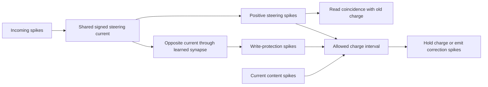

# Opponent steering for held charge

The released five-block model uses the same steering count to open a
read path and widen the interval that preserves held charge. When
steering is silent, the interval collapses to the current content. On
4,096 enwik8 validation bytes, the released model rewrote 90–98% of
already charged cells whose read aperture was closed. The deepest
block delivered 12.5% of its coincident read pulses from cells whose
charge had last changed at least 32 bytes earlier. The first three
blocks delivered none at that age in this sample.
[Native trace profile](../results/event_lm/opponent_steering/parent_trace_profile.json) ·
[Held-charge study](DEPTH_INHIBITION.md#charge-held-by-steering-spikes)

## Circuit

The original positive steering circuit receives the positive part of
synaptic current $u$ and emits $s_t$ pulses at threshold $\theta_t$.
An opponent neuron receives the negative part of the same current.
One nonnegative, quantized synaptic gain per channel determines how
much of that current reaches the opponent neuron. Its write-protection
spikes $v_t$ widen the old charge's permitted interval. Only the
positive steering spikes admit a read, so an inactive read can coexist
with an undisturbed memory cell.



$$
r_t = \operatorname{sgn}(m_t)\min(|m_t|,s_t)
\qquad
m_{t+1}=\operatorname{clip}
\bigl(m_t,\ p_t-s_t-v_t,\ p_t+s_t+v_t\bigr).
$$

The physical firing cap bounds the interval. The opponent thresholds
track the same activity inhibition as content and positive steering.
The opponent neuron resets each byte and uses the existing signed
synaptic projection. The additional synapse adds zero recurrent state.
At a zero gain it emits zero pulses. For the five-block model this adds
925 parameters and leaves the streaming footprint at 21,320 bytes.
[Integer implementation](../snnformer/event_lm.py)

Adaptive thresholds and dendritic pathways have been studied as ways
to retain information in spiking networks. This experiment tests an
opposite-polarity write-protection path on the existing steering
current and a charge interval shared by training and integer decoding.
[Adaptive spiking networks](https://arxiv.org/abs/1803.09574) ·
[Dual memory pathways](https://www.nature.com/articles/s42256-026-01255-3)

## Paired continuation

At initialization the vocabulary counts matched the released parent
for all 256 candidates at every byte of the validation sample. The
native pulse total matched exactly. Native CPU counts and the MPS
forward pass agreed. The new synapse gains received a nonzero gradient
in all five blocks on 512 enwik8 training targets.
[Initialization check](../results/event_lm/opponent_steering/warm_identity.json)

Both arms start from the same released held-charge checkpoint and use
fresh AdamW with seed 711. Each sees 6,553,600 additional enwik8 targets
in 1,600 eight-window batches of 512 bytes, with 64 warmup steps, a
peak learning rate of 0.0004, and the 310,000-pulse training target.
Evaluation uses the complete enwik8 split and 16 PG-19 books. The
separate validation books select PG-19 temperatures. A gain-zeroing
intervention measures the trained circuit's effect with the same
other weights.

## Results

| Seed-711 continuation | enwik8 bits/byte | PG-19 bits/byte | Native pulses/byte |
|---|---:|---:|---:|
| Held-charge control | 1.98564 | 2.98490 | 307,730 |
| Opponent write protection | 1.98533 | 2.97309 | 308,471 |

The opponent circuit gained 0.01180 bits per byte on PG-19, with lower
calibrated loss on 12 of 16 books. The raw PG-19 losses were 3.10338
for the control and 3.09454 for opponent steering. The enwik8 change
was 0.00031 bits per byte in this pair, and the final validation score
was 0.00050 higher. Both arms use 21,320 bytes of streaming state.
Native CPU inference matched MPS over 4,096 test bytes and preserved
exact single-byte and chunked decoding.
[Control enwik8](../results/event_lm/opponent_steering/enwik8_control_s711.json) ·
[Opponent enwik8](../results/event_lm/opponent_steering/enwik8_opponent_s711.json) ·
[Control PG-19](../results/event_lm/opponent_steering/pg19_control_s711.json) ·
[Opponent PG-19](../results/event_lm/opponent_steering/pg19_opponent_s711.json) ·
[Integer audit](../results/event_lm/opponent_steering/native_opponent_s711.json)

Opponent steering raised the deepest block's fraction of read pulses
from charge at least 32 bytes old from 11.69% to 13.18%, on the same
validation bytes used in the original profile. The five blocks emitted
about 68.5 write-protection spikes per input byte on that sample.
Zeroing the trained gains raised loss by 0.00032 bits per byte on a
separate 65,536-target validation probe. The measured circuit changes
retention in a single continuation and adds a small PG-19 gain.
[Control trace profile](../results/event_lm/opponent_steering/control_trace_profile.json) ·
[Opponent trace profile](../results/event_lm/opponent_steering/opponent_trace_profile.json) ·
[Zero-gain intervention](../results/event_lm/opponent_steering/probe_opponent_s711.json)

## Reproduce the native charge profile

```bash
python experiments/profile_charge_trace.py \
  --enwik8 data/enwik8 --checkpoint models/spiking-byte-lm-v2/weights.pt \
  --bytes 4096 --json checkpoints/parent-charge-profile.json
```

Read ages are weighted by delivered pulses. The age is the number of
bytes since the stored integer charge most recently changed.

Replay the paired training records through the standard runner. Both
use the bundled v2 parent and verify its checksum.

```bash
PYTORCH_ENABLE_MPS_FALLBACK=0 python experiments/replay_event_run.py \
  results/event_lm/opponent_steering/event_correction_code_s711_opponent_warm_opponent.json \
  --enwik8 data/enwik8 --device mps --parent-checkpoints models/spiking-byte-lm-v2 \
  --output-dir checkpoints/replayed-opponent
```
