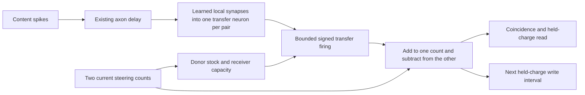

# Widening the held-charge SNN and sharing steering pulses

The v7 SNN and Transformer parents each saw 101,580,800 enwik8
targets. Each arm in this study adds 9,830,400 targets, giving
111,411,200 total targets. The 243-channel SNN stores held charge
in Int16 and keeps 32,616 bytes of persistent tensors per stream.
The 187-channel parent keeps 29,674 bytes. The full-attention
reference keeps its original 512-byte context and grows the
SwiGLU width from 1,805 to 2,421. Its persistent tensors occupy
6 MiB per stream. Keeping both widths of both models lets the
comparison measure the gain from adding channels separately from
the gain from observing more training targets.
[v7 checkpoints and data setup](HANDOFF.md#checkpoints) ·
[Exact wider warm starts](TRACE_TAP_READ.md#expand-within-32-kib)

| Arm | Parameters | Persistent tensor state |
|---|---:|---:|
| Continued 187-channel SNN | 9,960,960 | 29,674 B |
| Packed 243-channel SNN | 12,799,488 | 32,616 B |
| Packed 243-channel SNN, growth in the first two groups | 12,799,488 | 28,584 B |
| Continued full attention | 9,962,496 | 6 MiB |
| Wider full attention | 12,801,024 | 6 MiB |
| 243-channel SNN, present steering transfers | 12,879,678 | 32,616 B |
| 243-channel SNN, delayed steering transfers | 12,879,678 | 32,616 B |

## Where the v7 gap grows

The v7 checkpoints predicted the same 24,576 enwik8 validation
targets across 1,536 disjoint 16-byte tails. Before each tail,
both models reset state and saw the history shown in the table.
Thirty-two bytes account for 76% of the gap measured with 497
bytes of warmup. The new circuit tests how each block uses
spikes already arriving within its short axon delays.
[Paired v7 validation histories and target offsets](../results/event_lm/packed_width/parent_validation_history.json)

| Warmup bytes | Continued SNN bpb | Full attention bpb | Gap |
|---:|---:|---:|---:|
| 1 | 2.28360 | 2.27647 | 0.00714 |
| 8 | 1.90420 | 1.88004 | 0.02416 |
| 32 | 1.82949 | 1.77214 | 0.05735 |
| 96 | 1.81302 | 1.74405 | 0.06896 |
| 224 | 1.81014 | 1.73591 | 0.07423 |
| 497 | 1.80915 | 1.73382 | 0.07534 |

## Transfer already-fired steering pulses

Within each delay group, every pair of content channels has one
signed transfer neuron. Its learned synapses receive all content
counts arriving from that group. The present-input control uses
the group's current content counts. Both arms use the same
80,190 trainable synapses, arranged in local matrices from each
group to its transfer neurons. An unpaired channel keeps its
own steering pulse count.

Let $s_a$ and $s_b$ be the steering counts for one pair, $C_a$
and $C_b$ their firing limits, and $q$ the signed input to their
transfer neuron in charge ticks. Its lower and upper bounds are
$L=-\min(s_a,C_b-s_b)$ and $U=\min(s_b,C_a-s_a)$. The neuron
fires the signed count

$$
r=\operatorname{FIRE}_{64}(\operatorname{clip}(q,64L,64U)).
$$

A positive count moves pulses from $b$ to $a$. A negative count
moves pulses in the other direction. The two counts become
$(s_a+r,s_b-r)$. Each stays within its original firing limit and
their sum remains $s_a+s_b$. The transfer neuron emits $|r|$
counted pulses to direct the move. The adjusted steering is
used by the immediate and delayed spike paths, the pre-write
held read, and the next held-charge interval. The axon ring
still stores the original content packet. This lets all transfers
run before the parallel held-charge scan.
[Integer circuit and streaming implementation](../snnformer/event_lm.py)



Prior work uses recurrent circuits for divisive normalization
and input-dependent spiking dynamics in language models. The
design tested here is the exact conservation of each pair's
steering count while an axon arrival reallocates the counts used
for both reading and writing.
[Rawat, Heeger and Martiniani](https://arxiv.org/abs/2409.18946) ·
[NeuronSpark](https://arxiv.org/abs/2603.16148)

## Warm-start audits

Both transfer arms start with zero transfer synapses. On 4,096
real enwik8 validation bytes, the two widened models reproduced
every parent's vocabulary count and the same 1,295,092,804 total
pulses. Each also matched CPU integer batch, chunk, and byte-step
execution against the Metal forward pass. A next-byte loss on
512 training targets reached 4,442 transfer synapses per block.
The delayed arm completed an optimizer update on eight 512-byte
training windows with the pulse penalty enabled and CPU fallback
disabled. These measurements verify the initial circuit and
training path.
[Delayed warm audit](../results/event_lm/packed_width/warm_delayed_transfer.json) ·
[Present warm audit](../results/event_lm/packed_width/warm_present_transfer.json) ·
[Optimizer smoke run](../results/event_lm/packed_width/event_correction_code_s7907_packed_width_transfer_smoke.json)

## Add channels to the shortest-delay groups

On 65,536 validation targets, the v7 SNN scored 1.74428 bpb.
For each intervention, the same frozen weights run while the held
read and arrival bypass projections from one group are muted in
every block. The group's immediate projections stay active.
[Frozen temporal-group interventions](../results/event_lm/packed_width/parent_temporal_groups.json)

| Delays across blocks, bytes | Axon cells | Held cells | Muted loss increase |
|---|---:|---:|---:|
| 1 | 517 | 517 | 0.87238 bpb |
| 1, 2, 3 | 987 | 517 | 0.70274 bpb |
| 2, 4, 9 | 2,397 | 517 | 0.57198 bpb |
| 3, 8, 27 | 5,750 | 506 | 0.29103 bpb |

The short-group growth arm adds 28 channels to each of the first
two groups. It keeps every parent channel inside its original
delay group. The widths become 75, 75, 47, and 46. This spends
4,032 fewer persistent bytes than the even 243-channel expansion
at the same parameter count. On 4,096 validation bytes, the
warm model keeps each parent output count and the exact pulse
total. Every block's new expansion receives a next-byte gradient.
The group ablation motivates the allocation. The matched
continuation measures what adding channels changes.
[Short-group warm audit](../results/event_lm/packed_width/warm_short_groups.json)

## Learning rate at a continuation boundary

A separate CPU probe continues the released 187-channel SNN for
120 updates, or 491,520 enwik8 targets. Both runs use seed 7907,
16 warmup steps, and the same validation windows, pulse target,
and AdamW settings. The v7 parent scores 1.79099 bpb on these
32,768 validation targets.
[Original weights and both exact training logs](../results/event_lm/packed_width/restart)

| Peak learning rate | 40 updates | 80 updates | 120 updates |
|---:|---:|---:|---:|
| 0.00020 | 1.8225 | 1.8139 | 1.8091 |
| 0.00005 | 1.7946 | 1.7931 | 1.7927 |

The quarter-rate pilot ends 0.01641 bpb below the standard-rate
pilot on this validation slice. Its loss still rises by 0.00174
bpb from the parent. A longer matched continuation is needed to
measure the effect on test loss.

## Matched runs

The launcher trains all arms with seed 7907, 2,400 AdamW updates,
eight 512-byte windows per update, 96 warmup steps, and peak
learning rate 0.0002. The SNNs use the 310,000-pulse soft
training target. Evaluation uses 4,999,999 enwik8 test targets
and 8,404,368 targets from 16 pinned PG-19 test books. PG-19
temperatures use eight separate calibration books. Native
audits count total pulses and transfer pulses. Frozen-weight
interventions set transfer synapses to zero and test whether
the learned delayed synapses also work with present input.
[Exact launcher](../experiments/run_v4_continuation.sh) ·
[Dataset manifests and evaluation protocol](HANDOFF.md#score-checkpoints)

```bash
study=checkpoints/work/packed-width
for arm in snn control transformer control-transformer delayed-transfer present-transfer short-groups; do
  PYTHON=.venv/bin/python bash experiments/run_v4_continuation.sh "packed-width-$arm" "$study"
done
```
