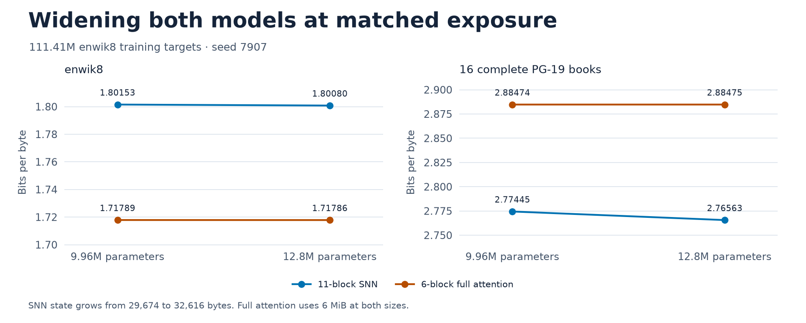
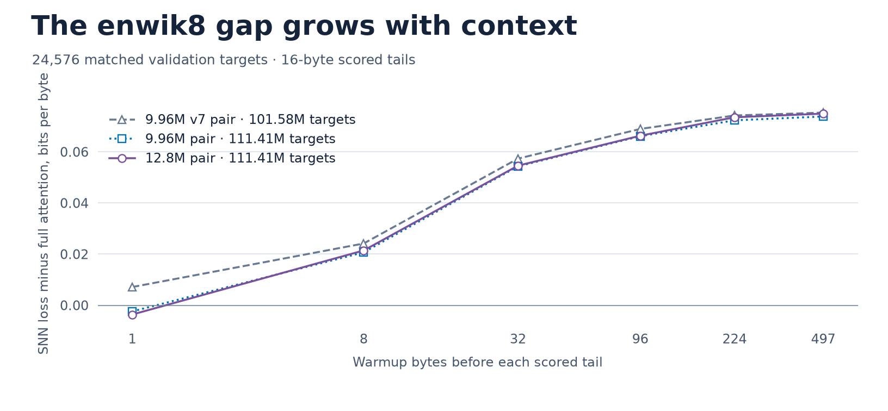
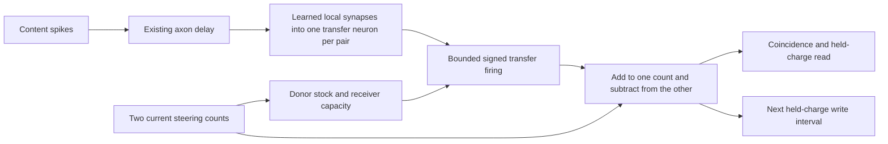
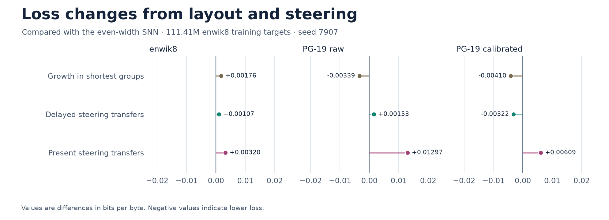

# Widening the held-charge SNN and sharing steering pulses

The v7 SNN and Transformer parents each saw 101,580,800 enwik8
targets. Each arm in this study adds 9,830,400 targets, giving
111,411,200 total targets. The 243-channel SNN stores held charge
in Int16 and keeps 32,616 bytes of persistent tensors per stream.
The 187-channel parent keeps 29,674 bytes. The full-attention
reference keeps its original 512-byte context and grows the
SwiGLU width from 1,805 to 2,421. Its persistent tensors occupy
6 MiB per stream. Keeping both widths of both models lets the
comparison measure the gain from adding channels separately from
the gain from observing more training targets.
[v7 checkpoints and data setup](HANDOFF.md#checkpoints) ·
[Exact wider warm starts](TRACE_TAP_READ.md#expand-within-32-kib)

| Arm | Parameters | Persistent tensor state |
|---|---:|---:|
| Continued 187-channel SNN | 9,960,960 | 29,674 B |
| Packed 243-channel SNN | 12,799,488 | 32,616 B |
| Packed 243-channel SNN, growth in the first two groups | 12,799,488 | 28,584 B |
| Continued full attention | 9,962,496 | 6 MiB |
| Wider full attention | 12,801,024 | 6 MiB |
| 243-channel SNN, present steering transfers | 12,879,678 | 32,616 B |
| 243-channel SNN, delayed steering transfers | 12,879,678 | 32,616 B |

## Matched width comparison

All four width runs saw 111,411,200 training targets. The
table reports bits per byte for seed 7907 on the full enwik8
test split and 16 pinned PG-19 books. PG-19 temperatures were
fit on eight separate books.

| Model | enwik8 | PG-19 calibrated | PG-19 raw |
|---|---:|---:|---:|
| 187-channel SNN | 1.801526 | 2.774447 | 2.869215 |
| 243-channel SNN | 1.800803 | **2.765625** | **2.855879** |
| Original full attention | 1.717889 | 2.884740 | 3.080086 |
| Wider full attention | **1.717858** | 2.884745 | 3.080105 |

The 56 extra channels lower SNN loss by 0.00072 bpb on
enwik8 and 0.00882 bpb across PG-19. Each PG-19 book improves
at the wider size. At about 12.8M parameters, full attention
leads by 0.08295 bpb on enwik8 and the SNN leads by 0.11912
bpb on calibrated PG-19. Its PG-19 lead appears in every
eight-byte prefix recurrence bin. The difference is 0.08813
bpb on first occurrences and 0.15031 bpb when the nearest
prior occurrence is at least 512 bytes away.
[Full-corpus scores and per-book records](../results/event_lm/packed_width)



## Where the v7 gap grows

The v7 checkpoints predicted the same 24,576 enwik8 validation
targets across 1,536 disjoint 16-byte tails. Before each tail,
both models reset state and saw the history shown in the table.
Thirty-two bytes account for 76% of the gap measured with 497
bytes of warmup. The new circuit tests how each block uses
spikes already arriving within its short axon delays.
[Paired v7 validation histories and target offsets](../results/event_lm/packed_width/parent_validation_history.json)

| Warmup bytes | Continued SNN bpb | Full attention bpb | Gap |
|---:|---:|---:|---:|
| 1 | 2.28360 | 2.27647 | 0.00714 |
| 8 | 1.90420 | 1.88004 | 0.02416 |
| 32 | 1.82949 | 1.77214 | 0.05735 |
| 96 | 1.81302 | 1.74405 | 0.06896 |
| 224 | 1.81014 | 1.73591 | 0.07423 |
| 497 | 1.80915 | 1.73382 | 0.07534 |

Both continued model pairs were scored on those same tails.
The SNN scored 0.00240 bpb lower with one byte of warmup at
9.96M parameters and 0.00362 bpb lower at 12.8M. With 32 bytes
of warmup, full attention led by 0.05435 and 0.05460 bpb. With
497 bytes, those gaps reached 0.07384 and 0.07495 bpb. Both
SNNs leave most of the context-dependent gap to close.
[Original-width continuation](../results/event_lm/packed_width/control_validation_history.json) ·
[Wider continuation](../results/event_lm/packed_width/wide_validation_history.json)



## Transfer already-fired steering pulses

Within each delay group, every pair of content channels has one
signed transfer neuron. Its learned synapses receive all content
counts arriving from that group. The present-input control uses
the group's current content counts. Both arms use the same
80,190 trainable synapses, arranged in local matrices from each
group to its transfer neurons. An unpaired channel keeps its
own steering pulse count.

Let $s_a$ and $s_b$ be the steering counts for one pair, $C_a$
and $C_b$ their firing limits, and $q$ the signed input to their
transfer neuron in charge ticks. Its lower and upper bounds are
$L=-\min(s_a,C_b-s_b)$ and $U=\min(s_b,C_a-s_a)$. The neuron
fires the signed count

$$
r=\operatorname{FIRE}_{64}(\operatorname{clip}(q,64L,64U)).
$$

A positive count moves pulses from $b$ to $a$. A negative count
moves pulses in the other direction. The two counts become
$(s_a+r,s_b-r)$. Each stays within its original firing limit and
their sum remains $s_a+s_b$. The transfer neuron emits $|r|$
counted pulses to direct the move. The adjusted steering is
used by the immediate and delayed spike paths, the pre-write
held read, and the next held-charge interval. The axon ring
still stores the original content packet. This lets all transfers
run before the parallel held-charge scan.
[Integer circuit and streaming implementation](../snnformer/event_lm.py)



Prior work uses recurrent circuits for divisive normalization
and input-dependent spiking dynamics in language models. The
design tested here is the exact conservation of each pair's
steering count while an axon arrival reallocates the counts used
for both reading and writing.
[Rawat, Heeger and Martiniani](https://arxiv.org/abs/2409.18946) ·
[NeuronSpark](https://arxiv.org/abs/2603.16148)

## Warm-start audits

Both transfer arms start with zero transfer synapses. On 4,096
real enwik8 validation bytes, the two widened models reproduced
every parent's vocabulary count and the same 1,295,092,804 total
pulses. Each also matched CPU integer batch, chunk, and byte-step
execution against the Metal forward pass. A next-byte loss on
512 training targets reached 4,442 transfer synapses per block.
The delayed arm completed an optimizer update on eight 512-byte
training windows with the pulse penalty enabled and CPU fallback
disabled. These measurements verify the initial circuit and
training path.
[Delayed warm audit](../results/event_lm/packed_width/warm_delayed_transfer.json) ·
[Present warm audit](../results/event_lm/packed_width/warm_present_transfer.json) ·
[Optimizer smoke run](../results/event_lm/packed_width/event_correction_code_s7907_packed_width_transfer_smoke.json)

## Matched steering sources

The trained delayed-transfer circuit scores 1.801870 bpb on
enwik8 and 2.762408 bpb on calibrated PG-19. Relative to the
even-width SNN at the same exposure, enwik8 loss rises by
0.001067 bpb and calibrated PG-19 loss falls by 0.003217 bpb,
with gains on 12 of the 16 books. Both models use temperature
1.25. The delayed model's raw PG-19 loss rises by 0.001528 bpb
to 2.857407.
[enwik8](../results/event_lm/packed_width/enwik8_delayed_transfer_s7907.json) ·
[PG-19](../results/event_lm/packed_width/pg19_delayed_transfer_s7907.json) ·
[Training](../results/event_lm/packed_width/event_correction_code_s7907_packed_width_delayed_transfer.json)

The native decoder matches every Metal output count on 4,096
enwik8 test bytes and preserves each pair's steering count at
every inspected byte and block. It counts 106.21 transfer
pulses per byte within 308,085 total pulses per byte. Persistent
tensor state remains 32,616 bytes.
[Trained native audit](../results/event_lm/packed_width/native_delayed_transfer_s7907.json)

On 65,536 validation targets, the intact delayed model scores
1.741251 bpb. Setting its transfer synapses to zero raises loss
to 1.741448 bpb. Sending current content through those same
weights raises loss to 1.743007 bpb. The present-input training
arm tests how well each input can learn the rule.
[Frozen transfer interventions](../results/event_lm/packed_width/probe_delayed_transfer_s7907.json)

The present-input circuit finishes at 1.803999 bpb on enwik8
and 2.771714 bpb on calibrated PG-19. The arriving-input
circuit beats its present-input counterpart by 0.002129 bpb on
enwik8 and 0.009305 bpb on calibrated PG-19, with lower loss on
all 16 books. The even-width SNN leads both steering arms on
enwik8. In the native audit, the present-input arm preserves
each pair's steering count and emits 82.65 transfer pulses per
byte within 310,478 total pulses per byte.
[enwik8](../results/event_lm/packed_width/enwik8_present_transfer_s7907.json) ·
[PG-19](../results/event_lm/packed_width/pg19_present_transfer_s7907.json) ·
[Training](../results/event_lm/packed_width/event_correction_code_s7907_packed_width_present_transfer.json) ·
[Native audit](../results/event_lm/packed_width/native_present_transfer_s7907.json)

On the same 65,536 validation targets, zeroing the present-input
transfer synapses raises loss by 0.000004 bpb. Feeding delayed
content into those weights raises loss by 0.001447 bpb.
[Frozen present-input interventions](../results/event_lm/packed_width/probe_present_transfer_s7907.json)



## Add channels to the shortest-delay groups

On 65,536 validation targets, the v7 SNN scored 1.74428 bpb.
For each intervention, the same frozen weights run while the held
read and arrival bypass projections from one group are muted in
every block. The group's immediate projections stay active.
[Frozen temporal-group interventions](../results/event_lm/packed_width/parent_temporal_groups.json)

| Delays across blocks, bytes | Axon cells | Held cells | Muted loss increase |
|---|---:|---:|---:|
| 1 | 517 | 517 | 0.87238 bpb |
| 1, 2, 3 | 987 | 517 | 0.70274 bpb |
| 2, 4, 9 | 2,397 | 517 | 0.57198 bpb |
| 3, 8, 27 | 5,750 | 506 | 0.29103 bpb |

The short-group growth arm adds 28 channels to each of the first
two groups. It keeps every parent channel inside its original
delay group. The widths become 75, 75, 47, and 46. This spends
4,032 fewer persistent bytes than the even 243-channel expansion
at the same parameter count. On 4,096 validation bytes, the
warm model keeps each parent output count and the exact pulse
total. Every block's new expansion receives a next-byte gradient.
The group ablation motivates the allocation. The matched
continuation measures what adding channels changes.
[Short-group warm audit](../results/event_lm/packed_width/warm_short_groups.json)

The wider trained SNN gives the same ordering on the same 65,536
targets. Muting the one-byte group raises loss by 0.87509 bpb.
Muting the group with delays of 3, 8, and 27 bytes raises it by
0.29600 bpb.
[Frozen group interventions at 12.8M](../results/event_lm/packed_width/wide_temporal_groups.json)

The short-group decoder completed an AdamW update on eight
512-byte enwik8 windows on Metal. The smoke record includes the
configuration, parent digest, and counted pulses.
[Short-group training smoke](../results/event_lm/packed_width/event_correction_code_s7907_packed_width_short_smoke.json)

After the matched continuation, the short-group layout scores
1.802562 bpb on enwik8 and 2.761530 bpb on calibrated PG-19.
Relative to the even-width SNN, enwik8 loss rises by 0.001758
bpb and calibrated PG-19 loss falls by 0.004096 bpb. Fifteen
of the 16 test books improve. Raw PG-19 loss falls to 2.852489
bpb. The native decoder uses 28,584 bytes of persistent state
and counts 309,698 pulses per byte on the 4,096-byte test audit.
It matches the Metal counts on the full audit sample.
[enwik8](../results/event_lm/packed_width/enwik8_short_groups_s7907.json) ·
[PG-19](../results/event_lm/packed_width/pg19_short_groups_s7907.json) ·
[Training](../results/event_lm/packed_width/event_correction_code_s7907_packed_width_short_groups.json) ·
[Native audit](../results/event_lm/packed_width/native_short_groups_s7907.json) ·
[Frozen interventions](../results/event_lm/packed_width/probe_short_groups_s7907.json)

On the shared validation tails, the short-group model scores
1.816524 bpb with 32 bytes of warmup. The gap to full attention
is 0.053883 bpb, within 0.00072 bpb of the gap at even width.
[Paired short-group histories](../results/event_lm/packed_width/short_groups_validation_history.json) ·
[Write spikes into the held-charge reads](TRACE_READ_DRIVE.md)

## Contribution of the wider Transformer units

The full-attention width change moves the held-out scores by
less than 0.00004 bpb. On 32,768 validation targets, zeroing the
outgoing weights of the 616 added SwiGLU units per block moves
the wider score from 1.694266 to 1.694273 bpb. The original-width
model scores 1.694294 on those same windows.
[Frozen Transformer intervention](../results/event_lm/packed_width/transformer_added_units.json)

## Activity in the added spiking neurons

On the same 4,096 enwik8 test bytes, the native decoder counts
309,773 pulses per byte at 187 channels and 308,415 at 243.
Both models reproduce the Metal output counts exactly on those
bytes. The added content neurons generate 715 pulses per byte
and the added steering neurons generate 531. The added steering
neurons in blocks 1–7 are silent on the sample.
[187-channel native audit](../results/event_lm/packed_width/native_control_s7907.json) ·
[243-channel native audit](../results/event_lm/packed_width/native_wide_s7907.json)

On 65,536 validation targets, silencing both added populations
moves loss from 1.73900 to 1.73840 bpb. The 187-channel model
scores 1.73744 bpb on the same slice.
[Frozen expansion intervention](../results/event_lm/packed_width/probe_wide_s7907.json) ·
[Original-width intervention record](../results/event_lm/packed_width/probe_control_s7907.json)

On a 512-target Metal backward pass, the default training
rectifier gave added steering synapses zero gradients in blocks
1–7. The existing `--steering-gradient-at-zero` option yielded
nonzero gradients in all eleven blocks, with exact native count
parity on 4,096 validation bytes. The seven-block replication
tested that derivative on a separate architecture and found a
PG-19 gain alongside increased enwik8 loss.
[Eleven-block gradient audit](../results/event_lm/packed_width/wide_steering_gradient.json) ·
[Earlier seven-block comparison](EXPANSION_GROWTH.md#training-the-added-steering-neurons)

## Learning rate at a continuation boundary

A separate CPU probe continues the released 187-channel SNN for
120 updates, or 491,520 enwik8 targets. Both runs use seed 7907,
16 warmup steps, and the same validation windows, pulse target,
and AdamW settings. The v7 parent scores 1.79099 bpb on these
32,768 validation targets.
[Original weights and both exact training logs](../results/event_lm/packed_width/restart)

| Peak learning rate | 40 updates | 80 updates | 120 updates |
|---:|---:|---:|---:|
| 0.00020 | 1.8225 | 1.8139 | 1.8091 |
| 0.00005 | 1.7946 | 1.7931 | 1.7927 |

The quarter-rate pilot ends 0.01641 bpb below the standard-rate
pilot on this validation slice. Its loss still rises by 0.00174
bpb from the parent. A longer matched continuation is needed to
measure the effect on test loss.

## Matched runs

The launcher trains all arms with seed 7907, 2,400 AdamW updates,
eight 512-byte windows per update, 96 warmup steps, and peak
learning rate 0.0002. The SNNs use the 310,000-pulse soft
training target. Evaluation uses 4,999,999 enwik8 test targets
and 8,404,368 targets from 16 pinned PG-19 test books. PG-19
temperatures use eight separate calibration books. The SNN
streams through each corpus unit in 8,192-byte chunks with
state carried between chunks. Full attention scores 256-byte
segments after warming each window on up to 256 preceding
bytes. Native audits count total pulses and transfer pulses.
Frozen-weight interventions set transfer synapses to zero and
test whether the learned delayed synapses also work with present
input.
[Exact launcher](../experiments/run_v4_continuation.sh) ·
[Dataset manifests and evaluation protocol](HANDOFF.md#score-checkpoints) ·
[SHA-256 catalog for the measured weights](../results/event_lm/packed_width_checkpoints.sha256)

Restore the [v7 parent checkpoints](HANDOFF.md#checkpoints)
before launching these continuations. The loader skips a completed
training record, and the launcher fills in any missing evaluations.

```bash
study=checkpoints/packed-width-study
for arm in snn control transformer control-transformer delayed-transfer present-transfer short-groups; do
  PYTHON=.venv/bin/python bash experiments/run_v4_continuation.sh "packed-width-$arm" "$study"
done
```

Replay the widened pair's validation history probe on CPU.

```bash
.venv/bin/python experiments/probe_lm_context.py --event-lm --device cpu \
  --checkpoint "$study/wide_s7907.pt" "$study/transformer_s7907.pt" \
  --data data/enwik8 --split val --histories 1 8 32 96 224 497 \
  --tail-bytes 16 --tails 1536 --batch-size 32 \
  --json "$study/results/wide_validation_history.json"
```

## Paired context and CPU decoding

The frozen probes use the same 1,536 positions and 16-byte targets
as the validation history study and repeat the relative offsets on
the enwik8 test split. At 32 bytes of test warmup, the 243-channel
SNN scores 1.82614 bpb and full attention scores 1.76922 bpb.
Doubling ring capacity with the original reads preserves the
counts. Choosing taps by the frozen network's coincidence raises
loss by 0.49366 bpb at the original capacity. Replacing the held
read with delayed coincidence raises loss by 1.32742 bpb. The
observed difference from 10-bit router weights with the original
resolution is −0.00049 bpb, with a paired bootstrap interval of
[−0.00209, 0.00116]. These tests intervene on trained weights.
[Validation probes](../results/event_lm/packed_width/wide_context_ablations_val.json) ·
[Test probes](../results/event_lm/packed_width/wide_context_ablations_test.json) ·
[Trained width control](../results/event_lm/packed_width/wide_context_trained_width_control.json) ·
[Trained routing control](../results/event_lm/packed_width/wide_context_trained_routing_control.json)

The matched CPU benchmark on the Apple M3 Max uses the same
512-byte prompt, 128 greedy steps, batch one, two threads and
seven alternated trials. Median decode time is 3.61 ms/byte
for the native SNN and 1.80 ms/byte for the FP32 Transformer
with a 512-byte KV ring. Generation samples record the exact
prompt, seed and generated bytes.
[CPU timing](../results/event_lm/packed_width/decode_wide_matched_cpu.json) ·
[Paired samples](../results/event_lm/packed_width/best_enwik8_generation_samples.json) ·
[Short and long prompts](../results/event_lm/packed_width/enwik8_long_prompt_decoding.json)

```bash
out=checkpoints/work/wide-context
for split in val test; do
  options=()
  if [[ $split == test ]]; then options=(--test); fi
  python experiments/ablate_wide_snn_context.py "${options[@]}" \
    --history-record results/event_lm/packed_width/wide_validation_history.json \
    --output "$out/$split.json"
done
python experiments/score_packed_width_controls.py "$out/trained.json" \
  checkpoints/packed-width-study/{control,delayed_transfer}_s7907.pt
python experiments/benchmark_packed_width_cpu.py --output "$out/decode.json"
python experiments/generate_best_enwik8_samples.py
python experiments/compare_enwik8_decoding.py
```
