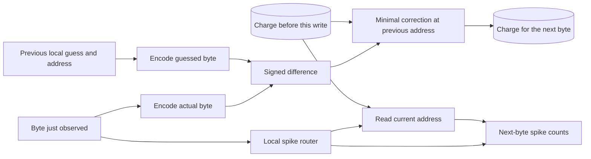

# Spiking memory for prediction errors

The [direct spike forecast follow-up](SPIKE_CODE_FORECAST.md) keeps
the stronger 16× router and predicts a compact spike code in one
vocabulary pass per byte.

The local spike router makes a provisional next-byte guess. When the byte
arrives, the same two synaptic projections encode both the guess and the
arrival as a signed spike count. Their difference supplies the target for
the cell nominated when the guess was made.

Let $C(x)$ denote the shared spike code, $m$ the charge of the
previously nominated cell, and $r_t$ the tolerance emitted by the
current local context. At byte $t$, the update is

$$
e_t = C(x_t) - C(\hat x_t), \qquad
m' = \operatorname{clip}(m, e_t-r_t, e_t+r_t).
$$

The implementation bounds $e_t$ to the charge range before forming
the interval. The first byte has no previous address. Each step reads
the current address before writing to the preceding one. The recalled
spikes enter the last membrane through a small synaptic projection. The
write depends on the local winner and on the byte that has already
arrived, so interval composition gives the same update as the
byte-by-byte integer path.



The observed-byte control uses the same address timing, spike code,
tolerance, and readout with $C(x_t)$ as its write target. This isolates
the subtraction. Both variants keep all local delay groups. The earlier
bank projects its target from context and adds recall inside the last
delay block. The error variant chooses its provisional byte by the
largest local spike count. The score margin between candidate bytes
does not enter the write target.

The experiment draws on error-driven memory in sequence models. Its
write target is a difference in learned spike codes, and its stored
state is integer membrane charge updated by interval projection.
[Correction code](../snnformer/correction_memory.py) ·
[Event decoder](../snnformer/event_lm.py) ·
[Gated DeltaNet](https://arxiv.org/abs/2412.06464) ·
[Titans](https://arxiv.org/abs/2501.00663)

## Matched comparison

Every model trains for 1,600 steps with two 2,048-byte windows per
step, for 6,553,600 enwik8 targets per seed. The six models use the same
sampled windows within seeds 0, 1, and 2. All four spiking decoders use
16× count resolution. The streaming budget is 32 KiB, including the
delay lines and the bank. The wider Transformer uses a 73,728-byte
attention state.

| Decoder | Parameters | Streaming tensor state |
|---|---:|---:|
| Plain spike router | 396,480 | 30,552 B |
| Original correction bank | 396,672 | 32,256 B |
| Observed-byte bank | 396,672 | 32,512 B |
| Prediction-error bank | 396,672 | 32,704 B |
| 39-byte local Transformer | 396,576 | 31,488 B |
| 94-byte local Transformer | 396,576 | 73,728 B |

Evaluation scores all 4,999,999 enwik8 targets and 8,404,368 targets from
16 complete PG-19 test books. PG-19 temperatures are fit per checkpoint
on eight different books from the official validation split. Memory
models carry the bank across evaluation chunks. The finite-context
models receive 256 preceding bytes at a chunk boundary to warm their
state. The intervention on the error bank hides reads of charge last
changed at least 128 bytes ago. Another pass hides every memory read.
Both interventions preserve memory writes and use the same fitted
temperature as the original checkpoint. The evaluator can share one
state trajectory across the read conditions. On 65,536 PG-19 targets
this produced the same losses, accuracy, and write statistics as
separate passes.
[Full PG-19 test manifest](../results/event_lm/correction_pg19_full_book_manifest.json) ·
[Calibration manifest](../results/event_lm/correction_pg19_validation_manifest.json)

## Held-out results

Three-seed means in bits per byte. PG-19 uses the validation temperatures.

| Decoder | enwik8 | Complete PG-19 books |
|---|---:|---:|
| Plain spike router | 2.3695 | **3.3572** |
| Original correction bank | 2.4580 | 3.4108 |
| Observed-byte bank | 2.4356 | 3.4334 |
| Prediction-error bank | 2.4153 | 3.3815 |
| 39-byte local Transformer | **2.3619** | 3.3675 |
| 94-byte local Transformer | 2.3684 | 3.3848 |

The error target beat the observed-byte target on PG-19 in all three
seeds by 0.0520 bits per byte on average. It beat the plain router and the
39-byte Transformer in seed 0, with a higher loss than both in the
other seeds. It trailed the plain router and both Transformers on the
complete enwik8 split in every seed.
[All evaluation records](../results/event_lm) ·
[Error seed 0](../results/event_lm/pg19_event_correction_error_error_long_s0.json) ·
[Seed 1](../results/event_lm/pg19_event_correction_error_error_long_s1.json) ·
[Seed 2](../results/event_lm/pg19_event_correction_error_error_long_s2.json)

| PG-19 read intervention | Calibrated loss increase | Raw loss increase |
|---|---:|---:|
| Hide charge last changed at least 128 bytes ago | +0.0174 | +0.0238 |
| Hide all reads | +0.0473 | +0.0512 |

Each intervention increased both losses in all three seeds. The
older-read loss increases were 0.0199, 0.0133, and 0.0192 after
calibration. In seed 0, including old reads improved loss on every book.
The write statistics matched across all three read conditions.

The earlier 512-byte training protocol used the same total number of
targets with different sampled windows. Scored on these complete books,
its 16× plain router averaged 3.3219, the 39-byte Transformer averaged
3.3297, and the 94-byte Transformer averaged 3.2944. The prediction-error
bank is behind all three references. The win over the matched plain router
and the 39-byte Transformer did not repeat across seeds, so this study
stays at the tested model size and training budget.
[Earlier training protocol](SPIKE_CORRECTION.md#spike-count-scaling) ·
[Earlier checkpoints on the full books, seed 0](../results/event_lm/pg19_prediction_error_short_training_refs_s0.json) ·
[Seed 1](../results/event_lm/pg19_prediction_error_short_training_refs_s1.json) ·
[Seed 2](../results/event_lm/pg19_prediction_error_short_training_refs_s2.json)

## Integer decoding

The seed-0 memory checkpoints emitted identical spike counts on 1,537
held-out PG-19 bytes in Metal batch inference and native CPU batch,
chunked, and byte-by-byte inference. The CPU audit checked tensor types
throughout the forward path. Turning off reads in the two new banks
recovered the local router's exact outputs with the same weights, and
left the final charge identical. The native error model generated 128
bytes from a text prompt. The repository tests passed 220 checks and
two subtests.
[Integer verification](../results/event_lm/prediction_error_integer_verification.json)

The error variant computes a local vocabulary prediction before its
corrected one. On 4,096 enwik8 validation bytes at seed 0, it emitted
615,432 pulses per byte from integrate-and-fire outputs, versus
307,731 in the plain router and 344,736 in the observed-byte variant.
Its bank emitted 127 write correction pulses per byte, versus 177 in
the observed-byte bank. These counts come from the integer decoder.
[Pulse counts](../results/event_lm/prediction_error_activity_s0.json)

## Reproduce

Set `enwik8` to the canonical raw file. These commands use Apple MPS and
the platform-independent int32 decoder can run on CPU.

```bash
enwik8=/path/to/enwik8
export PYTORCH_ENABLE_MPS_FALLBACK=0
for seed in 0 1 2; do
  train=(python experiments/train_event_lm.py --data "$enwik8" --device mps
         --seed "$seed" --dim 96 --depth 3 --ctx 2048 --bs 2 --steps 1600
         --warmup 80 --eval-every 400 --eval-bs 2 --eval-batches 16
         --final-eval-batches 48 --mlp-ratio 4.703125)
  for variant in event_correction_residual event_correction_observed event_correction_error; do
    "${train[@]}" --variant "$variant" --hidden 192 --no-carry --spike-resolution 16 \
      --tag error_long --checkpoint "checkpoints/${variant}_error_long_s${seed}.pt"
  done
  "${train[@]}" --variant event_steered --hidden 201 --no-carry --spike-resolution 16 \
    --tag error_long --checkpoint "checkpoints/event_steered_error_long_s${seed}.pt"
  "${train[@]}" --variant transformer_local --local-lookback 39 \
    --tag error_long_32k --checkpoint "checkpoints/transformer_local_error_long_32k_s${seed}.pt"
  "${train[@]}" --variant transformer_local --local-window 32 \
    --tag error_long_94 --checkpoint "checkpoints/transformer_local_error_long_94_s${seed}.pt"
done
```

Use `experiments/prepare_pg19.py` with the two manifests above to restore
the book files. Score enwik8 with `--enwik8 "$enwik8"` or complete books
with the matching manifest and its prepared directory. Use 2,048-byte
evaluation chunks, 256 warmup bytes, and a batch size of eight. For the
PG-19 comparison the temperature grid is 0.8, 1.0, 1.15, 1.25, 1.4, 1.5,
1.65, 1.8, 2.0, and 2.25. Add `--hide-memory-age 128 --hide-memory-age 1`
to the evaluation of the error checkpoint.
`experiments/generate_event_lm.py` also accepts the new checkpoint.
