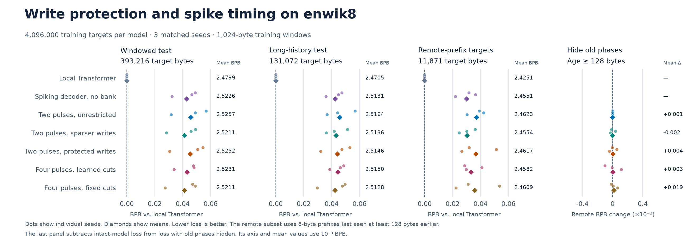
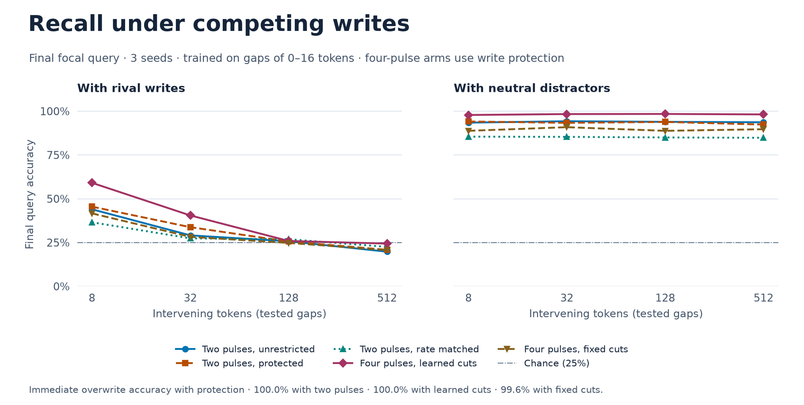

# Write protection and timing reads in the spiking decoder

The [paired-pulse study](PULSE_MEMORY.md) established that a query could
read membrane charge and restore it exactly. On enwik8, almost all
queries used recent writes. This iteration tests two changes inside the
spiking decoder, with the same 32-position local attention window.

The [follow-up write study](PULSE_WRITE_CREDIT.md) adds the shared learned
threshold control and measures the delayed effect of individual writes.

## What changed

**Protected writes.** An accepted write starts a per-cell cooldown. A write
at token `t` with hold `h` makes `t+h` the earliest next accepted write.
Rejected offers leave the charge and the cooldown unchanged. The cell
remains readable throughout. The language model uses 16 cells. Twelve
accept unrestricted writes, two have a 128-byte hold, and two have a
512-byte hold. The streamed implementation stores a cooldown per cell.
The batched implementation follows the same accepted-event sequence
using a successor scan. It propagates a local surrogate gradient through
eligible write proposals, with the discrete schedule fixed in backward.
[Write scheduling](../snnformer/pulse_memory.py)

**Four-pulse timing.** Each query proposes three cumulative integer cuts
between zero and 256. Sorting and differencing the cuts yields four
nonnegative increments that sum to 256. Exactly one pulse crosses the
threshold. Its time channel carries the result and subtractive reset
leaves the original phase. The hidden relay receives four one-hot event
channels per cell, one per substep. With two pulses, the relay receives
the first-pulse bit. The fixed timing control uses the same four channels
with cuts of 64, 128 and 192. The four-pulse design adds two pulse
applications per probe and increases the width of the input and output
projections. [Timing read](../snnformer/pulse_timing.py)

The pulse cycle is equivalent to comparing the stored charge against
ordered thresholds. Tests check the integer state and the emitted event,
including tied cuts, endpoints, and agreement between batched and
streaming execution. PyTorch simulates the neurons and timing channels.
Pulse applications and spike counts are modeled operation counts.

## Language protocol

Seven variants use the same canonical enwik8 split and the same
sampled training windows within each of seeds 0, 1 and 2. They train on
4,096,000 next-byte targets per run, with 1,024-byte context. The three
references are the local Transformer, the reset-per-byte spiking
decoder, and the unrestricted binary-read memory. The other variants
use protected writes with two pulses, protected writes with four
learned pulses, protected writes with four fixed pulses, or rate-matched
unrestricted writes with two pulses. The protected and sparse two-pulse
models have identical parameter counts. Both four-pulse models store
the same number of parameters, and the fixed-cut model's cut projection
weights are inactive.

The sparse control learns its write projection from next-byte loss.
For each seed, the corresponding protected two-pulse checkpoint sets
the target rates on a fixed sample of 65,536 training bytes. The sparse
model's write bias calibrates per cell, before training, every eight
training steps using a partial correction from the finished minibatch,
and at the end on the fixed training sample. Current-token inference
uses the stored bias. The final training calibration rates and the actual
held-out rates are recorded separately.

The language report includes the final test over disjoint 1,024-byte
windows and a second, paired probe over 131,072 targets preceded by at
least 1,024 input bytes. The predefined remote-prefix subset contains
targets whose previous eight bytes last occurred at least 128 bytes
earlier in the same window. To test the contribution of old phase, the
paired probe also hides every phase at least 128 bytes old from the read
comparison. Accepted writes, cooldowns and probe routing stay intact.
The report records actual write rates, spike counts, pulse applications,
and timing-bin event counts.

## Language results

Mean bits per byte across three seeds. Lower is better. Each windowed
test scores 393,216 targets. The remote-prefix subset contains 11,871
targets from the paired probe.

| Model | Parameters | Windowed test | Paired test | Remote-prefix subset |
| --- | ---: | ---: | ---: | ---: |
| Local Transformer | 357,696 | **2.4799** | **2.4705** | **2.4251** |
| Reset-per-byte spiking decoder | 362,688 | 2.5226 | 2.5131 | 2.4551 |
| Two pulses, unrestricted | 370,432 | 2.5257 | 2.5164 | 2.4623 |
| Two pulses, rate-matched unrestricted | 370,432 | 2.5211 | 2.5136 | 2.4554 |
| Two pulses, protected | 370,432 | 2.5252 | 2.5146 | 2.4617 |
| Four pulses, protected, learned cuts | 378,144 | 2.5231 | 2.5150 | 2.4582 |
| Four pulses, protected, fixed cuts | 378,144 | 2.5211 | 2.5128 | 2.4609 |

The sparse and protected two-pulse models both averaged **6.13 writes
per input byte** on the paired test. Their four slow cells averaged
0.0204 and 0.0208 writes per byte, respectively. Protected writes lost
to the sparse control on windowed test in all three seeds. Learned cuts
had mixed results against fixed cuts. The local Transformer led each
seed's windowed test.

Write protection increased the share of probes reading charge at least
128 bytes old from **0.003%** in the unrestricted bank to **7.55%**.
The sparse control reached **6.26%**. Hiding those old phases changed
the protected two-pulse model's mean remote-prefix loss by
approximately **+0.000004 bpb**. Across all five banks, the largest
absolute change in mean remote-prefix loss was under **0.00002 bpb**.
Old charge altered individual read outputs. Its effect on this test's
mean loss was negligible.

Each admitted probe emits one spike across its entire cycle. The
protected learned-cut model averaged 33.88 pulse applications and 8.47
read-cycle spikes per input byte, versus 15.97 and 7.99 for the protected
two-pulse model. Its four timing bins accounted for 17%, 34%, 31% and
18% of its probes. Streaming storage was 96,576 bytes for the protected
models, including 128 bytes of cooldowns. The unprotected two-pulse
model used 96,448 bytes, and the Transformer used 73,728 bytes.
[Seed 0](../results/pulse_iteration/seed0.json)
· [Seed 1](../results/pulse_iteration/seed1.json)
· [Seed 2](../results/pulse_iteration/seed2.json)



## Synthetic protocol

The [interference runner](../experiments/train_pulse_interference.py)
trains with gaps of zero to 16 tokens. Rivals write independent values
to other keys. Their writes use the same operation marker as focal
writes. Each complete two-token gap group can contain a rival write and
a query. The quiet control has no rival writes in the gap. A separate
query checks whether a legitimate, immediate same-key overwrite took
effect. The suite evaluates gaps of 8, 32, 128 and 512, with 512 episodes
per gap and seed. Synthetic protected cells use the repeating hold
pattern `0, 4, 16, 64` across 96 cells. Its sparse comparison uses
post-training bias calibration on separate 16-gap episodes. The
language sparse control additionally calibrates during training.

## Synthetic results

Each number pools 1,536 held-out episodes across three seeds. The table
scores the final focal-key query with rival writes and a 32-token gap.
Chance accuracy is 25%.

| Read | Unrestricted writes | Protected writes | Rate-matched unrestricted |
| --- | ---: | ---: | ---: |
| Two pulses | 29.10% | 33.79% | 27.41% |
| Four pulses, learned cuts | 32.16% | **40.49%** | 30.60% |
| Four pulses, fixed cuts | 31.25% | 28.26% | 30.92% |

With write protection in place, learned cuts beat fixed cuts in all
three seeds at gap 32. Those two models have the same phase storage and
readout width. The comparison changes both the ability to learn the cuts
and the ability to condition them on the query. The comparison with
two pulses also changes parameter count, from 20,452 to 31,012. At gaps
128 and 512 under competing writes, the protected learned-cut model
scored 25.91% and 24.41%. Without the competing writes, it scored 98.18%
at gap 512. Both the unrestricted and protected learned-cut models
scored 100% on immediate, legitimate same-key overwrites.
[Two-pulse records](../results/pulse_recall/write_interference_v1.json)
· [Learned four-pulse records](../results/pulse_recall/write_interference_timing_v1.json)
· [Fixed four-pulse records](../results/pulse_recall/write_interference_timing_fixed_v1.json)



## Reproduce

```bash
export ENWIK8_PATH=/absolute/path/to/enwik8

train() {
  variant=$1
  seed=$2
  shift 2
  python experiments/train_lm.py --variant "$variant" --levels 32 --device mps \
    --dim 96 --depth 3 --heads 4 --ctx 1024 --bs 4 --steps 1000 \
    --warmup 100 --eval-every 250 --eval-bs 8 --eval-batches 8 \
    --final-eval-batches 48 --lr 0.003 --seed "$seed" --tag pulse_iter_4m \
    --checkpoint "checkpoints/${variant}_iter_4m_s${seed}.pt" "$@"
}

for seed in 0 1 2; do
  for variant in transformer_local temporal_spike_reset temporal_pulse temporal_pulse_hold \
                 temporal_pulse_timing temporal_pulse_timing_fixed; do
    train "$variant" "$seed"
  done
  train temporal_pulse_sparse "$seed" \
    --match-pulse-writes "checkpoints/temporal_pulse_hold_iter_4m_s${seed}.pt"
  python experiments/eval_pulse_lm.py --device mps --old-phase-age 128 \
    --checkpoint "checkpoints/transformer_local_iter_4m_s${seed}.pt" \
      "checkpoints/temporal_spike_reset_iter_4m_s${seed}.pt" \
      "checkpoints/temporal_pulse_iter_4m_s${seed}.pt" \
      "checkpoints/temporal_pulse_sparse_iter_4m_s${seed}.pt" \
      "checkpoints/temporal_pulse_hold_iter_4m_s${seed}.pt" \
      "checkpoints/temporal_pulse_timing_iter_4m_s${seed}.pt" \
      "checkpoints/temporal_pulse_timing_fixed_iter_4m_s${seed}.pt" \
    --json "results/pulse_iteration/seed${seed}.json"
done

python experiments/train_pulse_interference.py --json results/pulse_recall/write_interference_v1.json
python experiments/train_pulse_interference.py --read-bins 4 \
  --json results/pulse_recall/write_interference_timing_v1.json
python experiments/train_pulse_interference.py --read-bins 4 --fixed-cuts \
  --json results/pulse_recall/write_interference_timing_fixed_v1.json
python experiments/plot_pulse_iteration.py

python experiments/generate_lm.py --checkpoint checkpoints/temporal_pulse_timing_iter_4m_s0.pt \
  --prompt 'The history of ' --bytes 48 --temperature 0.8 --seed 0
```

Append `--force` when replacing an existing training result. Select a
device available locally.
