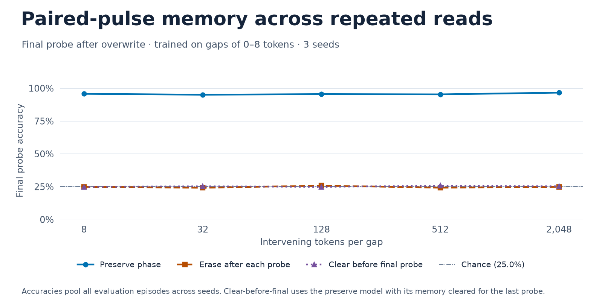
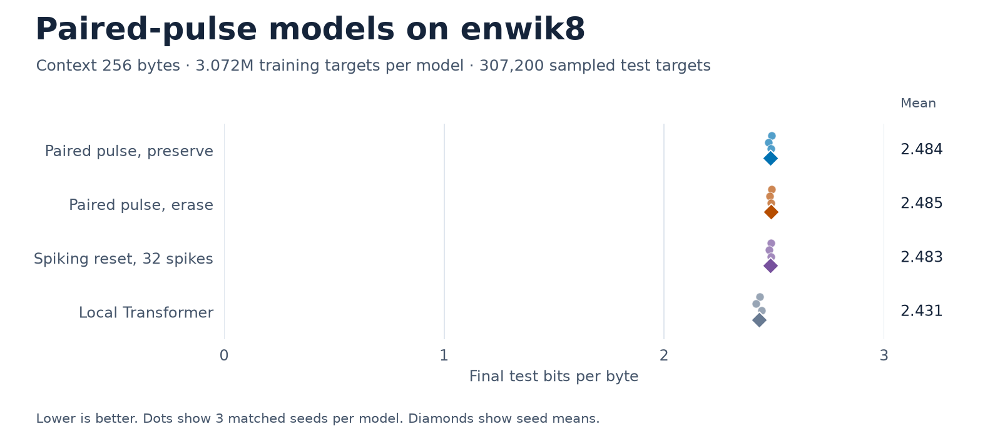

# Paired-pulse membrane memory

Temporal Spiking LM carries the fractional charge left over from
neuronal integration. This experiment adds a population of
nonleaky integrate-and-fire cells as explicit persistent state. A
learned write pulse replaces a cell's phase. A pair of complementary
currents reads one bit from the cell and restores the stored phase.
The design tests whether preserving that state through reads helps
synthetic recall or next-byte prediction. [Temporal Spiking LM](TEMPORAL_SNN.md)

The [follow-up study](PULSE_ITERATION.md) tests write protection, four-pulse
timing and learned versus fixed cuts under competing writes.

## Read, restore and write

Each cell has a threshold \(Q=256\) and an integer phase
\(s\in\{0,\ldots,Q-1\}\). A probe delivers an integer current \(q\) in
\([0,Q]\), followed by its complement \(Q-q\). Both pulses use
subtractive reset. In equations, with \(\mathbf{1}[\cdot]\) denoting
the binary threshold comparison,

```text
r1 = 1[s + q >= Q]
u  = s + q - Q * r1
r2 = 1[u + (Q - q) >= Q]
s' = u + (Q - q) - Q * r2
```

The pulse pair adds exactly one threshold's worth of charge. The
intermediate phase `u` is in `0..255`, and the second pulse fires
exactly when the first did not. Thus `r1 + r2 = 1` and `s' = s`
for all `256 × 257 = 65,792` phase and probe-current pairs. The
readout routes only `r1` to the next computation. An event tally
includes both pulses, including the second pulse when it fires.

The first pulse reports whether the stored phase meets the probe's
threshold `Q - q`. For example, a probe of 80 tests whether the phase
is at least 176. Starting from phase 200, the first pulse emits one
spike and leaves phase 24. The second adds 176 and returns the phase
to 200. Repeating the same probe returns the same bit until a write
changes the phase.

A hard binary spike can authorize a per-cell write after the read.
The write stores an integer phase derived from a learned projection
of incoming spikes. In the restorative version, cells retain their
phase until an authorized write. The destructive control delivers
the same two pulses and reports the same first-pulse bit for a given
pre-read phase, then erases the probed cells before applying any
authorized writes. This order keeps the immediate read rule fixed
while changing what persists to later tokens.

## What the experiment isolates

The synthetic task supplies visible operation masks for permitted
write and probe positions. The language model instead uses its learned
binary read and write decisions without those task masks. The bank sits
in the last decoder block. Its first-pulse events feed a synaptic projection
into that block's output neurons. Those neurons emit the spikes consumed
by the vocabulary projection. The memory state is the vector of phase values,
updated from spike projections. [Memory source](../snnformer/pulse_memory.py)
· [Decoder integration](../snnformer/temporal_snn.py)
An 8-bit phase has 256 possible values and each probe returns one
bit. Storage therefore depends on the number of cells. With no
intervening overwrite or destructive read, the phase survives any
number of idle steps. That algebraic property says only that a
stored phase survives. Learning which phases to write and how to
probe them is a separate question that the tasks measure.

The model uses discrete spike decisions and integer-valued phase in
its forward rule. Floating-point tensors can represent every phase
and pulse current in this rule exactly. Learned projections and the
training gradients run in PyTorch. The backward pass uses surrogate
gradients for hard decisions. A count of pulse applications and emitted
spikes describes the modeled operations. It is distinct from a measured
neuromorphic energy cost. The batched simulator evaluates the first pulse
and applies the analytical state transition after the restoring pulse.
Streaming evaluation applies both increments explicitly.

## Evaluation protocol

The synthetic model learns four random key–value bindings per episode
with 16 possible keys and four possible values. Every query uses a common
sentinel in place of a value. Episodes interleave distractors and reads of
other keys. An explicit overwrite replaces the focal binding midway through
the episode. Outside the designated write positions, the task allows no
writes. The two trained arms use the same initial weights and generated
examples within each seed. A third condition uses the preservation model's
weights and clears its bank immediately before the final query. The score
is exact value classification, with 25% chance accuracy.

Training gaps are 0–8 tokens. Final evaluation uses 1,024 matched episodes
per gap and seed at gaps of 8, 32, 128, 512 and 2,048. The language model
uses a separate training run with learned operation decisions on ordinary
bytes. The two pulse variants and the earlier baseline models each use
3,072,000 sampled enwik8 training targets per seed, 256-byte training
windows and a 32-position local attention window. The two pulse variants
have the same 370,432 parameters and differ only in whether a read erases
the probed cell. The previously trained controls are the reset-per-byte
spiking decoder and the conventional local Transformer.

The paired long-history probe scores the same 131,072 targets per model
with 1,024 unscored preceding input bytes per window and 128 scored target
bytes. The remote subset uses only the preceding bytes. It includes a
target if its preceding eight-byte sequence last appeared at least 128
bytes earlier in the same window. A separate inference run clears only
the bank before each scored byte. Event totals include probes on both
history and scored input positions. Each authorized probe emits exactly
one spike across its two pulses, and writes are counted separately.

## Repeated-recall results

The preserving model's final-query accuracy was 95.7%, 95.1%, 95.5%,
95.3% and 96.6% across the five tested gaps. At the largest gap, each
condition pooled 3,072 episodes across three seeds.

| 2,048-token gap | First focal read | Repeated focal read | First read after overwrite | Final repeated read |
| --- | ---: | ---: | ---: | ---: |
| Preserve phase | 92.74% | 92.74% | 96.65% | **96.65%** |
| Erase probed cells after each read | 66.63% | 24.84% | 100.00% | 24.90% |
| Preserve, then clear immediately before final read | 92.74% | 92.74% | 96.65% | 25.29% |

When the overwrite changed the correct value, the preserving model
answered 95.61% of final queries correctly. Clearing the bank left
earlier scores unchanged. The preservation advantage applies to repeated
reads with four bindings and no competing writes in the distractor gaps.
[Raw accuracy and firing counts](../results/pulse_recall/repeated_reads_v1.json)



## enwik8 results

Scores are means of three matched seeds. Lower bits per byte is better.
The last two columns use the paired 1,024-byte-history probe. Its remote
subset contains 11,871 targets.

| Model | 256-byte window test | Long-history test | Remote-prefix subset |
| --- | ---: | ---: | ---: |
| Paired-pulse memory, preserve | 2.4840 | 2.4731 | 2.4121 |
| Paired-pulse memory, erase | 2.4851 | 2.4746 | 2.4129 |
| Reset-per-byte spiking decoder | 2.4833 | 2.4731 | 2.4123 |
| Conventional local Transformer | **2.4314** | **2.4197** | **2.3741** |

The preserving arm's difference from the reset spiking model changed
sign across seeds in both protocols. Clearing the preserving bank before
each target increased mean long-history loss by 0.0011 bpb and remote
subset loss by 0.0006 bpb. This comparison showed no consistent language
modeling advantage from adding the bank.
[Paired losses, seed 0](../results/pulse_lm/seed0.json)
· [Seed 1](../results/pulse_lm/seed1.json)
· [Seed 2](../results/pulse_lm/seed2.json)

In the preserving model, the 16 cells averaged 7.90 writes and 8.17
read-cycle spikes per input byte. The probe and write authorization events
are counted separately from the read-cycle spikes. The bank added 64 bytes
of FP32 streaming tensor storage per stream, for 96,448 bytes across the
full model's streaming tensors. Its information capacity is 16 bytes of
integer phase. The conventional Transformer used 73,728 streaming bytes.

A separate analysis of seed 0 on 128 held-out 1,024-byte windows found
a median of one byte since the last write to a probed, initialized cell.
Only 18 of 1,101,668 probes reached a phase at least 128 bytes old.
Five emitted spikes that would disappear if that phase were zeroed with
the probe held fixed. This measures the age of the directly stored phase.
An older input can still affect a newer write through the model's context.
[Phase-age diagnostic](../results/pulse_lm/phase_age_seed0.json)



## Reproduce

```bash
python experiments/train_pulse_recall.py --threads 4 --steps 800 \
  --eval-samples 1024 --eval-gaps 8 32 128 512 2048 \
  --json results/pulse_recall/repeated_reads_v1.json

export ENWIK8_PATH=/absolute/path/to/enwik8
for seed in 0 1 2; do
  for variant in temporal_pulse temporal_pulse_erase; do
    python experiments/train_lm.py --variant "$variant" --device mps \
      --dim 96 --depth 3 --heads 4 --ctx 256 --bs 12 --steps 1000 \
      --warmup 100 --eval-every 250 --eval-bs 12 --eval-batches 10 \
      --final-eval-batches 100 --lr 0.003 --seed "$seed" --tag pulse_3m \
      --checkpoint "checkpoints/${variant}_3m_s${seed}.pt"
  done
done
```

Use the [Temporal Spiking LM reproduction commands](TEMPORAL_SNN.md#reproduce-the-enwik8-comparison)
to train the matched controls. Append `--force` to a training command
to replace existing results. Select the device available locally.

```bash
python experiments/eval_pulse_lm.py --device mps \
  --checkpoint checkpoints/temporal_pulse_3m_s0.pt \
    checkpoints/temporal_pulse_erase_3m_s0.pt \
    checkpoints/temporal_spike_reset_p32_temporal_3m_s0.pt \
    checkpoints/transformer_local_p4_temporal_3m_s0.pt \
  --json results/pulse_lm/seed0.json

python experiments/inspect_pulse_age.py --checkpoint checkpoints/temporal_pulse_3m_s0.pt \
  --window-count 128 --window-bytes 1024 --min-age 128 --device cpu \
  --json results/pulse_lm/phase_age_seed0.json

python experiments/generate_lm.py --checkpoint checkpoints/temporal_pulse_3m_s0.pt \
  --prompt 'The history of ' --bytes 64 --temperature 0.8 --seed 0

python experiments/plot_pulse_memory.py
```

## Related work

- Paired-pulse facilitation is an established biological effect in
  which the response to a second presynaptic stimulus depends on the
  first. Here the complementary second input provides exact phase
  restoration in an idealized accumulator. [Jackman et al., 2016](https://pmc.ncbi.nlm.nih.gov/articles/PMC4729191/)
- Mongillo, Barak and Tsodyks model working memory as stored in
  transient synaptic facilitation, with spiking activity loading,
  refreshing and reading the state. Here the persistent quantity is
  a nonleaky cell's bounded membrane phase. [Mongillo et al., 2008](https://barak.net.technion.ac.il/files/2012/11/synapticmemory.pdf)
- NeuronSpark already uses input-dependent spiking membrane state for
  language modeling. Its neuron dynamics use token-dependent decay,
  gain and threshold with subtractive reset, and its associative
  memory accumulates gated key–value outer products. The experiment
  here tests a fixed-threshold phase read and restoration rule at
  individual cells. [NeuronSpark, §3.2](https://arxiv.org/html/2603.16148#S3.SS2)
