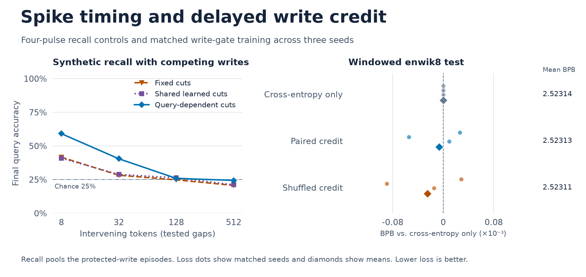

# Testing which spiking memory writes help later predictions

The [write protection and timing study](PULSE_ITERATION.md) found that the
decoder could retain charge for hundreds of bytes. Hiding old charge had
little effect on enwik8 loss. This study measures individual writes and
tests whether their measured effects can train the gate that chooses
which writes to accept.

## Shared learned pulse thresholds

The four-pulse bank already has one control with fixed cuts and one with
cuts that depend on the query. The new control learns three thresholds
per cell and uses them for every query. It starts from the same cuts as
the fixed control, at 64, 128 and 192 charge ticks. It uses the cut bias
parameters and bypasses their projection weights. All three models
store the same number of parameters and produce the same four timing
channels. The shared cuts moved during training.

On synthetic recall with competing writes and a 32-token gap, the
protected models scored 28.26% with fixed cuts, 28.84% with shared
learned cuts and 40.49% with query-dependent cuts. Query-dependent cuts
beat the shared control in each of three seeds. The gap-128 scores were
near 25% chance for all three. The outcome supports query dependence for
this synthetic task at the tested shorter gap.
[Shared-cut synthetic results](../results/pulse_recall/write_interference_timing_global_v1.json)

Under the same enwik8 protocol with 4,096,000 sampled training targets,
the fixed, shared and query-dependent models averaged 2.52110, 2.52288
and 2.52312 test bits per byte across three seeds. The shared control
scored 2.46258 on the paired remote-prefix subset. Hiding phases at
least 128 bytes old changed that loss by −0.00005 bits per byte.
[Seed 0](../results/pulse_global/seed0.json)
· [Seed 1](../results/pulse_global/seed1.json)
· [Seed 2](../results/pulse_global/seed2.json)

## Replay of one accepted write

For each frozen query-dependent checkpoint, the diagnostic samples eight
protected writes with replacement from each of 128 disjoint 1,024-byte
windows, on each of the canonical enwik8 validation and test splits. Every
sampled write has the full delay of 128–512 bytes available in its window.
The replay replaces the write's charge with the cell's charge immediately
before that write. It uses the original cooldown schedule, probe gates,
pulse cuts and later writes. The change applies only when a delayed probe
would read that write's charge. The original and replay use the same target
bytes. Their loss difference measures the marginal effect of the selected
write under the original routing. A positive difference means the new
charge helped. An unchanged prediction contributes zero.
[Diagnostic](../experiments/inspect_write_credit.py)

On held-out test, 1,494 of 3,072 sampled writes changed at least one
delayed read. Averaged over each write's 385 delayed targets, 753 writes
helped, 696 hurt, and 1,623 were within 0.000001 bits per byte of zero.
Mean effects for seeds 0, 1 and 2 were +0.00000958, +0.00003865 and
−0.00000341 bits per byte. Validation also had mixed signs. The raw
results give the full distribution and the loss conditional on probes
that still had access to the write. Replay of the factual read matched
the original logits exactly on the tested CPU and Metal batches.
[Frozen checkpoint results](../results/pulse_credit/frozen_write_credit_v1.json)

Estimating a memory update by comparing future loss between old and new
memory has precedent in textual-memory systems. The experiment here
changes the charge of one spiking cell with the rest of the recorded
schedule fixed. [Long-horizon memory optimization](https://arxiv.org/html/2609.37930v1#S2)

## Write gate training

Starting from each of the same three checkpoints, the training probe
updates only the write gate weights and biases for the four protected
cells. The readout, payload projection and other decoder parameters stay
fixed during this probe. Each arm uses the same 192 minibatches of four
1,024-byte windows from the training split, for 786,432 continuation
targets. Four sampled writes per window give up to 3,072 credit labels.
For each write, its mean paired loss difference defines a signed label.
The magnitude weights a binary loss on the gate, scaled by the 95th
percentile of nonzero absolute scores and clipped at one. The auxiliary
loss has coefficient 0.05. The three arms use next-byte loss alone,
next-byte loss with the measured write scores, or both losses with
scores permuted within each cell. The arms share the same frozen label
computation. Training and calibration use the training split. Rate
calibration fits each final gate's bias against the original checkpoint
on a separate fixed set of 65,536 training bytes. Held-out rates are
measured again with the trained checkpoints.
[Training runner](../experiments/train_write_credit.py)

The paired held-out probe uses the same 131,072 targets and the same
11,871 remote-prefix targets as the previous study. It also hides phases
at least 128 bytes old at read time. This intervention tests the impact
of old charge across the bank.

| Write gate training | Windowed test | Paired test | Remote-prefix subset |
| --- | ---: | ---: | ---: |
| Next-byte loss | 2.523139 | 2.514948 | 2.458219 |
| Next-byte loss plus paired write credit | 2.523132 | 2.514917 | 2.458148 |
| Next-byte loss plus shuffled write credit | 2.523114 | 2.514949 | 2.458181 |

These are three-seed mean bits per byte. The largest gap between
windowed test means was 0.000025 bits per byte, with shuffled credit
slightly ahead. The direction of the paired-credit difference from the
next-byte control changed across seeds on both windowed and remote-prefix
test. Hiding old charge changed the paired-credit model's mean
remote-prefix score by +0.0000095 bits per byte. The mean held-out
write rates for the four protected cells were 0.020678, 0.020673 and
0.020672 accepted writes per input byte, respectively. This training
probe did not establish a benefit from the paired credit signal.
[Held-out scores, seed 0](../results/pulse_credit/heldout_seed0.json)
· [Seed 1](../results/pulse_credit/heldout_seed1.json)
· [Seed 2](../results/pulse_credit/heldout_seed2.json)



## Reproduce

```bash
export ENWIK8_PATH=/absolute/path/to/enwik8
python experiments/inspect_write_credit.py --device cpu --window-count 128 --draws 8 \
  --checkpoint checkpoints/temporal_pulse_timing_iter_4m_s0.pt \
    checkpoints/temporal_pulse_timing_iter_4m_s1.pt \
    checkpoints/temporal_pulse_timing_iter_4m_s2.pt \
  --json results/pulse_credit/frozen_write_credit_v1.json

for seed in 0 1 2; do
  python experiments/train_write_credit.py --device mps --seed "$seed" \
    --checkpoint "checkpoints/temporal_pulse_timing_iter_4m_s${seed}.pt"
  python experiments/eval_pulse_lm.py --device mps --old-phase-age 128 \
    --checkpoint "checkpoints/pulse_credit_ce_v1_s${seed}.pt" \
      "checkpoints/pulse_credit_paired_v1_s${seed}.pt" \
      "checkpoints/pulse_credit_shuffled_v1_s${seed}.pt" \
    --json "results/pulse_credit/heldout_seed${seed}.json"
done
```

The [pulse iteration reproduction commands](PULSE_ITERATION.md#reproduce)
train the base checkpoints. Add `temporal_pulse_timing_global` to that
protocol to train the shared-cut language model. Its three [paired
evaluations](../results/pulse_global) use the same `eval_pulse_lm.py`
settings.

```bash
python experiments/train_pulse_interference.py --read-bins 4 --global-cuts \
  --json results/pulse_recall/write_interference_timing_global_v1.json
python experiments/plot_write_credit.py --include-remote
```
