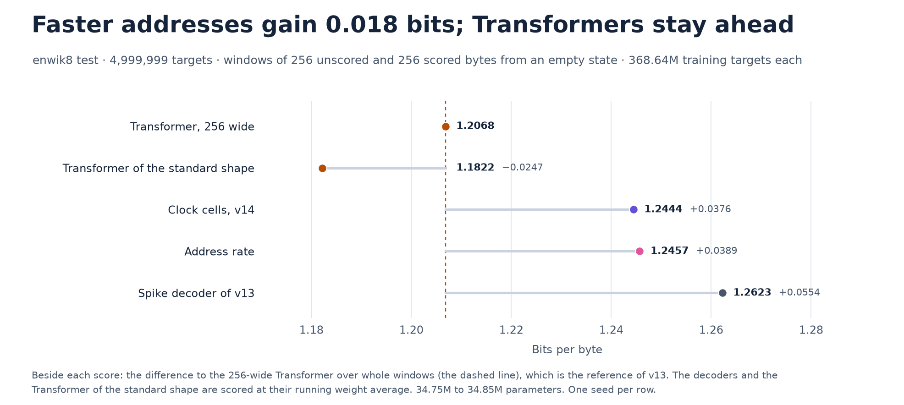
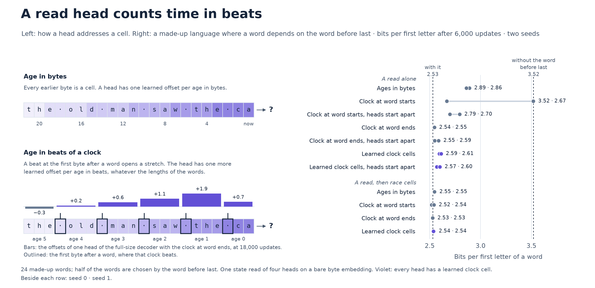
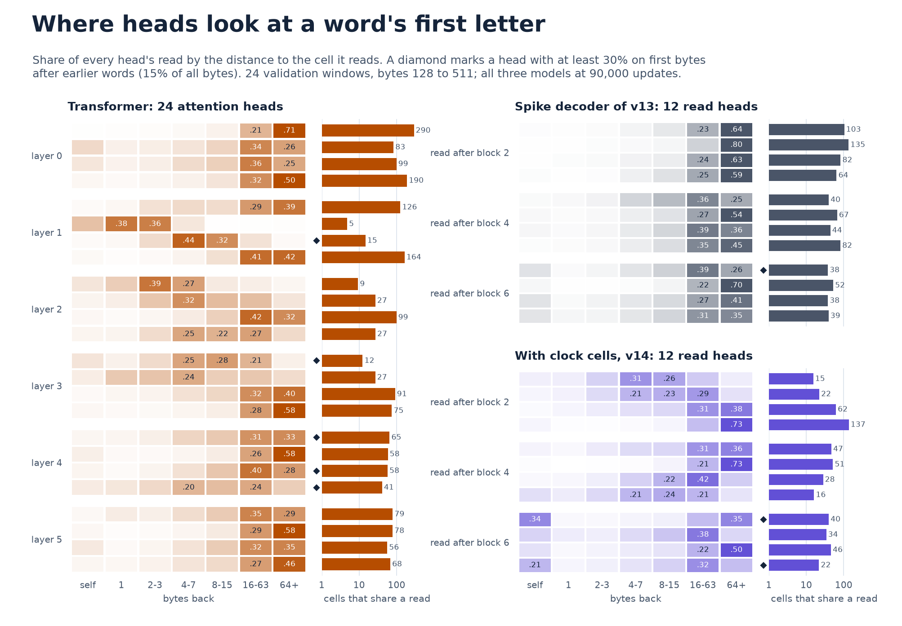
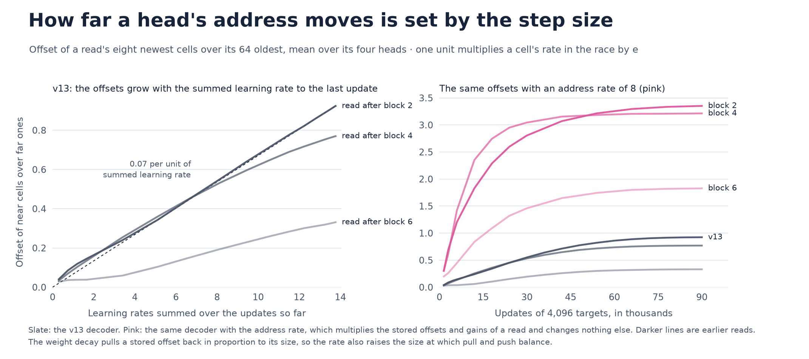
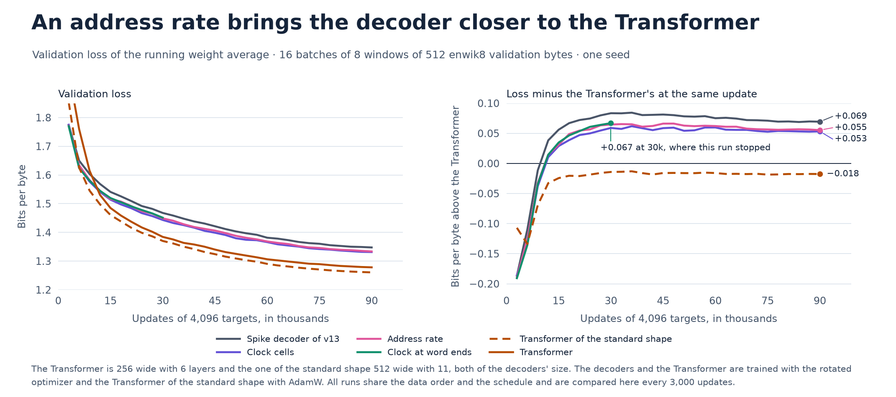
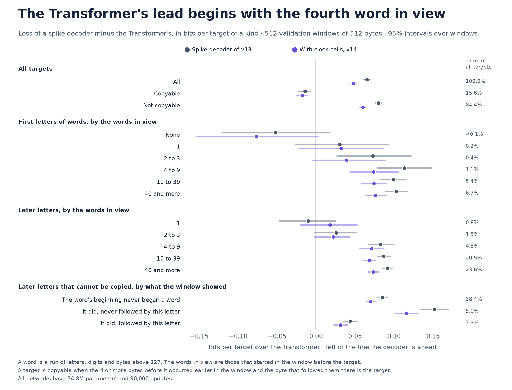
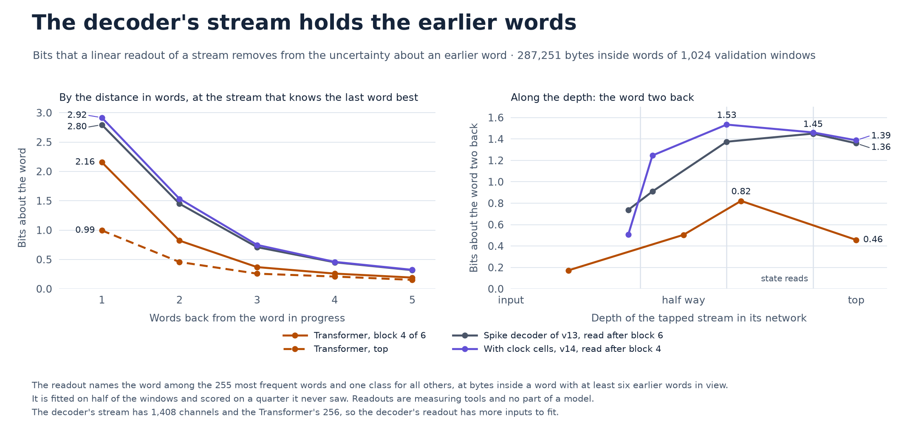

# Read clocks and the address rate

## Complete enwik8 test

A spike-only decoder whose read heads learn their addresses eight
times as fast scores **1.2444 bits per byte** on 4,999,999
held-out enwik8 predictions. The v13 decoder scores 1.2623 under
the same scoring, and the full-attention Transformer that v12 and
v13 were measured against scores 1.2068. The distance to that
Transformer fell from 0.055 to 0.038 bpb.

The gain is the address rate's. The released decoder also has a
clock cell for every read head, and the same decoder without
clocks scores 1.2457. The 0.0013 between the two is less than a
second run moves a decoder. A Transformer of the standard shape
and the same size, trained for this study, scores 1.1822. It is
the stronger reference, and the released decoder is 0.062 bpb
above it.

| Model, 368.64M training targets from scratch | Parameters | enwik8 test | Over the 256-wide Transformer | Paired 95% interval |
|---|---:|---:|---:|---:|
| Transformer, 256 wide, AdamW | 34,845,696 | 1.2068 | | |
| Transformer, 256 wide, rotated optimizer | 34,845,696 | 1.2041 | −0.0028 | −0.0034 to −0.0021 |
| Transformer of the standard shape, AdamW | 34,752,000 | 1.1822 | −0.0247 | −0.0253 to −0.0241 |
| **Clock cells and address rate, released** | 34,822,736 | **1.2444** | +0.0376 | +0.0369 to +0.0384 |
| Address rate | 34,819,544 | 1.2457 | +0.0389 | +0.0381 to +0.0397 |
| v13 decoder | 34,819,544 | 1.2623 | +0.0554 | +0.0546 to +0.0562 |

Every row is one model with one seed. All six received the same
512-byte training windows in the same order. Every window of the
test starts from an empty state and holds 256 unscored bytes
before its 256 scored ones. The intervals resample whole windows.
All rows but the first are scored with their running weight
average. The last weights score 1.2447 with clock cells, 1.2454
with the address rate alone and 1.1825 for the Transformer of the
standard shape.

The 256-wide Transformer has 6 layers, 24 heads and an MLP of 42
times its width, which is the shape v12 gave it to match a
decoder. The Transformer of the standard shape is 512 wide with
11 layers, 8 heads and an MLP of 4 times its width.

Two limits come first.

**The Transformer is still ahead.** The released decoder is 0.038
bpb above the 256-wide Transformer and 0.062 above the one of the
standard shape. On validation the decoders lead the 256-wide
Transformer up to 9,000 updates and are level with the standard
one at 6,000. Both Transformers take their lead between there and
30,000 updates, and it changes little after that.
[Where the gap is](#where-the-gap-is)

**The decoder has no stream form.** State reads and race cells
run inside 512-byte windows only, as in v13. There is no
streaming score, no native integer run and no pulse audit for
this decoder, and it writes text only by running a whole window
for every byte. Both races are computed in closed form and in
floating point.
[Limits](#limits)

**PG-19.** On 16 complete PG-19 test books, 8,404,368 targets,
the released decoder scores 1.5338 bpb, the decoder with the
address rate alone 1.5360 and the v13 decoder 1.5516. The
256-wide Transformer scores 1.4821 and the one of the standard
shape 1.4570. The released decoder is 0.0517 behind the first,
with a paired 95% interval of 0.0511 to 0.0522, and 0.077 behind
the second. The scoring is the one above, with every book a
passage of its own. One temperature per model is fitted on eight
separate validation books, and the fit is 1 for every model. The
training mixture holds PG-19 training books, so these are
held-out books of a trained domain.



[Records](../results/event_lm/read_clocks) ·
[Diagnostics](../experiments/read_clocks) ·
[Restore and rescore](V14_HANDOFF.md) ·
[All arms](READ_CLOCKS_ARMS.md)

## What changed in the circuit

The circuit is the v13 decoder: a stream of 1,408 channels
through eight blocks, race cells on delayed fibres after blocks
0, 1, 3 and 5, and a state read after blocks 2, 4 and 6.
[v13 circuit](STATE_READS.md#the-circuit)

A read head charges every earlier byte's cell by the match of
the present probe with the cell's tag, times a learned gain, plus
a learned offset for the cell's age in bytes. The cells then race
for 256 spikes. This study changes how those charges are learned
and adds a second kind of age.

**Address rate.** The gains and the age offsets are charges, and
a charge has to move further than a synapse does: one unit of
charge multiplies a cell's rate in the race by e. With
`--read-address-rate 8` their stored values count eight times, so
that one update moves them eight times as far. The decoder keeps
its 34,819,544 parameters.

**Age in beats.** With `--read-beats 8` every head has nine more
offsets, for a cell's age in beats of a clock: 0 to 7, and one
for all older cells. A cell's age in beats is the number of beats
that fell after it. The clock at word ends beats at the first
byte after every word, which the bytes themselves tell: a byte
that is no letter, digit or byte of a longer character, after one
that is. Under that clock the cells of the word in progress have
age 0, the cells of the word before it age 1, and so on, whatever
the lengths of the words. The three reads gain 108 parameters.

**Clock cells.** With `--read-clock learned` every head has a
clock cell instead, and its spike is the beat. The cell hears the
256 tag channels of its read through synapses that start silent,
and it starts by beating on a quarter of the bytes. A head then
counts a cell's age in whatever its clock cell has learned to
mark. Whole beats decide the ages. The clock cell learns from the
mean offset over clocks that beat with its chances. The three
reads gain 3,192 parameters.

| Decoder | Flags added to the v13 command | Parameters |
|---|---|---:|
| Address rate | `--read-address-rate 8` | 34,819,544 |
| Clock at word ends | the above and `--read-beats 8 --read-beat-start 1 --read-clock end` | 34,819,652 |
| Clock cells | the above with `--read-clock learned --lr-scale clock_rest=8` | 34,822,736 |

`--read-beat-start 1` starts every head with one unit of charge
for an age of its own, the first head for the word in progress,
the next for the word before, and so on, so that the heads do not
all turn to the same word.



## What the v13 reads were doing

The study began with the released v13 decoder and the question of
what its twelve read heads address.

**They are broad.** At a word's first letter 38 to 135 cells
share one read, and the largest share of a single cell is 0.06 to
0.26. Most of every head's read comes from cells 16 or more bytes
back. No head puts more than 19% of its read on the word in
progress or on any one of the three words before it.
[Head use of the decoder](../results/event_lm/read_clocks/head_use_decoder_v13.txt)

**The Transformer's heads are sharp.** In its layers 1 to 3 the
Transformer of the v13 release, trained with the rotated
optimizer, holds heads that share a read among 5 to 27 cells, 1
to 15 bytes back. Two heads put 82% and
92% of their read on the word in progress, one 46% on the word
before it, and one 54% on the first bytes after earlier words,
which are 15% of all bytes.
[Head use of the Transformer](../results/event_lm/read_clocks/head_use_transformer.txt)



**The match addresses, the age hardly does.** Over the cells of a
window the match of probe and tag spreads the charges by 0.8 to
2.4 units, and the offsets for the age in bytes by 0.1 to 0.3.
Probe and tag carry 4 to 8 pulses per channel, so the match is
not coarse.
[Match statistics](../results/event_lm/read_clocks/read_match_stats_decoder_v13.txt)

**The reads carry the decoder.** On 96 validation windows the v13
decoder scores 1.3865 bits per byte as trained, 1.8133 when every
head ignores the match and 1.9347 without reads. Losing the match
costs the copyable targets most, 0.22 against 1.06 bits, and the
other targets 0.35.
[Read ablation](../results/event_lm/read_clocks/read_ablate_decoder_v13.txt)

**The addresses never arrived.** In the v13 run the offset of a
read's eight newest cells over its 64 oldest grew by 0.07 for
every unit of summed learning rate, from the first evaluation to
the last update: 0.04, 0.24, 0.55 and 0.92 at 1,500, 12,000,
30,000 and 90,000 updates for the read after block 2. It stopped
where the learning rate did. So the size of these charges was set
by the step size and not by what the reads needed.
[Addresses of the v13 run](../results/event_lm/read_clocks/read_addresses_decoder_v13.json)



## The made-up language

In the made-up language of the v13 study a word depends on the
word before last. A model that cannot use that word scores 3.52
bits on a word's first letter, and one that can 2.53. Each arm is
a small decoder with one read of four heads after 6,000 updates
on a laptop CPU.

| Read | Seed 0 | Seed 1 |
|---|---:|---:|
| Ages in bytes | 2.891 | 2.860 |
| Clock at word starts | 3.519 | 2.668 |
| Clock at word starts, heads start apart | 2.794 | 2.700 |
| Clock at word ends | 2.542 | 2.546 |
| Clock at word ends, heads start apart | 2.551 | 2.588 |
| Clock cells | 2.595 | 2.612 |
| Clock cells, heads start apart | 2.570 | 2.600 |
| Ages in bytes, then race cells | 2.548 | 2.547 |
| Clock at word starts, then race cells | 2.520 | 2.542 |
| Clock at word ends, then race cells | 2.527 | 2.529 |
| Clock cells, then race cells | 2.542 | 2.536 |

A read with ages in bytes cannot name the word before last,
because the words between have no fixed length. A clock at word
ends reaches the bound with the read alone. Clock cells come
within 0.09 bits of it.

**A beat belongs at the end of a word.** A clock that beats at a
word's first letter fails on one seed. Seen from the gap after a
word that word has age 0, and seen from inside the next word it
has age 1, so no single offset addresses it. A beat at the first
byte after a word gives every word one age from all later bytes.
The clock cells found that phase without being told: in every
run two of the four came to beat on the spaces and nowhere else,
with 99% to 100% of their beats there.

A layer of race cells after the read closes the rest for every
kind of read, the one with ages in bytes too. The language is
small enough for the cells to sort out what a broad read brings.
[Seed 0](../results/event_lm/read_clocks/word_time_reads_s0.json) ·
[Seed 1](../results/event_lm/read_clocks/word_time_reads_s1.json) ·
[Probe](../experiments/probe_word_time.py)

## Three decoders of full size

The three decoders were trained from scratch on a server GPU
with the data order and the schedule of v13, beside a Transformer
of the standard shape. The decoder with the clock at word ends
was paused at 30,000 updates to give its share of a GPU to the
pilots below, and was not taken up again.

| Updates | Transformer, 256 wide | Transformer, standard shape | v13 decoder | Clock cells | Address rate | Clock at word ends |
|---:|---:|---:|---:|---:|---:|---:|
| 3,000 | 1.9608 | 1.8538 | 1.7743 | 1.7751 | 1.7715 | 1.7701 |
| 6,000 | 1.7597 | 1.6259 | 1.6499 | 1.6262 | 1.6341 | 1.6238 |
| 9,000 | 1.6148 | 1.5455 | 1.6033 | 1.5769 | 1.5823 | 1.5803 |
| 12,000 | 1.5304 | 1.4976 | 1.5687 | 1.5408 | 1.5450 | 1.5448 |
| 18,000 | 1.4587 | 1.4382 | 1.5256 | 1.4974 | 1.5075 | 1.5052 |
| 24,000 | 1.4172 | 1.3986 | 1.4918 | 1.4671 | 1.4737 | 1.4780 |
| 30,000 | 1.3844 | 1.3702 | 1.4678 | 1.4433 | 1.4490 | 1.4513 |
| 42,000 | 1.3502 | 1.3318 | 1.4309 | 1.4055 | 1.4124 |  |
| 60,000 | 1.3064 | 1.2904 | 1.3815 | 1.3661 | 1.3685 |  |
| 90,000 | 1.2783 | 1.2607 | 1.3476 | 1.3315 | 1.3336 |  |

Validation loss of the running weight average in bits per byte,
on 16 batches of 8 windows of 512 enwik8 validation bytes. The
256-wide Transformer is the one trained with the rotated
optimizer, as the decoders are. The final evaluation on 64
batches gives 1.3239 with clock cells, 1.3254 with the address
rate alone and 1.2574 for the Transformer of the standard shape.



**The address rate is the gain.** With it the decoder is 0.014
bpb better on validation at 90,000 updates, 0.017 on the test and
0.016 on PG-19. The offsets of a read's eight newest cells over
its 64 oldest end at 3.4, 3.2 and 1.8 units in the three reads,
where v13 ended at 0.9, 0.8 and 0.3. At 30,000 updates, with 60%
of the summed learning rate spent, they have 84%, 95% and 80% of
their final size. In v13 they had 60%, 69% and 59% of it there.
So these charges are no longer set by the step size alone.
[Addresses with the address rate](../results/event_lm/read_clocks/read_addresses_address_rate.txt)

**The heads sharpened.** In v13 no head put more than 19% of its
read on the word in progress or on any one of the three words
before it. With the address rate alone one head of the read after
block 4 shares its read among 16 cells, and puts 38% of it on the
word in progress at a word's first letter and 41% on the word
before at a later letter. The released decoder holds two such
heads, one after block 2 and one after block 4. Other heads
stayed broad. The broadest shares its read among 137 cells in the
released decoder and among 168 with the address rate alone.
[Head use with the address rate](../results/event_lm/read_clocks/head_use_address_rate.txt) ·
[Head use of the released decoder](../results/event_lm/read_clocks/head_use_decoder_v14.txt)

**The clocks add nothing that a second run would not.** The
decoder with clock cells led the one with the address rate alone
by 0.007 bpb at 24,000 updates and leads it by 0.002 at 90,000.
On the test the two are 0.0013 apart and on PG-19 0.0022. The
decoder with the clock at word ends, which is told where the
words end, was level with the address rate alone when it was
paused: 1.4513 against 1.4490. A second run of that decoder on
another machine ended 0.006 from the first at 12,000 updates, so
none of these differences is a result.

**The clock cells did not find the words.** In the made-up
language two of four clock cells came to beat on the spaces and
nowhere else. In the released decoder no clock cell does. The
twelve cells beat at 4% to 46% of the bytes, and 12% to 34% of a
cell's beats fall on the first byte after a word, where 15% of
all bytes lie. The nearest to a word clock is one cell of the
read after block 6: a third of its beats fall after a word, it
marks 59% of the word ends, and the space takes 31% of its beats.
In eleven of the twelve heads the offsets for the age in beats
fall with every beat of age, by 0.7 to 3.2 units from the newest
stretch to the cells older than seven beats. The heads use their
clocks as a second and coarser measure of nearness and not as an
address of a word.
[Clock beats](../results/event_lm/read_clocks/clock_beats_decoder_v14.txt) ·
[Addresses of the released decoder](../results/event_lm/read_clocks/read_addresses_decoder_v14.txt)

Why cells that find the spaces of the made-up language do not
find them in text was not measured. The decoder with the clock at
word ends gives one reason: word time that is handed to these
reads is worth nothing that could be told at 30,000 updates, so
a clock cell has little to gain by marking words.

## Where the gap is

On 512 validation windows the 256-wide Transformer with the
rotated optimizer scores 1.3006 bits per byte, the v13 decoder
1.3658 and the released decoder 1.3484. The table gives each
decoder's loss over the Transformer's in bits per target of a
kind.

| Targets | Share of all | v13 decoder | Released decoder | Address rate alone |
|---|---:|---:|---:|---:|
| All | 100% | +0.065 | +0.048 | +0.050 |
| Copyable | 15.6% | −0.014 | −0.018 | −0.023 |
| Not copyable | 84.4% | +0.080 | +0.060 | +0.064 |
| First letters of words | 15.2% | +0.087 | +0.061 | +0.066 |
| Later letters of words | 59.5% | +0.071 | +0.056 | +0.057 |
| Other bytes | 25.3% | +0.039 | +0.022 | +0.025 |

A word is a run of letters, digits and bytes above 127. A target
is copyable when the 4 or more bytes before it occurred earlier
in the window and the byte that followed them there is the
target.

**The decoders copy better than the Transformer.** On copyable
targets all three are ahead of it, by 0.014 to 0.023 bits.

**The lead begins with the fourth word in view.** The words in
view are those that started in the window before the target.

| Words in view | First letters, v13 | First letters, released | Later letters, v13 | Later letters, released |
|---|---:|---:|---:|---:|
| None | −0.052 | −0.077 | | |
| 1 | +0.030 | +0.032 | −0.010 | +0.018 |
| 2 to 3 | +0.073 | +0.039 | +0.026 | +0.022 |
| 4 to 9 | +0.113 | +0.074 | +0.083 | +0.071 |
| 10 to 39 | +0.099 | +0.074 | +0.087 | +0.068 |
| 40 and more | +0.103 | +0.077 | +0.092 | +0.073 |

With up to three words in view no interval of the released
decoder excludes zero. Those targets are 2.7% of all, so their
intervals are wide. From the fourth word on the Transformer is
0.07 bits ahead on first and on later letters alike, and its lead
does not grow with more text in view.
[Words in view](../results/event_lm/read_clocks/words_in_view.txt)

**The lead is in letters that cannot be looked up.** Later
letters that cannot be copied are 50.7% of all targets, and the
released decoder is 0.069 bits behind on them.

| Later letters that cannot be copied | Share of all | v13 decoder | Released decoder |
|---|---:|---:|---:|
| The word's beginning never began a word in the window | 38.4% | +0.085 | +0.070 |
| It did, and was never followed by this letter | 5.0% | +0.152 | +0.115 |
| It did, and was followed by this letter | 7.3% | +0.044 | +0.031 |

The largest loss per target is at the third letter of a word
whose beginning the window never showed, with four or more words
in view. These are 7.0% of all targets, at +0.153 in v13 and
+0.115 now. Where the window has shown the same beginning with
the same letter the decoder is 0.03 bits behind.
[Later letters](../results/event_lm/read_clocks/later_letters.txt)

The released decoder is a fifth to a half nearer than v13 on
every part of the gap, and the shape of the gap is as it was.
What remains is in predicting a word from the words before it,
where nothing in the window can be looked up.



## The stream knows the words

A linear readout was fitted to name an earlier word from one
stream at a single byte: one of the 255 most frequent words, or
one class for all others. The table gives the bits it removes
from the uncertainty about that word, at bytes inside a word with
at least six earlier words in view.

| Stream | Channels | Word 1 back | Word 2 back | Word 3 back |
|---|---:|---:|---:|---:|
| Transformer, block 4 of 6 | 256 | 2.16 | 0.82 | 0.37 |
| Transformer, block 6 of 6 | 256 | 0.99 | 0.46 | 0.26 |
| v13 decoder, read after block 2 | 1,408 | 2.27 | 0.91 | 0.40 |
| v13 decoder, read after block 6 | 1,408 | 2.80 | 1.45 | 0.71 |
| Released decoder, read after block 2 | 1,408 | 2.82 | 1.25 | 0.51 |
| Released decoder, read after block 4 | 1,408 | 2.92 | 1.53 | 0.75 |
| Released decoder, read after block 6 | 1,408 | 2.79 | 1.46 | 0.71 |
| Released decoder, where the output reads | 1,408 | 2.73 | 1.39 | 0.66 |

Block 4 is the Transformer's best. The readout is fitted on half
of 1,024 validation windows and scored on a quarter it never saw.

**The decoder's stream holds the earlier words.** After its
second read a linear readout finds 1.53 bits about the word two
back, where the Transformer's best block gives 0.82. With the
address rate the first read brings what took two reads in v13:
2.82 bits about the last word after block 2, where v13 had 2.27.

At the first byte after a word the uncertainty about the word
that has just ended is 4.12 bits. A readout of the released
decoder's stream after its second read removes 3.91 of them, 2.43
about the word before and 1.22 about the one before that. The
Transformer's best blocks give 3.62, 1.72 and 0.78.
[Inside words](../results/event_lm/read_clocks/word_probe.txt) ·
[After a word](../results/event_lm/read_clocks/word_probe_ends.txt)

**Holding a word is not using it.** The decoder's stream has
1,408 channels and the Transformer's 256, so the decoder's
readout has more inputs to fit. And a Transformer need not hold
an earlier word at the present byte, because every layer can
fetch it again. The measurement says one thing: the decoder's
loss from the fourth word on is not for want of the earlier words
in its stream. What the cells after the reads make of those
words is where the search goes next.



## Race cells answer one at a time

In the released v13 decoder 6 to 11 of a cluster's 350 cells fire
at a byte, and the busiest of them takes 64% to 77% of the
cluster's 64 spikes. The spikes of a byte are spread as an even
split over 3 to 5 cells would be. A layer of 16 clusters so
answers a byte with about 16 cells, and a cell learns from the
bytes at which it wins. Over the text 82 to 152 cells of a
cluster are in use by the same measure, and in the last layer a
third of the cells get less than a tenth of an even share.

| Cells after block | Cells firing at a byte | Share of the busiest cell | Cells in use at a byte | Cells in use over the text | Under a tenth of an even share |
|---:|---:|---:|---:|---:|---:|
| 0 | 7.1 | 74% | 3.1 | 148 | 17% |
| 1 | 6.3 | 77% | 2.8 | 150 | 14% |
| 3 | 8.3 | 70% | 3.7 | 152 | 11% |
| 5 | 11.0 | 64% | 5.0 | 82 | 35% |

The cells in use are the perplexity of the spikes over the 350
cells: the number of cells that an even split with the same
entropy would use. 32 validation windows, means over the 16
clusters of a layer.
[Cell use of the v13 decoder](../results/event_lm/read_clocks/cell_use_decoder_v13.txt)

A race of this kind is a lookup. The cluster names one of its
cells, and that cell's output synapses speak. The MLP of a
Transformer answers every byte with all of its units instead.

In the released decoder the cells answer as they did in v13: 6 to
11 cells of a cluster fire at a byte, and the busiest takes 64%
to 78% of the spikes. The address rate changed the reads and left
the cells as they were.
[Cell use of the released decoder](../results/event_lm/read_clocks/cell_use_decoder_v14.txt) ·
[Cells that answer for themselves](#cells-that-answer-for-themselves)

## Spike precision is not the limit

Every population of the decoder passes whole spikes on, so a
neuron that sends up to n spikes at a byte tells 2n + 1 values
apart. A finer spike resolution would buy precision with more
spikes. Two measurements on the v13 decoder say that it has
little to give.

| Population | Neurons | Silent at a byte | Mean spikes | Values told apart |
|---|---:|---:|---:|---:|
| Stream after block 0 | 1,408 | 5% | 6.0 | 31 |
| Stream after block 6 | 1,408 | 2% | 14.4 | 74 |
| Relays of block 0 | 243 | 45% | 1.5 | 8 |
| Relays of block 6 | 243 | 4% | 9.1 | 48 |
| What the cells after block 0 add | 1,408 | 15% | 2.3 | 12 |
| What the read after block 2 adds | 1,408 | 26% | 1.5 | 8 |
| What the read after block 6 adds | 1,408 | 6% | 5.6 | 30 |
| Probes, tags and payloads of the read after block 2 | 256 | 8% | 4.2 | 22 |

The values told apart are the number of evenly used values with
the entropy of a neuron's spike count, on 24 validation windows.
[Spike levels of every population](../results/event_lm/read_clocks/spike_levels_decoder_v13.txt)

Rounding a charge to whole spikes leaves an error of up to half a
spike, with a variance of a twelfth of a squared spike. Adding a
noise of whole spikes with that same variance to every population
that writes into the stream costs the decoder 0.0044 bits per
byte on 96 validation windows. Twice the variance costs 0.0095
and four times 0.0172. The same noise on the relays costs 0.0012,
on the steering neurons 0.0012 and on the packets of the reads
0.0002. If the rounding that is there costs what one more of its
size does, it costs the decoder about 0.007 bits per byte, a
tenth of its distance to the Transformer.
[Cost of spike noise](../results/event_lm/read_clocks/spike_noise_decoder_v13.txt)

The released decoder answers the same noise alike. On the stream
it costs 0.0052, 0.0085 and 0.0177 at one, two and four times the
variance, on the relays 0.0008, on the steering neurons 0.0028
and on the packets of the reads 0.0007.
[Cost of spike noise in the released decoder](../results/event_lm/read_clocks/spike_noise_decoder_v14.txt)

The price of the pulse budget says the same of the budget. In the
record of the v13 run the price that holds the decoder at 310,000
pulses per byte is at most 0.006 nats per doubling of the pulses
up to 36,000 updates and below 0.002 from 42,000 on.
[Record of the v13 run](../results/event_lm/state_reads/runs/pilot-race64-d8-c350-dl4.json)

## Layouts that changed nothing

Beside the three decoders the study trained 43 pilots of other
layouts. Most are the decoder with the clock at word ends with
one thing changed, and all are compared with that decoder, the
base, at the same update.

| Change | Arms | Compared at | Against the base |
|---|---|---:|---:|
| Eight heads per read | `end8-a8-h8` | 12,000 | +0.007 |
| Seven reads of eight heads | `r7h8` | 12,000 | −0.002 |
| A second offset for the cell at each word end | `end8-a8-m` | 24,000 | −0.010 |
| The same with an address rate of 64 | `end64-m` | 24,000 | −0.001 |
| Heads that start with eight units on one word each | `end8-a8-s8` | 3,000 | +0.122 |
| Clock cells with marks, or with a faster clock | `tag8-a8-m`, `tag8-a8-c8` | 6,000 and 7,500 | −0.001 and −0.001 |
| Race cells on fibres that hold the last words | `word-sum`, `gend3-sum`, `gend3-mean` | 3,000 to 6,000 | +0.013 to +0.052 |
| More and smaller clusters | `c32n175`, `c64n87`, `c32f128`, `c64f64` | 3,000 to 6,000 | +0.007 to +0.027 |
| Cell layers right after the reads | `g0246` | 6,000 | +0.006 |
| Several races within a cluster | `r7b9`, `r25b3`, `r50b2`, `r175b1`, `r50b8p` | 3,000 to 12,000 | +0.017 to +0.032 |
| A softer race where the gradient is taken | `soft2`, `soft4` | 1,500 and 3,000 | +0.028 and +0.020 |
| Thinner blocks and more cells | `h122c624`, `h61c762` | 1,500 | +0.140 and +0.342 |
| Wider fans and fewer cells | `f512c175`, `f1024c88` | 3,000 to 4,500 | −0.000 and +0.012 |
| Twice the cells, at 46.3M parameters | `big-n700` | 1,500 | −0.016 |

A second run of the base ended 0.006 from the first, so only the
larger numbers mean anything, and none of those is a gain. Ten
more arms were stopped before their first evaluation.

**Marked cells hold an early lead.** With `--read-marks` a beat
marks the cell it falls on, and a head has a second offset for
the marked cell of every age, so that one offset addresses the
stream's state at the end of a chosen word. The arm leads the
base by 0.006 to 0.010 from 12,000 to 24,000 updates, where it
was stopped. The clock cells led the base by 0.004 to 0.011 at
those updates and end 0.002 ahead of the address rate alone, so
the marks are not counted as a gain.

**Early leads do not last.** Most of these pilots were stopped
within their first 12,000 updates. The lead of the Transformer
forms between 9,000 and 30,000 updates, and an arm has to be
read there.
[All arms](READ_CLOCKS_ARMS.md)

## Cells that answer for themselves

A race answers a byte with about one cell of a cluster. Four
pilots asked what cells gain that answer with more.

**Grouped races.** The cells of a cluster race in 7 to 175 equal
groups, so that as many cells fire at a byte. The five arms end
0.017 to 0.032 behind the base, the one with a pulse budget
raised by the added spikes among them.

**Threshold cells.** With `--granule-budget 0 --granule-slope` no
race is run. A cell fires by its own charge over a threshold, and
a silent cell still learns, from a smooth threshold that the
trainer puts in the step's place. These are spiking cells.

**Soft cells.** With `--granule-soft` a cell answers with a real
number and sends no spikes. A decoder with them is a hybrid and
no result of this repository. The arms show what a dense answer
could give if spikes cost nothing.

**Relay neurons.** With `--granule-relays 256` the fibres of a
cell layer are the axons of 256 relay neurons that hear the whole
stream, where a cluster otherwise listens to 256 stream channels
of its own. Every cell then weighs a learned view of all 1,408
channels.

| Arm | Cells | 12,000 | 18,000 | 24,000 |
|---|---|---:|---:|---:|
| `slope` | Threshold cells | +0.0269 | | |
| `softcells` | Soft cells, no spikes | +0.0280 | | |
| `slope-relay` | Threshold cells on relays | +0.0180 | +0.0125 | +0.0083 |
| `soft-relay` | Soft cells on relays, no spikes | +0.0101 | +0.0100 | +0.0039 |
| `relay-last` | Racing cells on relays and word-end relays | +0.0112 | +0.0141 | +0.0108 |
| `slope-relay-last` | Threshold cells on relays and word-end relays | +0.0202 | +0.0193 | +0.0155 |

Validation loss over the base at the same update. In the last two
arms the cells also hear the relays as they were at the last
letter of each of the last three words.

**Dense cells start behind and close in.** Without relays the
two dense forms are 0.027 and 0.028 behind the racing cells at
12,000 updates. On relays the threshold cells are 0.018 behind
there and 0.008 at 24,000, where the pilots ended with the
server's free hours. That is before the Transformer's lead is
complete, so whether they pass the racing cells was not seen.
Spiking and soft cells on relays end 0.004 apart, so whole spikes
are not what holds the dense cells back.

**Word-end relays do not help.** The threshold cells with them
are 0.007 behind their twin without at 24,000 updates and do not
close in. Racing cells on relays and word-end relays stay 0.011
behind the base.

## Limits

**One seed.** Every arm and every score is one seed. The test
intervals cover the choice of test windows, not the training
run. The decoder with the clock at word ends was trained a
second time on another machine to 12,000 updates and ended
0.006 bits per byte from the first run.

**No stream form.** As in v13 the reads and the cell layers hold
no carried state. The decoder is scored in windows only. It has
no streaming evaluation, no native integer decoder and no pulse
audit. The generator of the earlier releases refuses it. The
window generator of this release runs the last 512 bytes again
for every byte it writes.
[v13 limits](STATE_READS.md#limits) ·
[Write text](V14_HANDOFF.md#write-text)

**The races are computed, not simulated.** The spike counts of a
race are its rates rounded to whole spikes by fixed starting
phases, and the rates are computed in floating point.

**A clock cell learns from chances.** Its whole beats decide the
ages that a head sees. Its synapses learn from the mean offset
over clocks that would beat with the cell's chances, which is
computed in floating point beside the spikes.

**The clock at word ends reads the bytes.** It is told where a
word ends. That makes it a measurement of what word time is
worth and no part of a spike circuit. The clock cells are the
spike form, and the released decoder has them. The decoder with
the clock at word ends stopped at 30,000 updates and has no test
score.

**The released clock cells mark no words.** They are part of the
released decoder because it scores best, by 0.0013 bpb. Its gain
over v13 is the address rate's, and a decoder without clocks is
released beside it.

**Soft cells are no spiking cells.** The arms `softcells` and
`soft-relay` answer with real numbers. They are stand-ins that
show what a form of cell could gain, and no decoder with them is
a result of this repository.

**The pulse count is the trainer's.** It counts the spikes of
the reads, the clock cells and the race cells as the trainer
does and is no audit by a native decoder.

**Validation is small, and pilots stopped early.** The curves
use 16 batches of 8 windows. Most pilots were stopped between
3,000 and 12,000 updates, before the part of training in which
the Transformer takes its lead. An arm that was stopped early
was judged on its early learning alone.
[Arms](READ_CLOCKS_ARMS.md)

**The Transformer of the standard shape ran on two machines.**
Its first 15,000 updates ran on the server and the rest on a
laptop GPU, from the saved state. It was trained with AdamW, as
the Transformer of v12 was, and its averaged weights are scored.
It was scored on the laptop GPU, where the 256-wide Transformer
scores the same 1.206839 as on the server.

**The settings do not record the code.** Flags were added while
the study ran. Every one of them is in the code of this release.

**The probes run on validation windows.** The splits by words
in view, the linear readouts, the head and cell statistics and
the spike noise are measured on 24 to 1,024 validation windows
of 512 bytes, not on the test split.

## Reproduce

Restore the checkpoints and rescore them with the commands in
the [handoff](V14_HANDOFF.md). The released decoder is the v13
command with the address rate and the clock cells added, which
are the two lines after `--granule-delays`.

```bash
python experiments/train_event_lm.py --variant event_correction_code --no-carry \
  --dim 1408 --hidden 243 --depth 8 --memory-heads 4 --memory-slots 14 --memory-width 32 \
  --forecast-key-channels 2 --match-forecast-key --learn-context-keys --spike-resolution 16 \
  --pulse-budget 310000 --code-loss-weight 0.25 --compact-delays --compact-axon-state \
  --activity-inhibition --inhibition-by-expansion --local-trace --trace-write-credit \
  --router-charge-bits 8 --residual-correction-start 7 --compact-trace-state \
  --delay-group-widths 75,75,47,46 --trace-arrival selected --trace-arrival-groups 2 \
  --early-readout-weight 0.25 --clock-start 7 --clock-threshold 35 \
  --read-after 2,4,6 --read-width 256 --read-window 512 --read-mode race --read-budget 256 \
  --read-resolution 4 --granule-after 0,1,3,5 --granule-clusters 16 --granule-cells 350 \
  --granule-fan 256 --granule-budget 64 --granule-delays 4 \
  --read-address-rate 8 \
  --read-beats 8 --read-beat-start 1 --read-clock learned --lr-scale clock_rest=8 \
  --rotated-adam 50 --weight-average 0.999 \
  --data data/enwik8 --training-mixture data/training-v1/prepared/catalogue.json \
  --ctx 512 --bs 8 --steps 90000 --warmup 1000 --lr 3e-4 --wd 0.05 --seed 20001 \
  --eval-every 1500 --eval-bs 8 --eval-batches 16 --final-eval-batches 64 --validation-only \
  --device cuda --tag read_clocks --results-dir checkpoints/read_clocks/tag8-a8/results \
  --checkpoint checkpoints/read_clocks/tag8-a8/model.pt
```

The decoder with the address rate alone drops the line that
starts with `--read-beats`. The Transformer of the standard shape
is `--variant transformer --dim 512 --depth 11 --heads 8
--mlp-ratio 4 --weight-average 0.999` with the data and schedule
flags of the last four lines.

`--weight-average` writes the averaged weights beside the
checkpoint as `model.pt.averaged`. Two CUDA runs with one seed
are not bit-identical, so a retrained decoder will not reproduce
the checkpoint hash.

```bash
python experiments/plot_read_clocks.py
python experiments/plot_read_clocks.py --tables
python experiments/plot_read_clocks.py --arms > docs/READ_CLOCKS_ARMS.md
```

## Earlier work

[State reads and race cells, v13](STATE_READS.md) ·
[Coasting read heads, v12](COASTING_HEADS.md) ·
[Surprise clock and fast synapses, v11](SURPRISE_CLOCK.md) ·
[History](SHUNTFORMER_HISTORY.md) ·
[Leaderboard](LEADERBOARD.md)
