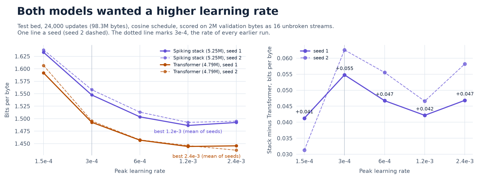
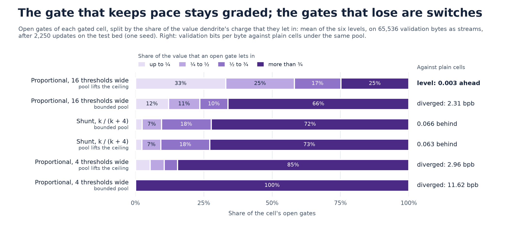
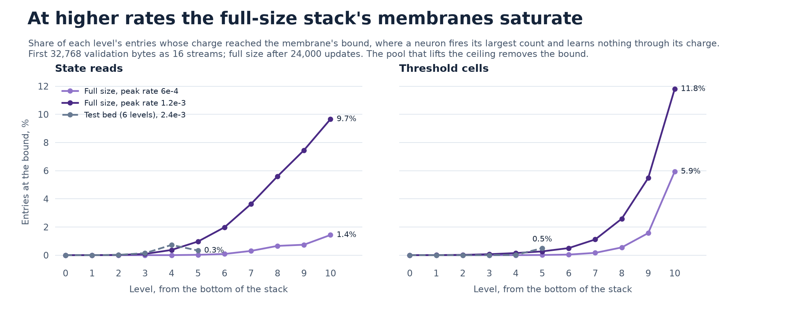
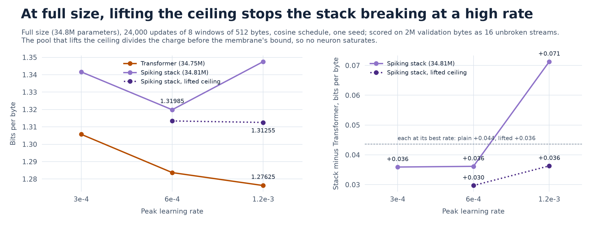
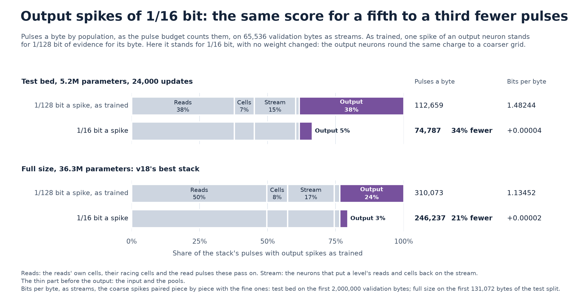
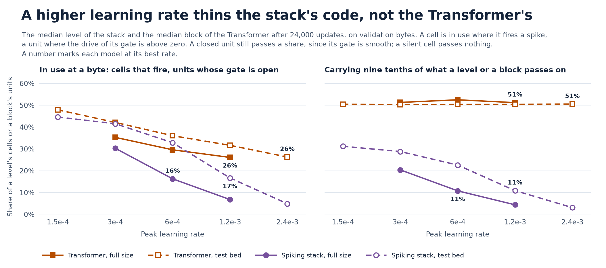

# A scaling law the other way around

*The study of Volley v18. Every number here is from a finished run. The verdicts are those of the records in
`results/event_lm/knowledge_gap/`, which were committed before their runs. What still runs is listed at the end.*

v17 found that the stack's gap to the Transformer is knowledge, and that on the test bed it reopens with more data:
the delayed stack trained on streams leads its Transformer after 6,000 updates and trails it after 24,000. A stack
that is to beat the Transformer must do the opposite and learn more from each added byte. Its gap must shrink as both
models see more data. This study therefore judges every design by **the slope of its gap per doubling of the training
data**, measured over separate runs at 6,000 to 96,000 updates (24.6M to 393M bytes), each model at its best learning
rate (`data_scaling_long.json`, analysis `experiments/data_scaling_long.py`).

## Both models wanted a higher learning rate

Every run up to v17 trained at a peak rate of 3e-4. On the test bed both models do better at higher rates, and the
stack gains a little more (`learning_rate_with_data.json`, two seeds):

| 24,000 updates, 2M validation bytes as streams | 1.5e-4 | 3e-4 | 6e-4 | 1.2e-3 | 2.4e-3 |
|---|---:|---:|---:|---:|---:|
| Spiking stack, seed 20001 | 1.6329 | 1.5475 | 1.5036 | **1.4864** | 1.4924 |
| Spiking stack, seed 20002 | 1.6379 | 1.5580 | 1.5130 | **1.4926** | 1.4950 |
| Transformer, seed 20001 | 1.5917 | 1.4927 | 1.4569 | **1.4442** | 1.4455 |
| Transformer, seed 20002 | 1.6066 | 1.4955 | 1.4575 | 1.4460 | **1.4368** |
| Gap of the two-seed means | 0.036 | 0.059 | 0.051 | 0.044 | 0.053 |

The stack is best at 1.2e-3 on both seeds, the Transformer at 2.4e-3 on their mean. From 3e-4 to its best rate the
stack gains 0.063 and the Transformer 0.053. The difference of 0.010 is under the 0.020 that the record set for calling
the flattening an artefact of the learning rate: **it is not one.** At each model's best rate the gap is 0.048, and it
is on new contexts on both seeds (+0.056 and +0.075). The data-scaling curves now read the Transformer at 2.4e-3.

Split by what each byte's context offers, the better rate helps the stack's knowledge almost twice as much as the
Transformer's (seed 20001, `learning_rate_by_context.json`, a diagnostic made after the runs):

| From 3e-4 to 1.2e-3, bits per byte | New contexts (76% of bytes) | Copyable from the last 240 bytes (7%) |
|---|---:|---:|
| Spiking stack | **−0.073** | −0.034 |
| Transformer | −0.039 | **−0.177** |

At 3e-4 the stack's knowledge was starved, and the Transformer's copying. At each model's best rate the gap on new
contexts falls from 0.087 to 0.061, and it is still the whole gap.

The stack gaining more from bigger steps fits a reading of where its curve flattens. Every synapse sends whole ticks
of charge, and every cell whole spikes, so an update smaller than a tick changes nothing the stack fires. Two
spike-only remedies are under test: quantal release (synapses that round at random while training, so that their
expected charge is their stored size, `weight_precision_with_data.json`) and stochastic firing (threshold cells that
fire their last spike at random, `cell_dither_with_data.json`). Both are exact at scoring.

The neighbouring rates show that the band of good rates is narrow for the stack's knowledge and wide for the
Transformer's (seed 20001, the extension of `learning_rate_by_context.json`):

| Bits per byte | New contexts | Fourth letter of a word on | Copyable from the last 240 bytes |
|---|---:|---:|---:|
| Stack, 6e-4 to 1.2e-3 | −0.017 | level | **+0.048** |
| Transformer, 6e-4 to 1.2e-3 | −0.010 | −0.013 | −0.033 |
| Stack, 1.2e-3 to 2.4e-3 | **+0.012** | **+0.031** | level |
| Transformer, 1.2e-3 to 2.4e-3 | +0.004 | level | −0.021 |

Below its best rate the stack's knowledge starves; above it, its knowledge is what breaks first, the completion of
words most of all. Three other readings of the flattening were ruled out on the way:

- **The pulse budget.** Its price falls to 0.00–0.02 by the end of every 24,000-update run, while the stack spends
  its budget to within 2%. A looser budget would buy almost nothing. Where a budget binds, its price shows it: a
  12-level test bed held to the 6-level budget ran at a price of 0.10 to 0.24, and gained 0.067 when its budget
  doubled. At full size the price stays at 0.00–0.02 at depth 11 and at depth 22 alike, so the wider gap at depth
  22 is not the budget's either.
- **Noisy late weights.** Averaging the weights helps the stack about as much as it helps the Transformer, and by
  the end of a run it helps neither.
- **A dense code that grows denser.** At 3e-4, 35% to 56% of a level's cells fire at every byte, at 6,000 and at
  24,000 updates alike, in the plain bed, which learns late better, as in the delayed one
  (`experiments/cell_activity.py`). At the higher rates the code grows sparser with data, not denser (the census by
  rate below).

The largest step that v15's walk from the Transformer to the stack priced was the unit: plain rectifying units in place
of gated ones cost 0.025, against 0.001 for whole spikes (`docs/STREAM_FORM.md`). The stack's cells are plain units.
Gated cells were only judged at 6,000 updates. A screen on the laptop measured them by their slope
(`gated_cells_with_data.json`): the gated cell trails the plain bed by 0.067 at 6,000 updates and by 0.108 at 24,000,
and the self-gated cell is level at both lengths. A third of the gated stack's pulses at 6,000 updates and a fifth at
24,000 were its gates' own steps (`experiments/gate_state.py`), but a gate whose steps stay inside the cell still
trails, so most of the loss is the gate's form and not that energy (`proportional_gate_check.json`). The gates that
lose work as switches: half to all of their open states let in more than three quarters of the value. One gate keeps
pace with plain cells in that check, a gate that opens in proportion to its charge under the pool that lifts the
ceiling, and its open states spread over the whole range. Its screen by slope is pre-registered
(`proportional_gates_with_data.json`), and a pass releases a full-size run (`full_size_proportional_gate.json`).

A second screen measures the other half of a smooth unit, in spikes: noisy thresholds
(`noisy_thresholds_with_data.json`). A real neuron's membrane is noisy, so near its threshold it fires by chance, and
its average rate is a smooth curve of its input. Under logistic noise of half a threshold, a cell's average count is
within 0.025 spikes of 0.5 · softplus(2 · charge / threshold). The cell learns from that curve's slope, where a plain
cell learns from a stand-in. The noise falls with the learning rate, so training ends on the whole counts that scoring
fires. On the laptop's seed the arm leads the plain bed by 0.0036 at 6,000 updates and by 0.0019 at 24,000, at the
same energy: under the 0.005 its record asked, and shrinking with data, so it earns no seeds. At full size it was
0.004 better. A true slope for the threshold cell is worth 0.002 to 0.004 and does not change the slope with data.

## At full size the membranes cap the rate

The full-size pilot (`full_size_rate_pilot.json`, 24,000 updates on windows of 512, one seed) did not repeat the test
bed's finding:

| 2M validation bytes as streams | 3e-4 | 6e-4 | 1.2e-3 |
|---|---:|---:|---:|
| Spiking stack | 1.3416 | **1.3199** | 1.3475 |
| Transformer | 1.3057 | 1.2837 | **1.2762** |
| Gap | 0.036 | 0.036 | 0.071 |

At each model's best rate the gap is 0.044, wider than at 3e-4. The Transformer gains more from its best rate than the
stack does (0.029 against 0.022). On new contexts the two gain alike (the stack 0.029, the Transformer 0.028); the
Transformer's extra gain is on near copies. The stack is best at a lower rate, and at the higher one its membranes saturate:

At 1.2e-3, 2.7% of the reads' entries and 2.0% of the cells' sit at the membrane's bound, up to 9.7% and 11.8% at the
top level. A neuron there fires its largest count whatever more it hears, and learns nothing through its charge. The
test bed barely saturates even at 2.4e-3, which is why it never showed this (`membrane_saturation.json`,
`experiments/membrane_saturation.py`). v15's pool that lifts the ceiling divides the charge before the bound. In a
continued run at 1e-3 it was 0.019 ahead, and no release used it, because all of them trained at 3e-4, where nothing
saturates. A full-size pilot of the lifted stack (`full_size_lifted_ceiling_pilot.json`):

| 2M validation bytes as streams | 6e-4 | 1.2e-3 |
|---|---:|---:|
| Plain stack | 1.3199 | 1.3475 |
| Lifted stack | 1.3134 | **1.3126** |
| Transformer | 1.2837 | 1.2762 |

Lifting removes the saturation entirely, at the same energy (about 308,000 pulses a byte in training): no read and
almost no cell reaches its cap. At 1.2e-3 it is worth 0.035, and the stack is level across 6e-4 and 1.2e-3 instead of
breaking at the higher rate. At each model's best rate the lifted stack is 0.036 behind the Transformer, as the plain
stack was at 3e-4. Lifting removes the widening, and the gap that remains is the stack's knowledge. Its best arm was
0.0073 ahead of the plain stack's best, short of the 0.010 that the record asked, so the full-size pair trains the
plain stack at 6e-4 as recorded.

## The unit at full size, and word heads

The largest step that v15's walk from the Transformer to the stack priced was the unit (0.025). One 24,000-update
run each at full size, against the plain stack at 6e-4 (`full_size_unit_screen.json`):

| 2M validation bytes as streams | Score | Against the plain stack | On new contexts |
|---|---:|---:|---:|
| Plain stack | 1.3199 | | |
| Gated cells, equal parameters | 1.4381 | +0.118 | +0.162 |
| Noisy thresholds | 1.3157 | −0.004 | level |
| Self-gated cells | 1.3208 | +0.001 | +0.006 |

Gated cells lose badly: their gate dendrites sit at their bound a fifth of the time. Noisy thresholds train level at
the same energy, with a small gain on near copies. Self-gated cells train level too. None closes the knowledge gap.

The bound is not why gated cells lose. Under the pool that lifts the ceiling no cell's body reaches its cap and the
saturated share among the gates' populations falls from 21% to 6.5%, and the gated stack is as far behind the
lifted plain stack as before: 1.4265 against 1.3134, 0.113 behind and 0.151 behind on new contexts
(`full_size_lifted_gate.json`). The gated form has 712 cells a level where the plain one has 1,188; self-gated
cells keep all 1,188 and are level, so the loss may be the fewer cells as much as the gate.

Word heads at full size, at 90,000 updates with v15's fast synapses at reach 8,192, gain 0.0009 on test over v17's
stack (paired interval 0.0004 to 0.0013), under the 0.003 their record asked (`full_size_word_heads.json`). The run is
the best spike-only stack so far, 1.11615 on test and 1.14908 on validation: 0.0095 behind the Transformer as it
reads, and 0.013 behind the Transformer with taught output synapses. Its gap keeps v17's shape, all of it knowledge.

## Depth by recurrence adds knowledge at full size

Recorded after the v18 release (`full_size_loop_pilot.json`). A looped stack runs levels 2 to 8 twice with the same
synapses: 18 level passes on the parameters of 11, with the pulse budget scaled by the passes. Its control is the
plain stack given the same budget. One 24,000-update run each at 6e-4:

| 2M validation bytes as streams | Pulses a byte | Score | Against the plain stack | On new contexts |
|---|---:|---:|---:|---:|
| Plain stack | 308,000 | 1.3199 | | |
| Plain stack, raised budget | 506,000 | 1.3291 | +0.009 | +0.016 |
| Looped stack, raised budget | 504,000 | 1.3102 | −0.010 | −0.010 |

At equal energy the loop gains 0.019, and 0.026 on new contexts (interval 0.023 to 0.028), which passes the 0.010
its record asked. Against the plain stack at the old budget, the design it would replace, it gains 0.010 on the
whole and on new contexts, for 1.63 times the pulses and about 1.4 times the training time. More pulses alone
hurt: the plain stack puts them into the same eleven levels and its membranes saturate (3.0% of the cells'
entries at their bound against 0.8%, 2.9% of the reads' against 0.3%), where the loop spreads them over eighteen
passes (1.4% and 1.6%). The loop has earned a run of 90,000 updates beside the pair. Not yet separated: whether
the loop needs the raised budget at full size, and whether the pool that lifts the ceiling adds to it.

## The cell's shape holds with data

Recorded after the v18 release. A full-size cell hears every channel's present byte and one delayed copy of it. The
test bed's own cell hears a narrower fan of the delayed stream. At 6,000 updates the full size's shape was 0.020
ahead on the laptop's seed, 0.009 of it on new contexts. After 24,000 updates at 3e-4, on four seeds, it still leads
(`cell_shape_with_data.json`):

| Seed | Test bed's shape | Full size's shape | Lead | Gain on new contexts |
|---|---:|---:|---:|---:|
| 20001 | 1.54749 | 1.53518 | 0.01231 | 0.0182 |
| 20002 | 1.55804 | 1.53519 | 0.02285 | 0.0215 |
| 20003 | 1.55522 | 1.53326 | 0.02196 | 0.0219 |
| 20004 | 1.55186 | 1.54734 | 0.00452 | 0.0203 |
| Mean | | | **0.01541** | **0.0205** |

It passes its mark: 0.010 on average, ahead at three seeds or more. The gain on new contexts is the same at every
seed, 0.018 to 0.022, while the near copies swing with the seed. On the laptop's seed at 6,000 updates that gain was
0.009. The devices and seeds differ, so the growth is a pointer and not a result, but this is the first gain on
knowledge here that did not fade with data. The full-size stack already has this shape. By the rule recorded before
the runs, the test bed has it too in every study recorded from now on.

## The output's spikes were finer than the score needs

Recorded after the v18 release. `experiments/gate_state.py` counts a stack's pulses by population, as the pulse budget
counts them. On the test bed the output neurons fire more of them than any other population: 43,281 of 112,659 a byte
after 24,000 updates, against 32,164 for the reads' cells. At full size they fire 72,956 of 310,073. An output neuron
fires one spike for every 1/128 bit of evidence for its byte. Every other population's spikes are weighed by synapses
that learn, so the budget's price already trades their precision against the loss. The output's spike alone has a
weight that the scoring rule fixes.

`--output-step` lets one output spike stand for several fine steps. The output neurons' threshold rises by that
factor, the counts they return stay in fine steps, and the budget counts the coarse spikes. On trained weights, with
no weight changed (`output_step_on_trained_weights.json`):

| One output spike stands for | 24,000 updates: bits per byte | Pulses a byte | 6,000 updates: bits per byte | Pulses a byte |
|---|---:|---:|---:|---:|
| 1/128 bit, as trained | 1.482439 | 112,659 | 1.628291 | 111,330 |
| 1/32 bit | +0.000005 | 80,198 | +0.000012 | 82,296 |
| 1/16 bit | **+0.000042** | **74,787** | +0.000039 | 77,456 |
| 1/8 bit | +0.000156 | 72,081 | +0.000187 | 75,035 |

The scores are the test bed's first 2,000,000 validation bytes as streams, each paired piece by piece with the same
weights' fine scoring. Spikes of 1/16 bit cost 0.00004 bits per byte (interval 0.00003 to 0.00006) and save 34% of
the bed's pulses. From 1/16 to 1/8 bit the cost grows about fourfold, as the variance of a rounding does when its
step doubles.

At full size, v18's best stack fires 246,237 pulses a byte with spikes of 1/16 bit in place of 310,073, 21% fewer. On
the first 131,072 bytes of the test split, scored as the headline was, they cost 0.00002 bits per byte (interval
−0.00003 to 0.00007, which holds zero). The complete splits are queued.

This is a saving in energy and no gain in bits. Whether a stack that trains with coarse output spikes turns the freed
pulses into bits is not shown. The budget's price says little would come of it late in training: at the end one e-fold
more pulses is worth 0.0045 nats a byte on the test bed and 0.0043 at full size. A screen on the laptop measures it
(`output_step_with_data.json`, pre-registered): a test bed trained with spikes of 1/16 bit at the old budget, for
which the price predicts a lead of 0.009 after 6,000 updates and 0.002 after 24,000, and one trained at a budget cut
by what the output saves. At full size more pulses in the same levels are worth less than nothing: the plain stack
given 507,000 pulses a byte for 310,000 is 0.009 worse (`full_size_loop_pilot.json`, above).

## The stack's code thins as the rate rises, and the Transformer's stays in use

Recorded after the v18 release, a census on trained weights with no training (`unit_density_by_rate.json`). An
earlier census of one pair at 3e-4 had found the Transformer's units as dense as the stack's cells, and nothing had
been measured at full size or at the rates where the two models train best. `experiments/cell_activity.py` counts
the cells of a level that fire at a byte and `experiments/unit_density.py` the units of a block whose gate is open.
Both also count how many of them carry nine tenths of what the level or the block passes on.

| Peak rate | Test bed: cells firing | Cells sending nine tenths | Units open | Units passing nine tenths | Full size: cells firing | Cells sending nine tenths | Units open | Units passing nine tenths |
|---|---:|---:|---:|---:|---:|---:|---:|---:|
| 1.5e-4 | 45% | 31% | 48% | 50% | – | – | – | – |
| 3e-4 | 42% | 29% | 42% | 50% | 30% | 20% | 35% | 51% |
| 6e-4 | 33% | 23% | 36% | 50% | 16% | 11% | 30% | 52% |
| 1.2e-3 | 17% | 11% | 32% | 50% | 7% | 4% | 26% | 51% |
| 2.4e-3 | 5% | 3% | 26% | 51% | – | – | – | – |

Each entry is the median level or block after 24,000 updates, on the test bed the mean of two seeds, which differ by
0.016 at most.

At 3e-4 as many cells fire as units are open, 42% and 42% on the test bed. Above it the stack's code thins: 17% of a
level's cells fire at 1.2e-3 and 5% at 2.4e-3 on the test bed, and 30%, 16% and 7% at 3e-4, 6e-4 and 1.2e-3 at full
size. It thins with data as well: on the laptop's seed at 1.2e-3, 29% fire after 6,000 updates and 16% after 24,000,
and the headline stack, trained at 3e-4 for 90,000 updates, fires at 18%. The Transformer's units close far less, from
48% to 26% over the five rates on the test bed and from 35% to 26% at full size. And a closed unit still passes a
share, because its gate is smooth: half of a block's units carry nine tenths of what it passes on, at every rate and
both sizes. A silent cell passes nothing. Nine tenths of a level's spikes come from 29%, 11% and 3% of its cells at
3e-4, 1.2e-3 and 2.4e-3 on the test bed. At each model's best full-size rate that is 11% of the stack's cells against
51% of the Transformer's units.

No cell dies: at full size none of 13,068 cells never fires at 3e-4 and 6e-4, and 2 at 1.2e-3. The thinning is in
what the synapses weigh. With the rate a cell's resting charge falls (0.44, 0.40 and 0.33 of a threshold at full
size), which alone would let it fire more often, while its input synapses grow (a median norm of 0.93, 1.51 and
2.46). The cells become detectors that large synapses hold silent at most bytes. The pool that lifts the ceiling and
noisy thresholds leave the density as it is.

The silent cells are far from firing, and further at a higher rate (the record's two amendments). A cell fires from
half a threshold of charge on, and its resting charge takes a third to a half of one threshold. On the test bed 6%,
12%, 27%, 57% and 84% of cells and bytes lie more than eight thresholds below zero over the five rates, and at full
size 34%, 63% and 86%. Between one threshold below zero and the firing point lie 3.5% on the test bed at 1.2e-3 and
2.8% at full size at 6e-4. So neither a lower rest nor a threshold that is soft over one threshold would reach the
silent cells. The spikes that remain weigh more. For every spike of a cell, the neurons that put the cells back on
the stream send 0.33, 0.44, 0.66, 1.36 and 3.49 pulses over the five rates on the test bed and 0.73, 1.55 and 3.09
at full size: fewer events, each heavier. The pulses that the cells give up go to the reads' own cells and to the
neurons that put the cells back on the stream at both sizes, and to the output on the test bed alone.

The stack stops gaining from a higher rate where its code is thin. On the test bed it is 0.004 worse at 2.4e-3 than
at 1.2e-3, where the Transformer is 0.004 better, and at full size under the lifting pool it gains 0.001 from 6e-4 to
1.2e-3, where the Transformer gains 0.007. But the gap to the Transformer is no smaller at 3e-4, where as many cells
fire as units are open (0.036 at full size, as at the best rates). So this is a difference between the two models
that grows with the rate and with data, and it is not shown to cost bits. No run has held the density while the rate
rose, and none has let a silent cell pass anything.

## Still running

| Record | Question |
|---|---|
| `data_scaling_long.json` | The curves: the Transformer, the delayed stack and the plain stack at 6,000 to 96,000 updates, at each model's best rate |
| `weight_precision_with_data.json` | Finer charge grids and quantal release, at 6,000 and 24,000 updates |
| `cell_dither_with_data.json` | Stochastic firing of the threshold cells, alone and with quantal release |
| `loop_with_data.json` | A looped test bed at 6,000 and 24,000 updates against a plain bed given the same pulse budget, a screen on the laptop |
| `randomness_at_best_rate.json` | Quantal release and stochastic firing at the best rate, 1.2e-3; a third seed on the laptop |
| `proportional_gates_with_data.json` | The wide proportional gate under the lifting pool at 6,000 and 24,000 updates, two seeds on the server and one on the laptop (pre-registered) |
| `full_size_proportional_gate.json` | The same gate at full size against the lifted plain stack, released only by a pass of the screen (pre-registered) |
| `plain_units_with_data.json` | A diagnostic in floats on the server's CPU: the test bed's Transformer with plain or gated units, hard or smooth, at 6,000 and 24,000 updates: which property of the unit falls behind with data (pre-registered) |
| `output_step_with_data.json` | Output spikes of 1/16 bit in training, at the old budget and at a budget cut by the saving, a screen on the laptop (pre-registered) |
| `full_size_best_rate_pair.json` | The stack and its Transformer at full size, each at its best full-size rate, 90,000 updates: the plain stack at 6e-4 training since 2026-11-23 00:35 UTC, the Transformer at 1.2e-3 next |
