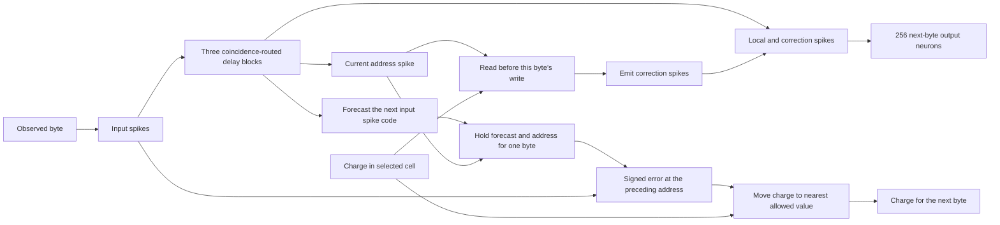

# Forecasting the next byte’s spike code

[Forecast-keyed reads](#forecast-keyed-reads) tests whether the forecast
can identify the context for its own correction.
[Learned context keys and firing thresholds](#learned-context-keys-and-firing-thresholds)
tests separate context tags and compares two model sizes.

## Architecture

The 16× spike router is the local backbone. Each byte fires one
afferent. Three blocks turn it into signed spike packets and route
present and delayed packets over two sets of learned synapses. A
steering packet of size $g$ sends the first $\min(|p|,g)$ pulses of a
signed packet $p$ down one route. The rest go down the other route
with the same sign. The two routes sum to $p$, so each pulse has
exactly one destination. The three blocks keep 3, 8, and 27 bytes
of delay history, for a 39-byte maximum local receptive field.
[Spike router and count sweep](SPIKE_CORRECTION.md#spike-count-scaling)

The new branch forecasts 32 channels of the next byte’s learned input
spikes directly from the router's output. At the next byte, the
observation and the saved forecast produce a signed error. The
previous context’s address spike selects the cell to update. The
current context reads before this write and its recall is emitted
as correction spikes onto the same output synapses as the local
spikes. One vocabulary population fires per byte.



For input spike code $c_t$ and its previous forecast $\hat c_t$,
the write target is $e_t=c_t-\hat c_t$. The addressed charge $m$
changes to $\operatorname{clip}(m,e_t-r_t,e_t+r_t)$, where the
network emits the tolerance $r_t$ and the state bounds also limit
the interval. A cell inside the interval stays put. Outside it,
the signed excess determines the smallest correction. A composition
of these interval projections is another interval projection, so
CPU byte streaming and chunked scoring follow the same write rule.
[Decoder](../snnformer/event_lm.py) · [Cell update](../snnformer/correction_memory.py)

The architectural change is the direct forecast of an existing spike
code and its use in this previous-context charge update. Spiking
prediction errors and error-driven sequence memory have precedents.
[Dendritic predictive coding](https://arxiv.org/abs/2205.05303) ·
[Gated DeltaNet](https://arxiv.org/abs/2412.06464)

## Training and evaluation

Both banks start from the same three plain 16× router checkpoints and
freeze the router weights. Each bank adds 11,904 trainable weights
with four sets of 14 cells and eight charge coordinates per cell.
The 2,144 additional streaming bytes hold the cell charge, prior
address spikes, and prior forecast. The hard-guess control uses the
same parameter count and state. It first picks a byte with the
vocabulary head, encodes that guess, and runs the vocabulary head
again after combining recall with the local route. This comparison
changes the forecast and the recall injection together.

Every decoder starts with 6,553,600 enwik8 training targets from
512-byte windows. Continuation adds the same 819,200 sampled targets
from 1,024-byte windows for every decoder, using seeds 100–102 for
parents 0–2. AdamW starts fresh for continuation. Peak learning rates
are 0.003 for the new bank weights and 0.00075 for the continued
plain router and Transformer references. Both banks train on
next-byte loss. The direct forecast also uses a 0.25-weighted
smooth L1 loss against the detached next input code, with the code
counts divided by 16. These losses run outside integer decoding.
[Training entry point](../experiments/train_event_lm.py)

Evaluation uses all 4,999,999 enwik8 test targets, 2,097,136 targets
from PG-19 excerpts, and 8,404,368 targets from the same 16 complete
PG-19 books. PG-19 temperatures are chosen per checkpoint on eight
disjoint validation books. Evaluation carries bank charge through each
enwik8 test stream or book. Local models warm up with 256 prior bytes
at chunk boundaries.
[Excerpt manifest](../results/event_lm/correction_pg19_test_manifest.json) ·
[Complete-book manifest](../results/event_lm/correction_pg19_full_book_manifest.json) ·
[Validation manifest](../results/event_lm/correction_pg19_validation_manifest.json)

## Held-out loss

Three-seed mean bits per byte, lower is better. PG-19 scores use the
validation temperatures. State is persistent tensor storage for one
stream.

| Decoder after continuation | Parameters | State | enwik8 | PG-19 excerpts | PG-19 complete books |
|---|---:|---:|---:|---:|---:|
| Plain 16× spike router | 396,480 | 30,552 B | 2.32907 | 3.31968 | 3.32931 |
| Hard-guess error bank | 408,384 | 32,696 B | 2.31230 | **3.30498** | **3.31457** |
| Direct spike forecast bank | 408,384 | 32,696 B | **2.31129** | 3.30959 | 3.31939 |
| 39-byte Transformer | 396,576 | 31,488 B | 2.24377 | 3.36272 | 3.37458 |
| 94-byte Transformer | 396,576 | 73,728 B | 2.24319 | 3.32142 | 3.33255 |

The direct forecast beat the continued plain router on both corpora in
all three seeds. On the complete PG-19 books it beat each continued
Transformer in two seeds out of three. The hard-guess bank had a
0.00481 bits-per-byte advantage over the direct forecast on the complete
books. Both Transformer references led on enwik8 by about 0.068 bits
per byte.
[enwik8 forecast record](../results/event_lm/enwik8_event_correction_code_forecast_pilot_s100.json) ·
[Complete-book forecast seed 100](../results/event_lm/pg19_full_event_correction_code_forecast_pilot_s100.json) ·
[Seed 101](../results/event_lm/pg19_full_event_correction_code_forecast_pilot_s101.json) ·
[Seed 102](../results/event_lm/pg19_full_event_correction_code_forecast_pilot_s102.json)

| Parent checkpoint before continuation | enwik8 | PG-19 excerpts | PG-19 complete books |
|---|---:|---:|---:|
| Plain 16× spike router | 2.31556 | 3.31208 | 3.32193 |
| 39-byte Transformer | 2.24021 | 3.31823 | 3.32967 |
| 94-byte Transformer | 2.24307 | 3.28383 | 3.29435 |

The direct forecast improved on the original plain router by 0.00427
bits per byte on enwik8 and 0.00255 on the complete books. Continuation
increased complete-book loss for both Transformer references. The
earlier 94-byte Transformer still leads the direct forecast on complete
books by 0.02503 bits per byte. The earlier 39-byte Transformer leads
on enwik8 and is 0.01029 bits per byte behind the forecast bank on the
complete books, with the forecast ahead in two of the three seeds.
[Prior full-book references](PREDICTION_ERROR_MEMORY.md#held-out-results)

| Forecast read intervention on complete books | Calibrated loss increase | Raw loss increase |
|---|---:|---:|
| Hide charge last changed at least 128 bytes ago | +0.00144 | +0.00366 |
| Hide all reads | +0.00255 | +0.00505 |

Either intervention increased loss in every seed. Both preserve writes
and the validation temperature. The older reads give a measurable
contribution beyond the 39-byte local receptive field.

## Integer inference and spike activity

On the first 4,096 enwik8 validation bytes, the native direct forecast
emitted **316,761 spikes per byte** on average across three seeds,
compared with **606,815** for the hard guess and **309,147** for the
original plain router. This is a 47.8% reduction from the hard guess
and 2.5% more emissions than the plain router. Counts sum the absolute
emissions at integrate-and-fire outputs. The forecast’s mean absolute
error per coordinate was 8.15 counts. A constant per-coordinate median
fit to the first 1,048,576 training bytes had 9.26 counts of error.

For each bank, hiding all reads exactly reproduced its frozen plain
router’s counts on this sample. Native CPU batch counts matched MPS on
all 4,096 bytes and matched CPU streaming on the first 513 bytes. The
CPU audit checked tensor operations and allowed only integer and
boolean tensors in the measured native forward and streaming paths.
[Audit script](../experiments/audit_spike_code.py) ·
[Activity and parity records](../results/event_lm/forecast_pilot_activity_and_parity.json)

## Next iterations

1. **Reject mismatched reads with the same membrane rule.** Give part
   of each cell a learned context tag and store it with the error from
   that context. The current query emits a tag and a tolerance. Any
   charge needed to bring the stored tag into that interval produces
   inhibitory pulses on the value read. Keep the bank size fixed by
   trading value coordinates for tag coordinates. Compare against the
   current bank on validation, and break the tag associations in an
   ablation while preserving writes. This tests whether collisions
   explain the small benefit from old charge.
2. **Learn firing precision within the existing router.** Give each
   packet group a learned quantized threshold shared by its content and
   steering neurons. This preserves the coincidence rule in each group.
   Train with a fixed emission budget and compare it with the uniform
   16× router before scaling width. This directly targets the enwik8 gap
   between the local spike network and the Transformers.
3. **Scale at fixed streaming state first.** Keep a 32 KiB track for
   long-document prediction and compare against the strongest
   Transformer checkpoints selected on validation. Track loss on
   complete held-out books, enwik8, and the loss from masking older
   reads. Once those results are consistent across seeds, increase
   parameter and data budgets for both architectures and add a
   full-attention Transformer with its state measured.

## Reproduce the pilot

Use the 1,600-step, 512-byte recipes for the three parent decoders.
Use the 16× count router recipe for the spiking parent.
[Parent checkpoint recipes](SPIKE_CORRECTION.md#reproduce-the-matched-runs)

```bash
enwik8=/path/to/enwik8
export PYTORCH_ENABLE_MPS_FALLBACK=0
triplets=()
for parent in 0 1 2; do
  seed=$((parent + 100))
  router="checkpoints/event_steered_count16_correction_2x_s${parent}.pt"
  train=(python experiments/train_event_lm.py --data "$enwik8" --device mps
         --seed "$seed" --dim 96 --depth 3 --ctx 1024 --bs 2 --steps 400
         --warmup 32 --eval-every 100 --eval-bs 2 --eval-batches 8
         --final-eval-batches 48 --mlp-ratio 4.703125)
  spike=(--hidden 201 --no-carry --spike-resolution 16 --initialize-from "$router")
  for variant in event_steered event_correction_error event_correction_code; do
    options=(--lr 0.00075)
    if [[ "$variant" != event_steered ]]; then
      options=(--freeze-router --memory-slots 14 --memory-width 32)
    fi
    if [[ "$variant" == event_correction_code ]]; then
      options+=(--code-loss-weight 0.25)
    fi
    "${train[@]}" "${spike[@]}" "${options[@]}" --variant "$variant" --tag forecast_pilot \
      --checkpoint "checkpoints/${variant}_forecast_pilot_s${seed}.pt"
  done
  "${train[@]}" --variant transformer_local --local-lookback 39 --lr 0.00075 \
    --initialize-from "checkpoints/transformer_local_correction_32k_2x_s${parent}.pt" \
    --tag forecast_pilot_39 --checkpoint "checkpoints/transformer_local_forecast_pilot_39_s${seed}.pt"
  "${train[@]}" --variant transformer_local --local-window 32 --lr 0.00075 \
    --initialize-from "checkpoints/transformer_local_correction_2x_s${parent}.pt" \
    --tag forecast_pilot_94 --checkpoint "checkpoints/transformer_local_forecast_pilot_94_s${seed}.pt"
  triplets+=(--model-triplet "$router"
             "checkpoints/event_correction_error_forecast_pilot_s${seed}.pt"
             "checkpoints/event_correction_code_forecast_pilot_s${seed}.pt")
done
python experiments/audit_spike_code.py "${triplets[@]}" --enwik8 "$enwik8" \
  --device mps --json /tmp/forecast-activity-reproduced.json
```

Prepare the three PG-19 manifests above with `experiments/prepare_pg19.py`.
Use the matching `--books-dir` and `--manifest` as well as
`--calibration-books` and `--calibration-manifest` with the evaluator.
Score enwik8 separately with `--enwik8 "$enwik8"`. Use `--device mps
--context 2048 --history 256 --batch-size 8` and the PG-19
temperature grid 0.8, 1.0, 1.15, 1.25, 1.4, 1.5, 1.65, 1.8, 2.0,
and 2.25. Use `--hide-memory-age 128 --hide-memory-age 1 --memory-stats`
on the PG-19 forecast runs. The evaluator accepts the checkpoint path
via `--checkpoint` and writes its result to `--json`.
[Evaluator](../experiments/eval_event_lm.py)

## Forecast-keyed reads

Each cell now has the option to use two of its eight charge coordinates
for a copy of the forecast that produced the stored error. The other six
hold signed error charge. A current context sends its own forecast through
the same projection. The previously nominated cell receives the preceding
forecast and its error once the actual byte arrives. The existing interval
update stores the forecast with zero tolerance and moves the error charge
only as far as the learned tolerance requires.

At read time the current forecast defines an interval around each key
coordinate, using the same learned per-head tolerance. The current
address spike enables the comparison. The largest out-of-band difference
is the length of the veto packet, since overlapping inhibitory pulses
share a slot. The router’s coincidence operation takes those slots away
from the stored error burst on both sign rails. With five positive
correction pulses and two veto pulses, three positive pulses survive.
The surviving counts feed the same correction synapse and vocabulary
population.
[Decoder](../snnformer/event_lm.py) · [Charge update](../snnformer/correction_memory.py)

### Paired experiment

The keyed bank and the always-read control have **407,616 parameters**,
including **11,136 trainable weights**, and **32,696 bytes** of streaming
tensor state. Both save and train the full forecast. Both reserve two
coordinates for the key, write those coordinates in the same way, and
send the six error coordinates through the same size read synapse.
Only the keyed bank uses the stored coordinates to inhibit reads.

Both arms use the 16× parent and the same seeds, training windows,
1,024-byte context, and 819,200 continuation targets as the full-width
forecast pilot. Each pair starts from the same weights and freezes the
router. The narrow control isolates matching from the loss of two error
coordinates. The full-width forecast and earlier Transformer results
provide the reference points above.

At evaluation, rotating keys by one slot within each head keeps every
payload, write, and fitted temperature intact. Age interventions hide
only payload charge based on its last effective change and give the
regular and masked reads a shared write trajectory. Complete enwik8
scoring covers 4,999,999 targets. PG-19 scoring covers 8,404,368 targets
from the same 16 complete books and uses the disjoint validation manifest
above for temperatures.

### Forecast-key results

Three-seed mean bits per byte. PG-19 uses the validation temperatures.

| Decoder | Complete enwik8 | Complete PG-19 books |
|---|---:|---:|
| Forecast-keyed bank | 2.31310 | 3.32051 |
| Matched always-read bank | 2.31210 | 3.31955 |
| Earlier full-width forecast bank | **2.31129** | **3.31939** |

The keyed bank scored about 0.001 bits per byte higher than the matched
control on both corpora. The matched control led in all three PG-19
seeds and two of the three enwik8 seeds. The earlier full-width
forecast remains the lower-loss version of this circuit.
[enwik8 records](../results/event_lm/enwik8_forecast_key_keyed_s100.json) ·
[Complete-book seed 100](../results/event_lm/pg19_full_forecast_key_keyed_s100.json) ·
[Seed 101](../results/event_lm/pg19_full_forecast_key_keyed_s101.json) ·
[Seed 102](../results/event_lm/pg19_full_forecast_key_keyed_s102.json) ·
[Matched control seed 100](../results/event_lm/pg19_full_forecast_key_narrow_s100.json)

| Complete-book read intervention | Keyed loss increase | Always-read loss increase |
|---|---:|---:|
| Rotate stored keys | +0.00016 | |
| Hide payload last changed at least 128 bytes ago | +0.00118 | +0.00179 |
| Hide payload last changed at least 512 bytes ago | +0.00053 | +0.00070 |
| Hide all payload reads | +0.00142 | +0.00238 |

Rotating keys increased loss in all three seeds on both corpora, by
0.00020 bits per byte on enwik8 and 0.00016 on the complete books. On
PG-19, 46 of 48 book-seed pairs had higher loss after rotation. The
actual key associations contribute a small amount to the trained
bank’s predictions. The loss from hiding older reads was smaller for
the keyed bank than for the matched control. Every read intervention
preserved the measured write counts for each book and seed.

### Native inference

On the first 4,096 enwik8 validation bytes, the keyed bank emitted about
315,251 integrate-and-fire output spikes per byte, compared with 316,132
for the control. Adding the bank write and pooled veto counts gives
315,459 versus 316,263 spikes per byte on that sample, a difference of
about 0.25%. The veto suppressed about a third of the proposed error
pulses before projection into the vocabulary path. Both banks used one
vocabulary pass. Native CPU counts matched MPS and matched 513 successive
CPU streaming steps for every seed.
[Activity and parity record](../results/event_lm/forecast_key_activity_and_parity.json)

### Reproduce the paired experiment

Reuse the spiking parent checkpoints from the pilot above.

```bash
enwik8=/path/to/enwik8
export PYTORCH_ENABLE_MPS_FALLBACK=0
triplets=()
for parent in 0 1 2; do
  seed=$((parent + 100))
  router="checkpoints/event_steered_count16_correction_2x_s${parent}.pt"
  for arm in narrow keyed; do
    match=()
    if [[ "$arm" == keyed ]]; then
      match+=(--match-forecast-key)
    fi
    python experiments/train_event_lm.py --variant event_correction_code --device mps \
      --data "$enwik8" --seed "$seed" --dim 96 --hidden 201 --depth 3 --no-carry \
      --spike-resolution 16 --memory-heads 4 --memory-slots 14 --memory-width 32 \
      --forecast-key-channels 2 "${match[@]}" --initialize-from "$router" --freeze-router \
      --code-loss-weight 0.25 --ctx 1024 --bs 2 --steps 400 --warmup 32 --lr 0.003 \
      --eval-every 100 --eval-bs 2 --eval-batches 8 --final-eval-batches 48 --validation-only \
      --tag "forecast_key_${arm}" --checkpoint "checkpoints/event_correction_code_forecast_key_${arm}_s${seed}.pt"
  done
  triplets+=(--model-triplet "$router"
             "checkpoints/event_correction_code_forecast_key_narrow_s${seed}.pt"
             "checkpoints/event_correction_code_forecast_key_keyed_s${seed}.pt")
done
python experiments/audit_spike_code.py "${triplets[@]}" --device mps --enwik8 "$enwik8" \
  --json /tmp/forecast-key-activity-reproduced.json
```

Score with the pilot’s evaluator and complete-book manifest. Add
`--memory-stats --hide-memory-age 128 --hide-memory-age 512 --hide-memory-age 1`
for PG-19, and `--memory-stats` for enwik8. Add `--shuffle-memory-keys`
for each keyed checkpoint.

## Learned context keys and firing thresholds

The tag and forecast share a single synaptic projection. Two output
lanes per head emit a context tag and six forecast the next byte’s
payload code. The forecast loss supervises the six payload lanes.
In the matching model, next-byte loss reaches the tag lanes through
the effect of their veto on the recalled correction. This version uses
the same interval update, two tag coordinates per cell, and signed
coincidence rule as the forecast-keyed bank. The two tag coordinates
record the tag from the context that produced the error.

Each of the four delay groups in a block has a threshold shared by its
content and steering neurons. The twelve learned thresholds round
to multiples of 16 charge ticks from 32 to 128. A group at 32
ticks emits about twice as many pulses for a given drive as a group at
64 ticks. The outgoing synapses charge half as much per pulse in that
example. Coincidence compares pulse counts in the group’s shared units,
and every signed content pulse goes down one of the two existing
synaptic paths. The integer decoder uses one accumulator with enough
precision to add the resulting charges before the next firing stage.
[Decoder and integer export](../snnformer/event_lm.py) ·
[Learned quantization step sizes](https://openreview.net/forum?id=rkgO66VKDS)

The training objective uses a mean budget of 310,000 pulses per byte.
It raises the loss penalty on spike activity when a batch exceeds that
target. The count includes every integrate-and-fire output and the
bank's write, read, and veto pulses. Realized activity is measured
separately as the mean over validation windows and over a native
4,096-byte held-out audit sample.
[Training entry point](../experiments/train_event_lm.py) ·
[Native audit](../experiments/audit_spike_code.py)

### Paired training and evaluation

The four small spiking models train from scratch under the same budget.
The three fixed-threshold models compare always reading the selected
cell, verifying the forecast key from the earlier study, and verifying
a separate context tag. The fourth model combines context tags with
learned thresholds. The two context-tag models also run at the larger
size. The always-read control has the same head and cell shapes as the
context-tag model and uses its recall payload on every addressed read.

| Scope | Training targets per seed | Spiking params with learned thresholds | Transformer params for each reference | Spiking state | Local Transformer state | Full-attention K/V state |
|---|---:|---:|---:|---:|---:|---:|
| Small | 6,553,600 | 407,628 | 407,808 | 32,696 B | 31,488 B | 1,179,648 B |
| Large | 13,107,200 | 815,244 | 815,232 | 32,696 B | 32,768 B | 1,572,864 B |

All models at a size use the same enwik8 training windows in seeds 0, 1,
and 2. The larger spike router doubles its membrane width and keeps the
delay and cell shapes within 32 KiB. Local Transformers see 39 and 30
bytes at the two sizes, respectively. Full attention sees the available
causal prefix inside a window of at most 512 bytes, its training length.
Its state column is the FP32 size of the keys and values needed per
stream at that length. The fixed-state models score with 2,048-byte
chunks and 256 warmup bytes where needed. The bank carries charge
across chunks. Full attention scores 256 targets per window with up to
256 warmup bytes. All rows score the same 4,999,999 enwik8 targets and
8,404,368 targets from 16 complete PG-19 books. PG-19 temperatures use
the same disjoint validation books.

A separate paired test starts from the three established 16× plain
router checkpoints. Both arms train for 819,200 additional enwik8 targets
with the same pulse budget. This measures the threshold change on a
trained local router without the effect of recall.

On this shorter continuation all twelve thresholds in all three
exported checkpoints rounded to 64 ticks. Mean enwik8 loss was
2.32838 bits per byte for uniform thresholds and 2.32834 for
the learned parameters. On the complete books it was 3.32185
and 3.32211, respectively.
[enwik8](../results/event_lm/enwik8_threshold_scale_router_warm.json) ·
[PG-19](../results/event_lm/pg19_full_threshold_scale_router_warm.json) ·
[Native pulse counts](../results/event_lm/threshold_scale_router_warm_activity.json)

### Small model results

Three-seed mean test bits per byte. PG-19 uses validation temperatures.
Pulse counts use the first 4,096 enwik8 test bytes and include the bank.

| Decoder | enwik8 | Complete PG-19 books | Pulses per byte |
|---|---:|---:|---:|
| Always-read spiking bank | 2.39550 | 3.36437 | 298,515 |
| Forecast-keyed spiking bank | 2.43130 | 3.37224 | 294,613 |
| Separate context tags, fixed thresholds | 2.43025 | 3.36729 | 296,319 |
| Separate context tags, learned thresholds | 2.42716 | 3.38277 | 303,374 |
| Local Transformer | 2.24107 | 3.34604 | |
| Full-attention Transformer | 2.28026 | 3.29995 | |

Separate context tags beat the forecast keys on PG-19 in two
seeds. The always-read control had lower mean loss on both corpora.
Rotating tags raised PG-19 loss by 0.00141 bits per byte, with an
increase in each seed. Hiding reads of charge last changed at least
128 bytes earlier raised mean loss by 0.00503, with two seeds showing
an increase. Hiding all reads raised it by 0.01212. The interventions
used the original temperature and matched the write counts per book.
[Context-tag scores and interventions](../results/event_lm/pg19_full_threshold_scale_context_small.json) ·
[Always-read scores](../results/event_lm/pg19_full_threshold_scale_always_small.json)

The learned thresholds lowered enwik8 loss by 0.00308 bits per byte
compared with the fixed-threshold context-tag model and raised PG-19
loss by 0.01549. They used 2.4% more pulses on the audit sample. All
twelve first-block groups across the three models fired at 32 ticks.
Ten of twelve second-block groups used 32 ticks and two used 48.
All last-block groups used 48.
[enwik8 scores](../results/event_lm/enwik8_threshold_scale_learned_small.json) ·
[PG-19 scores](../results/event_lm/pg19_full_threshold_scale_learned_small.json) ·
[Native pulse counts and thresholds](../results/event_lm/threshold_scale_small_activity.json)

### Larger model results

| Decoder | enwik8 | Complete PG-19 books | Pulses per byte |
|---|---:|---:|---:|
| Separate context tags, fixed thresholds | 2.24015 | 3.25043 | 303,952 |
| Separate context tags, learned thresholds | 2.25351 | 3.25233 | 303,493 |
| Local Transformer | 2.04457 | 3.26187 | |
| Full-attention Transformer | 2.01841 | 3.29072 | |

The fixed-threshold spiking bank and both Transformers have exactly
815,232 parameters and the same training exposure. The fixed-threshold
bank had lower PG-19 loss than the full-attention Transformer in each
seed. Its 0.01144-bit-per-byte mean advantage over the local Transformer
came from one seed. Its mean enwik8 loss exceeded the local Transformer’s
by 0.19559 bits per byte.
[Fixed-threshold enwik8](../results/event_lm/enwik8_threshold_scale_context_large.json) ·
[Fixed-threshold PG-19](../results/event_lm/pg19_full_threshold_scale_context_large.json) ·
[Local Transformer PG-19](../results/event_lm/pg19_full_threshold_scale_transformer_local_large.json) ·
[Full attention PG-19](../results/event_lm/pg19_full_threshold_scale_full_large.json)

The learned-threshold model used 0.15% fewer pulses than the fixed
model on the audit sample. It scored 0.01336 bits per byte higher
on enwik8 and 0.00190 higher on PG-19. Its thresholds ranged from
32 to 80 ticks. On the complete books, hiding all memory reads
increased mean loss by 0.00476, with an increase in two seeds.
Hiding reads of values last changed at least 128 bytes earlier
changed mean loss by less than 0.00001. Rotating the tags lowered
mean loss by 0.00028, with a decrease in two seeds.
[Learned-threshold enwik8](../results/event_lm/enwik8_threshold_scale_learned_large.json) ·
[PG-19 scores and interventions](../results/event_lm/pg19_full_threshold_scale_learned_large.json) ·
[Native pulse counts and thresholds](../results/event_lm/threshold_scale_large_activity.json)

The native audit checked all 24 spiking checkpoints from the main
comparison and the paired router test. The CPU decoder matched MPS
counts on 4,096 test bytes and matched its own streaming output over
the first 513 bytes. Each checkpoint used one vocabulary pass.

### Reproduce these runs

Set `enwik8` to the canonical data path. Use this common training command
with each arm’s flags and seed. The score and training records list the
paths to the resulting checkpoints.

```bash
export PYTORCH_ENABLE_MPS_FALLBACK=0
train=(python experiments/train_event_lm.py --data "$enwik8" --device mps
       --ctx 512 --bs 8 --depth 3 --lr 0.003 --warmup 80 --eval-every 400
       --eval-bs 8 --eval-batches 8 --final-eval-batches 48 --validation-only)
bank=(--variant event_correction_code --hidden 201 --no-carry --spike-resolution 16
      --memory-heads 4 --memory-slots 14 --memory-width 32 --forecast-key-channels 2
      --pulse-budget 310000 --code-loss-weight 0.25)
"${train[@]}" "${bank[@]}" --seed 0 --dim 96 --steps 1600 --learn-context-keys \
  --match-forecast-key --learn-packet-thresholds --tag threshold_scale_small_learned \
  --checkpoint checkpoints/event_learned_threshold_scale_small_s0.pt
```

Use `--dim 192 --steps 3200` for the large spiking models. Exclude the
threshold flag for the fixed 16× context-tag control. At the small size,
the always-read control uses only `--learn-context-keys` in addition to
the bank flags, and the forecast-keyed control uses only
`--match-forecast-key`. The Transformer arms use `--dim 96 --steps 1600
--mlp-ratio 4.90625` and `--dim 128 --steps 3200 --mlp-ratio 5.94140625`.
Supply `--local-lookback 39` or `30` to `--variant transformer_local`.
For full attention use `--variant transformer`.

The paired plain router test uses `--variant event_steered --dim 96
--hidden 201 --depth 3 --no-carry --spike-resolution 16 --pulse-budget 310000`,
`--ctx 1024 --bs 2 --steps 400 --lr 0.00075 --warmup 32 --eval-every 100
--eval-bs 2 --eval-batches 8 --final-eval-batches 48 --validation-only`,
and `--initialize-from` with the matching original 16× checkpoint.
Seeds 100–102 start from parent seeds 0–2. Supply
`--learn-packet-thresholds` for the learned arm.

Score with the same enwik8 and PG-19 commands as above, with
`--context 256 --history 256` for full attention. The small separate
context-tag model and large learned-threshold model also use
`--memory-stats --hide-memory-age 128 --hide-memory-age 1 --shuffle-memory-keys`
on PG-19. To audit pulse counts and parity, pass the spiking checkpoints
to `experiments/audit_spike_code.py --checkpoint` with `--split test`.
