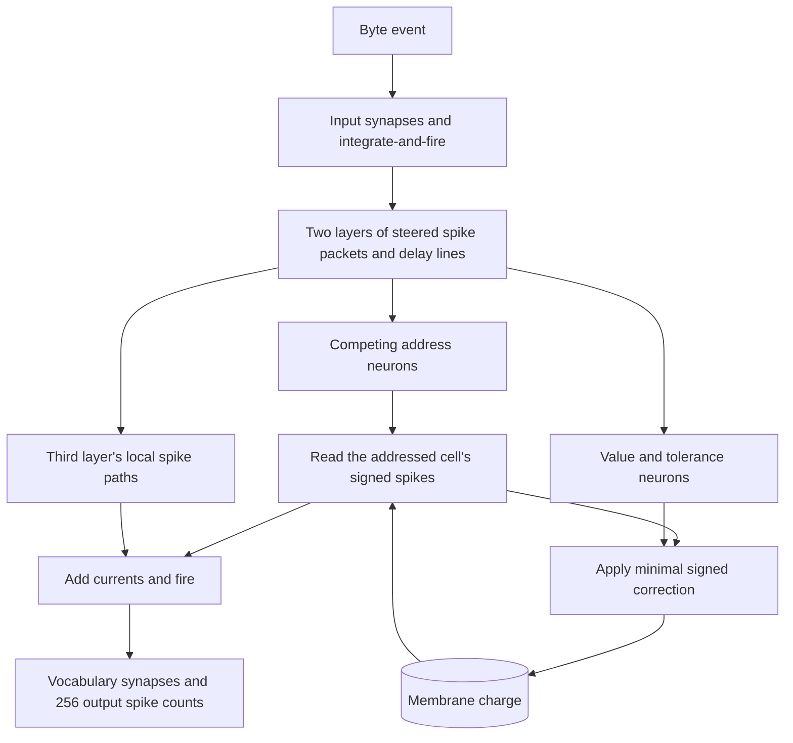
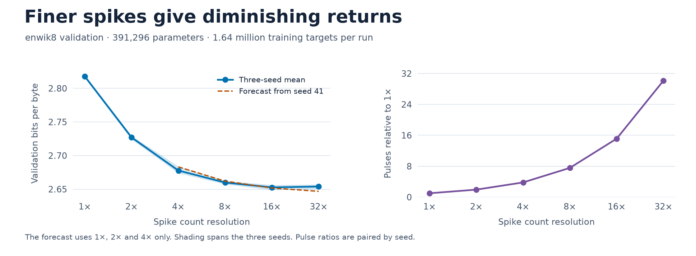

# Spike correction memory for byte prediction

The spike decoder emits a signed count for each of the 256 possible next
bytes. The native CPU path uses integer weights, spike counts, and membrane
state from the input event to the output. Training uses floating point
master weights and surrogate gradients with the same discrete forward
decisions. Benchmark scoring converts the output counts to probabilities
outside the decoder.

The [prediction error experiment](PREDICTION_ERROR_MEMORY.md) tests the
same write rule with a target computed from the local router's previous
guess and the next observed byte.



## Locate the loss

The no-carry spike router sees the current byte and at most 38 preceding
bytes. The equal-lookback Transformer uses layer windows of 14, 14, and 13,
which also gives 39 input bytes in total. The continuous control uses the
spike router's topology, parameter shapes, clipping ranges, and delay
schedule, with continuous synaptic weights and activations.

All three trained on the same 3,276,800 sampled enwik8 target bytes per
seed. Mean loss on 196,608 held-out test bytes per seed was 2.5996 for
the original spike router, 2.4465 for its continuous control, and 2.4667 for
the equal-lookback Transformer. The two quantization changes are combined
in the continuous control. A follow-up changed firing resolution while
keeping synaptic weight quantization. In the seed-41 validation pilot,
one, two, and four spike counts per original unit scored 2.8192, 2.7274,
and 2.6832. This comparison used the same 391,296 parameters and sampled
training windows. Four counts per unit entered the held-out study.

Increasing the resolution scales the input drive and firing caps in
integer units. The subsequent synapses, integration, reset, delays, and
output remain integer operations. The likelihood transform divides the
counts by the same resolution, keeping its interpretation fixed.
The four-count pilot emitted 3.79 times as many pulses as the one-count
pilot on 4,096 real validation bytes, counted at every integrate-and-fire
output. [Pulse counts](../results/event_lm/correction_resolution_activity.json)

## Spike count scaling

Six resolutions used the same 391,296 parameters, training windows, and
optimizer settings within each of three seeds. Each run trained on
1,638,400 enwik8 targets and scored the same 98,304 validation targets.
Pulse traffic is the sum of the absolute integer counts emitted by the
integrate-and-fire neurons on a 4,096-byte validation excerpt.
The table averages the pulse ratio within each seed.

| Count resolution | Validation bits per byte | Pulses relative to 1× |
|---:|---:|---:|
| 1× | 2.8178 | 1.00× |
| 2× | 2.7270 | 1.94× |
| 4× | 2.6778 | 3.80× |
| 8× | 2.6599 | 7.57× |
| 16× | **2.6526** | 15.13× |
| 32× | 2.6539 | 30.14× |



A power law with a floor fitted to seed 41 at 1×, 2×, and 4× gives
\(\hat L(r)=2.6423+0.1770 r^{-1.056}\). It predicted 2.6619 and 2.6517
at 8× and 16×. The measured losses for that seed were 2.6598 and 2.6528.
At 32× it underpredicted loss by 0.0096. Fitting the three-seed mean over
the same first three resolutions underpredicted the 32× mean by 0.0251.
The sweep establishes diminishing returns at this width and training
budget. The fitted exponent and floor depend on which seeds are used.
[Plot source](../experiments/plot_spike_resolution.py) ·
[Pulse counts and integer parity](../results/event_lm/spike_resolution_activity.json) ·
[Precision scaling across model and data budgets](https://arxiv.org/abs/2411.04330)

The follow-up tested the selected 16× resolution at 6,553,600 training
targets per seed. Both spike routers had 396,480 parameters and used
30,552 bytes of streaming tensor state. The PG-19 scores use temperatures
fit on separate validation books, as in the original comparison.

| Decoder | Streaming state | enwik8 bits per byte | PG-19 bits per byte |
|---|---:|---:|---:|
| 4× spike router | 30,552 B | 2.3371 | 3.3305 |
| 16× spike router | 30,552 B | 2.3156 | 3.3121 |
| 39-byte local Transformer | 31,488 B | **2.2402** | 3.3182 |
| 94-byte local Transformer | 73,728 B | 2.2431 | **3.2838** |

The 16× router improved over 4× on both corpora in every seed. It led
the 39-byte Transformer on PG-19 in two of three seeds and by 0.0062 bits
per byte on average. The 16× router emitted 3.91 times as many pulses as
4× on the validation excerpt. At the raw PG-19 output scale, its 3.4550 mean
compares with 3.4702 for the 39-byte and 3.4310 for the 94-byte Transformer.
[Long-run enwik8 and PG-19 records](../results/event_lm) ·
[Long-run pulse counts and integer parity](../results/event_lm/spike_resolution_long_activity.json)

With the longer-run 4× weights held fixed, changing the inference count
resolution to 16× moved enwik8 validation loss from 2.3788 to 2.3799.
Training at 16× reached 2.3537 on the same validation targets. The
shorter-budget checkpoints also gained about 0.0005 bits per byte from
the inference switch alone versus 0.0251 from training at 16×.
[Inference-only sweep](../results/event_lm/spike_resolution_inference_only.json)

Higher resolutions use the actual quantized weight magnitudes to check
FP32 accumulator bounds before an accelerator forward pass. The native
decoder continues to use int32, with a worst-case bound checked when
the model is built. For every trained router in this sweep and follow-up,
Metal and CPU agreed exactly over 4,096 validation bytes. CPU integer
batch and streaming predictions agreed over the first 513 of those bytes.

## Write a correction

A learned population of competing address neurons picks one bank slot
per head by emitting a winning spike. Independent neuron populations
emit a desired value \(v\) and a nonnegative tolerance \(r\). The selected
cell emits its stored count \(m\) before the current byte writes.
It then integrates the smallest signed correction that brings it into
the interval proposed by the current spikes.

$$
\Delta = \operatorname{sgn}(v-m)\max(|v-m|-r,0),
\qquad
m' = m + \Delta = \operatorname{clip}(m,v-r,v+r).
$$

Cells already inside the interval emit zero correction spikes. A silent
address leaves its bank alone. The batch path composes the interval
projections. The streaming path computes excitatory and inhibitory
correction counts and adds their difference to the membrane. Both compute
the same integer recurrence. The address, value, and tolerance populations
learn from the language loss.

The first pilot used memory in place of the oldest local delay group.
It scored 2.7857 on enwik8 validation at seed 41. The next pilot kept every
local delay and gave recalled spikes their own synaptic projection in the
last block. A third variant routed writes through the preceding address
spike, binding the observed continuation to the previous context. With
seed 42, the current-address and previous-address variants scored 2.7623
and 2.7799. The finer spike router scored 2.6733 at that seed. The
current-address variant went forward to quantify the bank's effect on
held-out text.

For a scalar cell, the update has the same projection as passive-aggressive
regression. Gated DeltaNet also uses an error-correcting update, and
SpikeLM explores signed spikes with richer encodings. This decoder combines
learned spike addresses with value and tolerance populations, stores the
resulting corrections as integer membrane charge, and trains the recurrence
end to end through an exact interval scan. For the scan, composing two
clamps just clamps the first interval's endpoints into the second
interval. A cell retains its charge until subsequent corrections change
it. Two contexts that fire the same address can overwrite each other's
information.
[Passive-aggressive regression, §5](https://jmlr.org/papers/volume7/crammer06a/crammer06a.pdf) ·
[Gated DeltaNet](https://arxiv.org/abs/2412.06464) ·
[SpikeLM](https://arxiv.org/abs/2406.03287) ·
[Hebbian memory in SNNs](https://arxiv.org/abs/2205.11276) ·
[Correction code](../snnformer/correction_memory.py)

## Evaluation

The main comparison uses three seeds and the same 3,276,800 training
targets and optimizer schedule for every model. The memory decoder has
396,672 learned parameters, the finer spike router has 396,480, and the
Transformers have 396,576. The 39-byte Transformer shares a streaming
state ceiling of 32,256 bytes with the spike models. The wider Transformer
uses 32-byte attention per layer and 73,728 bytes of state. Parameter and
state measurements exclude benchmark counters.

The book evaluation uses the central 131,072 bytes of 16 previously unused
PG-19 test books. Each checkpoint's scoring temperature is selected
on eight disjoint books from the official validation split. Every
test run sees the same 2,097,136 target bytes. The correction bank
survives chunk boundaries. The other models warm up on enough preceding
bytes to reconstruct their finite context.

The memory intervention hides cells last changed at least 128 bytes
earlier. Another pass hides every prior read. Both operate on the read
only, preserving local spikes, writes, and memory state. Read age measures
time since an effective change to the cell. The larger budget doubles the
number of training targets with the same three seeds. A separate seed-0
check scores the full source texts of the same 16 PG-19 books and tests an
additional intervention on reads aged 2,048 bytes or more.
[PG-19 source](https://github.com/google-deepmind/pg19) ·
[Validation manifest](../results/event_lm/correction_pg19_validation_manifest.json) ·
[Excerpt test manifest](../results/event_lm/correction_pg19_test_manifest.json) ·
[Full book manifest](../results/event_lm/correction_pg19_full_book_manifest.json)

## Held-out loss

Three-seed means after 3,276,800 enwik8 training targets per seed. enwik8
scores every target in its test split, 4,999,999 bytes. PG-19 scores the
16 excerpts with the validation-selected temperature.

| Decoder | Parameters | Streaming state | enwik8 bits/byte | PG-19 bits/byte |
|---|---:|---:|---:|---:|
| Finer spike router | 396,480 | 30,552 B | 2.4656 | 3.3793 |
| Spike router with correction memory | 396,672 | 32,256 B | 2.5571 | 3.4339 |
| Local Transformer, 39 bytes | 396,576 | 31,488 B | **2.4492** | **3.3501** |
| Local Transformer, 94 bytes | 396,576 | 73,728 B | 2.4761 | 3.3549 |

The fine-count model led the 94-byte Transformer on enwik8 in two of three
seeds and led both Transformers in mean top-1 accuracy at this budget
on enwik8 (52.67%) and PG-19 (43.24%).
[enwik8 main records](../results/event_lm) ·
[PG-19 seed 0](../results/event_lm/pg19_correction_v1_s0.json) ·
[Seed 1](../results/event_lm/pg19_correction_v1_s1.json) ·
[Seed 2](../results/event_lm/pg19_correction_v1_s2.json)

At the shorter training budget, hiding reads aged 128 bytes or more
reduced mean PG-19 loss by 0.00139 bits per byte. Hiding all prior reads
reduced it by 0.00176. This paired test leaves the bank's writes intact.

Three-seed means after 6,553,600 training targets per seed.

| Decoder | enwik8 bits/byte | PG-19 bits/byte |
|---|---:|---:|
| Finer spike router | 2.3371 | 3.3305 |
| Spike router with correction memory | 2.4181 | 3.3960 |
| Local Transformer, 39 bytes | **2.2402** | 3.3182 |
| Local Transformer, 94 bytes | 2.2431 | **3.2838** |

At this budget, hiding reads aged 128 bytes or more increased calibrated
PG-19 loss by 0.00266 bits per byte and reduced top-1 accuracy by 0.040
percentage points. Both directions held in all three seeds. At the raw
output scale, hiding those reads reduced loss by 0.00435. Hiding all
reads increased calibrated loss by 0.01043 and reduced raw loss by
0.01295. Each paired comparison uses the temperature fit on validation
for the original checkpoint in both conditions. The improvement from
old reads depends on the choice of metric and is small relative to the
gap to the same-budget spike router.
[PG-19 seed 0](../results/event_lm/pg19_correction_2x_s0.json) ·
[Seed 1](../results/event_lm/pg19_correction_2x_s1.json) ·
[Seed 2](../results/event_lm/pg19_correction_2x_s2.json)

The shorter-budget seed-0 check covered 8,404,368 targets across 16
complete books. The 39-byte Transformer scored 3.37031, the fine-count
router scored 3.41119, and the correction model scored 3.46801. Hiding
reads aged at least 128 bytes improved the correction model by 0.00201
bits per byte, with loss lower
on 15 of 16 books. Hiding reads aged at least 2,048 bytes improved loss
by 0.00035 across the complete texts.
[Complete-book scores](../results/event_lm/pg19_correction_full_books_s0.json)

## Integer execution

On 1,537 held-out enwik8 bytes, the trained four-count router and both
trained residual memory variants emitted identical counts in the MPS
batch path and the native CPU batch and byte-by-byte paths. The two
memory variants also matched across irregular chunk boundaries. The CPU
audit checked the dtype of every tensor entering and leaving PyTorch
operations during the native forward path. Masking old reads changed
output counts at 1,313 of 1,537 positions in the main correction model
and produced the same final charge. The native generation command
returned 128 bytes from a text prompt. The full test suite passed
215 tests and two subtests.
[Native integer verification](../results/event_lm/correction_integer_verification.json)

## Reproduce the matched runs

Use the canonical raw enwik8 file and set `enwik8` to its location.
These commands use Apple MPS. The scripts also accept `--device cpu`
and `--device cuda`.

```bash
enwik8=/path/to/enwik8
export PYTORCH_ENABLE_MPS_FALLBACK=0
for seed in 0 1 2; do
  for steps in 800 1600; do
    if [[ "$steps" == 800 ]]; then
      tag=correction_v1
      narrow_tag=correction_32k
    else
      tag=correction_2x
      narrow_tag=correction_32k_2x
    fi
    train=(python experiments/train_event_lm.py --device mps
           --data "$enwik8" --seed "$seed" --ctx 512 --bs 8
           --steps "$steps" --warmup 80 --eval-every "$((steps / 4))"
           --eval-bs 8 --eval-batches 8 --final-eval-batches 48
           --mlp-ratio 4.703125)
    "${train[@]}" --variant event_steered --hidden 201 --no-carry --spike-resolution 4 \
      --tag "$tag" --checkpoint "checkpoints/event_steered_${tag}_s${seed}.pt"
    "${train[@]}" --variant event_correction_residual --hidden 192 --no-carry --spike-resolution 4 \
      --tag "$tag" --checkpoint "checkpoints/event_correction_residual_${tag}_s${seed}.pt"
    "${train[@]}" --variant transformer_local --local-window 32 \
      --tag "$tag" --checkpoint "checkpoints/transformer_local_${tag}_s${seed}.pt"
    "${train[@]}" --variant transformer_local --local-lookback 39 \
      --tag "$narrow_tag" --checkpoint "checkpoints/transformer_local_${narrow_tag}_s${seed}.pt"
  done
done
```

The diagnosis and pilot records preserve their `args` as run.
For the longer count comparison, rerun the 1,600-step `event_steered`
command with `--spike-resolution 16` and `--tag count16_correction_2x`,
using that tag in the checkpoint name. The count figure reads the pilot
and pulse records with `python experiments/plot_spike_resolution.py`.

Use the official validation manifest to fit a temperature for each
checkpoint before scoring test books. This example uses seed 0 at the
shorter budget.

```bash
python experiments/prepare_pg19.py --output data/pg19-correction-test \
  --manifest results/event_lm/correction_pg19_test_manifest.json
python experiments/prepare_pg19.py --output data/pg19-correction-validation \
  --manifest results/event_lm/correction_pg19_validation_manifest.json

checkpoints=(checkpoints/event_steered_correction_v1_s0.pt
             checkpoints/transformer_local_correction_v1_s0.pt
             checkpoints/transformer_local_correction_32k_s0.pt
             checkpoints/event_correction_residual_correction_v1_s0.pt)
score=(python experiments/eval_event_lm.py --device mps --context 2048
       --history 256 --batch-size 8 --checkpoint "${checkpoints[@]}")
"${score[@]}" --enwik8 "$enwik8" --json enwik8-correction-reproduced.json
"${score[@]}" \
  --books-dir data/pg19-correction-test \
  --manifest results/event_lm/correction_pg19_test_manifest.json \
  --calibration-books data/pg19-correction-validation \
  --calibration-manifest results/event_lm/correction_pg19_validation_manifest.json \
  --temperatures 0.8 1.0 1.15 1.25 1.4 1.5 1.65 1.8 2.0 2.25 \
  --hide-memory-age 128 --hide-memory-age 1 --memory-stats --json pg19-correction-reproduced.json

python experiments/generate_event_lm.py checkpoints/event_correction_residual_correction_v1_s0.pt \
  --prompt 'In the history of' --bytes 128
```

For complete books, prepare `correction_pg19_full_book_manifest.json` in
its own data directory and use it as the test manifest. Use age 2,048 in
place of the all-memory intervention to reproduce the longer-distance read
test.
