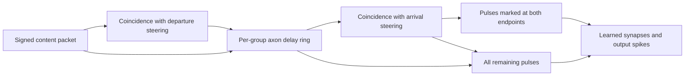

# Shared output reference and delayed spike routing

These experiments start from the [spiking byte-model release](https://github.com/DanielTea/transformer-snn/releases/tag/spiking-byte-lm-v1). The release model uses signed integrate-and-fire packets, local delay groups, and a context-tagged charge bank. See the [model card](../models/spiking-byte-lm/README.md) for the full circuit and checkpoint instructions.

## A shared inhibitory reference before output firing

The next-byte distribution and the winning byte depend on differences between vocabulary counts. The new circuit pools the bounded synaptic drive of the 256 output neurons in one signed integrate-and-fire population. Each of its pulses shifts every vocabulary neuron's charge by one firing threshold. The vocabulary fires once, after the shift.

Let \(q_i\) be the bounded current of neuron \(i\) in integer ticks. The vocabulary threshold is eight ticks, the pool threshold is \(256 \times 8\), and \(r\) is the signed pool count. The output is

\[
s_i = \left\lfloor\frac{q_i + 4 - \mathbf 1[q_i < 0] - 8r}{8}\right\rfloor.
\]

The sign term preserves the original treatment of half-threshold ties. The pool subtracts the same integer \(r\) from each output. It preserves every byte-pair margin exactly for fixed upstream spikes. It also adds zero trainable weights and zero persistent tensor bytes. The implementation bounds and pools the 256 currents before thresholding, with no second vocabulary projection or emission. [Decoder](../snnformer/event_lm.py)

For the validation resolution sweep, each of the three 815,232-parameter parents scores the same 32,768 enwik8 validation targets at each setting. With a shared reference, 26× was the highest tested resolution that kept all three validation runs under 310,000 pulses per byte. The confirmation trains a fixed-resolution control, a same-resolution reference, a 26× reference, and the two Transformer references. Each run starts from its corresponding release parent, starts a fresh AdamW optimizer, and sees another 819,200 sampled enwik8 training targets with matched seeds and windows. Pulses count integer emissions in the software circuit, including the shared reference and memory charge traffic.

Turning on the reference and compact delays for the three **original release checkpoints** preserves every vocabulary margin and decoded byte on the 4,096-byte enwik8 audit. Their mean activity fell from 303,952 to 185,134 pulses per byte and their state fell from 32,696 to 14,556 bytes per stream. This is a change in the inference circuit applied to the original weights. [Release-checkpoint audit](../results/event_lm/output_reference/release_export.json) · [Validation sweep](../results/event_lm/output_reference/resolution_validation.json)

```bash
python experiments/generate_event_lm.py models/spiking-byte-lm/weights.pt \
  --prompt 'The first chapter' --bytes 128 --compact-delays --output-reference
```

### Matched continuation results

Each row has 815,232 parameters and 13,926,400 cumulative training targets per seed. The loss columns are three-seed means in bits per byte. State is per-stream persistent tensor storage. Native pulses use a 4,096-byte enwik8 test sample.

| Continued model | enwik8 | PG-19 | State | Pulses per byte |
| --- | ---: | ---: | ---: | ---: |
| Fixed 16× | 2.27446 | 3.26856 | 32,696 B | 302,758 |
| Reference at 16× | 2.27050 | 3.30713 | 32,696 B | 208,066 |
| Reference at 26× | 2.27496 | 3.27132 | 32,696 B | 299,625 |
| Local Transformer | 2.06047 | **3.25865** | 32,768 B | — |
| Full-attention Transformer | **2.03281** | 3.29888 | 1.5 MiB | — |

Changing the reference at 16× reduced activity by 31.3% across the continued checkpoints. The 26× arm stayed close to the pulse budget and scored within 0.003 bits per byte of the fixed 16× control on both corpora. All continued spiking arms had higher enwik8 and PG-19 loss than the released fixed 16× model. The reference can be applied directly to those released weights. [enwik8 scores](../results/event_lm/output_reference/enwik8_reference26.json) · [PG-19 scores](../results/event_lm/output_reference/pg19_reference26.json) · [Native audit](../results/event_lm/output_reference/native_activity.json)

## Per-delay storage and coincidence at both ends

Each fixed axon group needs a history only as long as its own travel time. Its ring reads the packet that is due and immediately recycles that slot. Using one ring per group leaves predictions unchanged. For the 201-wide, three-block router, the 38 shared positions become \(\sum_g d_g w_g=3,103\) live packet counts. The int32 rings and the 2,144-byte correction bank together use 14,556 bytes per stream. The released layout uses 32,696 bytes.

On 4,096 enwik8 test bytes, the released checkpoint and its compact export emit the same integer count for every candidate byte at every position. In two single-threaded CPU passes per layout, the compact rings ran at 2,138 bytes/s and the released rings at 2,225 bytes/s. [Exact parity and timing](../results/event_lm/departure_coincidence/compact_delay_parity.json)

The departure-coincidence candidate uses that storage to carry two counts for each signed packet. At departure, the original steering train marks the coincident prefix. At arrival, the current steering train splits that prefix again. The first synapse receives the intersection at both endpoints, and the second receives every other pulse. For packet \(p\) and nonnegative departure and arrival counts \(a,b\), the routes carry \(\operatorname{sgn}(p)\min(|p|,a,b)\) and its signed complement within \(p\). The synapse shapes and causal lags stay the same, and routing conserves the number of content pulses. Streaming state is 26,968 bytes for the same router including the charge bank.



Delayed coincidence and adaptive axons are established SNN mechanisms. This experiment tests whether marking and splitting the same packet at both ends improves byte prediction when compared with arrival-only steering. [Polychronization](https://pubmed.ncbi.nlm.nih.gov/16378515/) · [Event-based delay learning](https://www.nature.com/articles/s41467-025-65394-8)

Both small models train from scratch with a shared output reference, compact delays, and 16× firing resolution. They use the same 407,616 parameters, initialization seeds, and 6,553,600 enwik8 targets per seed. The only routing change is `--departure-coincidence`. The [leaderboard](LEADERBOARD.md) contains the local and full Transformer references trained on the same seeds and targets.

On 196,608 enwik8 validation targets per seed, mean loss rose from 2.44800 to 2.45696 bits per byte with departure coincidence. One of the three seeds improved. The full enwik8 test confirmed the result across those seeds.

| Routing rule | enwik8 test bits/byte | State | Pulses per byte |
| --- | ---: | ---: | ---: |
| Arrival coincidence | **2.41024** | 14,556 B | 203,980 |
| Departure and arrival coincidence | 2.41472 | 26,968 B | 207,715 |

[Arrival-only scores](../results/event_lm/departure_coincidence/enwik8_arrival.json) · [Departure and arrival scores](../results/event_lm/departure_coincidence/enwik8_departure_arrival.json) · [Native audit](../results/event_lm/compact_depth/native_activity.json)

## Spending the state on depth

The depth comparison uses the compact, arrival-only router and the 16× shared reference. The three-block control uses a 192-dimensional spike stream and 201 expansion channels per block. The five-block candidate uses 264 stream channels and 82 expansion channels. The wider stream and narrower expansion give both exactly 815,232 trainable parameters. The new blocks repeat the first two delay schedules, extending local reach from 38 to 49 preceding bytes before correction memory. Seed 0 trains each architecture from scratch on the same 13,107,200 sampled enwik8 targets as the release comparison.

The five-block model scored 2.34239 bits per byte on the 196,608-target enwik8 validation set. The three-block model scored 2.35406. The released seed-0 checkpoint scored 2.28689 under the same validation protocol. The depth test changes width and depth together and has one seed.

| Seed-0 model | enwik8 test bits/byte | PG-19 test bits/byte | State | Pulses per byte |
| --- | ---: | ---: | ---: | ---: |
| Released three-block model | **2.24396** | **3.23276** | 32,696 B | 302,115 |
| Three blocks with shared reference | 2.31459 | 3.32425 | 14,556 B | 223,799 |
| Five blocks with shared reference | 2.30577 | 3.26072 | 8,920 B | 233,480 |

The five-block model improved loss on both corpora against the newly trained three-block control. The released seed-0 model still had lower loss on both. The packed five-block layout used 8,920 bytes of streaming state. The native CPU audit matched MPS counts for all eight new spiking checkpoints and matched the first 513 streaming positions to batch execution. [enwik8](../results/event_lm/compact_depth/enwik8_depth.json) · [PG-19](../results/event_lm/compact_depth/pg19_depth.json) · [Native audit](../results/event_lm/compact_depth/native_activity.json)

## Next architecture test

On the first occurrence of each eight-byte prefix in the enwik8 test split, the continued 16× reference model scored 2.5994 bits per byte and the continued local Transformer scored 2.3634. The gap is also present when the prefix recurs within 31 bytes. The next experiment can let each axon group choose among a few nearby delays by counting signed pulse mismatches to the current query. Those comparisons can compete as integer spike evidence, and the winning lag can feed the existing two-way coincidence split. That tests content-dependent short-context routing with the same learned projection sizes. [Spiking prefix-age scores](../results/event_lm/output_reference/enwik8_reference16.json) · [Local Transformer prefix-age scores](../results/event_lm/output_reference/enwik8_transformer_local.json)

## Replay a run

Use the [model card](../models/spiking-byte-lm/README.md#training-and-continuation) to retrieve the raw corpora and release checkpoints. Each training record contains its seed, model options, batch geometry, optimizer settings, validation curve, and any parent checkpoint hash. The replay command replaces local paths while retaining those settings.

```bash
python experiments/replay_event_run.py \
  results/event_lm/output_reference/event_correction_code_s200_output_reference_reference26.json \
  --enwik8 data/enwik8 --device mps \
  --parent-checkpoints checkpoints/downloads/checkpoints \
  --output-dir checkpoints/output-reference-study
```

The held-out enwik8 runs score 4,999,999 targets. PG-19 uses the same 16 complete books as the release and chooses each temperature on eight disjoint validation books. Use 2,048 scored bytes and 256 preceding bytes per window for the local models, or 256 scored bytes and 256 preceding bytes for full attention. The spiking correction state is carried across all chunks of each text. [Evaluator](../experiments/eval_event_lm.py) · [Corpus and scoring commands](../models/spiking-byte-lm/README.md)

Weights from these runs are under the local `checkpoints/` tree. The checksums are relative to the repository root. [Output and continued baselines](../results/event_lm/output_reference/checkpoints.sha256) · [Departure coincidence](../results/event_lm/departure_coincidence/checkpoints.sha256) · [Depth comparison](../results/event_lm/compact_depth/checkpoints.sha256)
