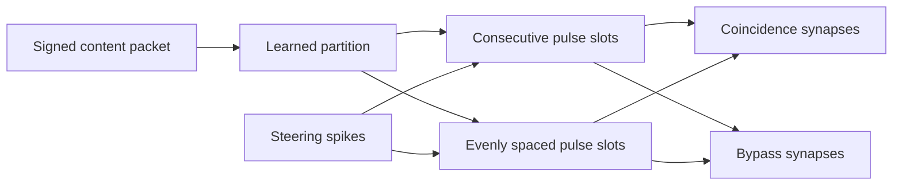

# Spike coincidence with evenly spaced pulses

In the released router, each signed content packet occupies consecutive
pulse slots. A steering aperture admits the first pulses and sends the
rest through the bypass. Once the aperture admits the entire packet,
that route loses information about how far the gate has opened. On
enwik8, first-occurrence eight-byte prefixes and prefixes recurring after
at least 512 bytes account for 78.7% of the gap between opponent
steering and the equal-data Transformer. This experiment changes the
nonlinearity within the immediate route.
[Equal-data enwik8 comparison](TRACE_WRITE_CREDIT.md#paired-next-byte-scores)

For a packet of magnitude $m$, a learned fraction $a$ transfers
$u=\operatorname{round}(am)$ pulses to a second lane. Its pulses are
evenly spaced over a clock of $P$ slots. The first lane carries the
remaining $m-u$ pulses in consecutive slots. At steering count $s$,
the two lanes send the following aggregate to the existing
coincidence synapses.

$$
c = \min(m-u,s) +
    \left\lfloor\frac{u\min(s,P)+P/2}{P}\right\rfloor .
$$

The bypass receives the remaining $m-c$ pulses. Each event keeps
its sign and occupies one route. The clock length is the smallest
power of two at least twice the firing resolution, which is 32
slots in this model. The integer expression counts the events
that arrive under the aperture. The reference test independently
places every event at the center of an equal-width sector and
checks that its arrival gives the same result. The decoder retains
the immediate synapses and its delayed and held-charge paths.
[Decoder](../snnformer/event_lm.py) · [Clock-slot test](../tests/test_correction_memory.py)

Deterministic pulse-train arithmetic is established. The architectural
change here is learning to partition the same signed packet between
two timing patterns, then routing the entire packet through an
existing pair of synaptic paths.
[Deterministic pulse-train arithmetic](https://homes.cs.washington.edu/~armin/DATE_2014.pdf)

The five-block model uses 20 learned fractions and 21,320 bytes
of streaming state. With the fractions at zero, native output and
total pulse counts matched the released checkpoint on 4,096 enwik8
validation bytes. CPU and MPS spike counts matched, and the new
fractions received gradients in all five blocks on 512 real enwik8
training targets.
[Initialization check](../results/event_lm/spread_coincidence/warm_identity.json)

The paired continuation uses `--spread-coincidence` and
`--trace-write-credit`, seed 711, the original pulse target of
310,000, and 6,553,600 additional enwik8 targets. It shares the
parent and training windows with the chronological-gradient
control. Both arms score the complete enwik8 test split and
16 complete PG-19 books.
[Matched continuation protocol](TRACE_WRITE_CREDIT.md#paired-next-byte-scores)

## Results

| Seed-711 continuation | enwik8 bpb | PG-19 bpb | PG-19 raw bpb | Native pulses per byte |
|---|---:|---:|---:|---:|
| Chronological write credit | 1.98691 | 2.99097 | 3.10893 | 307,270 |
| Spread coincidence | 1.98644 | 2.98129 | 3.10337 | 306,624 |

The learned fractions were 0, 1/64 or 2/64. Zeroing them on
65,536 enwik8 validation targets raised loss from 1.918109 to
1.918215 bits per byte. The intervention measures a small direct
effect on that sample. The PG-19 comparison uses one seed.
Native CPU counts matched MPS and native chunked outputs on
4,096 enwik8 test bytes. This continuation used 21,320 bytes of
persistent state per stream.
[Training, corpus scores, integer audit and zero-fraction probe](../results/event_lm/spread_coincidence)
