# State reads and race cells

## Complete enwik8 test

A spike-only decoder with state reads and race cells on delayed
fibres scores **1.2623 bits per byte** on 4,999,999 held-out
enwik8 predictions. The full-attention Transformer of the same
size and training scores 1.2068. Under the same scoring the v12
decoder with read heads scores 1.4669, so the distance to the
Transformer fell from 0.260 to 0.055 bpb.

A state read lets the present byte address the stream's own
earlier states by what they hold. A race cell is one of 350 cells
in a cluster that compete for a fixed number of spikes per byte.
The cells listen on fibres that bring the stream as it was up to
three bytes ago. All three are built from spike counts, and all
are trained by gradient descent with the rest of the decoder.

| Model, 368.64M training targets from scratch | Parameters | enwik8 test | Over the Transformer | Paired 95% interval |
|---|---:|---:|---:|---:|
| Transformer, AdamW | 34,845,696 | 1.2068 | | |
| Transformer, rotated optimizer | 34,845,696 | 1.2041 | −0.0028 | −0.0034 to −0.0021 |
| **Spike reads and race cells on delayed fibres** | 34,819,544 | **1.2623** | +0.0554 | +0.0546 to +0.0562 |
| Spike reads | 34,648,600 | 1.2991 | +0.0922 | +0.0913 to +0.0931 |
| Soft reads, a softmax hybrid, AdamW | 34,648,588 | 1.3197 | +0.1129 | +0.1119 to +0.1140 |
| v12 decoder with read heads | 34,845,184 | 1.4669 | +0.2600 | +0.2582 to +0.2618 |
| v12 plain decoder | 34,845,184 | 1.5973 | +0.3904 | +0.3869 to +0.3939 |

Every row is one model with one seed. All seven received the
same 512-byte training windows in the same order. Every window
of the test starts from an empty state and holds 256 unscored
bytes before its 256 scored ones, which is the scoring of the
Transformer's reference score. The intervals resample whole
windows. The three rows trained with the rotated optimizer are
scored with their running weight average. The last weights of
the best decoder score 1.2629.

Two limits come first.

**The Transformer is still ahead.** The best decoder is 0.055 bpb
above it. For the first 6,000 updates the decoder leads on
validation, at 9,000 the two are level, and from 12,000 on the
Transformer is ahead. The rotated optimizer that the decoders
are trained with changes the Transformer's test score by 0.003.
[Where the gap is](#where-the-gap-is)

**The decoder has no stream form.** State reads and race cells
run inside 512-byte windows only. The model refuses to carry
them through a stream, so there is no streaming score, no native
integer run, no pulse audit and no generator for this decoder.
The 313,016 pulses per byte in the training record are the
trainer's own count on validation. Both races are computed in
closed form and in floating point: a cell's rate is its softmax
share of the budget, and evenly spread starting phases turn the
rates into whole spikes. The released file scores 1.262257 on the
training GPU and 1.262237 on a laptop CPU.
[Limits](#limits)

The two v12 rows are the released v12 checkpoints scored in
these windows. On the [leaderboard](LEADERBOARD.md) they also
stand with their streaming scores of 1.4137 and 1.6110.

**PG-19.** On 16 complete PG-19 test books, 8,404,368 targets,
the best decoder scores 1.5516 bpb and the AdamW Transformer
1.4821. The decoder is 0.0695 behind, with a paired 95% interval
of 0.0690 to 0.0701. The decoder with spike reads alone scores
1.5798 and the Transformer under the rotated optimizer 1.4820.
The scoring is the one above, with every book a passage of its
own. One temperature per model is fitted on eight separate
validation books, and the fit is 1 for all four. The training
mixture holds PG-19 training books, so these are held-out books
of a trained domain. The soft-read hybrid and the v12 decoders
were not scored on PG-19 in windows.
[PG-19 records](../results/event_lm/state_reads/scores)

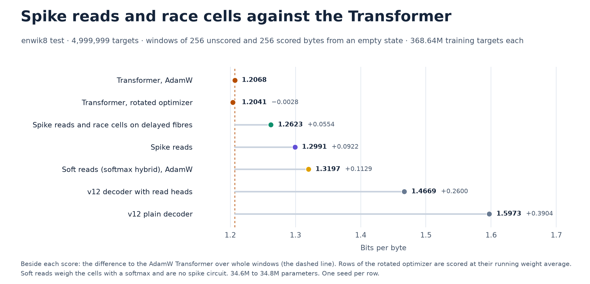

[Records](../results/event_lm/state_reads) ·
[Test scores](../results/event_lm/state_reads/scores) ·
[Checkpoint checksums](../results/event_lm/state_reads_checkpoints.sha256) ·
[Restore and rescore](V13_HANDOFF.md) ·
[All 89 arms](STATE_READS_ARMS.md)

## The circuit

```mermaid
flowchart LR
    B["Input byte"] --> A["Blocks 0 and 1, race cells after each"]
    A --> C["Block 2, then a state read"]
    C --> D["Block 3, then race cells"]
    D --> E["Block 4, then a state read"]
    E --> G["Block 5, then race cells"]
    G --> H["Block 6, then a state read"]
    H --> F["256 forecast neurons"]
    F -->|surprise| K["Block 7 on the surprise clock"]
    H --> K
    K --> M["Tagged forecast-error bank"]
    M --> V["256 vocabulary neurons"]
```

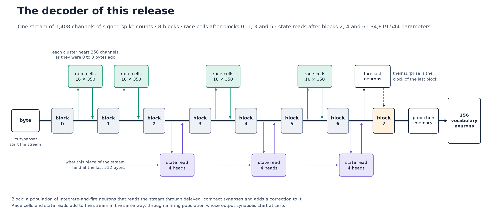

**Stream and blocks.** The stream is 1,408 channels of signed
spike counts with 16 pulses to a unit. Eight blocks of the v10
kind read it and add their corrections. The forecast neurons, the
surprise clock and the tagged forecast-error bank are the v11
circuit. Block 7 is the only block on the clock.
[v11 circuit](SURPRISE_CLOCK.md#one-signal-for-two-circuits)

| Part | Parameters |
|---|---:|
| 8 blocks | 18,112,512 |
| 4 layers of race cells | 11,491,264 |
| 3 state reads | 4,331,544 |
| Input and output synapses | 720,896 |
| Forecast-error bank and recall synapse | 163,328 |
| **Total** | **34,819,544** |

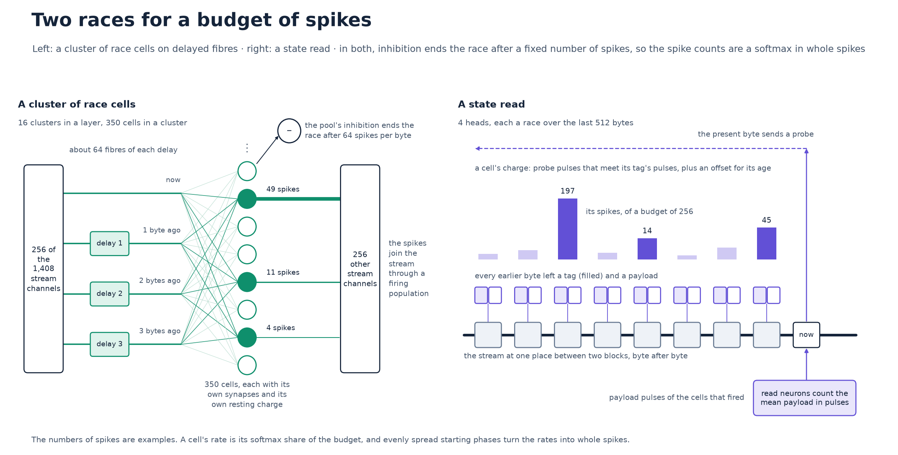

**State read.** After blocks 2, 4 and 6 every byte position is a
cell. Three sets of synapses turn the stream at that byte into a
tag, a payload and a probe of 256 channels, fired as spike
packets through populations whose thresholds an inhibitory pool
raises with the stream's activity. The 256 channels are split
over four heads. In a head the present byte's probe meets the
tags of the last 512 bytes. A probe pulse that meets a tag pulse
of its own sign on its channel charges that cell, and one that
meets a pulse of the other sign discharges it. A learned gain per
head scales the charge, and a learned offset for the cell's age
is added.

The cells of a head then race for 256 spikes. Every unit of
charge multiplies a cell's rate by e, and the pool's inhibition
ends the race when the budget is spent, so the spike counts are a
softmax in whole spikes. Every cell spike passes that cell's
payload pulses on. The threshold of the read neurons grows with
the number of cell spikes, so they count the mean payload, in
read pulses of a quarter payload pulse each. Output synapses
that start at zero
bring the count back to the stream through a firing population,
as a block's correction arrives.

**Race cells.** After blocks 0, 1, 3 and 5 a layer holds 16
clusters of 350 cells, 22,400 cells in the decoder. A cluster
shares 256 stream channels through fixed random wiring, as
granule cells share the mossy fibres of a glomerulus. Every cell
weighs those channels with its own synapses and has its own
resting charge. The cells of a cluster race for 64 spikes per
byte. A cell's charge in units of its threshold, times a
sharpness the cluster learns, sets its rate, and its resting
charge is its handicap. A block has 243 gated neurons that each
hear the whole stream. A cluster has 350 cells that each hear
256 channels, and the stream picks among them by what it
carries.
The axons reach 256 other channels through synapses that start
at zero.

**Delayed fibres.** The fibres of a cluster conduct at four
speeds. 64 of the 256 bring their channel as it is now, and 64
each as it was one, two and three bytes ago. A cell hears the
last four bytes side by side and can answer to a run of them.

**Training.** One loss trains all of it. The rates of both races
carry the gradient, and the whole spikes follow the rates. The
optimizer runs Adam in the eigenbasis of each weight matrix's
gradient moments, and the scored weights are a running average
with a decay of 0.999.
[The rotated optimizer](#the-rotated-optimizer-and-the-weight-average)

[Decoder](../snnformer/event_lm.py) ·
[Optimizer](../experiments/rotated_adam.py) ·
[Tests of the reads](../tests/test_state_reads.py) ·
[Tests of the cells](../tests/test_granule_cells.py)

## State reads

The v12 study ended with a probe on its frozen head decoder. One
attention head over the decoder's last 128 top states gained
0.027 bpb where 33 to 96 bytes were in view. The threshold set
beforehand was 0.02.
[The earlier probe](#the-earlier-probe)

The first runs of this study train such reads inside the
decoder, as softmax reads between blocks. Each run has 12,000
updates under AdamW and is scored with its last weights on
validation.

| Model after 12,000 updates | Validation | Copyable targets | Other targets |
|---|---:|---:|---:|
| Transformer | 1.6572 | 0.8419 | 1.8049 |
| Decoder with three soft reads | 1.6100 | 0.2644 | 1.8539 |
| Plain decoder | 1.8294 | 1.0446 | 1.9716 |

A target counts as copyable when the bytes just read occurred
earlier in the window with at least 4 bytes in common, and the
byte that followed them there is the target. The three columns
are 256 validation windows. With reads the decoder is ahead of
the Transformer at this budget, and the whole lead is on the
copyable targets.
[Split](../results/event_lm/state_reads/probes/match_split_12k_budget_17T1926.txt) ·
[Runs](../results/event_lm/state_reads/runs)

The trainer's own curves agree. At 12,000 updates the plain
decoder stands at 1.8570, the Transformer at 1.6716 and the
decoder with soft reads at 1.6115. A plain decoder without the
price on pulses reaches 1.8398, so the pulse budget is not what
holds the plain decoder back.

**Controls.** A read whose shares follow from the cells' ages
alone, without an address, scores 2.2637 after 2,000 updates,
against 2.0273 with the address. A window of 64 bytes instead of
512 scores 2.1549. Eight heads, six reads, wider reads and reads
after other blocks all stand between 2.00 and 2.07 at 2,000
updates. Plain decoders with a narrower stream and wider blocks
stand at 2.2225 and 2.1472 after 4,000 updates, against 2.1355
for the plain decoder.
[All read designs](STATE_READS_ARMS.md#read-designs)

**From a softmax to spikes.** The soft read weighs the cells with
a softmax over real numbers, so a decoder with soft reads is a
hybrid. The spike read took three steps to come close to it.

| Spike read after 2,000 updates | Validation |
|---|---:|
| Probe and tag keep only their positive pulses | 2.2954 |
| Signed pulses, a pulse of the other sign discharges the cell | 2.1089 |
| The mean payload counted in quarter pulses | 2.0738 |
| A race of rates for a budget of 256 spikes | 2.0382 |
| Soft read | 2.0273 |

With positive pulses alone the read is no better than a read
without an address. The control with positive pulses in the
later code scores 2.4280. The last row of spikes is the read of
this release. After 4,000 updates it stands at 1.8748 and the
soft read at 1.8447.

| Reads at one shape | 3,000 | 6,000 | 12,000 | 24,000 |
|---|---:|---:|---:|---:|
| Soft, AdamW, last weights | 1.9465 | 1.8323 | 1.7491 | 1.6606 |
| Spikes, AdamW, last weights | 1.9730 | 1.8552 | 1.7580 | 1.6782 |
| Soft, rotated optimizer, averaged | 1.7751 | 1.6556 | | |
| Spikes, rotated optimizer, averaged | 1.8029 | 1.6821 | 1.5981 | 1.5258 |

The spike read stays 0.01 to 0.03 bpb behind the soft read at
every step that both reached. A soft-read decoder of a wider
block shape was kept running as the hybrid reference for 66,000
updates. The spike-read decoder trails it by 0.022 there, and
the best decoder is 0.014 ahead of it.

On a copy task, where the second half of a sequence repeats the
first, a small decoder with spike reads reaches 0.041 bits per
repeated byte and 99.8% accuracy after 4,000 updates. With soft
reads it reaches 0.029 bits and 99.9%.
[Copy task with spike reads](../results/event_lm/state_reads/probes/copy_task_rate_17T1904.txt) ·
[with soft reads](../results/event_lm/state_reads/probes/copy_task_soft_17T1857.txt)

## The rotated optimizer and the weight average

Under AdamW the decoder's loss falls slowly in the middle of a
run and jumps down whenever the step size shrinks. Forks of the
soft-read run at 12,000 updates, where it stood at 1.7491, show
why.

| Fork from 12,000 updates | +1,000 | +3,000 | +5,000 | +8,000 |
|---|---:|---:|---:|---:|
| The run itself, AdamW at 3e-4 | | 1.7176 | | |
| AdamW at 1e-4 | | 1.6283 | | |
| AdamW at 3e-4, last weights | 1.7433 | 1.7281 | 1.7173 | |
| AdamW at 3e-4, running average | 1.6744 | 1.6434 | 1.6230 | |
| Rotated optimizer at 3e-4, last weights | 1.6638 | 1.6326 | 1.6176 | 1.6023 |
| Rotated optimizer at 3e-4, running average | 1.6423 | 1.5970 | 1.5723 | 1.5549 |

**The weights jitter around a better mean.** A running average of
the AdamW weights scores 0.07 to 0.09 bpb below the weights
themselves. The two differ by 6 to 11% of a weight's mean size
in the blocks. A random step of more than twice that size in all
weights moves the loss by 0.0005 bpb, so the jitter is not noise
in single weights. No weight group holds it either. Averaging
one group alone recovers at most 0.027 of the 0.078, and leaving
one group unaveraged costs at most 0.008.
[Attribution](../results/event_lm/state_reads/probes/averaging_attribution_17T1931.txt) ·
[Random steps in the decoder](../results/event_lm/state_reads/probes/sensitivity_decoder_larger_17T1915.txt) ·
[in the Transformer](../results/event_lm/state_reads/probes/sensitivity_transformer_larger_17T1915.txt)

**The decoder overshoots sooner than the Transformer.** One step
along the gradient of a batch should lower the loss on that
batch by a known amount. At 42,000 updates a step of 3e-5 keeps
82% of that promise in the Transformer and 22% in the decoder
with spike reads. A step of 1e-4 keeps 11% in the Transformer,
and in the decoder it raises the loss by 71% of the promise. At
3e-5 every weight group of the decoder alone keeps 40 to 83% of
its promise. The loss comes when all groups step together.
[Step fidelity](../results/event_lm/state_reads/probes/step_fidelity_17T2334.txt) ·
[Groups together](../results/event_lm/state_reads/probes/shared_step_17T2338.txt) ·
[Groups alone](../results/event_lm/state_reads/probes/step_sharpness_17T2336.txt)

**The rotated optimizer.** Adam scales every weight on its own. A
direction that many weights of a matrix share then moves by the
sum of their steps. The optimizer here keeps running second
moments of the gradient's rows and columns, refreshes their
eigenbases every 50 updates, rotates the gradient into them and
runs Adam there, so a shared direction is one coordinate with
one step. It follows SOAP
(Vyas et al., 2024). A running average of the weights with a
decay of 0.999 is kept beside it and scored.
[Optimizer](../experiments/rotated_adam.py) ·
[Tests](../tests/test_rotated_adam.py)

From scratch, the spike-read decoder stands at 1.6782 after
24,000 updates under AdamW. Under the rotated optimizer its last
weights stand at 1.5886 and its averaged weights at 1.5258. On
the test split the spike-read decoder trained this way scores
1.2991, against 1.3197 for the soft-read hybrid under AdamW. The
Transformer gains 0.003 from the same change.

The optimizer was not tuned further. Step sizes of 6e-4 and
1.5e-4 lose to 3e-4 on the best decoder: 1.6787 and 1.7079
against 1.6499 at 6,000 updates. Other refresh intervals and
second-moment decays made no difference in 500 updates.
[Forks](STATE_READS_ARMS.md#forks-of-the-soft-read-run-at-12000)

## Race cells

A block has few neurons and each hears the whole stream. The
cells are the opposite trade: many neurons, each on a few
channels. The first design gave the cells a firing threshold.

**Threshold cells go silent.** At 1,500 updates the cells of the
four layers fire on 6 to 37% of their bytes, and cutting all of
them costs 0.33 bpb. At 3,000 updates they fire on 1 to 11%, and
the cut costs 0.03. That arm has no price on the cells' own
spikes. Without the pulse budget as well the same happens: 0.29
at 1,500 and 0.015 at 3,000. A separate basis for every cluster
in the optimizer keeps 15 to 28% of the cells firing, and the
cut still costs 0.019. The decoder learns to do without them.
[Statistics and cuts](../results/event_lm/state_reads/probes/cells.json) ·
[What pushes them silent](../results/event_lm/state_reads/probes/cell_silencing_17T2154.txt)

**Race cells stay in use.** With a budget, the 64 spikes of a
cluster are spent at every byte whatever the charges are, and
only their division is learned. Cutting all race cells costs
0.64 bpb at 1,500 updates, 0.50 at 3,000 and 0.88 at 12,000.

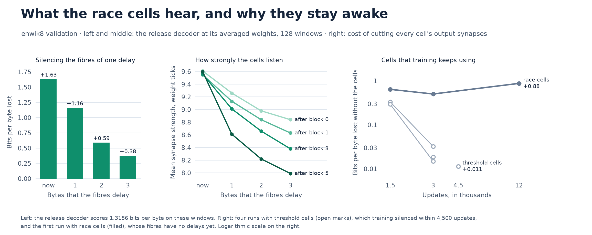

| Decoder with spike reads, averaged validation | 3,000 | 6,000 | 12,000 | 24,000 |
|---|---:|---:|---:|---:|
| No cells, 13 blocks | 1.8029 | 1.6821 | 1.5981 | 1.5258 |
| Threshold cells, 10 blocks, 212 cells per cluster | 1.7898 | 1.6709 | | |
| Race cells, 10 blocks, 212 cells per cluster | 1.7812 | 1.6634 | 1.5869 | 1.5163 |
| Race cells on delayed fibres, 8 blocks, 350 cells | 1.7743 | 1.6499 | 1.5687 | 1.4918 |
| Transformer | 1.9608 | 1.7597 | 1.5304 | 1.4172 |

The cells are paid for with blocks on the surprise clock. The
decoder with reads alone has 13 blocks, four of them on the
clock. Random steps in those four move its loss a tenth as far
as steps in the other nine. The cell decoders keep one block on
the clock. On validation the threshold cells and the race cells
are not told apart at 6,000 updates. The cut is what separates
them.

In the final decoder a cluster spends 64 to 65 spikes per byte
over 6 to 11 cells, and the leading cell takes 65 to 77% of them.
Between 1 and 2% of the cells of the first three layers never
fire in 128 validation windows, and 17% of the last layer.
[Final decoder](../results/event_lm/state_reads/probes/delay_use_and_cell_statistics_18T0336.txt)

## Delayed fibres

Race cells on the present stream gain 0.014 bpb at 12,000
updates, on copyable and other targets alike. On targets with
nothing to copy they fall behind the Transformer by 6,000
updates: 1.9330 against 1.9124. With fibres of four delays a
pilot stood at 1.9058 at that step, ahead of the Transformer. A
repeat of the pilot without delays stood at 1.9365.
[Split at 6,000](../results/event_lm/state_reads/probes/match_split_18T0053.txt)

The final decoder uses every delay. Silencing the fibres of one
delay in all four layers costs 1.63 bpb for the present stream,
1.16 for one byte back, 0.59 for two and 0.38 for three. The
synapses on the fibres of three bytes back are 8 to 17% smaller
than those on the present stream.

**Fewer blocks, more cells.** The release decoder has 8 blocks
instead of 10 and spends the parameters on 350 cells per cluster
instead of 212. Without delays that shape was behind the deeper
one, 1.5717 against 1.5602 at 15,000 updates. With delays the
two are level, 1.6033 against 1.5972 at 9,000, and the shape
with 8 blocks was the one run to the end.

## Where the gap is

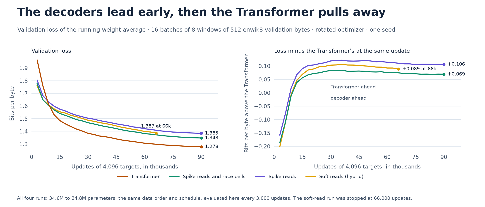

| Updates | Transformer | Soft reads, hybrid | Spike reads | Spike reads and race cells |
|---:|---:|---:|---:|---:|
| 3,000 | 1.9608 | 1.7593 | 1.8029 | 1.7743 |
| 6,000 | 1.7597 | 1.6492 | 1.6821 | 1.6499 |
| 9,000 | 1.6148 | 1.6076 | 1.6321 | 1.6033 |
| 12,000 | 1.5304 | 1.5767 | 1.5981 | 1.5687 |
| 24,000 | 1.4172 | 1.5147 | 1.5258 | 1.4918 |
| 42,000 | 1.3502 | 1.4537 | 1.4685 | 1.4309 |
| 60,000 | 1.3064 | 1.3989 | 1.4205 | 1.3815 |
| 90,000 | 1.2783 | | 1.3846 | 1.3476 |

All four are trained with the rotated optimizer and scored with
their averaged weights on 16 batches of validation. The decoders
learn faster for the first 6,000 updates. The Transformer passes
the spike-read decoder between 6,000 and 9,000. At 9,000 it is
level with the best decoder, 1.6148 in this run and 1.6028 in a
repeat against 1.6033, and at 12,000 it is ahead.

**The gap is on bytes with nothing to copy.** The split below
uses 512 validation windows at each step. 15.6% of the targets
are copyable.

| Updates | Copyable: Transformer | Best decoder | Other targets: Transformer | Best decoder |
|---:|---:|---:|---:|---:|
| 12,000 | 0.4042 | 0.2958 | 1.7531 | 1.8172 |
| 24,000 | 0.2864 | 0.2714 | 1.6467 | 1.7363 |
| 42,000 | 0.2541 | 0.2504 | 1.5722 | 1.6629 |
| 84,000 | 0.2379 | 0.2243 | 1.4994 | 1.5786 |

On copyable targets the decoder is ahead at every step. On the
other targets it is 0.064 behind at 12,000 updates and 0.079
behind at 84,000.

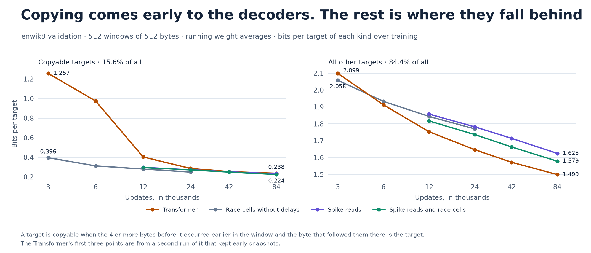

[Splits](../results/event_lm/state_reads/probes/splits.json)

**Most of it is on lower-case letters.** At 84,000 updates the
best decoder is 0.0647 bpb behind on these windows. Lower-case
letters are 68.4% of the targets and carry 0.0490 of it. The
third letter of a word has the largest gap of any place in a
word, 0.105. Letters after eight or more letters have the
smallest, 0.036.

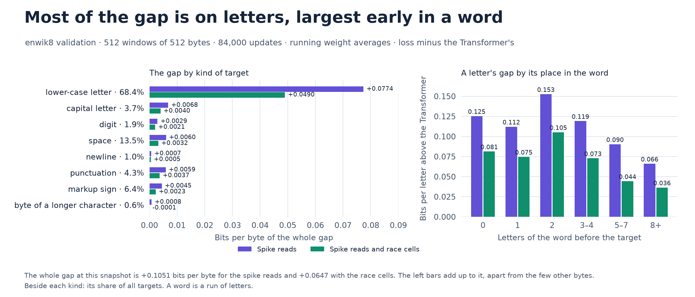

| Target at 84,000 updates | Share | Transformer | Spike reads, gap | Best decoder, gap |
|---|---:|---:|---:|---:|
| All | 100.0% | 1.3031 | +0.1051 | +0.0647 |
| Lower-case letter | 68.4% | 1.2887 | +0.1132 | +0.0716 |
| Capital letter | 3.7% | 3.9965 | +0.1827 | +0.1067 |
| Digit | 1.9% | 2.7304 | +0.1496 | +0.1082 |
| Space | 13.5% | 0.4320 | +0.0447 | +0.0236 |
| Punctuation | 4.3% | 1.7020 | +0.1351 | +0.0844 |
| Markup sign | 6.4% | 0.9030 | +0.0698 | +0.0359 |
| Byte of a longer character | 0.6% | 3.0019 | +0.1293 | −0.0145 |

[Kinds](../results/event_lm/state_reads/probes/match_and_class_split_18T0320.txt)

**The gap needs earlier words in view.** The final weights were
scored on windows cut to 1 to 64 bytes and on whole windows of
512, so every target has a known number of bytes before it.

| Bytes in view | Transformer | Best decoder, gap | Spike reads, gap |
|---|---:|---:|---:|
| 1 | 4.0081 | +0.009 | +0.009 |
| 2 | 3.2215 | −0.024 | −0.014 |
| 4 | 2.3218 | −0.002 | +0.044 |
| 6 | 1.9795 | +0.007 | +0.061 |
| 8 | 1.8545 | +0.024 | +0.059 |
| 9–12 | 1.7441 | +0.032 | +0.076 |
| 17–24 | 1.5401 | +0.052 | +0.100 |
| 33–48 | 1.4302 | +0.067 | +0.112 |
| 65–128 | 1.3062 | +0.062 | +0.109 |
| 257–512 | 1.2174 | +0.063 | +0.099 |

With up to 6 bytes in view the best decoder is within 0.025 bpb
of the Transformer on either side. The spike-read decoder
without cells is 0.04 to 0.06 behind from the third byte on, so
the cells on delayed fibres closed the gap over the last few
bytes. From 6 to 48 bytes the gap grows to 0.067, and it stays
near that up to 512 bytes.

The first letter of a word shows where it comes from.

| Words that ended in view | First letters | Transformer | Best decoder, gap | Spike reads, gap |
|---|---:|---:|---:|---:|
| 0 | 2,537 | 4.7954 | −0.056 ±0.014 | −0.019 ±0.013 |
| 1 | 8,952 | 4.1737 | +0.009 ±0.007 | +0.044 ±0.007 |
| 2 | 8,943 | 3.8039 | +0.042 ±0.008 | +0.087 ±0.009 |
| 3 | 8,930 | 3.6136 | +0.070 ±0.008 | +0.098 ±0.009 |
| 4–5 | 17,589 | 3.5371 | +0.067 ±0.006 | +0.111 ±0.007 |
| 6–9 | 29,804 | 3.5610 | +0.087 ±0.005 | +0.118 ±0.005 |
| 10–19 | 14,442 | 3.4327 | +0.073 ±0.007 | +0.119 ±0.008 |
| 20–39 | 15,358 | 3.2544 | +0.097 ±0.008 | +0.135 ±0.008 |
| 40 or more | 26,905 | 3.3183 | +0.099 ±0.006 | +0.131 ±0.006 |

The ± is one standard error over targets. With one earlier word
in view the best decoder predicts the next word's first letter
as well as the Transformer. With two it is 0.042 behind, and with
three 0.070. Beyond that the gap grows slowly. The Transformer's
lead is the use it makes of the second to fifth word back.

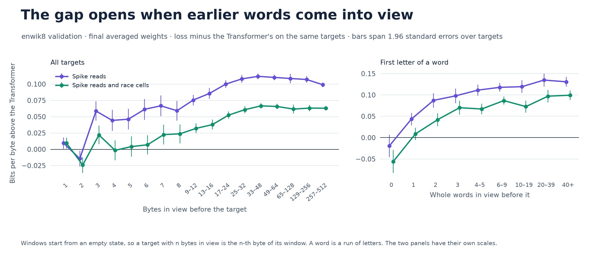

[Context split](../results/event_lm/state_reads/probes/context_split.json)

**Count tables of the training text help the decoder more.** A
table of what followed each context in 90,000,000 training bytes
was mixed into each model's prediction. A table of the last 12
bytes saves the Transformer 0.021 bpb, the best decoder 0.033
and the spike-read decoder 0.043. A table keyed by the present
word and the two words before it saves 0.017, 0.026 and 0.034.
Tables built from the window's own bytes save nothing. So about
0.01 bpb of the gap is statistics of short contexts that such a
table holds and that the Transformer has learned better than the
decoder.
[Count tables](../results/event_lm/state_reads/probes/count_tables.json)

## What was ruled out

Each line is one arm with one seed against the arm it changed,
on averaged validation unless it says otherwise. Differences
below 0.02 bpb before 12,000 updates are inside the noise of
this validation: two runs of one configuration differ by 0.018
with their last weights and 0.026 averaged at 3,000 updates.

| Change | Result | Against |
|---|---:|---:|
| Cells after every block, 200 per cluster | 1.5617 at 12,000 | 1.5687 |
| Fibres of 8 delays | 1.5661 at 12,000 | 1.5687 |
| Slow fibres that hold a share of their charge | 1.6485 at 6,000 | 1.6499 |
| Relay neurons before the fibres | 1.6512 at 6,000 | 1.6458 |
| 64 clusters of 87 cells, budget 16 | 1.7970 at 3,000 | 1.7743 |
| 32 clusters on 128 channels, budget 32 | 1.7945 at 3,000 | 1.7812 |
| A basis per cluster for the race cells' optimizer | 1.7908 at 3,000 | 1.7812 |
| Threshold cells on delayed fibres | 1.6722 at 6,000 | 1.6458 |
| Step size 6e-4 | 1.6787 at 6,000 | 1.6499 |
| Step size 1.5e-4 | 1.7079 at 6,000 | 1.6499 |
| Three times the step size for the cells | 1.5809 after 2,000 | 1.5789 |
| Stream of 704 channels, wider blocks | 1.5681 at 24,000 | 1.5258 |
| Stream of 1,024 channels | 1.6378 at 9,000 | 1.6321 |
| No pulse budget, spike reads | 1.7928 at 3,000 | 1.8029 |

Cells after every block and fibres of 8 delays are level with
the release decoder at 12,000 updates and were not run further.
The split by copyable targets does not separate them either:
1.8122 against 1.8172 on the other targets for cells after every
block.

Three probes looked for a cost of the spike code itself.

**Rounding to whole spikes costs little.** With every neuron's
firing phase drawn at random, one pass of the spike-read decoder
at 42,000 updates loses 0.006 bpb, and the mean of four passes
gains 0.007.
[Dither](../results/event_lm/state_reads/probes/dither.json)

**The weight grid is not the limit.** The synapses of the
decoders' blocks have a mean size of 5 to 8 ticks of their grid.
The trained Transformer with its weights rounded to a grid on
which their mean size is 7 ticks loses 0.004 bpb without
retraining. At 5 ticks it loses 0.007 and at 2 ticks 0.057.
[Weight grid](../results/event_lm/state_reads/probes/weight_grid.json) ·
[Synapse sizes](../results/event_lm/state_reads/probes/headroom_17T2032.txt)

**Almost no drive sits at a cap.** A drive at its cap passes no
gradient. In the race-cell decoder at 12,000 updates no
population of the blocks, the reads or the cells has one. The
forecast and vocabulary neurons have 0.2% of their drives
there, and the forecast population of the error bank 6.4%. The
stream carries 13,800 pulses per byte into block 0 and 25,100
into block 8.
[Stream statistics](../results/event_lm/state_reads/probes/stream_statistics_18T0117.txt)

## Word time: beat fibres

The context split asks for the second to fifth word back, and a
fibre that counts bytes reaches three bytes. A beat fibre counts
beats of a clock instead. A beat opens a new stretch of bytes.
The fibre's synapse keeps what its channel brought since the
last beat, and at a beat what it kept moves one place down a
chain of held stretches. A cell then hears the present stretch
and the held ones side by side, whatever their lengths in bytes.
The clock is a cell of its own that hears the whole stream and
races a silent rival for one spike per byte. Its spike is the
beat. Every beat fibre has such a clock cell, and the clock
cells of a cluster share their synapses and differ in the phases
their membranes start at.

**This is built and tested on a made-up language only.** No
decoder of full size has been trained with beat fibres. The code
and its tests are in this release. The pilots need 12,000
updates each on a GPU.
[Pilot plan](V13_HANDOFF.md#next-pilots)

In the made-up language a word depends on the word before last.
A model that cannot use that word scores 3.52 bits on a word's
first letter, and one that can 2.53. Each arm is a small decoder
after 2,000 updates on a laptop CPU, with two seeds.

| Fibres of the cells | Seed 0 | Seed 1 |
|---|---:|---:|
| Delays of 0 to 3 bytes | 3.533 | 3.534 |
| Delays of 0 to 7 bytes | 2.773 | 2.792 |
| Beats at every byte | 3.532 | 3.531 |
| Fixed word clock, summed count | 2.527 | 2.551 |
| Fixed word clock, mean count | 2.523 | 2.536 |
| Fixed word clock, last count | 3.535 | 3.530 |
| Learned clocks, summed count | 2.577 | 2.548 |
| Learned clocks, mean count | 2.653 | 2.648 |
| Learned clocks, last count | 2.789 | 2.824 |

With a clock that reads the word boundaries from the bytes, the
cells reach the bound. With learned clocks that keep a stretch's
summed count they come within 0.05 of it, and several clusters
become exact space clocks. A beat at every byte is a delayed
fibre and scores the same as one.

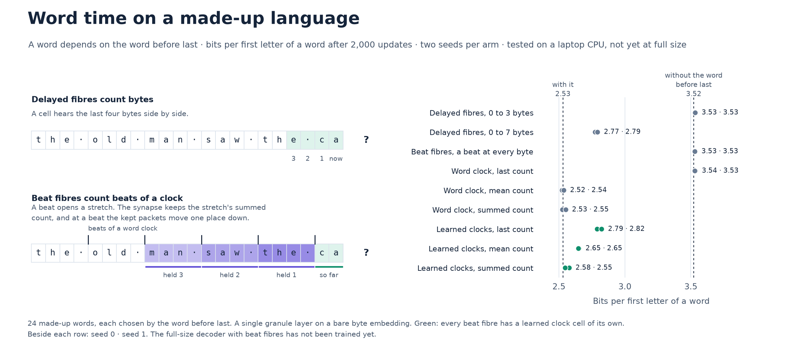

Two things had to be found for the clocks to learn. A clock
cell's threshold is 16 times a stream neuron's, because one step
of all its synapses otherwise moved its charge by more than a
threshold. And every beat fibre has its own clock cell, which
took 2,000 updates to reach what one clock per cluster needed
6,000 for. Hearing the mean over beats in training and whole
beats at scoring did not work, and neither did starting the
clocks near one beat per byte.
[Records](../results/event_lm/beat_fibres) ·
[Probe](../experiments/probe_word_time.py) ·
[Where the clocks beat](../experiments/probe_clock_cells.py)

## The earlier probe

On 17 November the released v12 head decoder was frozen and one
attention head was trained over its last top states. The
threshold was set before the run: 0.02 bpb on targets with 33 to
96 bytes in view. The head gained 0.027 there.

The split of that result set the direction of this study.
Copyable targets hold 23% of the v12 decoder's gap to the
Transformer, and a head over 512 cells closes 95% of that part.
The other 77% is on targets with nothing to copy, where no
variant of the head closes more than 4%. With 257 to 512 bytes
of history the v12 decoder scores what the Transformer reaches
with about 39. Stored states added 0.003 bpb over stored bytes,
keys made from bytes reached about 80% of the gain, and a
spiking race about 58% of the soft head's gain.

A read bolted onto a frozen decoder could only close the
copyable part. The reads of this study are trained with the
decoder, and the cells on delayed fibres are aimed at the rest.
[Records](../results/event_lm/state_attention) ·
[Probe](../experiments/probe_state_attention.py) ·
[Split](../experiments/probe_match_gap.py)

## The night's arms

The study trained 89 arms between 17 November 17:10 UTC and
18 November 04:03 UTC, each with one seed and most of them
stopped as soon as they fell behind. The arms page lists every
one with the settings it changed and where it ended.

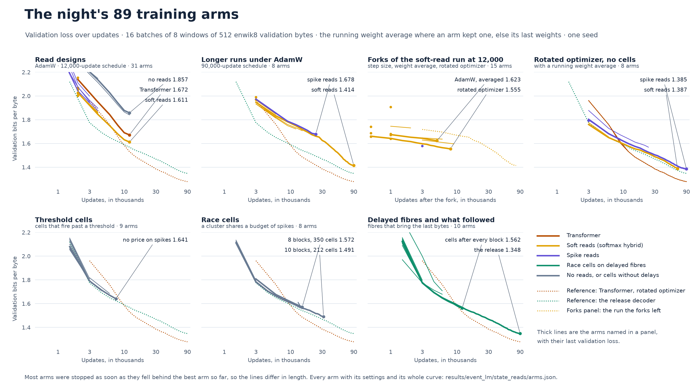

[Every arm](STATE_READS_ARMS.md) ·
[Settings and curves](../results/event_lm/state_reads/arms.json) ·
[Probe outputs](../results/event_lm/state_reads/probes) ·
[Probe scripts](../experiments/state_reads)

## Limits

**One seed.** Every arm and every score is one seed. The test
intervals cover the choice of test windows, not the training
run.

**No stream form.** The reads and the cell layers hold no
carried state, and the model raises an error when a stream asks
for one. The decoder is scored in windows only. It has no
streaming evaluation, no native integer decoder, no pulse audit
and no generator. A read would have to carry the tags and
payloads of its last 512 bytes, and a cell layer the last three
bytes of its channels.

**The races are computed, not simulated.** The spike counts of a
race are its rates rounded to whole spikes by fixed starting
phases. No membrane is stepped. The rates are computed in
floating point, so two machines can differ in the last digits:
1.262257 against 1.262237 on the test split.

**The pulse count is the trainer's.** 313,016 pulses per byte on
validation, against a budget of 310,000, counts the spikes of
the reads and the cells as the trainer does. It is not an audit
by a native decoder.

**The test protocol is windows.** Every model here is scored in
windows that start empty. A v12 decoder with read heads gains
from the stream it carries, 1.4137 against 1.4669, and the
decoder of this release has no such form to compare.

**Validation is small.** The curves use 16 batches of 8 windows.
Arms that differ by less than about 0.03 bpb before 12,000
updates are not told apart, and an arm that was stopped early
was judged on that.

**The settings do not record the code.** The spike read changed
form twice during the first hours. Arms named `race`, `race2`
and `race3` ran the three forms in turn, and only the third is
in the code of this release. The first cell arms ran before
`--granule-price` existed and had a price on their own spikes.
[Arms](STATE_READS_ARMS.md)

**Beat fibres are untested at full size.** Their only evidence is
the made-up language.

**The probes run on validation windows.** The splits by copyable
targets, kinds and context, the cell statistics and the cuts
are measured on 128 to 768 validation windows of 512 bytes, not
on the test split.

## Reproduce

Restore the checkpoints and rescore them with the commands in
the [handoff](V13_HANDOFF.md). The release decoder was trained
with one command.

```bash
python experiments/train_event_lm.py --variant event_correction_code --no-carry \
  --dim 1408 --hidden 243 --depth 8 --memory-heads 4 --memory-slots 14 --memory-width 32 \
  --forecast-key-channels 2 --match-forecast-key --learn-context-keys --spike-resolution 16 \
  --pulse-budget 310000 --code-loss-weight 0.25 --compact-delays --compact-axon-state \
  --activity-inhibition --inhibition-by-expansion --local-trace --trace-write-credit \
  --router-charge-bits 8 --residual-correction-start 7 --compact-trace-state \
  --delay-group-widths 75,75,47,46 --trace-arrival selected --trace-arrival-groups 2 \
  --early-readout-weight 0.25 --clock-start 7 --clock-threshold 35 \
  --read-after 2,4,6 --read-width 256 --read-window 512 --read-mode race --read-budget 256 \
  --read-resolution 4 --granule-after 0,1,3,5 --granule-clusters 16 --granule-cells 350 \
  --granule-fan 256 --granule-budget 64 --granule-delays 4 \
  --rotated-adam 50 --weight-average 0.999 \
  --data data/enwik8 --training-mixture data/training-v1/prepared/catalogue.json \
  --ctx 512 --bs 8 --steps 90000 --warmup 1000 --lr 3e-4 --wd 0.05 --seed 20001 \
  --eval-every 1500 --eval-bs 8 --eval-batches 16 --final-eval-batches 64 --validation-only \
  --device cuda --tag state_reads --results-dir checkpoints/state_reads/pilot-race64-d8-c350-dl4/results \
  --checkpoint checkpoints/state_reads/pilot-race64-d8-c350-dl4/model.pt
```

`--weight-average` writes the averaged weights beside the
checkpoint as `model.pt.averaged`. Two CUDA runs with one seed
are not bit-identical, so a retrained decoder will not reproduce
the checkpoint hash.

```bash
python experiments/plot_state_reads.py
python experiments/plot_state_reads.py --tables
python experiments/plot_state_reads.py --arms > docs/STATE_READS_ARMS.md
```

## Earlier work

[Coasting read heads, v12](COASTING_HEADS.md) ·
[Surprise clock and fast synapses, v11](SURPRISE_CLOCK.md) ·
[History](SHUNTFORMER_HISTORY.md) ·
[Leaderboard](LEADERBOARD.md)
