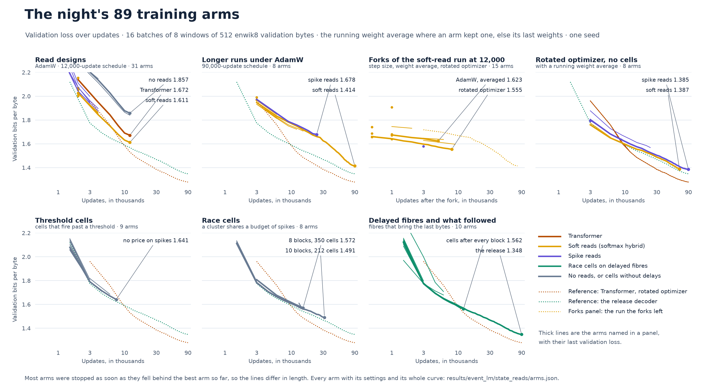

# Every training arm of the state-read study

The night of 17 to 18 November 2026 trained 89 arms. Each row is
one arm with one seed. The last column is the validation loss of
the running weight average where an arm kept one. Validation is
16 batches of 8 windows of 512 enwik8 validation bytes, so two
arms that differ by less than about 0.03 bits per byte before
12,000 updates are not told apart. Most arms were stopped as soon
as they fell behind the best arm so far.

The settings do not record the code. The spike read changed form
twice in the first hours: arms named `race`, `race2` and `race3`
ran the three forms in turn, and only the third is in the code of
this release. Flags were added during the night, and an arm that
started before a flag existed has no value for it. So
`read-signed=True` on a spike-read arm means that its code had
the flag, and the first arm `race-d13w256` ran with positive
pulses only. A cell arm without `granule-price` ran before that
flag existed and had a price on its cells' own spikes.
`fork12k-avg-save` has the settings of `fork12k-avg-lr3e4` and
was started to keep both the last and the averaged weights.
[Study page](STATE_READS.md) ·
[All settings and curves](../results/event_lm/state_reads/arms.json)

## Read designs

Does a read of the stream's own earlier states help, in which
shape, and can spikes carry it? Budget of 12,000 updates under
AdamW, raw weights.

Settings are given as the trainer flags that differ from
`reads-d13w256`.

| Arm | Started, UTC | Parameters | Differs in | Updates | Last weights | Averaged |
|---|---|---:|---|---:|---:|---:|
| `plain` | 17 17:10 | 34,845,184 | `clock-start=11` `depth=15` `read-after=unset` `read-heads=unset` `read-levels=unset` `read-mode=unset` `read-width=unset` `read-window=unset`. | 12,000 | 1.8570 |  |
| `plain-lr1e3` | 17 17:10 | 34,845,184 | `clock-start=11` `depth=15` `lr=0.001` `read-after=unset` `read-heads=unset` `read-levels=unset` `read-mode=unset` `read-width=unset` `read-window=unset`. | 4,000 | 2.3737 |  |
| `plain-lr6e4` | 17 17:10 | 34,845,184 | `clock-start=11` `depth=15` `lr=0.0006` `read-after=unset` `read-heads=unset` `read-levels=unset` `read-mode=unset` `read-width=unset` `read-window=unset`. | 4,000 | 2.2139 |  |
| `transformer` | 17 17:10 | 34,845,696 | Transformer of 6 layers and width 256 under AdamW, schedule of 12,000 updates. | 12,000 | 1.6716 |  |
| `plain-budget4x` | 17 17:10 | 34,845,184 | `clock-start=11` `depth=15` `pulse-budget=1240000.0` `read-after=unset` `read-heads=unset` `read-levels=unset` `read-mode=unset` `read-width=unset` `read-window=unset`. | 2,000 | 2.2755 |  |
| `plain-free` | 17 17:10 | 34,845,184 | `clock-start=11` `depth=15` `pulse-budget=1000000000.0` `read-after=unset` `read-heads=unset` `read-levels=unset` `read-mode=unset` `read-width=unset` `read-window=unset`. | 12,000 | 1.8398 |  |
| `race-d13w256` | 17 17:17 | 34,648,600 | `read-mode=race`. | 2,000 | 2.2954 |  |
| `reads-d13w256` | 17 17:17 | 34,648,588 | the base of this family. | 12,000 | 1.6115 |  |
| `reads-d13w256-win64` | 17 17:17 | 34,643,212 | `read-window=64`. | 2,000 | 2.1549 |  |
| `reads-d13x6` | 17 17:17 | 34,654,744 | `read-after=0,2,4,6,7,8` `read-width=128`. | 2,000 | 2.0589 |  |
| `reads-d14w128` | 17 17:17 | 34,749,964 | `clock-start=10` `depth=14` `read-after=2,5,9` `read-width=128`. | 2,000 | 2.0690 |  |
| `reads-over` | 17 17:17 | 39,176,716 | `clock-start=11` `depth=15` `read-after=2,6,10`. | 2,000 | 2.0018 |  |
| `shape-512x668` | 17 17:25 | 34,267,136 | `clock-start=11` `delay-group-widths=206,206,129,127` `depth=15` `dim=512` `hidden=668` `read-after=unset` `read-window=256`. | 4,000 | 2.2225 |  |
| `shape-704x486` | 17 17:25 | 34,403,072 | `clock-start=11` `delay-group-widths=150,150,94,92` `depth=15` `dim=704` `hidden=486` `read-after=unset` `read-window=256`. | 4,000 | 2.1472 |  |
| `sr-d11x6w256` | 17 17:50 | 34,451,992 | `clock-start=7` `depth=11` `read-after=1,2,3,4,5,6`. | 4,000 | 1.8648 |  |
| `sr-d13x6` | 17 17:50 | 34,654,744 | `read-after=0,2,4,6,7,8` `read-width=128`. | 2,000 | 2.0567 |  |
| `sr-704-d13x6` | 17 17:50 | 34,212,632 | `delay-group-widths=150,150,94,92` `dim=704` `hidden=486` `read-after=1,2,4,5,7,8`. | 4,000 | 1.8582 |  |
| `sr-704-d14x3` | 17 17:50 | 34,307,852 | `clock-start=10` `delay-group-widths=150,150,94,92` `depth=14` `dim=704` `hidden=486` `read-after=2,5,9`. | 2,000 | 2.0522 |  |
| `sr-d13w256h8` | 17 17:50 | 34,654,744 | `read-heads=8`. | 2,000 | 2.0695 |  |
| `race2-d13w256` | 17 17:57 | 34,648,612 | `read-mode=race` `read-signed=True`. | 3,000 | 1.9978 |  |
| `race2-r4` | 17 17:57 | 34,648,612 | `read-mode=race` `read-resolution=4` `read-signed=True`. | 4,000 | 1.8960 |  |
| `race2-rect` | 17 17:57 | 34,648,612 | `read-mode=race` `read-signed=False`. | 2,000 | 2.4280 |  |
| `age-d13w256` | 17 18:01 | 32,485,888 | `read-mode=age`. | 2,000 | 2.2637 |  |
| `race3-b256` | 17 18:05 | 34,648,600 | `read-budget=256` `read-mode=race` `read-signed=True`. | 3,000 | 1.9508 |  |
| `race3-b256-r4` | 17 18:13 | 34,648,600 | `read-budget=256` `read-mode=race` `read-resolution=4` `read-signed=True`. | 4,000 | 1.8748 |  |
| `race3-b64-r4` | 17 18:13 | 34,648,600 | `read-budget=64` `read-mode=race` `read-resolution=4` `read-signed=True`. | 3,000 | 1.9401 |  |
| `sr-d12w384` | 17 18:19 | 34,547,212 | `clock-start=8` `depth=12` `read-after=2,5,7` `read-width=384`. | 2,000 | 2.0236 |  |
| `sr-d12x4w256` | 17 18:19 | 33,828,368 | `clock-start=8` `depth=12` `read-after=1,3,5,7`. | 2,000 | 2.0223 |  |
| `sr-d13w256-e` | 17 18:19 | 34,648,588 | `read-after=0,3,6`. | 2,000 | 2.0272 |  |
| `race3-b256-r4-a8` | 17 18:27 | 34,648,600 | `read-address-rate=8.0` `read-budget=256` `read-mode=race` `read-resolution=4` `read-signed=True`. | 1,000 | 2.4323 |  |
| `sr-d13w256-b9` | 17 18:53 | 34,648,588 | `router-charge-bits=9`. | 4,000 | 1.8567 |  |

## Longer runs under AdamW

The best read designs on the 90,000-update schedule, still under
AdamW.

Settings are given as the trainer flags that differ from
`full-soft-d13w256`.

| Arm | Started, UTC | Parameters | Differs in | Updates | Last weights | Averaged |
|---|---|---:|---|---:|---:|---:|
| `full-soft-d13w256` | 17 17:59 | 34,648,588 | the base of this family. | 90,000 | 1.4140 |  |
| `full-rate-b256-r4` | 17 18:25 | 34,648,600 | `read-budget=256` `read-mode=race` `read-resolution=4` `read-signed=True`. | 24,000 | 1.6782 |  |
| `full-soft-a8` | 17 18:33 | 34,648,588 | `read-address-rate=8.0`. | 15,000 | 1.7068 |  |
| `full-soft-lr2e4` | 17 18:33 | 34,648,588 | `lr=0.0002`. | 12,000 | 1.7222 |  |
| `full-soft-704-d13x6` | 17 18:34 | 34,212,632 | `delay-group-widths=150,150,94,92` `dim=704` `hidden=486` `read-after=1,2,4,5,7,8`. | 6,000 | 1.8463 |  |
| `full-soft-s4` | 17 18:36 | 34,648,588 | `read-resolution=4`. | 3,000 | 1.9707 |  |
| `full-soft-s4k4` | 17 18:36 | 34,648,588 | `read-resolution=4` `read-synapse-gain=4.0`. | 3,000 | 1.9895 |  |
| `full-soft-free` | 17 18:49 | 34,648,588 | `pulse-budget=1000000000.0`. | 6,000 | 1.8125 |  |

## Forks of the soft-read run at 12,000

Why does a smaller step help so much in the middle of a run?
Forks of the soft-read run at 12,000 updates (one of the
spike-read run at 18,000) with other step sizes, a running weight
average and the rotated optimizer. A fork's updates count from
its start.

Settings are given as the trainer flags that differ from
`fork12k-avg-lr3e4`.

| Arm | Started, UTC | Parameters | Differs in | Updates | Last weights | Averaged |
|---|---|---:|---|---:|---:|---:|
| `fork12k-soft-lr1e4` | 17 18:55 | 34,648,588 | `lr=0.0001` `weight-average=unset`. From `full-soft-d13w256` at 12,000. | 9,000 | 1.5963 |  |
| `fork12k-soft-lr1p5e4` | 17 18:55 | 34,648,588 | `lr=0.00015` `weight-average=unset`. From `full-soft-d13w256` at 12,000. | 6,000 | 1.6360 |  |
| `fork12k-avg-lr3e4` | 17 19:14 | 34,648,588 | the base of this family. From `full-soft-d13w256` at 12,000. | 5,000 | 1.7173 | 1.6230 |
| `fork12k-avg-lr3e4-b2` | 17 19:14 | 34,648,588 | `adam-beta2=0.999`. From `full-soft-d13w256` at 12,000. | 1,000 | 1.7481 | 1.6789 |
| `fork12k-avg-lr1e4` | 17 19:20 | 34,648,588 | `lr=0.0001`. From `full-soft-d13w256` at 12,000. | 1,000 | 1.6550 | 1.6387 |
| `fork12k-avg-lr1p2e3` | 17 19:20 | 34,648,588 | `lr=0.0012`. From `full-soft-d13w256` at 12,000. | 1,000 | 2.1784 | 1.9067 |
| `fork12k-avg-lr6e4` | 17 19:20 | 34,648,588 | `lr=0.0006`. From `full-soft-d13w256` at 12,000. | 2,000 | 1.8806 | 1.7304 |
| `fork12k-avg-save` | 17 19:21 | 34,648,588 | the base of this family. From `full-soft-d13w256` at 12,000. | 1,000 | 1.7407 | 1.6699 |
| `fork12k-rot-lr1e4` | 17 19:36 | 34,648,588 | `lr=0.0001` `rotated-adam=50`. From `full-soft-d13w256` at 12,000. | 1,000 | 1.6420 | 1.6408 |
| `fork12k-rot-lr3e4` | 17 19:36 | 34,648,588 | `rotated-adam=50`. From `full-soft-d13w256` at 12,000. | 8,000 | 1.6023 | 1.5549 |
| `fork12k-rot-lr1e3` | 17 19:41 | 34,648,588 | `lr=0.001` `rotated-adam=50`. From `full-soft-d13w256` at 12,000. | 500 | 1.8485 | 1.7414 |
| `fork12k-rot-lr6e4` | 17 19:41 | 34,648,588 | `lr=0.0006` `rotated-adam=50`. From `full-soft-d13w256` at 12,000. | 500 | 1.7330 | 1.6866 |
| `fork18k-rate-rot-lr3e4` | 17 19:43 | 34,648,600 | `read-budget=256` `read-mode=race` `read-resolution=4` `read-signed=True` `rotated-adam=50` `steps=72000`. From `full-rate-b256-r4` at 18,000. | 3,000 | 1.6148 | 1.5781 |
| `fork12k-rot-b95-f10` | 17 19:50 | 34,648,588 | `adam-beta2=0.95` `rotated-adam=10`. From `full-soft-d13w256` at 12,000. | 500 | 1.6699 | 1.6583 |
| `fork12k-rot-b95-f50` | 17 19:50 | 34,648,588 | `adam-beta2=0.95` `rotated-adam=50`. From `full-soft-d13w256` at 12,000. | 500 | 1.6716 | 1.6582 |

## Rotated optimizer, no cells

The Transformer and the read decoders from scratch under the
rotated optimizer, and other shapes of the decoder at the same
size.

Settings are given as the trainer flags that differ from
`full-rate-rot`.

| Arm | Started, UTC | Parameters | Differs in | Updates | Last weights | Averaged |
|---|---|---:|---|---:|---:|---:|
| `full-transformer-rot` | 17 19:43 | 34,845,696 | Transformer of 6 layers and width 256 under the rotated optimizer, schedule of 90,000 updates. | 90,000 | 1.2783 | 1.2783 |
| `full-rate-rot` | 17 19:48 | 34,648,600 | the base of this family. | 90,000 | 1.3859 | 1.3846 |
| `full-soft-a8-rot` | 17 19:56 | 34,648,588 | `read-address-rate=8.0` `read-budget=unset` `read-mode=soft` `read-resolution=unset` `read-signed=unset`. | 6,000 | 1.7134 | 1.6556 |
| `full-soft-a8-h316-rot` | 17 19:59 | 34,671,116 | `delay-group-widths=98,98,60,60` `depth=10` `hidden=316` `read-address-rate=8.0` `read-budget=unset` `read-mode=soft` `read-resolution=unset` `read-signed=unset`. | 66,000 | 1.3963 | 1.3873 |
| `full-rate-free-rot` | 17 20:12 | 34,648,600 | `pulse-budget=1000000000.0`. | 3,000 | 1.8407 | 1.7928 |
| `full-rate-1024h456-rot` | 17 20:33 | 34,699,288 | `delay-group-widths=141,141,88,86` `depth=10` `dim=1024` `hidden=456`. | 9,000 | 1.7129 | 1.6378 |
| `full-rate-704h688-rot` | 17 20:33 | 34,657,048 | `delay-group-widths=212,212,133,131` `depth=10` `dim=704` `hidden=688`. | 24,000 | 1.6506 | 1.5681 |
| `early-transformer-rot` | 17 23:29 | 34,845,696 | Transformer of 6 layers and width 256 under the rotated optimizer, schedule of 90,000 updates. | 12,000 | 1.6008 | 1.5301 |

## Threshold cells

Many cheap cells on sparse fixed wiring that fire past a
threshold.

Settings are given as the trainer flags that differ from
`full-rate-gran256-rot`.

| Arm | Started, UTC | Parameters | Differs in | Updates | Last weights | Averaged |
|---|---|---:|---|---:|---:|---:|
| `full-rate-gran128-h200-rot` | 17 20:46 | 34,713,368 | `delay-group-widths=62,62,39,37` `granule-cells=330` `granule-clusters=32` `granule-fan=128` `hidden=200`. | 3,000 | 1.8463 | 1.7984 |
| `full-rate-gran128-rot` | 17 20:46 | 34,764,568 | `granule-cells=210` `granule-clusters=32` `granule-fan=128`. | 3,000 | 1.8410 | 1.7926 |
| `full-rate-gran256-rot` | 17 20:46 | 34,816,792 | the base of this family. | 4,500 | 1.7678 | 1.7088 |
| `full-rate-gran256-free-rot` | 17 21:28 | 34,816,792 | `granule-price=0.0`. | 7,500 | 1.7096 | 1.6409 |
| `pilot-gran128-h200-free` | 17 21:30 | 34,713,368 | `delay-group-widths=62,62,39,37` `granule-cells=330` `granule-clusters=32` `granule-fan=128` `granule-price=0.0` `hidden=200`. | 3,000 | 1.8549 | 1.8104 |
| `pilot-gran256-nobudget` | 17 21:58 | 34,816,792 | `granule-price=0.0` `pulse-budget=1000000000.0`. | 3,000 | 1.8393 | 1.7944 |
| `pilot-gran256-rs` | 17 22:37 | 34,816,792 | `granule-price=0.0` `rotate-stacks=True`. | 3,000 | 1.8472 | 1.7915 |
| `long-gran256-rs` | 17 23:08 | 34,816,792 | `granule-price=0.0` `rotate-stacks=True`. | 6,000 | 1.7459 | 1.6855 |
| `pilot-thr-dl4-rs` | 18 01:09 | 34,816,792 | `granule-delays=4` `granule-price=0.0` `rotate-stacks=True`. | 6,000 | 1.7337 | 1.6722 |

## Race cells

The cells of a cluster race for a fixed budget of spikes instead.

Settings are given as the trainer flags that differ from
`full-rate-race64-rot`.

| Arm | Started, UTC | Parameters | Differs in | Updates | Last weights | Averaged |
|---|---|---:|---|---:|---:|---:|
| `full-rate-race64-rot` | 17 22:03 | 34,816,856 | the base of this family. | 31,500 | 1.5397 | 1.4911 |
| `pilot-race64-d8-c350` | 17 22:31 | 34,819,544 | `clock-start=7` `depth=8` `granule-after=0,1,3,5` `granule-cells=350` `read-after=2,4,6`. | 15,000 | 1.6311 | 1.5717 |
| `pilot-race32-c32f128` | 17 22:32 | 34,764,696 | `granule-budget=32` `granule-cells=210` `granule-clusters=32` `granule-fan=128`. | 3,000 | 1.8481 | 1.7945 |
| `full-rate-race64-rs-rot` | 17 22:35 | 34,816,856 | `rotate-stacks=True`. | 3,000 | 1.8431 | 1.7908 |
| `fork-race12k-cells3` | 17 23:48 | 34,816,856 | `lr-scale=[['granule_layers', 3.0]]` `steps=3000` `warmup=300`. From `full-rate-race64-rot` at 12,000. | 2,000 | 1.5923 | 1.5809 |
| `fork-race12k-cells3-out03` | 17 23:48 | 34,816,856 | `lr-scale=[['granule_layers', 3.0], ['output.', 0.3]]` `steps=3000` `warmup=300`. From `full-rate-race64-rot` at 12,000. | 2,000 | 1.5893 | 1.5802 |
| `fork-race12k-ctl` | 17 23:48 | 34,816,856 | `steps=3000` `warmup=300`. From `full-rate-race64-rot` at 12,000. | 2,000 | 1.5850 | 1.5789 |
| `pilot-race64-rep` | 18 00:09 | 34,816,856 | `granule-delays=1`. | 6,000 | 1.7364 | 1.6683 |

## Delayed fibres and what followed

Fibres that bring each channel as it was up to 3 bytes ago, and
changes on top of them.

Settings are given as the trainer flags that differ from
`pilot-race64-d8-c350-dl4`.

| Arm | Started, UTC | Parameters | Differs in | Updates | Last weights | Averaged |
|---|---|---:|---|---:|---:|---:|
| `pilot-race64-dl4` | 17 23:55 | 34,816,856 | `clock-start=9` `depth=10` `granule-after=0,2,4,6` `granule-cells=212` `read-after=2,5,8`. | 9,000 | 1.6553 | 1.5972 |
| `pilot-race64-dl8` | 17 23:55 | 34,816,856 | `clock-start=9` `depth=10` `granule-after=0,2,4,6` `granule-cells=212` `granule-delays=8` `read-after=2,5,8`. | 4,500 | 1.7491 | 1.6888 |
| `pilot-race64-d8-c350-dl4` | 18 00:34 | 34,819,544 | the base of this family. | 90,000 | 1.3479 | 1.3476 |
| `pilot-race64-dl4-rl256` | 18 01:23 | 34,814,040 | `clock-start=9` `depth=10` `granule-after=0,2,4,6` `granule-cells=168` `granule-relays=256` `read-after=2,5,8`. | 6,000 | 1.7161 | 1.6512 |
| `pilot-race64-d8-c350-dl4-tr3` | 18 01:48 | 34,819,544 | `granule-traces=3`. | 6,000 | 1.7086 | 1.6485 |
| `pilot-race16-d8-g64x87-dl4` | 18 02:02 | 34,754,072 | `granule-budget=16` `granule-cells=87` `granule-clusters=64`. | 3,000 | 1.8418 | 1.7970 |
| `pilot-race64-d8-c350-dl4-lr15e5` | 18 02:35 | 34,819,544 | `lr=0.00015`. | 6,000 | 1.7348 | 1.7079 |
| `pilot-race64-d8-c350-dl4-lr6e4` | 18 02:35 | 34,819,544 | `lr=0.0006`. | 6,000 | 1.7800 | 1.6787 |
| `pilot-race64-d8-c350-dl8` | 18 03:37 | 34,819,544 | `granule-delays=8`. | 12,000 | 1.6299 | 1.5661 |
| `pilot-race64-d8-g7x200-dl4` | 18 03:37 | 34,819,592 | `granule-after=0,1,2,3,4,5,6` `granule-cells=200`. | 12,000 | 1.6278 | 1.5617 |

## Stopped before the first evaluation

Three more arms were started and stopped before they wrote a
validation loss: `full-ramp-r4`, `sr-d13w256-a8`,
`fork15k-a8-rot-lr3e4`.

