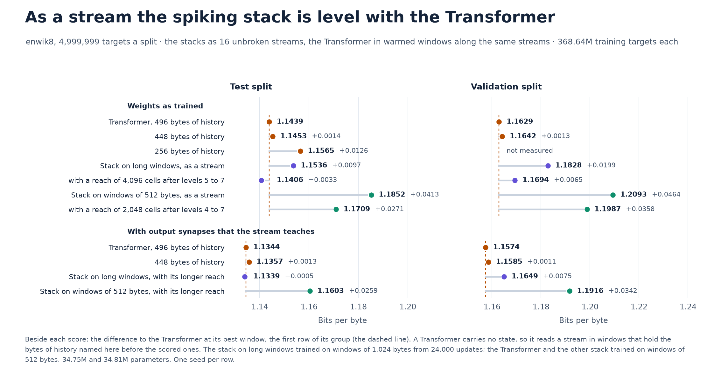
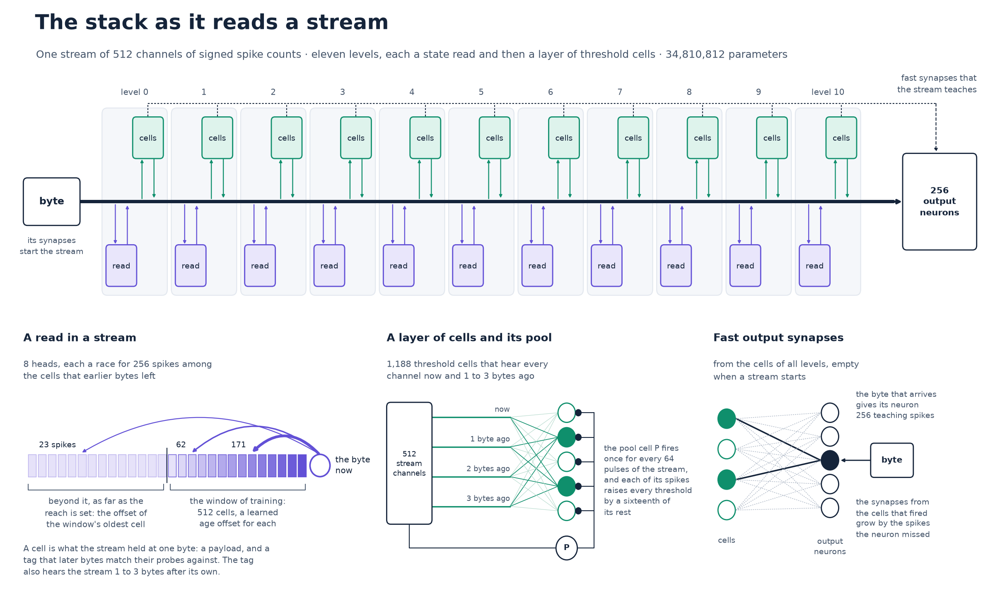
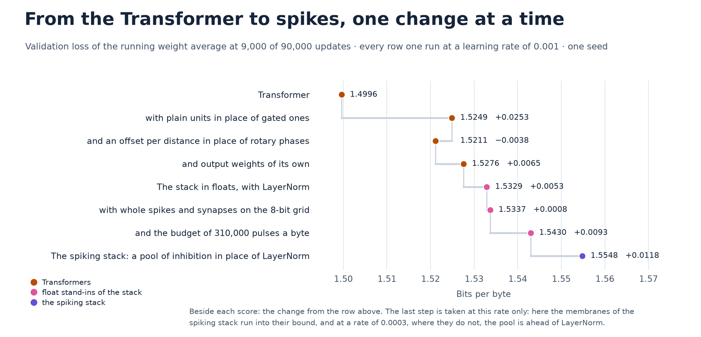
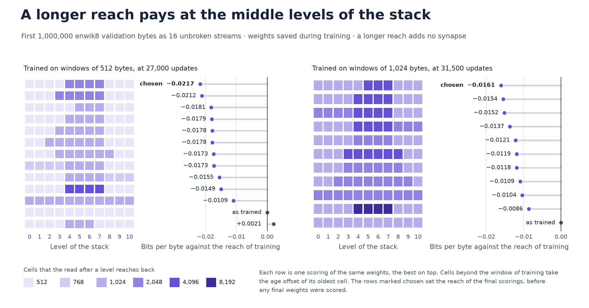
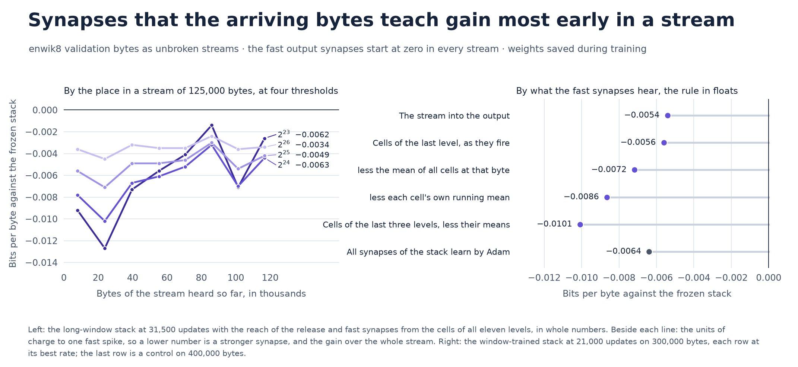

# A stack that reads a stream

## Complete enwik8 test

A spike-only stack that reads the test split as unbroken streams
scores **1.1406 bits per byte** on its 4,999,999 held-out enwik8
predictions. The full-attention Transformer of the same size,
trained on the same 368.64M byte targets, scores 1.1439 with the
window that suits it best. The stack is 0.0033 below it, with a
paired 95% interval of −0.0048 to −0.0018.

On the validation split the order turns. There the stack scores
1.1694 and the Transformer 1.1629, so the stack is 0.0065 behind,
with an interval of +0.0050 to +0.0079. On the 16 books of the
PG-19 test, a corpus that neither model trained on, the stack
scores 1.4249 and the Transformer 1.4265.

The stack and the Transformer are level. Which of them is ahead
depends on the text, by less than a hundredth of a bit per byte
either way. The decoder of v14 was 0.062 behind the Transformer
it was measured against, and that Transformer was 0.026 weaker
than this one. The stack is level only as a stream: in the
windows of the earlier releases, which start from an empty state,
the same weights are 0.039 behind.

The comparison is not symmetric. The released stack trained on
windows of 1,024 bytes for its last 66,000 updates, and as a
stream its reads reach up to 4,096 cells back. The Transformer
trained on windows of 512 bytes and reads 512. It cannot be
handed more: with 960 bytes of history it scores 1.89 on the
first million validation bytes, where it scores 1.19 with 448. A
Transformer trained on windows of 1,024 bytes is the control that
settles what the longer windows are worth, and it is still
training. Until it is scored, the stack is level with a
Transformer that reads 512 bytes. Where both trained on windows
of 512 bytes, the stack is behind, by 0.027 on the test and 0.036
on validation.

The stack is a new decoder. It has no blocks: each of its eleven
levels is a state read of eight heads and then a layer of
threshold cells with a pool cell, which is the layout of a
Transformer in spike parts. It carries its state through a
stream, so it reads a text of any length a byte at a time.

| Weights as trained · 368.64M training targets from scratch | Parameters | Reads the text as | enwik8 test | enwik8 validation | PG-19 test |
|---|---:|---|---:|---:|---:|
| Transformer | 34,752,000 | Windows, 496 bytes of history before 16 scored | 1.1439 | **1.1629** | 1.4265 |
| | | 448 before 64 | 1.1453 | 1.1642 | 1.4279 |
| | | 256 before 256 | 1.1565 | – | – |
| **Stack on long windows, released** | 34,810,812 | A stream, the reads after levels 5 to 7 reach 4,096 cells | **1.1406** | 1.1694 | **1.4249** |
| | | A stream, as trained | 1.1536 | 1.1828 | 1.4456 |
| Stack on windows of 512 bytes | 34,810,812 | A stream, the reads after levels 4 to 7 reach 2,048 cells | 1.1709 | 1.1987 | 1.4618 |
| | | A stream, as trained | 1.1852 | 1.2093 | 1.4761 |

| Over the Transformer with 496 bytes of history | enwik8 test | Paired 95% interval | enwik8 validation | Paired 95% interval |
|---|---:|---:|---:|---:|
| **Stack on long windows, with its longer reach** | **−0.0033** | −0.0048 to −0.0018 | **+0.0065** | +0.0050 to +0.0079 |
| as trained | +0.0097 | +0.0084 to +0.0111 | +0.0199 | +0.0186 to +0.0211 |
| Stack on windows of 512 bytes, with its longer reach | +0.0271 | +0.0259 to +0.0283 | +0.0358 | +0.0347 to +0.0370 |
| as trained | +0.0413 | +0.0405 to +0.0422 | +0.0464 | +0.0455 to +0.0473 |

Every row is one model with one seed, scored at the running
average of its weights. An enwik8 split is cut into 16 parts that
run side by side as unbroken streams, and a part after the first
hears the 8,192 bytes before it first, unscored. Every PG-19 book
is a stream of its own from an empty state, cut in the same way
into parts of 262,144 bytes. A stack takes a stream in pieces and
carries its state from piece to piece. The Transformer carries no
state and reads the same texts in windows that hold the named
bytes of history before the scored ones. The intervals resample
pieces of 512 bytes, which both models score. The Transformer's
PG-19 windows kept no bits, so PG-19 has no interval. A dash
marks a scoring that was not run.

A model can also learn while it reads. Fast synapses into the
output neurons start at zero in every stream, and each byte that
arrives teaches them, after it was predicted. The Transformer
gets the same rule on its last layer as a control, at the rate
that is best on the validation split.

| With output synapses that the stream teaches | Reads the text as | enwik8 test | Over the Transformer | enwik8 validation | Over the Transformer | PG-19 test |
|---|---|---:|---:|---:|---:|---:|
| Transformer | Windows, 496 bytes of history before 16 scored | 1.1344 | | **1.1574** | | – |
| | 448 before 64 | 1.1357 | | 1.1585 | | – |
| **Stack on long windows, released** | A stream with its longer reach | **1.1339** | −0.0005 | 1.1649 | +0.0075 | 1.4047 |
| Stack on windows of 512 bytes | A stream with its longer reach | 1.1603 | +0.0259 | 1.1916 | +0.0342 | – |

With these synapses the two are level on the test: the released
stack is 0.0005 below the Transformer, with a paired interval of
−0.0018 to +0.0009. On validation it is 0.0075 behind, with an
interval of +0.0062 to +0.0089. The Transformer gains more from
the rule than the stack does: 0.0095 on the test against the
stack's 0.0066, and 0.0055 on validation against 0.0044.

The last weights of the released stack score 1.1534 on the test
as trained, where the averaged ones score 1.1536.

Four limits come first.

**The stack saw longer windows than the Transformer reads.** The
control is a Transformer trained as the released stack was, on
windows of 512 bytes up to 24,000 updates and on windows of 1,024
bytes from there. It is training on a laptop GPU. This page will
name its score when it has one. Until then the comparison holds
against a Transformer that reads 512 bytes.
[What the window is worth](#long-windows-did)

**The lead changes sides with the text.** The intervals exclude
zero on both enwik8 splits, in opposite directions: measured
against the Transformer, the test split suits the stack 0.010
better than the validation split. Every score is one seed, and
the intervals cover the choice of the bytes, not the training
run. Two runs of a stack with different seeds were 0.001 to 0.005
apart during training.
[Limits](#limits)

**The settings were chosen on validation bytes.** The reach of
the reads, the levels that take it and the threshold of the fast
synapses were chosen on the first million validation bytes with
weights saved during training. The rate of the Transformer's fast
synapses was chosen on the whole validation split, and 496 bytes
of history is its best window on both splits.

**The races are computed, and no native decoder has run the
stack.** As in v13 and v14, the spike counts of a race are
computed in closed form and in floating point. The stream form is
the same arithmetic carried from piece to piece. There is no
integer decoder and no pulse audit for the stack.

**PG-19.** On the 16 books of the PG-19 test that the earlier
releases score, the released stack scores 1.4456 as trained,
1.4249 with its longer reach and 1.4047 with its fast synapses.
The Transformer scores 1.4265 with 496 bytes of history and
1.4279 with 448, and was not scored with fast synapses there. The
window-trained stack scores 1.4761 as trained and 1.4618 with its
longer reach.



[Records](../results/event_lm/stream_form) · [Every training arm](STREAM_FORM_ARMS.md) · [Model card](../models/spiking-byte-lm-v15/README.md) · [Restore and rescore](V15_HANDOFF.md)

## What changed in the circuit

The decoders of v13 and v14 were a stream of 1,408 channels
through eight relay blocks, with a state read after three of the
blocks and a layer of race cells after four. The stack of this
release has no blocks. It keeps the two parts that the last two
studies added, gives them the layout of a Transformer, and reads
its input as a stream.

**The stack.** With `--stack` a stream of 512 channels runs
through eleven levels. Every level is a state read and then a
cell layer, and both write their spikes back into the stream. The
read has 8 heads whose probe and tag neurons are 512 wide, and
its cells race for 256 spikes as in v13. The cell layer is one
cluster of threshold cells that hear every channel. There is no
relay block, no delay line of a block and no trace memory. The
only source of position is the age offset that a read head adds
for a cell's age in bytes, so the address rate of v14 is 64 here
instead of 8: at 8 the heads of a stack still spread over the
whole window after 1,500 updates.

**A fine pool.** Each level has one pool cell that hears the
stream and raises the threshold of the level's neurons. In the
decoders that pool was coarse: one spike for every 2,048 pulses
of the stream, each worth a quarter of a threshold. With
`--pool-fine 16 --pool-rest 4 --pool-rate 32 --output-pool 128`
the neurons of reads and cell layers count their threshold in
quanta sixteen times finer, rest at four of them, which is a
sixteenth of a threshold, and the pool fires once for every 64
pulses of the stream, each spike adding one quantum. The output
neurons get a pool of the same kind. A threshold that follows the
activity of the stream this closely is the stack's normalisation:
it divides what a neuron hears by how loud the stream is.

**Delayed fibres.** A cell hears every channel as it is now and
once more after a delay of one to three bytes (`--granule-fan
1024 --granule-delays 4`), as the race cells of v13 did. New
here, the tag neurons of a read do the same (`--read-delays 4`):
a cell's tag then tells what led up to the cell, and one read
finds how bytes like the present ones went on.

**Carried state.** `EventLM.stream` takes a stream in pieces of
any length, down to a byte at a time. Between pieces the stack
keeps, for every read, the tags and payloads of the cells that
later bytes can still reach and the last three bytes for its late
fibres, and for every cell layer the last three bytes. A stream
cut anywhere fires exactly the spikes of one pass over the whole
of it. Three rules make that so: a race adds up its normaliser in
the order of the cells' ages, a cell starts its race at a phase
that is fixed by its place in the stream, and whole cell spikes
are multiplied with whole payload pulses before anything is
divided.

**A reach beyond training.** A read's window is the number of
cells for which it has learned an age offset: 512. In a stream
the cells do not end there. With a longer reach the cells beyond
the window take the age offset of the window's oldest cell and
are addressed by their tags alone. That adds no synapse and can
be set after training, for the reads of some levels only.

**Fast output synapses.** With `EventLM.teach` every output
neuron has a second set of synapses from the cells of chosen
levels. They hold nothing that training has set. They are silent
at the start of a stream, belong to that stream alone, and every
arriving byte teaches them. A fibre's activity at a byte is its
cell's spikes less the cell's running mean, and the activities of
all fibres share a fixed number of units, as under a pool. When
the next byte arrives, the output neurons race for 256 spikes by
their counts, the neuron of the byte that came receives 256
teaching spikes, and every fast synapse changes by its fibre's
activity times the spikes that its neuron was taught beyond those
it fired. The charge that the fast synapses collect fires spikes
that count with those of the output neuron for the same byte. No
byte is learned from before it is predicted, nothing is trained
by gradient descent, and all of it counts in whole numbers, so
that a stream cut anywhere teaches the same synapses.

**Windows of two lengths.** The released stack trained on windows
of 512 bytes in batches of eight up to 24,000 updates and on
windows of 1,024 bytes in batches of four from there, with a
reach of 1,024 cells. An update holds 4,096 targets throughout,
and every window starts from an empty state with all the cells it
reaches inside the gradient. The saved state of the first run
continues under the new settings with
`experiments/stack/fork_state.py`.

| | Flags | Parameters |
|---|---|---:|
| The stack | `--stack --dim 512 --depth 11 --read-heads 8 --read-width 512 --read-address-rate 64 --granule-clusters 1 --granule-fan 512 --granule-cells 2038 --granule-slope` | 34,820,162 |
| with the fine pool | the above and `--pool-fine 16 --pool-rest 4 --pool-rate 32 --output-pool 128` | 34,820,162 |
| with delayed fibres for the cells | the above and `--granule-fan 1024 --granule-delays 4 --granule-cells 1359` | 34,818,325 |
| with late fibres for the tags | the above and `--read-delays 4 --granule-cells 1188` | 34,810,812 |
| on long windows, released | the above and from 24,000 updates `--ctx 1024 --bs 4 --read-reach 1024` | 34,810,812 |

The number of cells falls where fibres are added, so that every
row has the size of the reference Transformer, 34,752,000
parameters, within 0.2%.



## The reference became stronger

The Transformer of the standard shape that v14 was measured
against was trained with AdamW and scores 1.1822. The stack
trains with the rotated optimizer of v13, so this study trained
the same Transformer under that optimizer too, at two learning
rates. At 0.0003 it scores 1.1565 on the test in the windows of
the earlier releases, 0.026 better than under AdamW. At 0.001 it
was level with that at 45,000 updates, where it was stopped.

Every model of this study is measured against that Transformer.
It is 512 wide with 11 layers of 8 heads, pre-LayerNorm, gated
units of the SwiGLU kind with an MLP of four times the width,
rotary phases, and an output layer that shares the weights of the
input.

A Transformer carries no state, so it reads a stream in warmed
windows: a window holds some bytes of history, which are not
scored, and the scored bytes after them. The earlier releases
held 256 of each. A Transformer does best when its window holds
as much history as it can, so this release also scores it with
448 bytes of history before 64 scored ones and with 496 before
16.

| Reference Transformer, enwik8 test | Bits per byte |
|---|---:|
| 256 bytes of history, 256 scored | 1.1565 |
| 448 bytes of history, 64 scored | 1.1454 |
| 496 bytes of history, 16 scored | 1.1439 |

## The layout alone was not enough

The first stack had the coarse pool of the decoders and trained
at the learning rate of every earlier run, 0.0003. In windows of
512 bytes it ends 0.033 bits per byte ahead of the v14 decoder at
18,000 updates and 0.064 behind the Transformer. Giving the spike
parts the Transformer's layout closed a third of the distance.

| Averaged validation, windows | 6,000 | 12,000 | 18,000 |
|---|---:|---:|---:|
| Transformer | 1.5903 | 1.4574 | 1.4008 |
| Decoder of v14 | 1.6262 | 1.5408 | 1.4974 |
| Stack, coarse pool | 1.6187 | 1.5168 | 1.4644 |
| Stack, fine pool | 1.6089 | 1.5042 | 1.4518 |
| Stack with delayed fibres for cells and tags | 1.5811 | 1.4868 | 1.4415 |

The rest of this section is the search for the remaining
distance. It ran on a table of full-size runs at two learning
rates and on float stand-ins that take the spike rules away one
at a time.

### The learning rate, and a pool that normalises

The stack wants a higher learning rate than the Transformer. On a
small test bed (6 levels, 256 channels, 6,000 updates,
[record](../results/event_lm/stream_form/small_test_bed.json))
the stack is best at a rate of 0.003, three times the
Transformer's best rate of 0.001, and at their best rates the two
are level: 1.7197 against 1.7220. At the rate of every earlier
release, 0.0003, the small stack is 0.147 behind the small
Transformer. At full size the higher rate did not carry over. A
rate of 0.001 gives the plain stack a fast start and nothing that
lasts: it leads the run at 0.0003 up to 4,500 updates and is
0.042 behind it at 12,000.

A float stand-in showed what was missing. A stack in which every
read, every cell layer and the output hear a LayerNorm of the
stream reaches 1.5078 at 12,000 updates at a rate of 0.001, where
the plain stack at that rate stands at 1.5585. An exact division
by the summed activity, with no centring and no learned gain,
does the same (1.5065).

The fine pool is that division in spikes. At a rate of 0.001 it
reaches 1.5236 at 12,000 updates in one run and 1.5222 with a
second seed. At 0.0003 it reaches 1.5042, which is ahead of the
LayerNorm stand-in at that rate (1.5083) and of the coarse pool
(1.5168).

### From the Transformer to spikes, one change at a time

Eight runs at a rate of 0.001 walk from the Transformer to the
spiking stack. Each differs from the one before in one thing.



| At 9,000 updates | Averaged validation | Step |
|---|---:|---:|
| Transformer | 1.4996 | |
| with plain rectifying units in place of gated ones | 1.5249 | +0.0253 |
| and an offset per head and distance in place of rotary phases | 1.5211 | −0.0038 |
| and output weights of its own | 1.5276 | +0.0065 |
| The stack in floats, with LayerNorm and no pulse budget | 1.5329 | +0.0053 |
| with whole spikes and synapses on the 8-bit grid | 1.5337 | +0.0008 |
| and the budget of 310,000 pulses a byte | 1.5430 | +0.0093 |
| The spiking stack, with the fine pool in place of LayerNorm | 1.5548 | +0.0118 |

**Whole spikes cost nothing.** Rounding every count to whole
spikes and every synapse to the 8-bit grid moves the loss by
0.0008.

**The unit costs most.** A Transformer whose gated units are
replaced by plain rectifying ones at the same number of weights
loses 0.025, and the stack in floats is that Transformer within
0.008. Two further Transformers split the unit's lead: a hard
gate in place of the smooth one recovers 0.013 of it and a smooth
plain unit 0.016.

**Age offsets cost nothing.** An offset per head and distance,
which is what a read head has, is level with rotary phases from
7,500 updates on and ahead of them before.

**The output's own weights and the pulse budget cost 0.007 and
0.009.** A Transformer gains from sharing its output weights with
its input. The stack's output has synapses of its own.

**The last step is an effect of the learning rate.** At 0.001 the
membranes of the spiking stack run into their bound, as the next
part shows, and at 0.0003 the fine pool is ahead of LayerNorm.

The four Transformers of the ladder and the two with other units
are controls in floats. The three stacks in the middle are float
stand-ins made by `experiments/stack/diagnosis_build.py`. None of
them is a spiking network, and none is a result of this
repository.

### Membranes that saturate, and a ceiling that lifts

A membrane holds the charge of a neuron's largest count at its
resting threshold. A pool that raises the threshold leaves the
neuron fewer spikes, and a neuron at that limit learns nothing
through its charge. In the fine-pool stack at a rate of 0.001,
5.2% of the entries of a read sit at the limit after 12,000
updates, and 18% at the top level. At 0.0003 it is 0.03%. That is
why the stack does worse at the higher rate while the Transformer
does not.

With `--pool-lifts-ceiling` the pool divides the charge before
the membrane bounds it, so a neuron fires up to its largest count
at every threshold. A run at 0.001 was continued twice from its
state at 15,000 updates, once as it was and once with the lifted
ceiling. The lifted run was 0.0117 ahead at 18,000 updates and
0.0187 at 19,500 (1.4623 against 1.4810). The released stack
trains at 0.0003, where nothing saturates, and does not use it.

### Delayed fibres

Cells that hear every channel a second time after one to three
bytes are the clear gain among the changes to the circuit: 0.013
at 12,000 updates at a rate of 0.0003 (1.4914 against 1.5042).
Late fibres for the tags add 0.005 (1.4868). At a rate of 0.001
the lead of the delayed fibres is 0.056 at 1,500 updates and
fades to 0.002 by 6,000.

### What did not help

**Gated cells.** A cell with a gate dendrite that lets the charge
of its value dendrite in is the spike form of the Transformer's
gated unit, which is the largest step of the ladder. It was built
in four variants. At full size the gated stack leads at 1,500
updates (1.8513 against 1.8895) and stalls: 1.7352 at 6,000,
where plain cells stand at 1.6013. With a free pulse budget its
pulses grow to 645,000 a byte and it gets worse, with one rate
for all its synapses it diverges, and with delayed fibres it left
the range in which it learns after 4,000 updates.

**A veto dendrite** that closes a cell and fires no pulse ended
0.015 behind plain cells at 6,000 updates.

**Turned probes**, the spike form of rotary phases, start 0.14
behind and are still 0.010 behind at 12,000 updates.

**A wider learning slope** for the cells changed nothing (1.6048
against 1.6013 and 1.5969 at 6,000 updates).

[All arms](STREAM_FORM_ARMS.md)

## Reading a stream

### The same weights score better as a stream

A stack that was trained on windows from an empty state can be
scored on an unbroken stream without any change. The trainer
measures both on as many validation bytes. At 90,000 updates the
averaged weights of the window-trained stack score 1.2792 bits
per byte in windows of 512 bytes from an empty state and 1.1932
on streams that hear two pieces before the scored ones
([record](../results/event_lm/stream_form/runs/windows.json)).
Most of that is the empty state, which warmed windows also
remove. Against warmed windows of 256 bytes before 256 the stream
gains 0.013 on the complete test split for the window-trained
stack (1.1980 in warmed windows, 1.1852 as a stream) and 0.041
for the long-window stack (1.1951 and 1.1536). In warmed windows
the two stacks are close. What the long windows taught shows only
in a stream.

### Training on streams did not beat training on windows

The stream form also trains: `--stream PIECES` feeds stretches of
consecutive windows and hands the state on, without a gradient
through it. Four forks of the window-trained stack tried it, each
from a saved state and beside the unchanged run, and all were
validated on the same streams.

| Fork of the window-trained stack | From | Averaged, on streams | The unchanged run there |
|---|---:|---:|---:|
| Streams in stretches of 20 windows | 16,500 | 1.3301 at 24,000 | 1.3227 |
| Streams in stretches of 60 windows | 16,500 | 1.3562 at 19,500 | 1.3441 |
| Streams whose 15 groups take turns | 21,000 | 1.3237 at 24,000 | 1.3227 |
| The same with a reach of 1,024 cells, from the first fork | 28,500 | 1.2509 at 42,000 | 1.2647 |

Plain stretches are 0.007 to 0.012 behind, and the more so the
longer the rows stay in one text. Eight rows that run on through
the same texts make updates that resemble each other. Groups of
streams that take turns remove most of that and end 0.001 behind.

The last fork is 0.014 ahead, and most of that is not the
training. It is validated with its reach of 1,024 cells, and that
reach at scoring alone gains the unchanged run 0.011 on the
validation bytes of the next section. What is left, 0.003, is
less than two runs differ by. With a piece as long as the window
and the state detached, only half of the cells that a read
reaches are inside the gradient, and that costs about what the
matched condition gives.

### Long windows did

Windows of 1,024 bytes keep every cell that a read reaches inside
the gradient. Forked from the window-trained stack at 24,000
updates, the long-window stack is ahead of it after 3,000 updates
of its own. One scorer on the first million validation bytes, at
27,000 updates:

| At 27,000 updates, as a stream | Bits per byte |
|---|---:|
| Trained on windows of 512 bytes | 1.3462 |
| the same, reach of 1,024 cells at every level | 1.3353 |
| the same, reach of 2,048 cells after levels 4 to 7 | 1.3244 |
| Trained on windows of 1,024 bytes from 24,000 updates | 1.3196 |

### A longer reach pays at the middle levels



Lengthening the reach of every read from 512 to 1,024 cells gains
the window-trained stack 0.011 bits per byte at no cost in
synapses. Lengthening it at levels 4 to 7 alone gains 0.018, and
at 2,048 cells 0.022. The reads of the lowest and of the highest
levels lose a little from a longer reach, and without level 7 the
gain is gone.

The long-window stack keeps gaining far beyond its training. It
trained with a reach of 1,024 cells, and a reach of 4,096 cells
after levels 5 to 7 gains it 0.016. At 8,192 cells the gain falls
to 0.009.

Both settings were chosen on these validation bytes with weights
saved during training, before any final weights were scored.

### Synapses that the arriving bytes teach



The rule was first tried in floats beside a frozen stack. Fast
synapses from the stream into the output gain 0.0054 bits per
byte on 300,000 validation bytes, from the cells of the last
level 0.0087, and from the cells of the last three levels 0.0101.
Centring a cell on its own running mean matters (0.0056 without).
A control in which all synapses of the stack take an Adam step
after every piece gains 0.0064 at its best rate: the local rule
at the output does as well as learning everywhere.

In the model the rule counts in whole numbers. On eight streams
of 125,000 validation bytes the long-window stack gains 0.0063 at
a threshold of 2²⁴ units of fast charge to a spike. The gain is
larger early in a stream than late, 0.009 in the first quarter
and 0.006 in the last, and stronger synapses fade faster. A
longer reach already catches part of what the fast synapses
learn: without it the same stack gains 0.0095.

A Transformer can learn along its windows in the same way.
`experiments/eval_taught_reference.py` gives the reference
Transformer the same rule in floats, from its last layer, with
the rate chosen on the validation split. With 496 bytes of
history it gains 0.009 on the test, from 1.1439 to 1.1344, and
0.005 on validation. The released stack gains 0.007 and 0.004
from its fast synapses. The rule is not what makes the stack
level with the Transformer: the two are level without it as well.

## Limits

**Level, not ahead.** The released stack is ahead of the
Transformer on the test split and behind it on the validation
split, and both intervals exclude zero. Measured against the
Transformer, the two splits differ by 0.010, which is more than
two seeds of a stack differ by. A result that changes sides with
the text is a tie.

**One seed.** Every arm and every score is one seed. The
intervals of the test cover the choice of the test bytes, not the
training run. Two runs of the fine-pool stack with different
seeds are 0.001 to 0.005 apart up to 12,000 updates.

**The windows are not the Transformer's.** The released stack
trained on windows of 1,024 bytes from 24,000 updates and reaches
up to 4,096 cells back when it is scored. The reference
Transformer trained on windows of 512 bytes and reads 512. A
Transformer trained on windows of 1,024 bytes is the control, and
it was still training when this release was made. The Transformer
of this study cannot be handed a longer window as it is: with 960
bytes of history it scores 1.89 on the first million validation
bytes. At equal training windows the stack is behind, by 0.027 on
the test and 0.036 on validation with its longer reach.

**In windows the stack is still behind.** The window-trained
stack follows the Transformer at 0.040 to 0.050 bits per byte in
windows of 512 bytes from an empty state, from 18,000 updates to
the end. In the warmed windows of the earlier releases, 256 bytes
of history before 256 scored ones, the released stack scores
1.1951 on the test and the Transformer 1.1565.

**The reach was chosen on validation bytes.** The levels and the
reach of the final scorings, and the levels and the threshold of
the fast synapses, were chosen on the first million validation
bytes with weights from 27,000 to 31,500 updates.

**The fast synapses are float arithmetic on whole numbers.** They
count in 64-bit floating point on whole numbers below 2⁵³, which
is exact, and the race that teaches them is computed in closed
form. A GPU without 64-bit floats cannot run them.

**The races are computed, not simulated.** As in v13 the spike
counts of a race are its rates rounded to whole spikes by fixed
starting phases, and the rates are computed in floating point.

**The state of a stream carries no gradient.** Training on
streams hands the state on detached. A stack trained that way did
not beat one trained on windows.

**The pulse count is the trainer's.** The budget of 310,000
pulses a byte is held by the trainer's count of the spikes of
reads, cells, pools and stream neurons. There is no audit by a
native integer decoder, and the fast output synapses and a longer
reach fire spikes that the budget did not price.

**Validation is small, and pilots stopped early.** The curves use
16 batches of 8 windows. Most arms were stopped between 3,000 and
15,000 updates. Differences between forks of one saved state are
more reliable than differences between runs.

**Float stand-ins are no spiking networks.** The runs with
LayerNorm, with real-valued counts or without a pulse budget, and
all Transformers with other units, exist to place a gap.

**The settings do not record the code.** Flags were added while
the study ran, and several arms ran on a private build whose
switches `experiments/stack/diagnosis_build.py` reproduces. The
fine-pool arms that started before the pool was in the package
round one tie the other way.

## Reproduce

Restore the checkpoints and rescore them with the commands in the
[handoff](V15_HANDOFF.md). The released stack trained in two
steps. The first is the stack on windows of 512 bytes, up to
24,000 updates:

```bash
python experiments/train_event_lm.py --variant event_steered --no-carry --stack \
  --dim 512 --hidden 4 --depth 11 --spike-resolution 16 --router-charge-bits 8 \
  --pulse-budget 310000 --read-after 0,1,2,3,4,5,6,7,8,9,10 --read-width 512 --read-heads 8 \
  --read-window 512 --read-mode race --read-budget 256 --read-resolution 4 \
  --read-address-rate 64 --read-delays 4 --read-cap 128 \
  --granule-after 0,1,2,3,4,5,6,7,8,9,10 --granule-clusters 1 --granule-fan 1024 \
  --granule-delays 4 --granule-cells 1188 --granule-slope --granule-cap 128 \
  --pool-fine 16 --pool-rest 4 --pool-rate 32 --output-pool 128 \
  --rotated-adam 50 --rotate-stacks --weight-average 0.999 \
  --data data/enwik8 --training-mixture data/training-v1/prepared/catalogue.json \
  --ctx 512 --bs 8 --steps 90000 --warmup 1000 --lr 3e-4 --wd 0.05 --seed 20001 \
  --eval-every 1500 --eval-bs 8 --eval-batches 16 --final-eval-batches 64 --validation-only \
  --save-every 1500 --resume --stop-at 24000 \
  --device cuda --tag windows --results-dir checkpoints/stream_form/windows/results \
  --checkpoint checkpoints/stream_form/windows/model.pt
```

`--stop-at 24000` leaves with the whole training state in
`model.pt.resume`. The second step continues that state as a new
arm on windows of 1,024 bytes:

```bash
python experiments/stack/fork_state.py checkpoints/stream_form/windows/model.pt.resume \
  checkpoints/stream_form/long-windows/model.pt.resume --tag long_windows \
  --set ctx=1024 bs=4 read_reach=1024
```

Then run the first command again with `--ctx 1024 --bs 4
--read-reach 1024` in place of `--ctx 512 --bs 8`, without
`--stop-at`, with `--tag long_windows` and with `long-windows` in
both paths. It runs from 24,000 to 90,000 updates. The
window-trained stack of the table is the first command without
`--stop-at`.

The reference Transformer is `--variant transformer --dim 512
--depth 11 --heads 8 --mlp-ratio 4 --rotated-adam 50
--weight-average 0.999` with the data and schedule flags of the
first command.

`--weight-average` writes the averaged weights beside the
checkpoint as `model.pt.averaged`. A finished run deletes its
`model.pt.resume`, so the state of the window-trained stack at
24,000 updates is not among the released files. Two CUDA runs
with one seed are not bit-identical, so a retrained stack will
not reproduce a checkpoint hash.

```bash
python experiments/plot_stream_form.py
python experiments/plot_stream_form.py --tables
python experiments/plot_stream_form.py --arms > docs/STREAM_FORM_ARMS.md
```

## Earlier work

[Read clocks and the address rate, v14](READ_CLOCKS.md) · [State reads and race cells, v13](STATE_READS.md) · [Coasting read heads, v12](COASTING_HEADS.md) · [Surprise clock and fast synapses, v11](SURPRISE_CLOCK.md) · [History](SHUNTFORMER_HISTORY.md) · [Leaderboard](LEADERBOARD.md)
