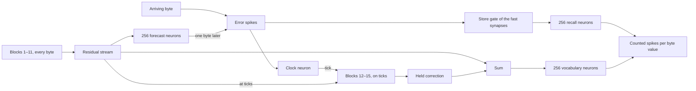

# Surprise as the clock and the write signal

## Complete enwik8 test

Fast synapses written on the decoder's own error spikes lower
the 25.79M spiking decoder from **1.78973 to 1.64541 bits per
byte** on 4,999,999 held-out predictions. No decoder weight
changes. The surprise clock is a negative result at this
training budget. Four added blocks that run on clock ticks score
1.78973 bpb, the same as the decoder without them. These
measurements use one continuation seed.

| Model | Parameters | State per stream | enwik8 (bpb) | PG-19 (bpb) |
|---|---:|---:|---:|---:|
| 25.79M SNN | 25,788,928 | 28,584 B | 1.78973 | 1.97852 |
| 25.79M SNN with fast synapses | 25,788,928 | 53,432 B | 1.64541 | 1.93961 |
| 34.85M SNN, added blocks on every byte | 34,845,184 | 40,714 B | 1.78633 | 1.96913 |
| 34.85M SNN, added blocks on a fixed stride | 34,845,184 | 43,796 B | 1.78761 | 1.96842 |
| 34.85M SNN, added blocks on the surprise clock | 34,845,184 | 43,796 B | 1.78973 | 1.97528 |
| 34.85M SNN, surprise clock and fast synapses | 34,845,184 | 68,388 B | 1.64278 | 1.93610 |
| 25.79M full attention | 25,790,976 | 6 MiB | 1.70433 | 1.93711 |
| 34.85M full attention | 34,845,696 | 6 MiB | 1.70426 | 1.93678 |

The spiking decoder with fast synapses is 0.0589 bpb below the
size-matched Transformer on enwik8 and 0.0025 above it on PG-19.
Full attention reads 512 bytes and the synapses carry the whole
stream, so the two rows differ in reach. With the same synapses
on its output, the 25.79M Transformer scores 1.57753 bpb on
enwik8. With synapses on both models the gap is 0.0679 bpb.
Without them it is 0.0854.

The clock arm trails both of its controls. The same four blocks
score 1.78761 bpb on a fixed five-byte stride and 1.78633 on
every byte. Silencing the added blocks at fixed weights changes
validation loss by at most 0.0006 bpb in each of the three arms.
The clock decoder with fast synapses has the lowest loss in the
table, but the clock does not earn it. The same synapses bring
the every-byte decoder to 1.64164 bpb and the fixed-stride
decoder to 1.64281 on the test replay of their fits.
[Score records](../results/event_lm/surprise_clock) ·
[Leaderboard](LEADERBOARD.md)

## One signal for two circuits

The decoder predicts every byte before it arrives. A second
population of 256 forecast neurons reads the residual stream
through the same output synapses as the vocabulary neurons. Its
firing threshold is 16 times higher, so one forecast spike stands
for 16 output counts, one eighth of a bit of log-odds. The
population adds no trainable parameters, and its counts fit one
signed byte per neuron.

Let $f_{t-1}(b)$ be the forecast spikes of byte value $b$ that
fired before byte $x_t$ arrived. The error spikes are the
winner's spikes that the arriving byte's own neuron did not match.

$$
s_t=\max_b f_{t-1}(b)-f_{t-1}(x_t).
$$

$s_t$ is zero when the forecast winner arrives and grows with
the lead of a wrong winner. The same count drives both circuits
in this study. It decides when the upper blocks run, and it
decides which bytes the fast synapses store. A clocked decoder
reads the forecast from the stream that enters its first clocked
block. A decoder without a clock reads it from the top stream.
[Decoder](../snnformer/event_lm.py)

## Measured first on the frozen v10 decoder

The 25.79M v10 decoder scores 1.81452 bits per byte on the
4,999,999 enwik8 validation targets as one stream. Word bytes
are letters, digits and UTF-8 bytes. The first byte of a word is
15.2% of the targets and carries 33.6% of the loss, 2.21 times
its share. The lead of a wrong winner in output counts has the
same shape with 2.09 times. The size-matched Transformer shows
2.22 times on its own loss.

| Byte inside its word | Share of targets | Mean loss (bits) |
|---|---:|---:|
| 1st | 15.2% | 4.017 |
| 2nd | 14.5% | 2.065 |
| 3rd | 12.0% | 1.984 |
| 4th | 9.3% | 1.519 |
| 5th | 7.1% | 1.118 |
| 6th or later | 16.3% | 0.967 |
| Between words | 25.6% | 1.125 |

The v10 decoder already carries a forecast of its own next spike
code in the tagged bank. That forecast's error is nearly flat
across the word, 1.18 times at word starts, so it was rejected as
the clock input. An integrate-and-fire neuron driven by the
winner's lead and tuned to five bytes per tick puts 29.5% of its
ticks on word starts. A fixed five-byte stride puts 15.2% there.
The same simulation leaves 37.7% of words without a tick and
gives 27.6% more than one, so the ticks follow surprise and only
loosely follow words.

The second measurement bounds the memory. An exact table of the
byte that last followed each context of 3, 4, 6, 8, 12 and 16
bytes was added to the frozen decoder's output with one fitted
strength per context length. The strengths were fitted on the
first half of validation and scored on the second half, where the
decoder alone scores 1.79873 bpb.

| Table reach | Stores every byte (bpb removed) | Stores only bytes the winner missed (bpb removed) |
|---:|---:|---:|
| 512 bytes | 0.1017 | 0.0923 |
| 4,096 bytes | 0.1268 | 0.1145 |
| 65,536 bytes | 0.1374 | 0.1190 |

The plan was to drop the memory below 0.02 bpb. The same tables
remove 0.0807, 0.1048 and 0.1151 bpb from the Transformer's loss,
so part of the gain is reach that neither model has.
[Frozen-decoder record](../results/event_lm/surprise_clock/surprise_validation.json) ·
[Probe](../experiments/probe_surprise.py)

## The surprise clock

One integrate-and-fire neuron per stream integrates the error
spikes. Its input saturates at one threshold $\theta$, and its
reset subtracts the threshold.

$$
m_t=\max\bigl(m_{t-1}+\min(s_t,\theta)-\lambda,\,0\bigr),
\qquad \text{tick}_t=[m_t\ge\theta],
\qquad m_t\leftarrow m_t-\theta\,\text{tick}_t.
$$

The trained clock uses $\theta=35$ forecast spikes, 4.4 bits
of lead, and no leak $\lambda$. The membrane stays inside
$[0,\theta)$ and the neuron fires at most once per byte.

Blocks 1–11 run on every byte as in v10. Blocks 12–15 run only
on bytes with a tick. They receive the byte-rate stream at those
bytes as their sequence, so their axon delays and held charge
count ticks. A delay of four reaches four ticks back, about 23
bytes at the measured rate. Let $h_t$ be the stream after
block 11, $e_i$ the byte of tick $i$ and $n(t)$ the number of
ticks up to byte $t$. The clocked blocks $U$ produce a correction
that is held between ticks.

$$
c_i=U(h_{e_1},\dots,h_{e_i})-h_{e_i},
\qquad \tilde h_t=\operatorname{clip}\bigl(h_t+c_{n(t)}\bigr),
\qquad c_0=0.
$$

The vocabulary neurons and the tagged bank read $\tilde h_t$.
The tick at byte $t$ uses the forecast made at byte $t-1$ and the
byte that arrived, so the clock is causal and the streaming step
matches the batched pass exactly. The added blocks start with
zeroed input synapses, and the grown decoder reproduces every
v10 output count before training.



## Fast synapses

Six heads watch the last 3, 4, 6, 8, 12 and 16 bytes. Each head
has four groups of 1,024 key neurons. A fixed random projection
of the delayed bytes selects one winner per group, so a context
activates four key neurons per head.

$$
a_{h,g}(t)=\Bigl(\sum_{j=0}^{m_h-1}(x_{t-j}+1)\,w_{h,g,j}\bmod(2^{31}-1)\Bigr)\bmod 1024.
$$

The weights $w$ are drawn once from a fixed seed and are never
trained. The code computes the winner with this integer form.
It does not simulate a competition among 1,024 membranes.

Every key neuron keeps exactly one potentiated synapse onto 256
recall neurons, one per byte value. The state is the byte that
synapse points at, one byte per key neuron, with zero for none.
When byte $x_t$ arrives with at least one error spike, the key
neurons that were active for the context ending at $t-1$ move
their synapse to $x_t$. Without error spikes no synapse moves.
The write uses the presynaptic key neuron, the arriving byte
and the error spikes as a third factor. No gradient is involved.
The byte value zero is never stored.

After the byte, the key neurons of the new context vote through
their synapses. Let $\ell_h(b)$ be the number of groups of head
$h$ whose synapse points at byte $b$. Agreeing synapses fire the
recall neuron of that byte, and the decoder counts its spikes
$q_t(b)$ together with the vocabulary neuron's spikes $z_t(b)$.

$$
q_t(b)=\sum_h R_{h,\ell_h(b)},\qquad R_{h,0}=0,
\qquad \text{score}_t(b)=z_t(b)+q_t(b).
$$

$R$ holds 24 integers, one per head and agreement level, in
spikes. They are the only fitted values. The fit minimizes
next-byte loss on enwik8 validation with the decoder frozen. The
loss is convex in $R$ because $R$ enters the counted spikes
linearly. A head stays silent until it has seen its whole
context. Colliding contexts share key neurons, and the agreement
level is what separates a real repeat from a collision.

The recall neurons are a population of their own. Adding their
spikes inside the vocabulary neurons would clip the sum at the
±2,048 counts of that population. On enwik8 validation the
clipped sum scores 1.69250 bpb for the 25.79M decoder and the
separate population scores 1.68363.

The synapses hold 24,576 bytes per stream, and the delayed bytes
add 16. A head of four groups emits four key spikes per byte, 24
in total. The streaming step writes, then reads, and matches the
batched pass and the chunked pass exactly.
[Fast synapses](../snnformer/fast_synapses.py) ·
[Readout fit](../experiments/fit_fast_synapses.py) ·
[Synapse tests](../tests/test_fast_synapses.py) ·
[Clock tests](../tests/test_surprise_clock.py)

## Comparison

Six arms continue the two 25.79M v10 parents for 9,830,400
targets in 2,400 updates of eight 512-byte windows. They use
seed 10007, 96 warmup updates and a peak learning rate of
0.00012. All six received identical windows from the v10
mixture of enwik8, C4 and PG-19 training text. The SNNs keep the
310,000-pulse soft budget. Total exposure is 140,902,400 targets.
[Expected window receipt](../results/event_lm/training_mixture/windows_s10007.json) ·
[Study launcher](../experiments/run_v4_continuation.sh) ·
[Mixture preparation](RESIDUAL_SCALE.md#expanded-training-data)

| Arm | Parameters | Change from the v10 parent |
|---|---:|---|
| 25.79M SNN | 25,788,928 | None |
| 34.85M SNN, every byte | 34,845,184 | Four more blocks that run on every byte |
| 34.85M SNN, fixed stride | 34,845,184 | The same four blocks on every fifth byte |
| 34.85M SNN, surprise clock | 34,845,184 | The same four blocks on clock ticks |
| 25.79M full attention | 25,790,976 | None |
| 34.85M full attention | 34,845,696 | SwiGLU population from 5,240 to 7,205 per block |

The three grown SNNs differ only in when the added blocks run.
The fixed stride uses the clock circuit with a constant drive, so
its ticks ignore the text. It was set to five bytes per tick,
the rate that the clock threshold was tuned to on the frozen
parent. After training the surprise clock ticks once per 5.70
bytes on the first 1,048,575 test targets, so the fixed stride
runs its blocks 14% more often. Each grown SNN reproduces every
output count of its parent on 4,096 validation bytes before
training, in the batched pass, the chunked pass and the one-byte
step. The grown Transformer reproduces its parent's logits
exactly. All added blocks have content gradients on the first
training windows.
[Clock warm audit](../results/event_lm/surprise_clock/warm_clock.json) ·
[Stride warm audit](../results/event_lm/surprise_clock/warm_stride.json) ·
[Depth warm audit](../results/event_lm/surprise_clock/warm_depth.json) ·
[Transformer warm audit](../results/event_lm/surprise_clock/warm_transformer.json)

Two more endpoints add fast synapses to the trained 25.79M SNN
and to the trained clock SNN. No gradient step follows. The fit
replays the frozen decoder over enwik8 validation and solves for
the 24 strengths. The same fit on the two Transformers' outputs
measures what the synapses are worth to full attention.

The audit of the sampled windows compares them with the PG-19
evaluation books. One of the 4,800 PG-19 windows shares an exact
64-byte span with test books 26239 and 27454, and one matches
test book 28988 on 12 normalized words. One of the 9,600 enwik8
windows matches test book 30312 on 12 normalized words. The C4
windows have no match. Calibration books 2383 and 6404, which
only select the temperature, have one exact and one normalized
match in the enwik8 windows and one exact match in the PG-19
windows. Every arm saw the same windows.
[Sampled-window audit](../results/event_lm/training_mixture/pg19_sampled_overlap_s10007.json) ·
[Audit code](../experiments/audit_mixture_pg19_overlap.py)

## What the clock does

The plan set one test for the clock before training. On windows
that start from an empty stream, the gap to full attention at
9–96 bytes of history had to fall to half of the unclocked
decoder's gap. It did not move.

| Bytes before the target | 25.79M SNN | Every byte | Fixed stride | Surprise clock |
|---|---:|---:|---:|---:|
| 1–8 | −0.0226 | −0.0260 | −0.0236 | −0.0238 |
| 9–32 | +0.0308 | +0.0279 | +0.0259 | +0.0297 |
| 33–96 | +0.0609 | +0.0570 | +0.0603 | +0.0613 |
| 97–256 | +0.0815 | +0.0764 | +0.0779 | +0.0812 |
| 257–512 | +0.0862 | +0.0825 | +0.0840 | +0.0865 |
| 9–96 | +0.0527 | +0.0490 | +0.0509 | +0.0527 |

Each entry is an SNN's loss minus its size-matched Transformer's
loss in bits per byte, on 2,048 disjoint 512-byte test windows.
At 9–96 bytes the clock arm keeps 0.999 of the 25.79M decoder's
gap, with a paired 95% interval of [0.968, 1.031]. The every-byte
arm keeps 0.930 [0.900, 0.962] and the fixed stride keeps 0.966
[0.936, 0.997]. The intervals resample windows from the one
training run.
[Paired history record](../results/event_lm/surprise_clock/history_gap_test.json) ·
[Probe](../experiments/probe_history_gap.py)

The trained clock still follows surprise. On the first 1,048,575
test targets it ticks once per 5.70 bytes. Word starts are 15.0%
of the bytes and receive 32.0% of the ticks. 38.0% of the words
pass without a tick, 37.4% get one and 24.6% get more. The median
gap between ticks is 4 bytes and the longest is 279.

| Fixed weights, 1,048,575 test targets | Surprise clock (bpb) | Fixed stride (bpb) |
|---|---:|---:|
| Intact | 1.79504 | 1.79511 |
| Held correction muted | 1.79544 | 1.79495 |
| Ticks displaced by 4,096 bytes | 1.79590 | 1.79511 |

Muting the clocked correction costs the clock arm 0.0004 bpb.
Displacing its ticks costs 0.0009, so the clocked blocks read
where the ticks fall, and what they add is small. The stride arm
loses nothing when its correction is muted. On 65,536 continuous
validation targets, silencing the output of the added blocks
raises loss by 0.0006 bpb in the clock arm and by 0.0001 in the
every-byte and stride arms. The 0.0034 bpb between the arms on
the test split is therefore not carried by the added blocks.
With fast synapses on the clock decoder, muting the clocked
correction lowers loss from 1.67460 to 1.67382 bpb.
[Clock and synapse interventions](../results/event_lm/surprise_clock/clock_probe_test.json) ·
[Intervention probe](../experiments/probe_clock.py) ·
[Continuous probes](../results/event_lm/surprise_clock)

## What the fast synapses add

The sweeps fit the strengths on the first half of enwik8
validation and score the second half. On that half the 25.79M
decoder falls from 1.79054 to 1.67985 bpb. The released strengths
are fitted on all of validation. Replayed on the test split they
lower the decoder from 1.78973 to 1.64541 bpb, and the streaming
evaluator reproduces that score to six decimals. The synapses
store 34.0% of the test bytes.
[25.79M fit](../results/event_lm/surprise_clock/synapses_control_s10007.json) ·
[Clock decoder fit](../results/event_lm/surprise_clock/synapses_clock_s10007.json)

| Context of the head | 1 group agrees | 2 agree | 3 agree | 4 agree |
|---|---:|---:|---:|---:|
| 3 bytes | 19 | 86 | 126 | 185 |
| 4 bytes | 13 | 66 | 109 | 143 |
| 6 bytes | 10 | 66 | 133 | 135 |
| 8 bytes | 8 | 52 | 140 | 103 |
| 12 bytes | 6 | 42 | 158 | 121 |
| 16 bytes | 5 | 28 | 187 | 195 |

The table gives the fitted recall spikes of the 25.79M decoder.
One nat of log-odds is 184.66 spikes. A single group adds 0.03 to
0.10 nats, because one synapse may belong to a colliding context.
Three or four agreeing groups add 0.56 to 1.06 nats.

The gain depends on how recently the context of the target
appeared. The groups below split the test targets by the distance
to the previous occurrence of their eight-byte context.

| Context last seen | Targets | 25.79M SNN | With fast synapses | 25.79M full attention |
|---|---:|---:|---:|---:|
| Not before | 1,919,830 | 2.0671 | 1.9653 | 1.9654 |
| 1–31 bytes back | 85,805 | 1.2252 | 1.0127 | 1.0703 |
| 32–127 bytes back | 335,417 | 1.5998 | 1.0072 | 1.4013 |
| 128–511 bytes back | 322,155 | 1.5884 | 1.1655 | 1.5025 |
| 512 bytes or more | 2,336,792 | 1.6376 | 1.5636 | 1.5844 |

The gain per byte is largest on contexts that recurred within
512 bytes, where the plain decoder trailed full attention by
0.09 to 0.20 bpb. Those targets are 14.9% of the test split and
carry 49% of the gain. Targets whose eight-byte context is new
still gain 0.10 bpb from the heads with shorter contexts.

Within one 512-byte window from an empty stream, the synapses
close the gap to full attention. On 2,048 paired test windows
the 25.79M decoder trails its Transformer by 0.0773 bpb over all
512 bytes. With synapses the difference is −0.0044 bpb, with a
paired 95% interval of [−0.0089, +0.0000]. At 9–96 bytes of
history the gap falls to 0.547 of the plain decoder's gap, with
an interval of [0.479, 0.608]. At 257–512 bytes the decoder with
synapses is 0.0206 bpb below full attention.

| Bytes before the target | 25.79M SNN | With fast synapses |
|---|---:|---:|
| 1–8 | −0.0226 | −0.0226 |
| 9–32 | +0.0308 | +0.0256 |
| 33–96 | +0.0609 | +0.0300 |
| 97–256 | +0.0815 | +0.0042 |
| 257–512 | +0.0862 | −0.0206 |

Beyond the window the loss keeps falling. The long-history probe
scores the same 8,192 test targets after more and more preceding
bytes. The targets are 256 evenly spaced tails of 32 bytes.

| History before the tail | 25.79M SNN (bpb) | With fast synapses (bpb) |
|---:|---:|---:|
| 128 bytes | 1.7988 | 1.7256 |
| 512 bytes | 1.7961 | 1.6833 |
| 2,048 bytes | 1.7969 | 1.6596 |
| 8,192 bytes | 1.7967 | 1.6491 |

The plain decoder gains nothing past 512 bytes. With synapses
the loss falls by another 0.0342 bpb between 512 and 8,192
bytes. Muting the synapses at fixed weights on the first
1,048,575 test targets raises loss from 1.67544 to 1.79686 bpb.
[Paired history record](../results/event_lm/surprise_clock/history_gap_test.json) ·
[Long-history record](../results/event_lm/surprise_clock/long_history_test.json) ·
[Interventions](../results/event_lm/surprise_clock/clock_probe_test.json)

### State and write rule

The sweep runs on the trained clock decoder, which scores 1.78850
bpb on the held-out half. All rows use six heads of four groups.

| Key neurons per group | Synapse state | Stored on error spikes (bpb removed) | Stored on every byte (bpb removed) |
|---:|---:|---:|---:|
| 256 | 6,160 B | 0.0945 | 0.0837 |
| 1,024 | 24,592 B | 0.1105 | 0.1139 |
| 4,096 | 98,320 B | 0.1167 | 0.1279 |
| 16,384 | 393,232 B | 0.1172 | 0.1349 |

Error spikes store 34.5% of the validation bytes. The gate helps
when key neurons are scarce, because predictable bytes then stop
overwriting useful synapses. At 24,592 bytes it costs 0.0034 bpb
and saves 65.5% of the writes. With more key neurons, storing
every byte is better. A higher gate stores less and removes
less: 0.1091 bpb at two error spikes, 0.1062 at four and 0.0999
at eight. At the same 24,592 bytes, two groups of 2,048 key
neurons remove 0.1093 bpb and eight groups of 512 remove 0.1090.
The 25.79M decoder gains 0.1107 bpb at the released setting.
[Size and gate sweep](../results/event_lm/surprise_clock/synapse_sweep.json) ·
[Higher gates](../results/event_lm/surprise_clock/synapse_gate_sweep.json) ·
[Group sweep](../results/event_lm/surprise_clock/synapse_group_sweep.json)

### The same synapses on every trained decoder

The fit runs unchanged on the two other grown decoders. These
two fits write no checkpoint, and their test scores are replays
of the fit.

| SNN | enwik8 test (bpb) | With fast synapses (bpb) | Held-out gain (bpb) |
|---|---:|---:|---:|
| 25.79M | 1.78973 | 1.64541 | 0.1107 |
| 34.85M, every byte | 1.78633 | 1.64164 | 0.1104 |
| 34.85M, fixed stride | 1.78761 | 1.64281 | 0.1107 |
| 34.85M, surprise clock | 1.78973 | 1.64278 | 0.1105 |

The held-out gain is the same within 0.0004 bpb on all four
decoders. With synapses the every-byte decoder is 0.0011 bpb
below the clock decoder, and the fixed stride matches it. The
lowest score in the study therefore belongs to the added blocks
and the synapses, not to the clock.
[Every-byte fit](../results/event_lm/surprise_clock/synapses_depth_s10007.json) ·
[Fixed-stride fit](../results/event_lm/surprise_clock/synapses_stride_s10007.json)

### The same synapses on full attention

The fit runs unchanged on the Transformers' logits, with the
error spikes computed from the lead of their wrong winner. The
25.79M Transformer falls from 1.70175 to 1.60882 bpb on the
held-out half and from 1.70433 to 1.57753 on the test split. Its
gain of 0.1268 bpb is smaller than the spiking decoder's 0.1443.
With synapses on both models the size-matched gap is 0.0679 bpb.
Without them it is 0.0854. The 34.85M Transformer falls from
1.70426 to 1.57744. These Transformer scores are replays of the
fit and have no streaming checkpoint.
[25.79M Transformer fit](../results/event_lm/surprise_clock/synapses_control-transformer_s10007.json) ·
[34.85M Transformer fit](../results/event_lm/surprise_clock/synapses_transformer_s10007.json)

## Native pulse measurements

The six SNN checkpoints reproduce the Metal output counts on the
same 4,096-byte enwik8 test sequence. Native one-byte steps
match the batch output on the first 513 input bytes. Native
chunks match the batch output on the full sequence.

| SNN | Persistent state per stream | Emitted pulses per byte | Forecast pulses per byte | Ticks per byte | Arrival currents per byte in an added block |
|---|---:|---:|---:|---:|---:|
| 25.79M | 28,584 B | 313,700 | — | — | — |
| 25.79M with fast synapses | 53,432 B | 321,971 | 8,086 | — | — |
| 34.85M, every byte | 40,714 B | 306,647 | — | 1 | 1,344 |
| 34.85M, fixed stride | 43,796 B | 312,966 | 7,583 | 0.200 | 269 |
| 34.85M, surprise clock | 43,796 B | 314,668 | 7,734 | 0.160 | 216 |
| 34.85M, surprise clock and fast synapses | 68,388 B | 314,852 | 7,734 | 0.160 | 216 |

The forecast pulses are included in the total. An added block
on the surprise clock receives 16% of the arrival currents of an
added block that runs on every byte, which is its tick rate.
Blocks 1–11 receive about 1,398 each. The four added blocks hold
12,130 bytes of delay lines and charge. The clock adds 3,082
bytes for the held correction, the previous forecast, its
membrane and a tick counter. On the 25.79M decoder the fast
synapses emit 24 key spikes and 161 recall spikes per byte on
this sequence. The streaming evaluator reports the same state
sizes, counted after the first tick.
[Native 25.79M](../results/event_lm/surprise_clock/native_control_s10007.json) ·
[Native 25.79M with synapses](../results/event_lm/surprise_clock/native_control-synapses_s10007.json) ·
[Native every byte](../results/event_lm/surprise_clock/native_depth_s10007.json) ·
[Native fixed stride](../results/event_lm/surprise_clock/native_stride_s10007.json) ·
[Native surprise clock](../results/event_lm/surprise_clock/native_clock_s10007.json) ·
[Native clock with synapses](../results/event_lm/surprise_clock/native_clock-synapses_s10007.json)

## Complete PG-19 books

The synapse strengths are the ones fitted on enwik8 validation.
On the 16 held-out books the 25.79M decoder falls from 1.97852
to 1.93961 bpb. Loss falls on every book, by 0.0028 to 0.1202
bpb. The size-matched Transformer scores 1.93711, and the
decoder with synapses is lower on 6 of the 16 books. The clock
decoder with synapses scores 1.93610, which is 0.0007 below the
34.85M Transformer and lower on 7 books. Every model selects
temperature 1.0 on the calibration excerpts.

The three grown SNNs score 1.96913 bpb on every byte, 1.96842 on
the fixed stride and 1.97528 on the surprise clock. The clock
arm is lower than the 25.79M decoder on all 16 books, and by
0.0032 bpb on the pooled bytes. It is higher than the fixed
stride on all 16 books, and by 0.0069 on the pooled bytes.
[PG-19 records](../results/event_lm/surprise_clock) ·
[Training-window overlap audit](../results/event_lm/training_mixture/pg19_sampled_overlap_s10007.json)

## Fixed transfer suite

Every window of the suite starts from an empty stream, and each
model receives the same bytes. The synapses hold only what the
window contains, so their reach gives them no advantage here.

| 25.79M models | WikiText-103 | C4 | enwik9 | text8 | LAMBADA passage | LAMBADA last sentence |
|---|---:|---:|---:|---:|---:|---:|
| SNN (bpb) | 2.3100 | 2.0374 | 1.7715 | 2.1362 | 3.4414 | 3.4498 |
| SNN with fast synapses (bpb) | 2.2154 | 1.9497 | 1.6974 | 2.0198 | 2.6261 | 3.3857 |
| Full attention (bpb) | 2.2897 | 2.0098 | 1.6753 | 2.1100 | 3.3051 | 3.3748 |

With synapses the 25.79M decoder is below its Transformer by
0.0743 bpb on WikiText-103, 0.0601 on C4 and 0.0902 on text8. It
stays 0.0221 above on enwik9. The synapses remove 0.0741 to
0.1164 bpb from the decoder on the four corpora. The ranking is
the same on the Wikipedia windows with zero overlap hits.

On LAMBADA with the full passage the decoder with synapses
completes 174 of the 5,153 final words with a correct word
boundary. Each Transformer completes one, and the SNNs without
synapses complete none. With only the last sentence it completes
19 words, and its loss is 0.0109 bpb above full attention. The
synapses can only recall a word that the prompt already contains.

Without synapses the clock arm is within 0.003 bpb of the 25.79M
decoder on all four corpora, and above the fixed stride on each.
The every-byte arm is below the 25.79M decoder on all four, by
0.0004 to 0.0050 bpb. The clock decoder with synapses is within
0.0022 bpb of the 25.79M decoder with synapses on each corpus.
The suite has no rows for full attention with synapses.
[Transfer tables](LEADERBOARD.md#byte-transfer-at-the-same-training-exposure) ·
[Complete transfer record](../results/event_lm/byte_transfer/surprise_clock_140902k.json) ·
[Benchmark protocol](BYTE_TRANSFER.md)

## Limits

Every trained arm is one continuation with one seed. Differences
of a few thousandths of a bit between the grown SNNs are inside
what one seed can show. The clock result is a null at this
training budget. It does not show that a surprise clock cannot
help a decoder trained with it from the start.

The 24 synapse strengths are fitted on enwik8 validation and
used unchanged on every other corpus. The fit sees no test text,
and no decoder weight changes. A fit on another corpus would give
other strengths.

The key neuron of a context is computed as a hash of the delayed
bytes. A winner-take-all competition among 1,024 membranes would
select a neuron in the same way and is not simulated. The synapse
state is one byte per key neuron, which stands for a single
potentiated synapse among 256.

The recall neurons are a second output population. Their spikes
are counted with the vocabulary neurons' spikes and are not
limited by the vocabulary neurons' ±2,048 range. Clipping the sum
to that range costs 0.0089 bpb on validation.

The error gate is not the best write rule at every size. With
24,592 bytes of synapse state, storing every byte removes 0.0034
bpb more than storing on error spikes. The gate wins only at
6,160 bytes. Its measured benefit at the release size is 65.5%
fewer writes.

The clock's ticks follow surprise and only loosely follow words.
The fixed stride ran the added blocks more often than the trained
clock, so the two arms do not have equal compute.

Full attention reads 512 bytes in every comparison. The fast
synapses carry the whole stream. The Transformer rows with the
same synapses show how much of the gain is reach that a
512-byte window cannot have.

## Reproduce

Restore the checkpoints or train them again as the
[v11 handoff](V11_HANDOFF.md#replay-and-rescore) describes. One
launcher runs every measurement on this page in order. It keeps
each record that already exists.

```bash
bash experiments/run_surprise_clock.sh checkpoints/surprise-clock-study
```

The launcher writes its records to `results` inside the study
directory. The committed copies are in
[`results/event_lm/surprise_clock`](../results/event_lm/surprise_clock).
[Launcher](../experiments/run_surprise_clock.sh) ·
[Checkpoint checksums](../results/event_lm/surprise_clock_checkpoints.sha256)

## Earlier work

None of the parts is new on its own. Clockwork RNNs run modules
at fixed rates, and hierarchical multiscale RNNs and Skip RNNs
learn when an upper layer updates. MEGABYTE runs its large model
once per fixed patch of bytes. SpaceByte places its large blocks
at word boundaries, and the Byte Latent Transformer cuts patches
where a small model's next-byte entropy is high. The clock here
uses the decoder's own error count after the byte arrives, and
needs no second model.
[Clockwork RNN](https://arxiv.org/abs/1402.3511) ·
[HM-RNN](https://arxiv.org/abs/1609.01704) ·
[Skip RNN](https://arxiv.org/abs/1708.06834) ·
[MEGABYTE](https://arxiv.org/abs/2305.07185) ·
[SpaceByte](https://arxiv.org/abs/2404.14408) ·
[Byte Latent Transformer](https://arxiv.org/abs/2412.09871)

The memory is a successor table written during inference. The
continuous cache and kNN-LM add stored continuations to a trained
model's output. Fast weights and dynamic evaluation change
weights at test time. Titans writes to its memory in proportion
to a gradient-based surprise. Match models in the PAQ compressors
predict the byte that followed the last occurrence of a hashed
context. Willshaw's binary associative memory stores pairs in
clipped synapses. The fast synapses combine these as integer
spikes, with one byte of state per key neuron and the forecast
error as the write gate.
[Continuous cache](https://arxiv.org/abs/1612.04426) ·
[kNN-LM](https://arxiv.org/abs/1911.00172) ·
[Fast weights](https://arxiv.org/abs/1610.06258) ·
[Dynamic evaluation](https://arxiv.org/abs/1709.07432) ·
[Titans](https://arxiv.org/abs/2501.00663) ·
[Willshaw et al. 1969](https://doi.org/10.1038/222960a0) ·
[PAQ8](https://mattmahoney.net/dc/paq.html)
