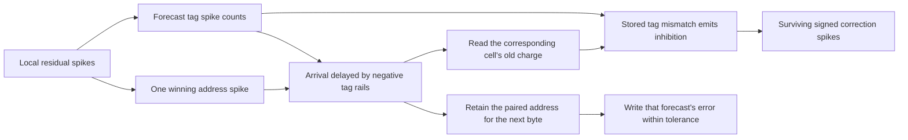

# Forecast tags time the address spike

A forecast-error bank has a learned address competition per head.
The winner emits one address spike. A cell also holds the tag of the
forecast that produced its error. On a read, tag mismatch outside
the tolerance interval inhibits the retrieved payload.

The new circuit uses each tag twice. Its signed pulse counts set the
arrival slot of the address spike, then verify the selected cell
through the existing inhibition rule. Each negative tag coordinate
inserts a fixed delay into the same address path. With tag counts
$q_0$ and $q_1$, the arrival slot is

$$
\phi = \mathbf{1}[q_0 < 0] + 2\,\mathbf{1}[q_1 < 0].
$$

The paired location $(a,\phi)$ has one cell for each arrival slot
of the original winner $a$. A silent address remains silent. The
next byte writes its observed error to the previous paired address.
The current byte reads the existing charge from its own address
before the write. When the stored tag and the current tag differ
by more than the learned tolerance, inhibitory pulses cancel
overlapping payload pulses. The forward circuit uses signed
integer comparisons and coincidence. Training sends a surrogate
gradient through the tag polarity that selected the slot.
[Decoder](../snnformer/event_lm.py) · [Charge update](../snnformer/correction_memory.py)

Product keys and coincidence addressing have prior work. The
combination tested here splits one spike address into timed cells
using the same tag that verifies the selected cell's payload.
[Product-key memory](https://proceedings.neurips.cc/paper/2019/hash/9d8df73a3cfbf3c5b47bc9b50f214aff-Abstract.html) ·
[Spike coincidence memory](https://pmc.ncbi.nlm.nih.gov/articles/PMC10071999/)

## Warm probe

The seven-block model expands from 14 to 56 cells per head with
the same projection weights and 3,257,088 learned parameters.
The expanded bank plus compact axons occupies 25,584 bytes of
persistent stream state. The single-phase control with compact
axons uses 19,536 bytes. CPU integer and MPS chunked outputs matched
on 4,096 validation bytes for both configurations.

| enwik8 validation measurement | One phase | Four phases |
|---|---:|---:|
| Address spikes on 4,096 bytes | 16,384 | 16,384 |
| Bank correction pulses | 1,600,091 | 879,909 |
| Delivered payload pulses | 158,249 | 371,178 |
| Mean age of addressed nonzero charge before inhibition | 13.43 bytes | 36.23 bytes |
| Loss on 65,536 targets, bits per byte | 1.92803 | 1.92818 |

All four phases received address spikes on the sample. The higher
read age and lower write volume establish the warm circuit's
behavior. The warm loss is almost unchanged.
[Warm probe](../results/event_lm/tag_phase_address/warm_tag_phase_probe.json) ·
[Compact axons](RESIDUAL_MEMBRANE.md#keep-the-stream-state-small)

A separate 262,144-target validation probe uses the same parent
weights and compares each head's own tag with the preceding head's
tag as the phase source. Both four-phase paths keep the original
write and verification tags. Using each head's own tag gave
55.39M bank correction pulses and 24.49M delivered payload pulses.
Using the preceding head's tag gave 101.75M writes and 10.96M
delivered pulses with the same number of cells. Loss stayed near
1.912 bits per byte across those two configurations and the
one-phase control. Suppressing four-phase reads from charge at
least 512 bytes old raised loss by 0.00016 bits per byte in the
own-tag configuration.
[Capacity-matched phase-source and memory-age probe](../results/event_lm/tag_phase_address/validation_memory_age_probe.json)

## Matched training

The continuation starts from the released seven-block parent
and uses 1,600 steps, seed 711, 512-byte windows, and 6,553,600
additional enwik8 targets. The only forward change from the
held-charge control is `--tag-phase-address`. Compact axon storage
leaves the spike counts unchanged. The paired study scores enwik8
and the same 16 PG-19 books. The validation probe collapses the
phase banks with the same trained weights to measure the
combined effect of the timing and capacity change.
[Three-step Metal smoke](../results/event_lm/tag_phase_address/event_correction_code_s711_tag_phase_address_smoke.json)

| Seed-711 continuation | enwik8 bpb | PG-19 bpb | Raw PG-19 bpb |
|---|---:|---:|---:|
| Held charge with one-phase addressing | 1.96430 | 2.88668 | 2.98308 |
| Four-phase addressing | 1.99725 | 2.90730 | 2.99722 |

The four-phase continuation had higher loss on both corpora in
this seed. The native decoder matched Metal counts on 4,096
enwik8 test bytes and emitted 311,699 pulses per byte. Collapsing
the trained phase addresses to one slot with the same weights
lowered validation probe loss from 1.934447 to 1.934276.
[Training and held-out scores](../results/event_lm/tag_phase_address) ·
[One-phase control](CONTEXT_LENGTH.md#repeat-at-326m-parameters)

## Supervise the corrected forecast

The existing auxiliary loss supervises the local forecast of
the observed spike code. The `--corrected-code-loss` experiment
supervises the same payload coordinates after adding the signed
error spikes that survived the bank's read inhibition. A silent
bank leaves the supervised forecast unchanged. Reads use the
pre-write charge, and the target is the next observed byte's
code. The next-byte objective, auxiliary loss weight of 0.25,
pulse target, model geometry, and integer decoding path are
shared with the four-phase control.

This uses the prediction-error code to give the bank direct
training feedback about the corrections it delivers. The
paired run uses the same parent and enwik8 training windows.
[Trainer](../experiments/train_event_lm.py) ·
[Three-step Metal smoke](../results/event_lm/tag_phase_address/event_correction_code_s711_corrected_forecast_smoke.json)
