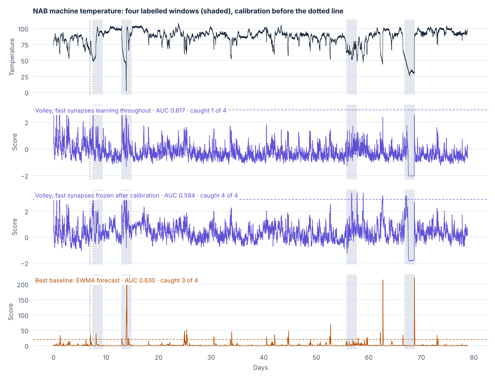
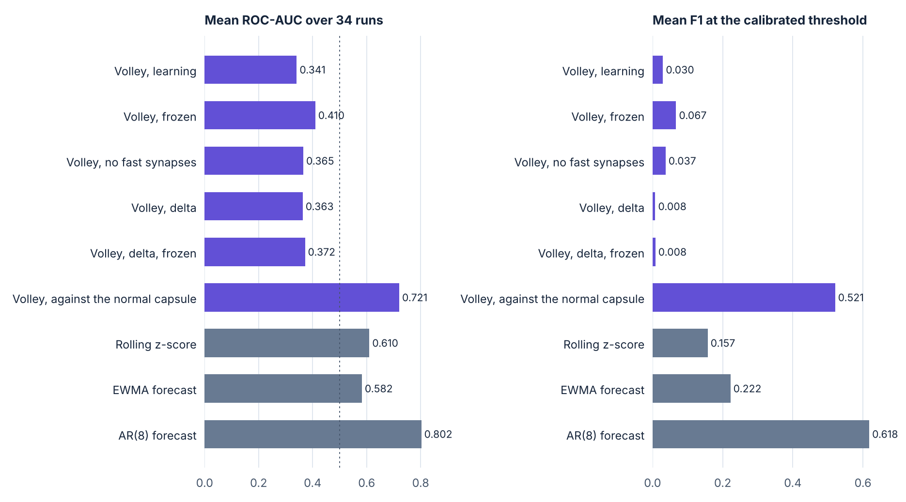

# Telemetry pilot

Can the stack read a machine's sensors as it reads text? This pilot takes the released v16 stack, which has only
ever been trained on bytes of Wikipedia, writes public sensor data as bytes, reads every sensor as one unbroken
stream with its own carried state, and asks whether the surprise of its predictions finds the labelled anomalies.
Nothing is trained: the weights are the checkpoint's, and the only learning is that of the fast output synapses
while they read.

In short: read as a carried stream, the stack's surprise is level with simple baselines on one industrial machine
and fails on a pump testbed, where it ranks the anomalies *below* the normal samples (mean ROC-AUC 0.34 over 34
runs). The stream itself is the reason. A stack that carries its state adapts to what it reads, so a fault that
holds steady soon costs few bits, and fast synapses that keep learning learn the fault too. Scored instead from the
capsule that the calibration left, the asset's normal, the same weights reach a mean ROC-AUC of 0.72 on the testbed
and catch all 34 anomalies within a median of 7 seconds. That is ahead of a rolling z-score (0.61) and an EWMA
forecast (0.58), and 0.08 behind an AR(8) forecast (0.80; paired 95% interval −0.14 to −0.03), at a high false-alarm
rate. On the industrial machine, whose normal drifts over ten weeks, fast synapses frozen after calibration do better
than the fixed capsule: all four windows caught within a median of 10 hours of their start, at 0.43 false alarms per
thousand normal samples, where the baselines take 16 to 19 hours. Nothing was trained on telemetry; one dataset is
one machine and the other one testbed.

[Code](../snnformer/telemetry.py) · [Pilot](../experiments/telemetry_pilot.py) ·
[Evaluation](../experiments/telemetry_evaluate.py) · [Monitor](../experiments/telemetry_monitor.py) ·
[Records](../results/telemetry) · [Figures](../experiments/plot_telemetry.py)

## Limits

- **No training on telemetry.** The stack has seen text only. What it does with sensor bytes is what transfers
  from text and what its reads and fast synapses pick up along each stream. A stack trained on telemetry is the next
  step, and these numbers do not say how it would do.
- **Small labelled sets.** The NAB machine has four labelled windows; one window more or less moves the rate caught
  by a quarter, and its ROC-AUC is a single run. SKAB has 34 runs, all of one testbed, whose anomalies are mostly
  valve manipulations.
- **The pilot was steered by its own results.** The release's reading recipe (reach 8,192 at levels 4 to 7, fast
  synapses on all levels at 2^24) and the encoding's 100 levels were fixed before any run. The frozen synapses, the
  delta encoding and the reference capsule were each added after a reading had shown why the one before failed, and
  were scored on the same data. The reference piece (48 samples on NAB, 16 on SKAB) was chosen once and not tuned.
  The warm-up left out of NAB's threshold is reported at the default of 100 samples and at 1,500, which was picked
  after seeing that the fast synapses take about five days of the machine to settle. Every row is one reading of
  one checkpoint.
- **The measures are this pilot's own**: pointwise ROC-AUC, and at a threshold set on each run's calibration, its
  pointwise F1, the anomalies caught, the delay to the first alarm and the false alarms. They are not NAB's
  official score or SKAB's leaderboard protocol, and do not compare with published numbers. NAB's windows open
  before the labelled event, so an alarm early in a window is an early warning.
- **Floating point on a CPU.** The stack runs as the release scores it, in floating point, here on four CPU
  threads: about 100 to 400 bytes a second for one stream, and 2.5 to 11 minutes for the 22,695 NAB samples. No native
  or neuromorphic runtime is involved.
- **The checkpoint differs from the manifest.** The `l2048-forget` archive of the v16 release, downloaded on
  22 November 2026, unpacks to a file of 139,521,961 bytes with SHA-256 `75c4c98b…`, where
  `models/spiking-byte-lm-v16/manifest.json` records 139,521,479 bytes and `9230b212…`. It loads, carries the run
  name `event_steered_s20001_v16_l2048_forget` and reads text at a plausible rate; every record here names the hash
  it was read with.

## How a sensor becomes a stream

A `Quantizer` fitted on a run's first samples, which are normal by the dataset's convention, maps a value to one of
100 levels between the 0.5th and 99.5th percentiles of normal, widened by half their span on each side and clipped
beyond. Three encodings write a level as bytes that text is full of:

- `digits`: two digits and a newline, three bytes a sample;
- `printable`: one of 94 printable characters, one byte a sample;
- `delta`: the change of level since the sample before as one printable character, so that a steady sensor
  repeats one byte and a jump writes a rare one.

Every sensor is one stream of the stack with its own state: the tags and payloads of its reads, the fibres of its
cells and its fast output synapses, which start silent and learn from that stream alone. That state is the
sensor's capsule. A `StreamReader` reads the sensors of a machine side by side and gives the surprise of every
sample: the bits that the stack's predictions spent on its bytes, each byte predicted before it arrived. A stream
read in pieces, or stopped, saved and resumed from its capsule, is scored exactly as one pass over all of it, and
each stream exactly as if it were read alone (`tests/test_telemetry.py`).

The pilot reads every run in up to five ways:

| Arm | The stream's state | Fast synapses |
|---|---|---|
| learning | Carried | Learn along the whole run |
| frozen | Carried | Learn along calibration, then keep what they hold |
| no fast synapses | Carried | None |
| reference | Every piece after calibration starts from the capsule that calibration left | Frozen after calibration |
| delta | As the arm it names, with the delta encoding | As the arm it names |

## The datasets and the baselines

- **NAB machine temperature** (`realKnownCause/machine_temperature_system_failure.csv` of the Numenta Anomaly
  Benchmark): the temperature of an internal component of a large industrial machine, 22,695 samples five minutes
  apart over 79 days, with four labelled windows: a planned shutdown, a fault that is hard to see, and the
  catastrophic failure it led to. The first 2,000 samples, before the first window, calibrate.
- **SKAB** (the Skoltech Anomaly Benchmark): 34 runs of a water-circulation testbed, eight sensors each (two
  vibration RMS, motor current, pressure, two temperatures, voltage, flow), once a second, every sample labelled.
  Each run's first 400 samples calibrate, as SKAB's own protocol has it.

Each method gives every sensor a score per sample. The stack's score is its surprise. A rolling z-score measures
the distance of the value from the mean of the 100 samples before it. An EWMA forecast gives the squared residual of
an exponential mean. An AR(8) forecast, fitted by least squares on the calibration samples, gives its squared
residual. Every method's sensor scores are then treated alike:

1. normalized by the median and median absolute deviation of their calibration samples;
2. averaged over the run's sensors;
3. smoothed by an exponential mean, with a span of 12 for NAB (an hour) and 5 for SKAB;
4. thresholded at the 99th percentile of their calibration after a warm-up.

## NAB machine temperature

| Method | ROC-AUC | F1 | Windows caught | Median delay | False alarms per 1,000 normal samples |
|---|---:|---:|---:|---:|---:|
| Volley, learning | **0.617** | 0.005 | 1 of 4 | 39 samples | **0.00** |
| Volley, frozen | 0.594 | 0.054 | **4 of 4** | 121 samples (10 h) | 0.43 |
| Volley, no fast synapses | 0.532 | 0.009 | 1 of 4 | 41 samples | 0.76 |
| Volley, printable, learning | 0.613 | 0.010 | 2 of 4 | 223 samples | 0.22 |
| Volley, delta, learning | 0.500 | 0.039 | 3 of 4 | 352 samples | 3.31 |
| Volley, reference | 0.480 | **0.145** | **4 of 4** | 38 samples (3 h) | 11.50 |
| Rolling z-score | 0.578 | 0.060 | 3 of 4 | 193 samples (16 h) | 0.76 |
| EWMA forecast | **0.630** | 0.089 | 3 of 4 | 196 samples (16 h) | 1.19 |
| AR(8) forecast | 0.577 | 0.094 | **4 of 4** | 228 samples (19 h) | 1.63 |

Without a threshold every method ranks the samples about equally badly: NAB's windows are two days wide around each
event, and most of a window looks normal. With the default warm-up the learning stack sets its threshold during the
first days, while its fast synapses are still learning the machine and its surprise is high, so it rarely alarms
later. The frozen arm catches all four windows, half a day ahead of the baselines, at fewer false alarms than any of
them. With the warm-up of 1,500 samples, which leaves the settling out of the threshold, the learning arm catches 3
of 4 within a median of 34 samples (3 hours) at 0.16 false alarms per thousand, and the frozen arm 4 of 4 within 17
samples at 3.04, where the baselines take 196 to 236 samples
([records](../results/telemetry/evaluation_nab_warm1500.json)).



## Learning while reading also learns the failure

The last window holds the catastrophic failure. The temperature falls below the calibrated range and stays there for
a day, so the quantizer writes the lowest level again and again. A constant stream is the easiest thing to predict.
The learning arm's surprise falls from 3.41 bits a sample in the 600 samples before the window to 1.63 inside it.
The frozen arm's falls less, from 4.42 to 3.10: its fast synapses keep the normal, but its reads still copy the last
8,192 cells, and they hold nothing but the fault. Both scores therefore drop below their normal at the moment the
machine fails, as the figure shows. What catches the window is the rise as the temperature slides out of range,
before the floor.

The same happens on SKAB, where the reading of a carried stream is a clear failure:

| Method | Mean ROC-AUC | Mean F1 | Anomalies caught | Median delay | False alarms per 1,000 normal samples |
|---|---:|---:|---:|---:|---:|
| Volley, learning | 0.341 | 0.030 | 22 of 34 | 30 s | **3.09** |
| Volley, frozen | 0.410 | 0.067 | 25 of 34 | 34 s | 8.65 |
| Volley, no fast synapses | 0.365 | 0.037 | 24 of 34 | 21 s | 9.14 |
| Volley, delta, learning | 0.363 | 0.008 | 15 of 34 | 39 s | 3.87 |
| Volley, delta, frozen | 0.372 | 0.008 | 14 of 34 | 40 s | 4.02 |

Every carried reading ranks the anomalies below the normal samples, the one without fast synapses as well: the reads
alone, which copy the last 8,192 cells, adapt to a fault that holds steady. Three things in the records explain it.

1. **The stream's surprise falls along every run** as it learns the sensor: 4.95 bits a sample in calibration,
   4.54 on later normal samples. SKAB's anomalies come late in a run.
2. **A valve manipulation pushes sensors out of range.** 13.8% of anomalous sensor samples are clipped, against
   4.4% of normal ones, and a clipped stream is constant.
3. **To a model of text, two digits are a word and not a magnitude.** "37" is no nearer "38" than "85". The delta
   encoding gives every jump a rare byte, but it throws the level away, and a valve that stays shut is a level.

A carried stream's surprise says how *unpredictable* the sensor is now, not how far it lies from the asset's normal.

## Against the normal

So the reference arm keeps the capsule that the calibration left, the state of every sensor after its normal
stretch, and starts every following piece from it: 16 seconds on SKAB, 4 hours on NAB. Within a piece the stack
still adapts, but every piece is predicted from the normal. Reading never changes a state that the stack handed out,
so the capsule can be rewound to any number of times, at no cost beyond reading the piece.

| SKAB, 34 runs | Mean ROC-AUC | Mean F1 | Anomalies caught | Median delay | False alarms per 1,000 normal samples |
|---|---:|---:|---:|---:|---:|
| Volley, learning | 0.341 | 0.030 | 22 of 34 | 30 s | 3.09 |
| **Volley, reference** | 0.721 | 0.521 | **34 of 34** | 7 s | 39.41 |
| Rolling z-score | 0.610 | 0.157 | 31 of 34 | 21 s | 9.26 |
| EWMA forecast | 0.582 | 0.222 | 29 of 34 | 9 s | 9.83 |
| AR(8) forecast | **0.802** | **0.618** | 33 of 34 | **4 s** | 28.65 |

Against the AR forecast, run by run, the reference arm is 0.082 behind in mean ROC-AUC, with a paired 95% interval
of −0.143 to −0.025, and ahead on 12 of the 34 runs. By group it scores 0.784 on the first valve's 16 runs (AR
0.818), 0.888 on the second's 4 (AR 0.900) and 0.600 on the other 14 (AR 0.756). It raises the most false alarms
of any method. The AR forecast has the advantage this pilot's encodings lack: it computes with the values as
numbers, and its coefficients pull every forecast back toward the calibrated normal level.



On the NAB machine the reference arm is the worst at ranking (0.480) and raises 11.5 false alarms per thousand.
That machine's normal drifts over ten weeks, and a reference of its first week flags the drift too. There the frozen
fast synapses, which keep the normal while the reads follow the machine, do better.

## What this means for Volley

- **Two capsules per stream.** A live capsule follows what the asset does now. That is the context a question
  about the asset needs, and its own surprise marks a change as it happens. A reference capsule holds the asset's
  normal, and surprise against it is the anomaly score. The reference has to be renewed on purpose, after
  maintenance or as seasons turn: the NAB machine shows that a reference which never changes goes stale, and SKAB
  shows that one which follows everything learns the fault.
- **Learning during inference needs a gate.** Fast synapses that learn everything learn the failure. They should
  learn what the reference calls normal and hold still while a stream is surprising, as the asset console of the
  presentation already draws.
- **The encoding has to carry magnitude and must not clip into a constant.** Digits are words to a model of text,
  and deltas lose the level. An out-of-range value needs bytes of its own, or a range check beside the stream.
- **The slow weights have to learn telemetry.** Numbers as magnitudes, the dynamics of motors, valves and heat,
  and the delta spike encoder of the vNN design belong in training, not on top of a model of text. This pilot is the
  baseline that such a stack has to beat, and the AR(8) forecast is the bar on SKAB.
- **False alarms decide whether operators listen.** The reference arm's 39 per thousand samples is far too many for
  a control room. Per-sensor thresholds, hold times (the monitor below holds three rows) and range rules come before
  a pilot on a line.
- **Throughput is not the limit for a few assets.** Eight sensors at 1 Hz in the digits encoding are 24 bytes a
  second, well within one CPU. A fleet needs a GPU or the native runtime.

## Watching a machine

`experiments/telemetry_monitor.py` is the reader as a service would run it. It replays a CSV as if its rows arrived
live, one capsule per named sensor, calibrates a `SurpriseMonitor` on the first rows, and prints a `watch`, `alarm`
or `clear` whenever a sensor's smoothed surprise crosses the lines that its own calibration set and stays across them
for three rows. With `--state` the capsules, levels and monitor are saved after the last row, and the next call goes
on with the next rows of the machine without fitting anything again. It reads the carried stream, so on SKAB it
inherits that stream's blindness: on the first run of the first valve it raised no event for the labelled anomaly.
Scoring it against the reference capsule is the next change to it.

## Reproduce

The data, under `data/telemetry` (ignored by git):

```bash
R=https://raw.githubusercontent.com/numenta/NAB/master
mkdir -p data/telemetry/nab
curl -o data/telemetry/nab/machine_temperature_system_failure.csv $R/data/realKnownCause/machine_temperature_system_failure.csv
curl -o data/telemetry/nab/combined_windows.json $R/labels/combined_windows.json
S=https://raw.githubusercontent.com/waico/SKAB/master/data
for d in valve1 valve2 other; do mkdir -p data/telemetry/skab/$d
  for i in $(seq 0 25); do curl -sf -o data/telemetry/skab/$d/$i.csv $S/$d/$i.csv || rm -f data/telemetry/skab/$d/$i.csv; done
done
```

Every arm, on the v16 checkpoint restored as in [the handoff](V16_HANDOFF.md#restore-the-checkpoints). The digits
encoding and the learning synapses are the defaults; the other arms add their flags:

```bash
CK=checkpoints/long_streams/l2048-forget/model.pt.averaged
READ="--reach 8192 --reach-levels 4 5 6 7"
FAST="--teach-levels 0 1 2 3 4 5 6 7 8 9 10 --teach-threshold 16777216"
python experiments/telemetry_pilot.py --checkpoint $CK --dataset skab $READ $FAST --out results/telemetry/skab_digits_taught
python experiments/telemetry_pilot.py ... $READ $FAST --freeze-after-calibration --out ..._frozen
python experiments/telemetry_pilot.py ... $READ $FAST --freeze-after-calibration --reference-piece 16 --out ..._reference
python experiments/telemetry_pilot.py ... --encoding delta $READ $FAST --out ..._delta_taught
python experiments/telemetry_pilot.py ... --encoding printable --levels 94 $READ $FAST --out ..._printable_taught
python experiments/telemetry_pilot.py ... $READ --out ..._untaught
```

Score them against the baselines, and draw the figures:

```bash
python experiments/telemetry_evaluate.py --run volley_learning results/telemetry/skab_digits_taught \
  --run volley_reference results/telemetry/skab_digits_reference --json results/telemetry/evaluation_skab.json \
  --scores results/telemetry/evaluation_skab_scores.npz
python experiments/telemetry_evaluate.py --run volley_learning results/telemetry/nab_digits_taught ... --warm 1500 \
  --json results/telemetry/evaluation_nab_warm1500.json
cd experiments && python plot_telemetry.py
```

Watch a machine, and go on later where it stopped:

```bash
python experiments/telemetry_monitor.py --csv first_rows.csv --delimiter ';' --time-column datetime \
  --sensors Accelerometer1RMS Current Pressure Temperature --checkpoint $CK --state checkpoints/capsules/pump
python experiments/telemetry_monitor.py --csv next_rows.csv ... --state checkpoints/capsules/pump
```

| Path | Holds |
|---|---|
| `snnformer/telemetry.py` | `Quantizer`, the encodings, `StreamReader` (capsules, `mark` and `rewind`, `save` and `resume`) and `SurpriseMonitor` |
| `experiments/telemetry_pilot.py` | Reads a dataset through a checkpoint and keeps the bits of every sample |
| `experiments/telemetry_evaluate.py` | The baselines and the measures |
| `experiments/telemetry_monitor.py` | A CSV replayed as a live machine, with events and saved capsules |
| `experiments/plot_telemetry.py` | The two figures |
| `results/telemetry/*.npz`, `*.json` | Every arm's bits, values and labels with its settings and hashes, and the evaluations |
