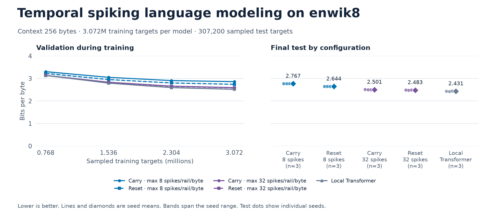

# Temporal Spiking LM

`TemporalSpikingLM` predicts the next byte with a spiking hidden backbone.
The embedding emits signed spike counts. The attention and feed-forward
sublayers receive spike counts, then emit new counts at their output
boundaries, including after each residual addition. The byte vocabulary
readout maps the last layer's spikes to continuous logits. Context enters
the prediction through the decoder's delays, attention and neuron state.
[Decoder implementation](../snnformer/temporal_snn.py)

## One byte per neuron update

At each byte, a synaptic projection and per-byte LayerNorm produce
currents. Signed channels have two integrate-and-fire populations.
One receives positive current and one receives the magnitude of negative
current. The outgoing signal is the difference of their spike counts.
The inner feed-forward layer uses only the positive population, so it
acts as a rectifier. Each normalization sees channels from a single byte.

Each population starts with half a threshold of charge. Current is
clipped to the configured range, then rounded to fixed-point ticks, with
256 ticks per threshold. The neuron releases one spike per threshold
crossed and retains the remainder in an integer phase. This is a
nonleaky neuron with subtractive reset. The benchmark compares caps of
8 and 32 spikes per rail per byte. The 32-spike setup increases the
current gains and rescales the resulting coincidence scores and logits.
At either cap, `temporal_spike_reset` starts every byte at half-threshold,
keeping the same quantization, delays and attention.

Training computes all emitted counts with a prefix sum of integer charge
and a difference of cumulative threshold crossings. The backward pass
uses the derivative of the clipped current at each byte as a local
straight-through surrogate. Gradients do not flow through the integer
phase recurrence. See the [neuron implementation](../snnformer/token_if.py).

## Delay and coincidence attention

Each layer splits its input channels into four groups with delays of
zero, one, two and three bytes before the query, key and value
projections. Each of those projections emits spikes. For each head,
attention scores the current query against signed key spikes via a
scaled dot product plus a learned relative-age bias. Only the current
position and the preceding `window − 1` positions are eligible. The
model rounds each score's gap from the best visible score. Gaps of
0–4 receive 16, 8, 4, 2 and 1 votes, respectively. Larger gaps receive
zero. The pooled current is the vote-weighted sum of signed value
spikes divided by the total vote count. Another neuron population
converts that current to spikes before the output projection.

The forward pass uses a discrete vote lookup. The backward pass uses
the derivative of a base-two exponential in the gap, with the
best-score reference detached from the gradient. See the
[attention implementation](../snnformer/spike_attention.py).

## Streaming state and implementation

Each layer holds spike keys and values in a `window`-slot ring buffer
and keeps three bytes of delay history plus its membrane phases. The
model also keeps the embedding's phase and stream position. State
storage stays fixed as the stream grows. Direct attention is limited
to 32 positions per layer in this benchmark. The batched implementation
scores O(NW) query–key pairs for N positions and a window of W. Stacked
layers and delays extend the direct paths between positions. Carried
phases can convey older influences in compressed form. The enwik8
comparison evaluates prediction within windows of 256 bytes.

The spiking claim concerns the hidden signals and neuron dynamics.
PyTorch stores spike counts as integer-valued floating-point tensors
and simulates synapses and local attention with dense floating-point
operations. Each synaptic weight is rounded to a power-of-two grid
during training and inference. The grid leaves enough significand bits
for exact FP32 dot products under the configured spike cap. This avoids
matrix-reduction order changing the current before charge quantization.
Score scaling, age bias, normalization and the vocabulary logits use
floating-point arithmetic. Forward attention weights come from a discrete
lookup and division by the vote sum. The benchmark measures byte prediction
on PyTorch. It does not measure neuromorphic energy use.

## Related architectures

- SpikeGPT already uses token position as neuron time. Its blocks use
  token shifts and a recurrent Spiking RWKV mixer. Here the mixer uses
  fixed groups of delay channels and a bounded window of signed query–key
  coincidences. [SpikeGPT architecture](https://arxiv.org/html/2302.13939#S3.SS2)
- WD-Spikingformer already uses causal attention over spiking queries,
  keys and values with winner-take-all competition. This implementation
  lets several keys near the best score contribute with discrete,
  normalized votes and combines that readout with carried fixed-point
  charge. [WTA Spiking Self-Attention](https://arxiv.org/html/2604.11321#S3.SS3)
- I-ViT's Shiftmax already uses base-two shifts in an integer attention
  normalizer. The spike vote table uses a simpler truncated geometric rule
  over signed coincidences. [I-ViT](https://arxiv.org/abs/2207.01405)

The proposed contribution is the combination of dual-rail spike
residuals, fixed-point charge across bytes, synaptic delays and
truncated coincidence votes in one causal decoder. The comparison
measures this implementation at a small training budget.

## enwik8 results

All scores below are means over three seeds, with 3.072 million sampled
training targets per seed. Lower bits per byte (bpb) is better.

| Model | Parameters | Validation bpb | Test bpb |
| --- | ---: | ---: | ---: |
| Temporal Spiking LM, max 8 spikes | 362,688 | 2.780 | 2.767 |
| Reset every byte, max 8 spikes | 362,688 | 2.658 | 2.644 |
| Temporal Spiking LM, max 32 spikes | 362,688 | 2.514 | 2.501 |
| Reset every byte, max 32 spikes | 362,688 | 2.498 | 2.483 |
| Conventional local Transformer | 357,696 | 2.440 | 2.431 |



The higher spike budget lowered test loss in both spiking variants.
Carrying membrane charge increased test loss at either budget in every
seed. The conventional Transformer led the matched comparison. For
external scale context, SpikeGPT reports 1.262 test bpb on enwik8 with
46.1 million parameters and 3,072-byte context under its own training
protocol. [SpikeGPT, Table 1](https://arxiv.org/html/2302.13939#S4.SS2)

At 12.288 million sampled training targets, seed 0 scored **2.244 test
bpb** with the 32-spike carried model and **2.105** with the conventional
local Transformer. [Spiking run](../results/lm/temporal_spike_ilif32_T1_s0_temporal_12m.json)
· [Transformer run](../results/lm/transformer_local_ann0_T1_s0_temporal_12m.json)

The 32-spike seed-0 checkpoints also scored the same 8,192 held-out
target bytes with histories of 32, 128, 256 and 1,024 bytes. The carried
model scored 2.546, 2.544, 2.548 and 2.546 bpb, respectively. In this
probe, the additional history did not improve next-byte prediction
beyond 128 bytes. The fixed-size streaming state allows continued
decoding, and arbitrary-distance recall remains unverified.
[Paired history probe](../results/lm_context/temporal_3m_seed0.json)

## Reproduce the enwik8 comparison

Install the repository dependencies and extract the raw
[enwik8 corpus](https://www.mattmahoney.net/dc/textdata.html). The
[training runner](../experiments/train_lm.py) validates the file length
and SHA-1, then uses the standard 90M/5M/5M byte split. All variants see
the same sampled training windows within each seed and use a 32-byte local
attention window. Each model trains for 3,072,000 sampled next-byte
targets. Final validation and test bits per byte each cover 307,200
targets in disjoint windows of context 256. Each window starts with
fresh state, so the protocol does not measure streaming long-context
recall.

Run from the repository root. Choose `--device cpu` or `--device cuda`
if the machine has no MPS device.

```bash
python -m pip install -r requirements.txt
export ENWIK8_PATH=/absolute/path/to/enwik8

run() {
  variant=$1
  levels=$2
  seed=$3
  python experiments/train_lm.py --variant "$variant" --levels "$levels" --device mps \
    --dim 96 --depth 3 --heads 4 --ctx 256 --bs 12 --steps 1000 \
    --warmup 100 --eval-every 250 --eval-bs 12 --eval-batches 10 \
    --final-eval-batches 100 --lr 0.003 --seed "$seed" --tag temporal_3m \
    --checkpoint "checkpoints/${variant}_p${levels}_temporal_3m_s${seed}.pt"
}

for seed in 0 1 2; do
  run transformer_local 4 "$seed"
  for levels in 8 32; do
    run temporal_spike "$levels" "$seed"
    run temporal_spike_reset "$levels" "$seed"
  done
done
```

The runner writes per-variant settings, learning curves and losses to
[`results/lm`](../results/lm). Add `--force` to replace an existing run
with the same name. The reset control isolates membrane carry within
the same architecture. The longer seed-0 comparison uses `--levels 32
--steps 4000 --eval-every 1000 --tag temporal_12m` and the other settings above.

Rebuild the chart with `python experiments/plot_temporal.py`.

Generate from a trained model with the
[streaming CLI](../experiments/generate_lm.py).

```bash
python experiments/generate_lm.py \
  --checkpoint checkpoints/temporal_spike_temporal_12m_s0.pt \
  --prompt 'The history of ' --bytes 64 --temperature 0.8 --seed 0
```
