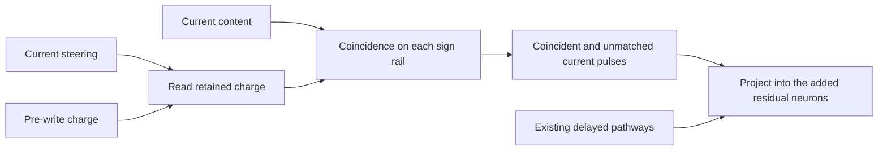

# Three-way spike coincidence in added residual neurons

In the released model, current content and steering choose the
immediate paths. The delayed coincidence path carries pre-write
held charge. This variant makes held charge participate in that
immediate choice in residual channels 384–767 of each block.

For signed content $p$, steering count $s$, and pre-write charge
$m$, steering opens the held read $r = \operatorname{sign}(m)
\min(|m|,s)$. Current content contributes to the coincident path
when it meets the held read on the same sign rail. A positive
match carries the smaller positive count. A negative match carries
the smaller negative magnitude. The bypass always receives the
remaining current pulses.



Each residual group uses its own rows of the same four-path
synaptic matrix. The first 384 residual channels receive the
original two-way split. The newly added channels receive the
three-way split. Both delayed paths follow the original rule.
The widened variants share 6,514,176 learned parameters,
19,536 bytes of stream state, and the same number of firing stages.
[Routing and native decoder](../snnformer/event_lm.py)

## What was measured

Widening starts the new residual channels silent. On 4,096
enwik8 validation bytes, the parent and the widened variant
emitted identical vocabulary counts and 1,292,767,233 total
pulses each. Native step, native chunked, and Metal forward
counts agreed. Across the seven layers, between 33.3% and 36.7%
of the pulses selected by two-way coincidence also met the
held charge. A gradient pass on 512 enwik8 training targets
reached the new projection in every block. A separate
three-step Metal training run completed on real enwik8 batches.
[Warm-start audit](../results/event_lm/trace_coincidence/warm_trace_coincidence.json) ·
[Training smoke record](../results/event_lm/trace_coincidence/event_correction_code_s711_trace_coincidence_smoke.json)

```bash
PYTORCH_ENABLE_MPS_FALLBACK=0 python experiments/audit_residual_growth.py \
  --enwik8 data/enwik8 --parent checkpoints/scale-3260k-study/trace_s0.pt \
  --device mps --trace-coincidence --json checkpoints/work/warm_trace_coincidence.json
```

## Paired training run

Run from the repository root with enwik8, the pinned PG-19 books,
and the 3.26M SNN parent restored.

```bash
bash experiments/run_v4_continuation.sh trace-coincidence
```

The command repeats the six-bit growth run's seed, parent,
1,600 steps, 512-byte windows, and 310,000-pulse target. The
comparison is against the six-bit grown SNN at 32,768,000 total
enwik8 targets. Score both corpora and audit native pulses.
On validation, the state probe can switch the new neurons
back to ordinary coincidence with trained weights held fixed.
It reports `ordinary_coincidence_bpb` next to the intact loss.
[Six-bit control](GROWN_RESIDUAL.md#matched-continuation) ·
[State probe](../experiments/probe_event_state.py) ·
[Data and checkpoint setup](HANDOFF.md)

| 32,768,000 training targets | enwik8 bpb | PG-19 bpb | Raw PG-19 bpb | Native pulses per byte |
|---|---:|---:|---:|---:|
| Six-bit grown control | 1.95646 | 2.86904 | 2.95290 | 306,923 |
| Three-way coincidence | 1.95911 | 2.87132 | 2.95721 | 307,297 |

The original circuit scored slightly lower on both test sets.
Switching the trained variant back to ordinary routing on 65,536
validation targets raised its loss from 1.89174 to 1.89242.
The learned routing gives a small benefit within that checkpoint
on this validation sample. The separately trained control has
the lower held-out loss. Native counts matched CPU step and chunk
decoding and the Metal batch path.
[Training, scores, and interventions](../results/event_lm/trace_coincidence)
