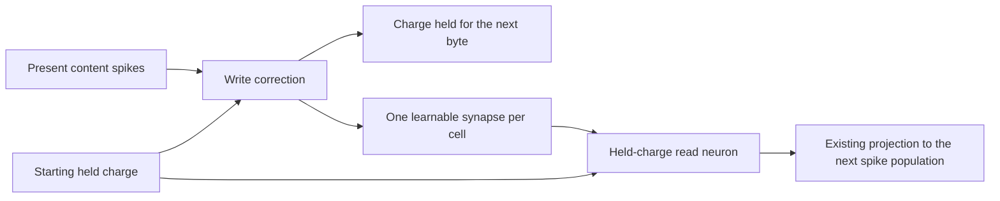

# Reading held charge with write-correction spikes

The short-group SNN keeps 28,584 bytes of state per stream and
scores 2.761530 bits per byte on calibrated PG-19. Its enwik8
test loss is 0.08470 bits per byte above the matched full-attention
model. The width study's paired history probe identifies a gap of
roughly 0.055 bits per byte after only 32 bytes of warmup. This
continuation gives each held-charge read neuron an extra input
from the correction spikes its own cell emits when writing.
[Short-group benchmark and history probe](PACKED_WIDTH.md)

## Use the write signal in the read

Let $h$ be the charge held at the start of a byte. The cell
computes the signed spike count $\Delta$ needed to move $h$
into the write interval centered on the current content packet.
The existing read count $r$ exposes the starting charge through
the steering aperture. The new synapse takes $\Delta$ as input
and supplies signed current to that read neuron. Its learned
weight $g$ is an integer number of charge ticks per spike. The
final read is

$$
\operatorname{FIRE}_{64}\!\left(\operatorname{clip}
  (64r+g\Delta,\,-64a,\,64a)\right),
$$

where $a$ is the smaller of the steering count and the neuron's
firing limit. A stable charge within the write interval produces
zero correction. When a byte shifts the interval away from held
charge, the correction can excite or inhibit the same cell's
read. The read drives the ordinary downstream synapses. There
are 243 new synapses per block and 2,673 across the network.
The correction and final read are each counted once as emitted
spikes. [Implementation](../snnformer/event_lm.py)



Prior work combines state and change in spike communication
and uses firing events to correct prediction error. This circuit
takes the particular correction produced by the bounded held-charge
write and feeds it into the read of that same cell.
[O'Connor et al., ICLR 2018](https://openreview.net/forum?id=HkZy-bW0-) ·
[Boerlin et al., 2013](https://doi.org/10.1371/journal.pcbi.1003258)

## Match inputs, training, and evaluation

The present-input arm applies the same learned synapses and
firing rule to the current content spikes. The continuation
control trains from the short-group checkpoint with its original
reads. The two new input arms start at zero gain, so at this
point every parent spike count and its pulse total is preserved.

Both arms match every parent output count on 4,096 real enwik8
validation bytes, including CPU integer batch, chunk, and byte-step
execution and the Metal forward pass. They retain the parent's
1,291,206,485 pulses on this sample and its 28,584 bytes of
persistent tensor state. A backward pass on 512 enwik8 training
targets reaches the new synapses in all 11 blocks.
[Write-input warm audit](../results/event_lm/trace_read_drive/warm_short_write.json) ·
[Present-input warm audit](../results/event_lm/trace_read_drive/warm_short_present.json)

All arms add 4,915,200 enwik8 targets to their 111,411,200-target
parents. The launcher uses seed 8237, 1,200 AdamW updates on
eight 512-byte windows, 48 warmup updates, and a peak learning
rate of 0.00008. This restart rate follows the lower-rate pilot.
The SNN arms use a 310,000-pulse soft target. The 12.80M
full-attention reference continues from its 12.8M width-study
checkpoint. Full held-out scores use the enwik8 test split and
the same 16 PG-19 test books as the width study. Source swaps
and zeroing the added synapses are measured on validation.
[Continuation-rate pilot](PACKED_WIDTH.md#learning-rate-at-a-continuation-boundary) ·
[Dataset setup](HANDOFF.md#score-checkpoints) ·
[Launcher](../experiments/run_v4_continuation.sh)

```bash
study=checkpoints/trace-read-drive-study
for arm in write control transformer present; do
  PYTHON=.venv/bin/python bash experiments/run_v4_continuation.sh "trace-read-drive-$arm" "$study"
done
```
