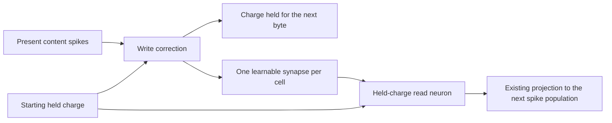

# Reading held charge with write-correction spikes

The short-group SNN keeps 28,584 bytes of state per stream and
scores 2.761530 bits per byte on calibrated PG-19. Its enwik8
test loss is 0.08470 bits per byte above the matched full-attention
model. On paired validation tails, the gap reaches 0.05388 bits
per byte after 32 bytes of warmup. This continuation gives each
held-charge read neuron an extra input
from the correction spikes its own cell emits when writing.
[Short-group benchmark and history probe](PACKED_WIDTH.md)

## Use the write signal in the read

Let $h$ be the charge held at the start of a byte. The cell
computes the signed spike count $\Delta$ needed to move $h$
into the write interval centered on the current content packet.
The existing read count $r$ exposes the starting charge through
the steering aperture. The new synapse takes $\Delta$ as input
and supplies signed current to that read neuron. Its learned
weight $g$ is an integer number of charge ticks per spike. The
final read is

$$
\operatorname{FIRE}_{64}\!\left(\operatorname{clip}
  (64r+g\Delta,\,-64a,\,64a)\right),
$$

where $a$ is the smaller of the steering count and the neuron's
firing limit. A stable charge within the write interval produces
zero correction. When a byte shifts the interval away from held
charge, the correction can excite or inhibit the same cell's
read. The read drives the ordinary downstream synapses. There
are 243 new synapses per block and 2,673 across the network.
The correction and final read are each counted once as emitted
spikes. [Implementation](../snnformer/event_lm.py)



Prior work combines state and change in spike communication
and uses firing events to correct prediction error. This circuit
takes the particular correction produced by the bounded held-charge
write and feeds it into the read of that same cell.
[O'Connor et al., ICLR 2018](https://openreview.net/forum?id=HkZy-bW0-) ·
[Boerlin et al., 2013](https://doi.org/10.1371/journal.pcbi.1003258)

## Match inputs, training, and evaluation

The present-input arm applies the same learned synapses and
firing rule to the current content spikes. The continuation
control trains from the short-group checkpoint with its original
reads. The two new input arms start at zero gain, so at this
point every parent spike count and its pulse total is preserved.

Both arms match every parent output count on 4,096 real enwik8
validation bytes, including CPU integer batch, chunk, and byte-step
execution and the Metal forward pass. They retain the parent's
1,291,206,485 pulses on this sample and its 28,584 bytes of
persistent tensor state. A backward pass on 512 enwik8 training
targets reaches the new synapses in all 11 blocks.
[Write-input warm audit](../results/event_lm/trace_read_drive/warm_short_write.json) ·
[Present-input warm audit](../results/event_lm/trace_read_drive/warm_short_present.json)

All arms add 4,915,200 enwik8 targets to their 111,411,200-target
parents. The launcher uses seed 8237, 1,200 AdamW updates on
eight 512-byte windows, 48 warmup updates, and a peak learning
rate of 0.00008. This restart rate follows the lower-rate pilot.
The SNN arms use a 310,000-pulse soft target. The 12.80M
full-attention reference continues from its 12.8M width-study
checkpoint. Full held-out scores use the enwik8 test split and
the same 16 PG-19 test books as the width study. Source swaps
and zeroing the added synapses are measured on validation.
[Continuation-rate pilot](PACKED_WIDTH.md#learning-rate-at-a-continuation-boundary) ·
[Dataset setup](HANDOFF.md#score-checkpoints) ·
[Launcher](../experiments/run_v4_continuation.sh)

```bash
study=checkpoints/trace-read-drive-study
for arm in write control transformer present; do
  PYTHON=.venv/bin/python bash experiments/run_v4_continuation.sh "trace-read-drive-$arm" "$study"
done
```

## The six-bit read stayed silent

The first write-input model scores 1.795816 bpb on enwik8 and
2.757065 bpb on calibrated PG-19 after 116,326,400 training
targets. Its raw PG-19 loss is 2.846544 bpb. Relative to the
111.41M-target parent, loss falls by 0.006746 bpb on enwik8
and 0.004465 bpb on calibrated PG-19, with gains on all 16 books.
[Training](../results/event_lm/trace_read_drive/event_correction_code_s8237_trace_read_drive_write.json) ·
[enwik8](../results/event_lm/trace_read_drive/enwik8_write_s8237.json) ·
[PG-19](../results/event_lm/trace_read_drive/pg19_write_s8237.json)

The native audit measures zero effective gains in all 11 blocks.
The added masters stayed below half of a six-bit weight tick.
Zeroing them or swapping their input leaves loss identical across
65,536 continuous validation targets and on the paired tails with
1, 32, and 497 bytes of warmup. The added input changes zero
read counts at this checkpoint.
[Native audit](../results/event_lm/trace_read_drive/native_write_s8237.json) ·
[Continuous validation interventions](../results/event_lm/trace_read_drive/probe_write_s8237.json) ·
[Paired-tail interventions](../results/event_lm/trace_read_drive/write_source_ablation.json)

## Carry fractional read charge

The eight-bit read uses 256 charge ticks per spike. Let $q_t$
be its synaptic current clipped within the steering aperture
for byte $t$, and $p_{t-1}$ be the carried remainder. The read
emits $s_t$ signed spikes and retains $p_t$ ticks.

$$
s_t=\left\lfloor\frac{p_{t-1}+q_t}{256}\right\rfloor,
\qquad p_t=p_{t-1}+q_t-256s_t.
$$

The remainder occupies one unsigned byte per read neuron. It
lies in $[0,255]$, so a current bounded by $\pm256a$ always
emits within $[-a,a]$. When the weighted write current is small,
repeated increments can cross a threshold across several bytes.
The existing signed residual-neuron scan evaluates the same
recurrence across a chunk. For zero gains, each input current
is a multiple of 256 and reproduces the parent's read count.
The 11-block short-group layout uses 31,257 persistent bytes
with carry. At zero gain, both carried sources reproduce every
parent count and the 1,291,206,485 parent pulses on the same
4,096 validation bytes.
[Write carry warm audit](../results/event_lm/trace_read_drive/warm_short_write_carry.json) ·
[Present carry warm audit](../results/event_lm/trace_read_drive/warm_short_present_carry.json) ·
[Eight-bit reset warm audit](../results/event_lm/trace_read_drive/warm_short_write_fine.json)

An inference probe uses the trained six-bit write checkpoint
for both eight-bit read rules. Both views retain
508 nonzero gains. The reset read changes zero counts per byte
and the carried read changes 0.714844 counts per byte on the
same 4,096 validation bytes. The quantity sums the absolute
count change from the original read across cells and blocks.
Both views match CPU integer batch, chunk, and byte-step counts
on their audited samples.
[Frozen precision audit](../results/event_lm/trace_read_drive/frozen_write_precision_native.json)

```bash
.venv/bin/python - "$study" <<'PY'
import sys
from pathlib import Path
import torch

study = Path(sys.argv[1])
checkpoint = torch.load(study / "write_s8237.pt", map_location="cpu", weights_only=True)
directory = study / "precision-probe"
directory.mkdir(exist_ok=True)
for name, carry in (("fine", False), ("carry", True)):
    options = {"trace_read_drive_bits": 8, "trace_read_drive_carry": carry}
    payload = dict(checkpoint, cfg={**checkpoint["cfg"], **options},
                   args={**checkpoint["args"], **options},
                   run_name=f"frozen_write_{name}_s8237")
    torch.save(payload, directory / f"write_{name}_s8237.pt")
PY
.venv/bin/python experiments/audit_spike_code.py --device cpu --split validation \
  --enwik8 data/enwik8 --activity-profile \
  --checkpoint "$study"/precision-probe/write_{fine,carry}_s8237.pt \
  --json "$study/results/frozen_write_precision_native.json"
```

The follow-up uses the same parents, 1,200 updates, seed 8237,
and pulse target. The fine write arm resets each byte at eight-bit
precision. The other two arms let both write and present inputs
carry charge at that precision.

```bash
for arm in write-carry write-fine present-carry; do
  PYTHON=.venv/bin/python bash experiments/run_v4_continuation.sh "trace-read-drive-$arm" "$study"
done
```
