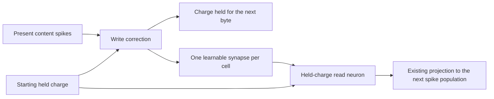
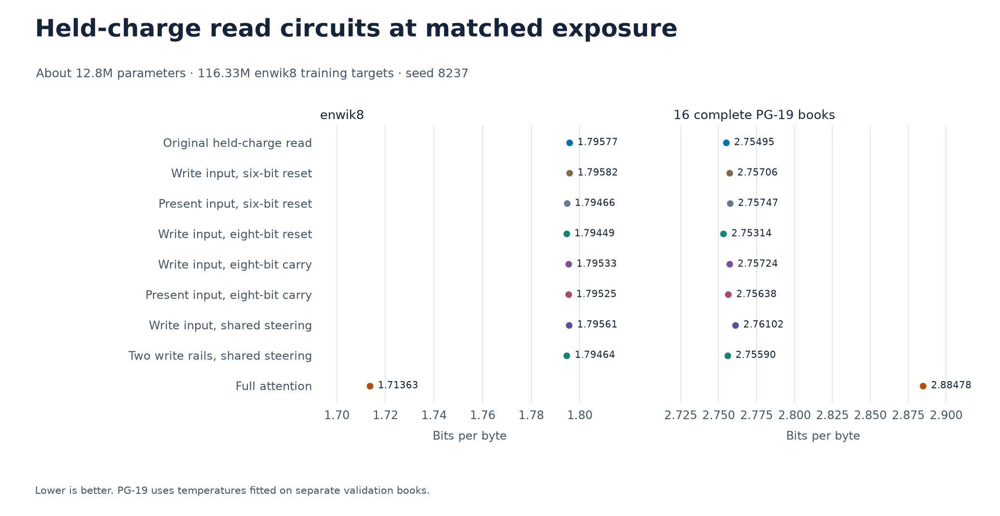
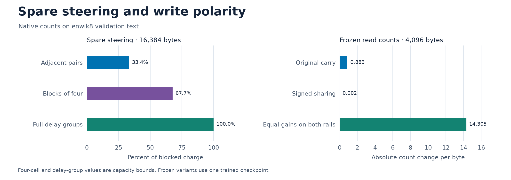

# Reading held charge with write-correction spikes

The short-group SNN keeps 28,584 bytes of state per stream and
scores 2.761530 bits per byte on calibrated PG-19. Its enwik8
test loss is 0.08470 bits per byte above the matched full-attention
model. On paired validation tails, the gap reaches 0.05388 bits
per byte after 32 bytes of warmup. This continuation gives each
held-charge read neuron an extra input
from the correction spikes its own cell emits when writing.
[Short-group benchmark and history probe](PACKED_WIDTH.md)

## Use the write signal in the read

Let $h$ be the charge held at the start of a byte. The cell
computes the signed spike count $\Delta$ needed to move $h$
into the write interval centered on the current content packet.
The existing read count $r$ exposes the starting charge through
the steering aperture. The new synapse takes $\Delta$ as input
and supplies signed current to that read neuron. Its learned
weight $g$ is an integer number of charge ticks per spike. The
final read is

$$
\operatorname{FIRE}_{64}\!\left(\operatorname{clip}
  (64r+g\Delta,\,-64a,\,64a)\right),
$$

where $a$ is the smaller of the steering count and the neuron's
firing limit. A stable charge within the write interval produces
zero correction. When a byte shifts the interval away from held
charge, the correction can excite or inhibit the same cell's
read. The read drives the ordinary downstream synapses. There
are 243 new synapses per block and 2,673 across the network.
The correction and final read are each counted once as emitted
spikes. [Implementation](../snnformer/event_lm.py)



Prior work combines state and change in spike communication
and uses firing events to correct prediction error. This circuit
takes the particular correction produced by the bounded held-charge
write and feeds it into the read of that same cell.
[O'Connor et al., ICLR 2018](https://openreview.net/forum?id=HkZy-bW0-) ·
[Boerlin et al., 2013](https://doi.org/10.1371/journal.pcbi.1003258)

## Match inputs, training, and evaluation

The present-input arm applies the same learned synapses and
firing rule to the current content spikes. The continuation
control trains from the short-group checkpoint with its original
reads. The two new input arms start at zero gain, so at this
point every parent spike count and its pulse total is preserved.

Both arms match every parent output count on 4,096 real enwik8
validation bytes, including CPU integer batch, chunk, and byte-step
execution and the Metal forward pass. They retain the parent's
1,291,206,485 pulses on this sample and its 28,584 bytes of
persistent tensor state. A backward pass on 512 enwik8 training
targets reaches the new synapses in all 11 blocks.
[Write-input warm audit](../results/event_lm/trace_read_drive/warm_short_write.json) ·
[Present-input warm audit](../results/event_lm/trace_read_drive/warm_short_present.json)

The initial 243-channel geometry also passed the exact warm-start
audit for both inputs at its original 32,616-byte state size. The
trained comparisons use the shorter delay-group layout.
[Write-input audit on the wider rings](../results/event_lm/trace_read_drive/warm_write.json) ·
[Present-input audit on the wider rings](../results/event_lm/trace_read_drive/warm_present.json)

All arms add 4,915,200 enwik8 targets to their 111,411,200-target
parents. The launcher uses seed 8237, 1,200 AdamW updates on
eight 512-byte windows, 48 warmup updates, and a peak learning
rate of 0.00008. This restart rate follows the lower-rate pilot.
The SNN arms use a 310,000-pulse soft target. The 12.80M
full-attention reference continues from its 12.8M width-study
checkpoint. Full held-out scores use the enwik8 test split and
the same 16 PG-19 test books as the width study. Source swaps
and zeroing the added synapses are measured on validation.
[Continuation-rate pilot](PACKED_WIDTH.md#learning-rate-at-a-continuation-boundary) ·
[Dataset setup](HANDOFF.md#score-checkpoints) ·
[Launcher](../experiments/run_v4_continuation.sh)

```bash
study=checkpoints/trace-read-drive-study
for arm in write control transformer present; do
  PYTHON=.venv/bin/python bash experiments/run_v4_continuation.sh "trace-read-drive-$arm" "$study"
done
```

## The six-bit read stayed silent

The first write-input model scores 1.795816 bpb on enwik8 and
2.757065 bpb on calibrated PG-19 after 116,326,400 training
targets. Its raw PG-19 loss is 2.846544 bpb. Relative to the
111.41M-target parent, loss falls by 0.006746 bpb on enwik8
and 0.004465 bpb on calibrated PG-19, with gains on all 16 books.
[Training](../results/event_lm/trace_read_drive/event_correction_code_s8237_trace_read_drive_write.json) ·
[enwik8](../results/event_lm/trace_read_drive/enwik8_write_s8237.json) ·
[PG-19](../results/event_lm/trace_read_drive/pg19_write_s8237.json)

The native audit measures zero effective gains in all 11 blocks.
The added masters stayed below half of a six-bit weight tick.
Zeroing them or swapping their input leaves loss identical across
65,536 continuous validation targets and on the paired tails with
1, 32, and 497 bytes of warmup. The added input changes zero
read counts at this checkpoint.
[Native audit](../results/event_lm/trace_read_drive/native_write_s8237.json) ·
[Continuous validation interventions](../results/event_lm/trace_read_drive/probe_write_s8237.json) ·
[Paired-tail interventions](../results/event_lm/trace_read_drive/write_source_ablation.json)

At the same 116.33M-target exposure, ordinary reads score
1.795773 bpb on enwik8, 2.754952 bpb on calibrated PG-19, and
2.841358 bpb on raw PG-19. The continuation control leads the
six-bit write arm on 14 of 16 books and scores 0.000959 bpb
lower on the paired enwik8 tails at 32 bytes of warmup.
[Control training](../results/event_lm/trace_read_drive/event_correction_code_s8237_trace_read_drive_control.json) ·
[Control enwik8](../results/event_lm/trace_read_drive/enwik8_control_s8237.json) ·
[Control PG-19](../results/event_lm/trace_read_drive/pg19_control_s8237.json) ·
[Control validation histories](../results/event_lm/trace_read_drive/control_validation_history.json) ·
[Checkpoint digests](../results/event_lm/trace_read_drive_checkpoints.sha256)

## Carry fractional read charge

The eight-bit read uses 256 charge ticks per spike. Let $q_t$
be its synaptic current clipped within the steering aperture
for byte $t$, and $p_{t-1}$ be the carried remainder. The read
emits $s_t$ signed spikes and retains $p_t$ ticks.

$$
s_t=\left\lfloor\frac{p_{t-1}+q_t}{256}\right\rfloor,
\qquad p_t=p_{t-1}+q_t-256s_t.
$$

The remainder occupies one unsigned byte per read neuron. It
lies in $[0,255]$, so a current bounded by $\pm256a$ always
emits within $[-a,a]$. When the weighted write current is small,
repeated increments can cross a threshold across several bytes.
Across any sequence, emitted charge plus the final remainder
equals the initial remainder plus the bounded synaptic input.
The existing signed residual-neuron scan evaluates the same
recurrence across a chunk. For zero gains, each input current
is a multiple of 256 and reproduces the parent's read count.
The 11-block short-group layout uses 31,257 persistent bytes
with carry. At zero gain, both carried sources reproduce every
parent count and the 1,291,206,485 parent pulses on the same
4,096 validation bytes.
[Write carry warm audit](../results/event_lm/trace_read_drive/warm_short_write_carry.json) ·
[Present carry warm audit](../results/event_lm/trace_read_drive/warm_short_present_carry.json) ·
[Eight-bit reset warm audit](../results/event_lm/trace_read_drive/warm_short_write_fine.json)

An inference probe uses the trained six-bit write checkpoint
for both eight-bit read rules. Both views retain
508 nonzero gains. The reset read changes zero counts per byte
and the carried read changes 0.714844 counts per byte on the
same 4,096 validation bytes. The quantity sums the absolute
count change from the original read across cells and blocks.
Both views match CPU integer batch, chunk, and byte-step counts
on their audited samples.

On the same 24,576 validation targets, carrying charge reduces
loss by 0.000246 bpb at 32 bytes of warmup and 0.000268 bpb
at 497 bytes compared with the eight-bit reset rule. This
probe keeps all trained master weights fixed.
[Frozen precision audit](../results/event_lm/trace_read_drive/frozen_write_precision_native.json) ·
[Frozen precision history scores](../results/event_lm/trace_read_drive/frozen_write_precision_history.json)

```bash
.venv/bin/python - "$study" <<'PY'
import sys
from pathlib import Path
import torch

study = Path(sys.argv[1])
checkpoint = torch.load(study / "write_s8237.pt", map_location="cpu", weights_only=True)
directory = study / "precision-probe"
directory.mkdir(exist_ok=True)
for name, carry in (("fine", False), ("carry", True)):
    options = {"trace_read_drive_bits": 8, "trace_read_drive_carry": carry}
    payload = dict(checkpoint, cfg={**checkpoint["cfg"], **options},
                   args={**checkpoint["args"], **options},
                   run_name=f"frozen_write_{name}_s8237")
    torch.save(payload, directory / f"write_{name}_s8237.pt")
PY
.venv/bin/python experiments/audit_spike_code.py --device cpu --split validation \
  --enwik8 data/enwik8 --activity-profile \
  --checkpoint "$study"/precision-probe/write_{fine,carry}_s8237.pt \
  --json "$study/results/frozen_write_precision_native.json"
.venv/bin/python experiments/probe_lm_context.py --event-lm --device cpu \
  --checkpoint "$study"/precision-probe/write_{fine,carry}_s8237.pt \
  --data data/enwik8 --split val --histories 1 32 497 --tail-bytes 16 --tails 1536 \
  --batch-size 32 --json "$study/results/frozen_write_precision_history.json"
```

The follow-up uses the same parents, 1,200 updates, seed 8237,
and pulse target. The fine write arm resets each byte at eight-bit
precision. The other two arms let both write and present inputs
carry charge at that precision.

```bash
for arm in write-carry write-fine present-carry; do
  PYTHON=.venv/bin/python bash experiments/run_v4_continuation.sh "trace-read-drive-$arm" "$study"
done
```

## Trained carry read

All rows in the comparison use the same 116,326,400 training
targets and seed 8237 for the continuation. Loss is measured in
bits per byte on the full enwik8 test split and 16 complete
PG-19 test books.

| Model | enwik8 | PG-19 calibrated | PG-19 raw | State |
|---|---:|---:|---:|---:|
| Original held-charge read | 1.795773 | 2.754952 | **2.841358** | 28,584 B |
| Write input, six-bit reset | 1.795816 | 2.757065 | 2.846544 | 28,584 B |
| Present input, six-bit reset | 1.794660 | 2.757469 | 2.848596 | 28,584 B |
| Write input, eight-bit reset | 1.794488 | **2.753136** | 2.841921 | 28,584 B |
| Write input, eight-bit carry | 1.795332 | 2.757239 | 2.848498 | 31,257 B |
| Present input, eight-bit carry | 1.795246 | 2.756376 | 2.843614 | 31,257 B |
| Write input, shared steering | 1.795614 | 2.761023 | 2.850012 | 31,257 B |
| Two write rails, shared steering | 1.794636 | 2.755903 | 2.845058 | 31,257 B |
| Full attention | **1.713626** | 2.884781 | 3.080808 | 6 MiB |

The six-bit present-read checkpoint has zero effective gains
in its new read synapses. The eight-bit reset checkpoint has
745 nonzero read gains and zero observed read count changes on
4,096 test bytes. Zeroing either checkpoint's added gains gives
the same loss on 65,536 consecutive validation targets.
[Present reset audit](../results/event_lm/trace_read_drive/native_present_s8237.json) ·
[Eight-bit reset audit](../results/event_lm/trace_read_drive/native_write_fine_s8237.json) ·
[Eight-bit reset intervention](../results/event_lm/trace_read_drive/probe_write_fine_s8237.json)

The carried model has lower loss than full attention on all 16
PG-19 books. It has lower loss than the original-read SNN on
one book. The native audit finds 746 nonzero read gains and a
mean absolute change of 0.959961 read counts per byte. The
steering aperture clips 92.45% of the added absolute charge on
these 4,096 test bytes. Cells with zero steering receive 89.52%
of the added charge. A further 2.93% is clipped at open cells.
Integer batch and chunked decoding match the Metal output for
the full sample. Byte-step decoding matches the first 513 bytes.
[Carry enwik8](../results/event_lm/trace_read_drive/enwik8_write_carry_s8237.json) ·
[Carry PG-19](../results/event_lm/trace_read_drive/pg19_write_carry_s8237.json) ·
[Native audit](../results/event_lm/trace_read_drive/native_write_carry_s8237.json) ·
[Matched leaderboard](LEADERBOARD.md)



On the paired validation tails, carry lowers loss by
0.000770 bpb relative to the original-read control at 32 bytes
of warmup. Full attention leads it by 0.048248 bpb there. At
497 bytes the carried model scores 0.000438 bpb above the
control. Zeroing the learned drive changes loss by less than
0.000003 bpb at 32 bytes and lowers loss by 0.000171 bpb at
497 bytes. Over 65,536 consecutive validation targets, zeroing
the drive lowers loss from 1.735461 to 1.735136 bpb.
[Trained carry source interventions](../results/event_lm/trace_read_drive/write_carry_source_ablation.json) ·
[Continuous carry intervention](../results/event_lm/trace_read_drive/probe_write_carry_s8237.json) ·
[Full-attention validation histories](../results/event_lm/trace_read_drive/transformer_validation_history.json)

For enwik8 targets whose eight-byte prefix recurred 1–31 bytes
back, carry lowers loss by 0.004176 bpb relative to ordinary
reads. For recurrences 32–127 bytes back, carry raises loss by
0.001532 bpb and leaves a 0.173176 bpb gap to full attention.
[Carry test loss by prefix age](../results/event_lm/trace_read_drive/enwik8_write_carry_s8237.json) ·
[Full-attention test loss by prefix age](../results/event_lm/trace_read_drive/enwik8_transformer_s8237.json)

The carried present-input control changes 4.050 read counts per
byte on the 4,096-byte native test sample. The aperture admits
37.10% of its weighted drive. Zeroing the present drive lowers loss
by 0.000202 bpb on the same 65,536 validation targets.
[Present carry audit](../results/event_lm/trace_read_drive/native_present_carry_s8237.json) ·
[Present carry intervention](../results/event_lm/trace_read_drive/probe_present_carry_s8237.json)

## Share spare read steering

Four disjoint enwik8 validation windows give 16,384 bytes of
native integer traces from the carried-read checkpoint. On
these windows, adjacent pairs could recover 33.40% of blocked
charge while protecting each donor's admitted current. Blocks
of four had an aggregate upper bound of 67.74%. Each full
delay group had sufficient spare capacity in charge ticks.
Whole-pulse rounding can use more capacity than this upper
bound counts.
[Headroom measurements and sample positions](../results/event_lm/trace_read_drive/write_carry_validation_headroom.json) ·
[Probe](../experiments/probe_read_headroom.py)

The sharing circuit runs after the write. For each cell, let
$a$ be its bounded steering aperture in pulses, $q$ its desired
signed read current, $C$ its firing cap, and $T$ the read
threshold in charge ticks. The cell receives
$aT$ ticks of aperture and contributes the following counts.

$$
\begin{aligned}
\text{requests} &= \left\lceil
  \frac{\min((|q|-aT)_+,\,(C-a)T)}{T}\right\rceil, \\
\text{spare} &= \left\lfloor\frac{(aT-|q|)_+}{T}\right\rfloor.
\end{aligned}
$$

The requests and spare steering pulses form two ordered trains
within each delay group. Matching pulses in that order changes
exactly the smaller of the two totals. A donor keeps enough
aperture for its admitted current. Each granted request moves
one aperture pulse from a donor to a receiver. The read then
uses the new aperture and the same fractional-charge recurrence.
Every group conserves its total steering allocation. The pulse
count includes the added request neuron. The circuit uses
12,802,161 trainable parameters and 31,257 persistent bytes.
[Integer implementation](../snnformer/event_lm.py) ·
[Prior work on excitation and inhibition within dendritic compartments](https://arxiv.org/abs/2010.12395)

Freezing the carried checkpoint and adding sharing admitted
3,409.28 previously blocked ticks per byte on 4,096 validation
bytes. The exchange moved 402.86 steering pulses per byte,
preserved every group budget, and preserved each donor's read
current. The resulting read differed from its base count by
0.001953 counts per byte. At 32 bytes of warmup, sharing lowered
frozen loss by 0.000002 bpb on the paired validation tails.
[Frozen integer audit](../results/event_lm/trace_read_drive/native_frozen_write_share_s8237.json) ·
[Frozen validation scores](../results/event_lm/trace_read_drive/frozen_write_share_history.json)

Both signed source arms start from the same short-group checkpoint
and use the original 1,200-update schedule and seed 8237. Write input
uses the local interval-correction spikes. Present input uses the
current content spikes.
[Write-sharing warm audit](../results/event_lm/trace_read_drive/warm_short_write_share.json) ·
[Present-sharing warm audit](../results/event_lm/trace_read_drive/warm_short_present_share.json)

After training the signed write-sharing arm, every group kept its
steering total and no donor lost admitted current in the native
test audit. An average of 234.87 transferred pulses per byte admitted
2,046.41 previously blocked ticks. The read count changed by 0.00244
counts per byte relative to the ordinary read of the same cell.
Disabling sharing on the trained weights lowered loss by 0.000278 bpb
on 65,536 continuous validation targets.
[Trained write-sharing audit](../results/event_lm/trace_read_drive/native_write_share_s8237.json) ·
[Fixed-weight sharing intervention](../results/event_lm/trace_read_drive/probe_write_share_s8237.json)

```bash
study=checkpoints/trace-read-drive-study
for arm in write-share present-share; do
  PYTHON=.venv/bin/python bash experiments/run_v4_continuation.sh "trace-read-drive-$arm" "$study"
done
```

## Learn two write conductances

In this configuration the write correction is the change in
held charge. With one signed gain $g$ and a fully open path,
the accumulated correction telescopes to $g(h_n-h_0)$ over
$n$ bytes. The shared aperture can admit both directions of
change, so the read may remain near its original firing count
even when the cell is repeatedly rewritten.

The two-rail model gives each cell learned gains $g_+$ and
$g_-$ on positive and negative write spikes. Its input is

$$
g_+[\Delta]_+ + g_-[-\Delta]_+
=\tfrac12(g_+-g_-)\Delta+\tfrac12(g_++g_-)|\Delta|.
$$

The first term encodes direction and the second encodes the
amount of write activity. Each conductance can excite or
inhibit the read. Both use the single carried phase, the
shared steering budget, and the read's ordinary firing cap.
This variant has 12,804,834 trainable parameters and 31,257
persistent bytes. Its matched continuation uses the same
short-group parent, training text, seed, and pulse target.

Copying each carried checkpoint gain into both polarities
produced 14.305 read count changes per byte in the same
4,096-byte validation audit. All requests received steering
and the donors retained their read current. The frozen loss at
32 bytes of warmup rose by 0.000407 bpb compared with signed
sharing. The learned-rail continuation starts both gains at zero.
[Frozen polarity audit](../results/event_lm/trace_read_drive/native_frozen_write_equal_rails_share_s8237.json) ·
[Paired validation scores](../results/event_lm/trace_read_drive/frozen_write_equal_rails_share_history.json) ·
[Two-rail warm audit](../results/event_lm/trace_read_drive/warm_short_write_rails_share.json)

The learned two-rail checkpoint moves 176.17 steering pulses per
byte and recovers 1,478.18 charge ticks per byte on 4,096 enwik8 test
bytes. The read changes by 5.786 counts per byte relative to its
ordinary count. Learned gains give 632 cells a nonzero response to
the magnitude of the write. Every delay group conserves steering
and admits the donor's original read current.

On the 65,536-target validation intervention, zeroing the new
conductances raises loss by 0.000346 bpb. Projecting the two gains
onto a single signed response raises loss by 0.000342 bpb. Disabling
steering sharing raises loss by 0.000537 bpb. The full enwik8 and
PG-19 results use one matched continuation seed.
[Training](../results/event_lm/trace_read_drive/event_correction_code_s8237_trace_read_drive_write_rails_share.json) ·
[Native audit](../results/event_lm/trace_read_drive/native_write_rails_share_s8237.json) ·
[Fixed-weight interventions](../results/event_lm/trace_read_drive/probe_write_rails_share_s8237.json)



```bash
PYTHON=.venv/bin/python bash experiments/run_v4_continuation.sh trace-read-drive-write-rails-share \
  checkpoints/trace-read-drive-study
```

### Reproduce the frozen steering probes

Both probes use the raw master weights from `write_carry_s8237.pt`.
The equal-gain intervention copies each write gain to both polarities.

```bash
parent=checkpoints/trace-read-drive-study/write_carry_s8237.pt
out=checkpoints/work/frozen-read-steering
python - "$parent" "$out" <<'PY'
import sys
from pathlib import Path
import torch

parent, out = map(Path, sys.argv[1:])
checkpoint = torch.load(parent, map_location="cpu", weights_only=True)
out.mkdir(parents=True, exist_ok=True)
for name, source in (("write_share", "write"), ("write_equal_rails_share", "write-rails")):
    flags = dict(trace_read_share_steering=True, trace_read_drive=source)
    state = checkpoint["state_dict"].copy()
    if source == "write-rails":
        for key, value in state.items():
            if key.endswith(".trace.read_drive.weight"):
                state[key] = torch.stack((value, value))
    run_name = f"frozen_{name}_s8237"
    derived = dict(checkpoint, cfg={**checkpoint["cfg"], **flags},
                   args={**checkpoint["args"], **flags}, state_dict=state, run_name=run_name)
    torch.save(derived, out / f"{run_name}.pt")
PY
python experiments/probe_read_headroom.py --enwik8 data/enwik8 \
  --checkpoint "$parent" --json "$out/write_carry_validation_headroom.json"
for arm in write_share write_equal_rails_share; do
  checkpoint="$out/frozen_${arm}_s8237.pt"
  audit=("$checkpoint")
  if [[ $arm == write_equal_rails_share ]]; then audit=("$parent" "$checkpoint"); fi
  python experiments/audit_spike_code.py --device mps --split validation \
    --enwik8 data/enwik8 --activity-profile --checkpoint "${audit[@]}" \
    --json "$out/native_frozen_${arm}_s8237.json"
  python experiments/probe_lm_context.py --event-lm --device cpu \
    --checkpoint "$checkpoint" --data data/enwik8 --split val \
    --histories 1 32 497 --tail-bytes 16 --tails 1536 --batch-size 32 \
    --json "$out/frozen_${arm}_history.json"
done
```
