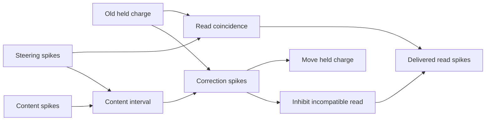

# Held charge checks its own read

Opponent steering extended the lifetime of some held charge while
leaving enwik8 loss essentially tied with its paired control. This
experiment makes the old charge verify that it is still relevant
when it is about to emit a read. The same signed correction spikes
that move the cell also drive inhibition of the read.
[Opponent-steering results](OPPONENT_STEERING.md#results)

Let $m$ be the previous charge and let $\Delta m$ be the smallest
signed correction that moves it into the new content interval. The
veto neuron receives the magnitude of this correction through a
nonnegative quantized synapse. Its spikes remove overlapping pulse
slots from the old charge's coincident read.

$$
v = \operatorname{IF}(\gamma |\Delta m|)
\qquad
r = \operatorname{sgn}(m)\max\bigl(0,\min(|m|,s)-v\bigr).
$$

The new read still takes its value from $m$. A charge already in
the interval emits no correction and therefore no veto. The gain
is shared within each axon delay group. Five blocks add 20 gains
and zero streaming state. All gains start at zero, so the new
decoder's native vocabulary counts, pulse totals, and 21,320-byte
streaming footprint match the released checkpoint at initialization.
Counts matched on 4,096 real enwik8 validation bytes on both CPU
and MPS. Gains received nonzero next-byte gradients in every
block on 512 enwik8 training targets.
[Decoder](../snnformer/event_lm.py) ·
[Initialization check](../results/event_lm/trace_read_veto/warm_identity.json)

The paired test starts both arms at the v2 checkpoint, uses seed
711 and 6,553,600 additional training targets, and trains both
with the chronological held-charge gradient. The candidate enables
`--trace-read-veto` and uses the same 310,000-pulse training target.
Scoring covers complete enwik8 and PG-19 test inputs. A zero-gain
intervention isolates the effect of read inhibition after training.
[Matched training rule](TRACE_WRITE_CREDIT.md)
