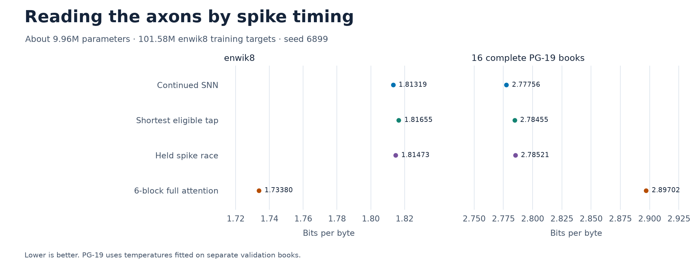

# Read existing axon packets in firing order

The v6 history probe locates most of the enwik8 gap within 32 bytes.
On a later 16,384-byte validation slice, choosing a tap per read
reduced signed pulse mismatch by 10.5% relative to the best single
fixed tap per group on that slice. This study tests whether the
extra agreement lowers next-byte loss.
[History and tap probes](TRACE_INTEGRATION.md#select-among-arrivals-in-the-existing-axons)

## Choose the packet that arrives first

Each delay group starts with a packet scheduled to arrive at age
$d$. Its existing ring also exposes up to three shorter ages,
down to one byte. The held-charge cell
reads before it writes. Current steering $s$ exposes the same
signed prefix of the held charge and of every candidate. Let $q$
be the exposed held read, $p_i$ a candidate packet, and
$z_i=\operatorname{clip}(p_i,-s,s)$ its exposed counts.

Each channel has one signed learned conductance $g_c$ in charge
ticks, quantized to the range $[-63,64]$. Unmatched spikes delay
that candidate's firing by

$$
L_i=\sum_c (64+g_c)\lvert z_{i,c}-q_c\rvert .
$$

A common clock reaches the candidate with the least inhibitory
charge first. Its release spike shunts the competing reads and
selects its own full packet $p_i$. Ties use the original tap order
from oldest to shortest. Groups with multiple taps race once
their oldest tap has arrived and their held read has pulses. The
fixed control reads the shortest candidate under the same release rule.
The implementation obtains the first firing directly from the
integer latencies. During training, a soft surrogate sends gradient
to the conductances and to the exposed spike counts.
[Read circuit](../snnformer/event_lm.py) ·
[Prior work on learning spiking delays](https://arxiv.org/abs/2501.07331)

## Correct the packet on the existing axon

The same $g_c$ that scales mismatch charge supplies the synaptic
correction from the ordinary packet $p_0$ to the selected packet.
The correction emits signed pulses,
$\delta=\operatorname{FIRE}_{64}(g\,(p_i-p_0))$. The layer clips
$p_0+\delta$ to the allowed count range. Its bypass carries the
unmatched pulses of that corrected packet. Its held read receives
the change in coincident counts between the corrected packet and
the ordinary one. Both projections keep their existing geometry.

The parallel held-charge update runs from the ordinary axons before
the tap is selected. This makes the query causal and keeps the same
interval scan for both batch and streaming execution. Chunk reads
use a byte position to determine when the oldest tap is valid.
The native step path uses the decoder's existing position and reads
the candidate slots before writing the current packet.

The 1,352 conductances start at zero. The race and shortest-tap
variants both match every parent vocabulary count on 4,096 real
enwik8 validation bytes. They add 118,591 release spikes on that
sample, about 29 per byte. All new conductances receive gradient on
a 512-target training window. Each SNN uses 29,674 persistent tensor
bytes per stream.
[Race warm start](../results/event_lm/trace_tap_read/warm_race.json) ·
[Fixed warm start](../results/event_lm/trace_tap_read/warm_fixed.json)

## Matched training

| Arm | Learned parameters | Stream state |
|---|---:|---:|
| Continued v6 SNN | 9,960,960 | 29,674 B |
| Shortest eligible tap | 9,962,312 | 29,674 B |
| Held spike race | 9,962,312 | 29,674 B |
| Continued full attention | 9,962,496 | 6 MiB at 512 bytes |

All arms add 9,830,400 targets to the 91,750,400-target SNN and
Transformer parents. The 2,400 updates use seed 6899, eight 512-byte
training windows per update, 96 warmup steps, and peak learning rate
0.0002. The SNNs retain the soft target of 310,000 generated pulses
per byte. The two new arms emit one release spike per active group
and count the signed correction pulses in that same budget.

The shortest tap is the lowest-mismatch fixed choice for 26 of 29
groups on the earlier calibration slice. Its total mismatch is
0.0065% above the best fixed combination of all groups on that
slice. Both tap arms start from the same SNN and use the same
conductance parameterization.
[Tap calibration](../results/event_lm/trace_integration/tap_choices_control_s5801.json) ·
[Parent checkpoint digests](../results/event_lm/trace_integration_checkpoints.sha256)

```bash
export PYTORCH_ENABLE_MPS_FALLBACK=0
for arm in control fixed race transformer; do
  bash experiments/run_v4_continuation.sh "trace-tap-$arm"
done
```

## Held-out results

The continued SNN is the bundled reference. It scores **1.81319
bpb on enwik8** and **2.77756 bpb on PG-19**. Full attention leads
on enwik8 by 0.07939 bpb, and the continued SNN leads on all 16
PG-19 books. The race reduces enwik8 loss by 0.00183 bpb compared
with the independently trained shortest-tap arm and raises PG-19
loss by 0.00066 bpb. Its enwik8 and
PG-19 losses are respectively 0.00154 and 0.00765 bpb higher than
the continued SNN's. This comparison uses one continuation seed.
[Ranked results and raw PG-19 scores](LEADERBOARD.md) ·
[Full-corpus records](../results/event_lm/trace_tap_read)



### What the trained race used

On 4,096 enwik8 test bytes, 1,007 of 1,352 conductances quantize
to nonzero values. The race chooses an older candidate than the
shortest tap on 38.46% of its 118,591 releases. Its release and
correction populations emit 28.95 and 132.89 pulses per byte
respectively. The full race emits 309,582 pulses per byte on
that sample. The continued SNN emits 309,354.
[Native race audit](../results/event_lm/trace_tap_read/native_race_s6899.json) ·
[Native continued SNN audit](../results/event_lm/trace_tap_read/native_control_s6899.json)

The frozen-weight intervention scores 65,536 validation targets.
Replacing the trained race with the shortest eligible tap shifts
loss from 1.74802 to 1.74778 bpb. Zeroing its tap conductances
gives 1.74794 bpb. The frozen race weights yield their lowest
loss on this slice with the fixed tap.
[Frozen race interventions](../results/event_lm/trace_tap_read/probe_race_s6899.json)

### Native CPU decoding

The median covers three timed runs of 64 greedy bytes on one M3 Max
CPU stream with two PyTorch threads. Both prompt lengths start at
byte 95,000,000 of enwik8. The state stays at 29,674 bytes per
stream. The timing includes the integer tensor work needed to
read the taps and choose a release.
[Timing record](../results/event_lm/trace_tap_read/decode_s6899.json)

| Decoder | After 128 prompt bytes | After 512 prompt bytes |
|---|---:|---:|
| Continued SNN | 2.247 ms/byte | 2.220 ms/byte |
| Shortest eligible tap | 3.152 ms/byte | 3.041 ms/byte |
| Held spike race | 3.448 ms/byte | 3.597 ms/byte |

```bash
python experiments/benchmark_decode.py --integer-event --contexts 128 512 \
  --steps 64 --warmups 1 --repeats 3 --threads 2 --device cpu \
  --prompt-file data/enwik8 --prompt-offset 95000000 \
  --checkpoint checkpoints/trace-tap-study/{control,fixed,race}_s6899.pt \
  --json checkpoints/work/v7_decode.json
```

## Expand within 32 KiB

Each local held cell stores a bounded signed count. At 16×
resolution the held range is −512 to +512, so Int16 preserves all
charge ticks. The arithmetic widens to Int32 in the integer decoder.
The training path keeps differentiable charge between chunks.
Enabling this storage layout frees state for 56 new content and
56 new steering channels per block. Each axon group keeps its
existing channels and delays. New expansion synapses start at zero.
New outgoing synapses give the added neurons a next-byte gradient.

| Warm start from the 101.58M endpoints | Parameters | Persistent tensor state |
|---|---:|---:|
| 187-channel continued SNN | 9,960,960 | 29,674 B |
| 243-channel SNN with Int16 held charge | 12,799,488 | 32,616 B |
| 243-channel spike race with Int16 held charge | 12,801,246 | 32,616 B |
| Full attention with wider SwiGLU | 12,801,024 | 6 MiB at 512 bytes |

On 4,096 enwik8 validation bytes the widened SNN reproduces every
parent vocabulary count and all 1,295,092,804 counted pulses.
Integer CPU batch, chunk, and byte-step counts match the quantized
Metal counts. Widening the trained race preserves its vocabulary
counts and pulse total, including every release spike in the sample.
The widened Transformer reproduces the parent logits
on eight 512-byte windows from the same slice. Both receive gradients
in every grown block on a 512-target training window. These are
initialization checks. The width comparison starts from the
101.58M endpoints and awaits a matched continuation.
[SNN warm start](../results/event_lm/trace_tap_read/warm_wide_packed_control_s6899.json) ·
[Race warm start](../results/event_lm/trace_tap_read/warm_wide_packed_race_s6899.json) ·
[Transformer warm start](../results/event_lm/trace_tap_read/warm_wide_transformer_s6899.json) ·
[One-update training checks](../results/event_lm/trace_tap_read/verification)

```bash
export PYTORCH_ENABLE_MPS_FALLBACK=0
parent=checkpoints/trace-tap-study
next=checkpoints/work/packed-width
python experiments/audit_residual_growth.py --device mps --enwik8 data/enwik8 \
  --parent "$parent/control_s6899.pt" --hidden 243 --compact-trace-state \
  --json "$next/warm_snn.json"
python experiments/audit_growth_gradients.py transformer --device mps --enwik8 data/enwik8 \
  --checkpoint "$parent/transformer_s6899.pt" --mlp-ratio 14.185546875 --seed 711 \
  --json "$next/warm_transformer.json"

shared=(--data data/enwik8 --device mps --ctx 512 --bs 8 --steps 2400 \
  --warmup 96 --lr 0.0002 --seed 7907 --eval-every 300 --eval-bs 8 \
  --eval-batches 8 --final-eval-batches 48 --validation-only --results-dir "$next/results")
snn=(--variant event_correction_code --dim 768 --depth 11 --no-carry \
  --memory-heads 4 --memory-slots 14 --memory-width 32 --forecast-key-channels 2 \
  --match-forecast-key --learn-context-keys --spike-resolution 16 \
  --pulse-budget 310000 --code-loss-weight 0.25 --router-charge-bits 8 \
  --compact-delays --compact-axon-state --activity-inhibition --inhibition-by-expansion \
  --local-trace --trace-write-credit --residual-correction-start 7)
python experiments/train_event_lm.py "${shared[@]}" "${snn[@]}" \
  --hidden 243 --grow-expansion --compact-trace-state --tag packed_width \
  --initialize-from "$parent/control_s6899.pt" --checkpoint "$next/wide_snn.pt"
python experiments/train_event_lm.py "${shared[@]}" "${snn[@]}" \
  --hidden 187 --tag packed_width_control \
  --initialize-from "$parent/control_s6899.pt" --checkpoint "$next/control.pt"
python experiments/train_event_lm.py "${shared[@]}" \
  --variant transformer --dim 256 --depth 6 --heads 4 --mlp-ratio 14.185546875 \
  --grow-feed-forward --tag packed_width \
  --initialize-from "$parent/transformer_s6899.pt" --checkpoint "$next/wide_transformer.pt"
```

To widen the trained timing circuit, use the wide SNN recipe with
`--trace-tap-read race`, initialize from `race_s6899.pt`, and set
distinct `--tag` and `--checkpoint` paths.
