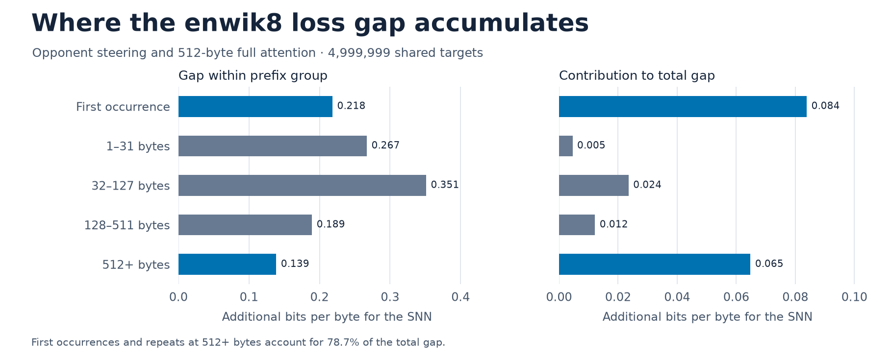

# Training held charge with credit for actual writes

Each held-charge cell applies a sequence of interval projections. An
interval can move the charge to its lower or upper bound, or leave the
previous charge intact. The training rule in `--trace-write-credit` sends
a future state's gradient to the most recent bound that moved it. A
touch at equality preserves the earlier source. A cell without a new
write sends credit to its initial charge.

The scan computes the charge after each interval pair, then reconstructs
the intermediate states. Composing two clips uses two projected bounds.
The paired evaluation has linear total work and logarithmic depth in
the number of timesteps. A prefix maximum of actual write indices
selects the source for each output. Backpropagation follows those
selected writes. Native decoding still applies the integer clip once
per byte.
[Implementation](../snnformer/correction_memory.py) ·
[Parallel prefix scans](https://www.cs.cmu.edu/afs/cs.cmu.edu/project/scandal/public/papers/CMU-CS-90-190.html)

The original and new training rules produced identical forward
vocabulary counts with the same weights. When bounds tie, the grouping
of the original parallel clips can affect which bound receives a
gradient. The new rule matched explicit
chronological writes and their gradients on an enwik8 training sample
of eight 53-byte windows. The architecture and parameter count are
shared by the two training rules.

## Apple GPU timing

Six interleaved timings used the same five-block checkpoint and eight
512-byte enwik8 training windows. Median language-loss forward and
backward time was 0.498 seconds with the original scan and 0.278
seconds with write credit, a 1.79× speedup in this timing. The
measurement covers the language objective and excludes the optimizer
step, auxiliary forecast loss, and pulse-budget loss.
[Timing record](../results/event_lm/trace_write_credit/trace_training_pair.json)

```bash
PYTORCH_ENABLE_MPS_FALLBACK=0 python experiments/benchmark_trace_training.py \
  --enwik8 data/enwik8 --checkpoint models/spiking-byte-lm-v2/weights.pt \
  --batch-size 8 --context 512 --trials 6 --json checkpoints/trace-training-pair.json
```

## Paired next-byte scores

The next-byte quality comparison uses the same starting weights, seed
711, optimizer settings, and 6,553,600 additional enwik8 targets as
the control in the opponent-steering study. Each arm uses the same
pulse target. [Matched control protocol](OPPONENT_STEERING.md#paired-continuation)

| Training rule | enwik8 bits/byte | PG-19 bits/byte | Native pulses/byte |
|---|---:|---:|---:|
| Original trace gradient | 1.98564 | 2.98490 | 307,730 |
| Credit for actual trace writes | 1.98691 | 2.99097 | 307,270 |

With the same number of training targets, held-out loss rose by
0.00127 bits per byte on enwik8 and 0.00607 on PG-19 in this seed.
The final enwik8 validation score was 0.00098 lower. Native CPU
inference and MPS still matched exactly in the 4,096-byte audit.
The matched read-veto trial uses the same faster gradient in both
arms. The longer-context continuation also uses it to keep the
training workload feasible locally.
[enwik8 score](../results/event_lm/trace_write_credit/enwik8_write_credit_s711.json) ·
[PG-19 score](../results/event_lm/trace_write_credit/pg19_write_credit_s711.json) ·
[Native audit](../results/event_lm/trace_write_credit/native_write_credit_s711.json) ·
[Read-veto design](TRACE_READ_VETO.md) · [Longer-context comparison](CONTEXT_LENGTH.md)

The 1.63M full-attention reference also continued for 6,553,600 targets
from its seed-0 checkpoint, using the same seed-711 windows and
AdamW schedule. It scored 1.79625 bits per byte on the complete
enwik8 split. Opponent steering scored 1.98533 at this training
exposure, a gap of 0.18908 bits per byte. The same Transformer scored
3.11887 bits per byte on PG-19 at a 512-byte context. Opponent
steering scored 2.97309 and led on all 16 books. Its advantage
was 0.14578 bits per byte after calibration and 0.26346 at the
raw output scale.
[Reference training](../results/event_lm/trace_write_credit/transformer_s711_trace_warm_reference.json) ·
[Reference enwik8](../results/event_lm/trace_write_credit/enwik8_transformer_s711.json) ·
[Reference PG-19](../results/event_lm/trace_write_credit/pg19_transformer_s711.json)

The enwik8 records group targets by the distance to the previous
occurrence of their eight-byte prefix. First occurrences and repeats
at least 512 bytes apart account for 78.7% of the overall enwik8 gap.
The largest per-target gap is in the 32–127-byte group at 0.35123
bits per byte. [Opponent-steering enwik8 record](../results/event_lm/opponent_steering/enwik8_opponent_s711.json)



## Share the scan with forecast-error memory

Both recurrences move a cell's charge by clipping it to a
permitted interval. Inference now composes adjacent pairs
recursively for both the local held-charge cells and the
forecast-error bank. This evaluates the same causal states
with linear total work. The earlier prefix scan remains the
default training gradient during replay.

The optional `--bank-write-credit` gradient makes each
forecast-error read send credit to the actual write that
moved its cell most recently. A read that follows a touch
at equality gives credit to the earlier write.

On the trained four-phase checkpoint, five interleaved Metal
trials gave the following median timings. Both comparisons
preserved every vocabulary count on the measured samples.

| Measured operation | Original prefix scan | Paired method |
|---|---:|---:|
| Forward on an 8,192-byte enwik8 validation chunk | 0.350 s | 0.240 s |
| Language forward and backward on 4,096 enwik8 training targets, changing the bank gradient only | 0.829 s | 0.347 s |

The second row measures the optional bank gradient and
excludes the optimizer and auxiliary losses. A separate
three-step trial exercised it with the regular training
objective and pulse tracking.
[Forward timing and paired trials](../results/event_lm/tag_phase_address/paired_scan_timing.json) ·
[Bank-gradient timing](../results/event_lm/tag_phase_address/bank_write_credit_timing.json) ·
[Metal training smoke](../results/event_lm/tag_phase_address/event_correction_code_s711_bank_write_credit_smoke.json)

```bash
PYTORCH_ENABLE_MPS_FALLBACK=0 python experiments/benchmark_trace_training.py \
  --site bank --trials 5 --checkpoint checkpoints/tag-phase-address-study/tag_phase_s711.pt \
  --enwik8 data/enwik8 --json checkpoints/work/bank-write-credit-timing.json
```
