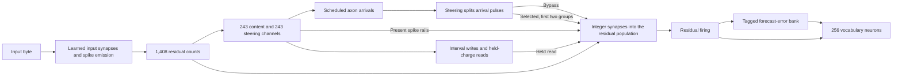

# ShuntFormer v10 model card

The checkpoint grows the selected-arrival SNN to 25,788,928
trainable parameters with 11 blocks and 28,584 bytes of
persistent tensor state per stream. Its continuation uses
a mixture of enwik8, C4 training pages, and PG-19 training
books. Total training exposure is 131,072,000 byte targets.
[Width study and training data](../../docs/RESIDUAL_SCALE.md) ·
[Checkpoint and corpus hashes](manifest.json) ·
[Restore and replay](../../docs/V10_HANDOFF.md)

## Decoder



Each of four delay groups routes content and steering into
fixed axons and a local held-charge read. Their widths are
75, 75, 47 and 46. All groups project the present rails, the
held read and the arrival bypass. The first two groups also
project the selected arrivals into the same residual current.
Extra residual neurons can acquire their own count responses
to those inputs. The earlier seven blocks emit their residual
counts. The final four forward the incoming count and emit
the signed difference. The tagged bank follows all 11 blocks.
[Selected-arrival circuit](../../docs/FIXED_ARRIVALS.md#route-the-part-that-arrived)

The bank uses four heads and 14 cells per head with two tag
counts and six forecast-error counts per cell. Tag mismatch
inhibits the bank correction before its current reaches the
vocabulary neurons. The native CPU decoder executes the
routing, cell updates and output entirely on integer counts.
The Metal trainer uses FP32 master weights and surrogate
gradients with quantized forward values.
[Decoder](../../snnformer/event_lm.py) ·
[Tagged bank](../../snnformer/correction_memory.py)

| Persistent component | Bytes per stream |
|---|---:|
| Fixed-delay Int16 rings | 21,094 |
| Int16 held charge | 5,346 |
| Int32 tag and forecast-error cells | 1,792 |
| Prior address and forecast counts | 352 |
| **Total** | **28,584** |

## Measured scope

On the full enwik8 test split, this checkpoint scores 1.79787
bpb. The size-matched full-attention model scores 1.71379 bpb.
The narrow SNN trained on the same windows scores 1.79789 bpb.
On the 16 held-out PG-19 books, the wide mixed SNN scores
2.02699 bpb. On the fixed C4 validation sample it scores
2.06397 bpb. The training mixture includes both source corpora.
The release bundles all study endpoints for direct comparison.
[Full enwik8 result and paired early predictions](../../docs/RESIDUAL_SCALE.md#complete-enwik8-test)

## Run

```bash
python experiments/generate_event_lm.py models/spiking-byte-lm-v10/weights.pt \
  --prompt 'The first chapter' --bytes 128
```

[Matched held-out scores and figures](../../docs/LEADERBOARD.md) ·
[Benchmark protocol](../../docs/BYTE_TRANSFER.md)
