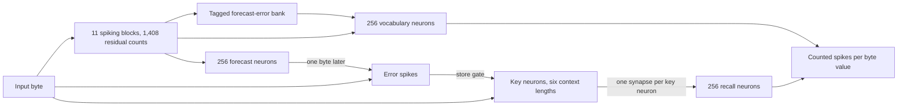

# ShuntFormer v11 model card

The checkpoint is the 25,788,928-parameter v10 decoder after
9,830,400 more training targets, with fast synapses on its
output. A population of forecast neurons predicts every byte.
The spikes it gets wrong decide which bytes the synapses store.
The synapses hold 24,576 bytes per stream and their 24 strengths
are fitted on enwik8 validation. Persistent state is
53,432 bytes per stream and total training exposure is
140,902,400 byte targets.
[Surprise study, circuits and controls](../../docs/SURPRISE_CLOCK.md) ·
[Checkpoint and corpus hashes](manifest.json) ·
[Restore and replay](../../docs/V11_HANDOFF.md)

## Decoder



The 11 blocks, their fixed axons, held charge and tagged bank
are the v10 circuit. The forecast neurons read the top residual
stream through the output synapses with a 16 times higher
threshold. When a byte arrives, the error spikes are the forecast
winner's spikes that the byte's own neuron did not match.
[v10 circuit](../spiking-byte-lm-v10/README.md#decoder)

Six heads watch the last 3, 4, 6, 8, 12 and 16 bytes. A fixed
random projection selects one of 1,024 key neurons in each of
four groups per head. Every key neuron keeps one synapse onto
the recall neurons. A byte that arrives with at least one error
spike moves the synapses of the previous context's key neurons
onto its recall neuron. The key neurons of the current context
then vote, and agreeing synapses fire the recall neuron with a
fitted number of spikes. The decoder counts recall spikes and
vocabulary spikes together. The native CPU decoder executes all
of it on integers, and its one-byte step matches the batched pass.
[Decoder](../../snnformer/event_lm.py) ·
[Fast synapses](../../snnformer/fast_synapses.py)

| Persistent component | Bytes per stream |
|---|---:|
| v10 delay rings, held charge and bank | 28,584 |
| Previous forecast counts | 256 |
| One synapse per key neuron | 24,576 |
| Last 16 bytes | 16 |
| **Total** | **53,432** |

## Measured scope

On the full enwik8 test split this checkpoint scores 1.64541
bpb. The same decoder without its synapses scores 1.78973. The
size-matched full-attention model scores 1.70433 with its
512-byte context, and 1.57753 with the same synapses on its
output. On the 16 held-out PG-19 books the checkpoint scores
1.93961 bpb with the strengths fitted on enwik8 validation. It
scores 1.97852 there without synapses, and full attention scores
1.93711. The synapses lower loss on all 16 books. The native
decoder emits 321,971 pulses per byte, of which 8,086 are
forecast spikes and 185 are key and recall spikes.
[Full results, controls and limits](../../docs/SURPRISE_CLOCK.md#complete-enwik8-test)

The release also contains the decoders with a surprise clock.
Their four added blocks did not improve on this model, and the
study reports them as a negative result. Greedy generation
tends to repeat recent text, because the synapses recall what
followed the same context.

## Run

```bash
python experiments/generate_event_lm.py models/spiking-byte-lm-v11/weights.pt \
  --prompt 'The first chapter' --bytes 128
```

[Matched held-out scores and figures](../../docs/LEADERBOARD.md) ·
[Benchmark protocol](../../docs/BYTE_TRANSFER.md)
