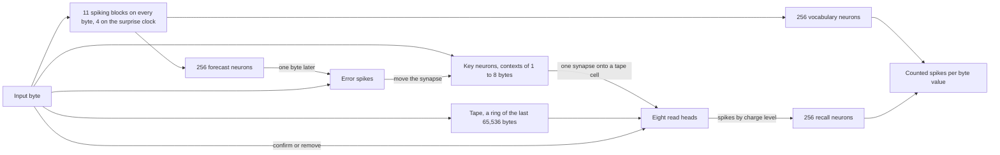

# ShuntFormer v12 model card

The checkpoint is a 34,845,184-parameter spiking decoder trained
from random weights for 368,640,000 byte targets beside coasting
read heads. Eight heads sit on a tape of the stream's last 65,536
bytes. Each follows a passage one byte at a time, gains charge
with every confirmed byte and is removed by the first wrong one.
Their 104 integer strengths are fitted, and nothing in them is
trained by gradient descent.

The weights are not in the repository. The file is 139 MB and is
in the `scratch` archive of the release as
`v12-scratch/heads_s20001.pt`. The model that runs from a clone
is still [v11](../spiking-byte-lm-v11/README.md).
[Coasting-head study, circuit and limits](../../docs/COASTING_HEADS.md) ·
[Checkpoint and archive hashes](manifest.json) ·
[Restore and replay](../../docs/V12_HANDOFF.md)

## Decoder



The 15 blocks, the forecast neurons and the error spikes are the
v11 circuit with the surprise clock.
[v11 circuit](../spiking-byte-lm-v11/README.md#decoder)

Each head owns 4,096 key neurons and one context length from 1
to 8 bytes. A key neuron keeps one synapse onto a tape cell. A
byte that arrives with an error spike moves the synapse of the
context before it onto its own cell. When a head's place is
empty, the key neuron of the current context puts a new head on
the cell its synapse reaches. A live head fires the recall
neuron of the byte in its cell, with a strength set by its
charge in 13 levels.

| State | Size per stream | Measured |
|---|---:|---|
| Decoder | 43,796 B | By the streaming evaluator, on the plain decoder of the same architecture |
| Tape | 65,536 B | Counted, one byte per cell |
| Key synapses | 65,536 B | Counted, 8 × 4,096 synapses of 16 bits |

## Measured scope

On the full enwik8 test split the checkpoint scores 1.4138 bpb
with heads and 1.6073 without. The same architecture trained
without a recall circuit scores 1.6110 alone and 1.4297 with
heads fitted afterwards. Trained beside the v11 fast synapses it
scores 1.4857 with them. The full-attention Transformer of the
same size and training scores 1.2068 with its 512-byte context
and 1.1756 with the same heads on its output.
[Full results, controls and limits](../../docs/COASTING_HEADS.md#complete-enwik8-test)

The enwik8 scores are replays. The decoder's outputs and error
spikes are recorded over the continuous stream, the heads are
replayed over the record, and their strengths are refitted on
enwik8 validation. The streaming evaluator, the native integer
decoder and the generator do not accept this checkpoint. It has
no pulse count, no PG-19 score and no measured head state. Every
number is one seed.

On held-out web pages, mathematics and source code the
checkpoint scores 1.6644, 2.0541 and 2.6160 bpb in 512-byte
windows, with the heads running inside the model and the
strengths it was trained beside. The plain decoder scores
1.7442, 2.3897 and 3.5534.

## Rescore

```bash
python experiments/probe_coasting_heads.py --enwik8 data/enwik8 --device cuda \
  --checkpoint checkpoints/v12-scratch/heads_s20001.pt \
  --cache-dir checkpoints/work/cache-heads --work-dir checkpoints/work/build \
  --synapses alone --score-test --setting 'orders=1,2,3,4,5,6,7,8;tape=65536' \
  --json checkpoints/work/recall_scratch-heads.json
```

[Head circuit](../../snnformer/coasting_heads.py) ·
[Replay record](../../results/event_lm/coasting_heads/recall_scratch-heads.json)
