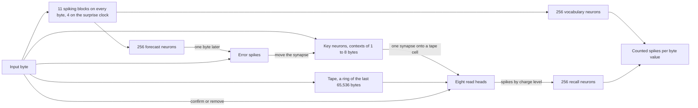

# ShuntFormer v12 model card

The checkpoint is a 34,845,184-parameter spiking decoder trained
from random weights for 368,640,000 byte targets beside coasting
read heads. Eight heads sit on a tape of the stream's last 65,536
bytes. Each follows a passage one byte at a time, gains charge
with every confirmed byte and is removed by the first wrong one.
Their 104 integer strengths are fitted, and nothing in them is
trained by gradient descent.

The weights are not in the repository. The file is 139 MB and is
in the `scratch` archive of the release as
`v12-scratch/heads_s20001.pt`. The model that runs from a clone
is still [v11](../spiking-byte-lm-v11/README.md).
[Coasting-head study, circuit and limits](../../docs/COASTING_HEADS.md) ·
[Checkpoint and archive hashes](manifest.json) ·
[Restore and replay](../../docs/V12_HANDOFF.md)

## Decoder



The 15 blocks, the forecast neurons and the error spikes are the
v11 circuit with the surprise clock.
[v11 circuit](../spiking-byte-lm-v11/README.md#decoder)

Each head owns 4,096 key neurons and one context length from 1
to 8 bytes. A key neuron keeps one synapse onto a tape cell. A
byte that arrives with an error spike moves the synapse of the
context before it onto its own cell. When a head's place is
empty, the key neuron of the current context puts a new head on
the cell its synapse reaches. A live head fires the recall
neuron of the byte in its cell, with a strength set by its
charge in 13 levels.

| State | Size per stream | Holds |
|---|---:|---|
| Decoder | 43,796 B | Delay lines, held charge, error bank and clock |
| Tape | 65,536 B | One byte per cell |
| Key synapses | 65,536 B | 8 × 4,096 synapses of 16 bits |
| Synapse marks | 4,096 B | One bit per key neuron that has a synapse |
| Heads | 64 B | A tape cell and a charge for each head |
| Total | 179,028 B | Measured by the streaming evaluator |

## Measured scope

On the full enwik8 test split the checkpoint scores 1.4137 bpb
in the streaming evaluator, and 1.6456 on 16 PG-19 books. Both
use the strengths it was trained beside. The same architecture
trained without a recall circuit scores 1.6110 and 1.7205, and
trained beside the v11 fast synapses 1.4859 and 1.6863. The
full-attention Transformer of the same size and training scores
1.2068 and 1.4821 with its 512-byte context.
[Leaderboard](../../docs/LEADERBOARD.md)

With strengths refitted to its own decoder on enwik8 validation
the checkpoint scores 1.4138 on enwik8. A replay of the heads
over the decoder's recorded outputs gives the same score, and
1.6073 without heads. The plain decoder with heads fitted
afterwards scores 1.4297 in that replay, and the Transformer
with the same heads on its output 1.1756.
[Full results, controls and limits](../../docs/COASTING_HEADS.md#complete-enwik8-test)

The native integer decoder fires 309,469 pulses per byte on the
first 4,096 bytes of the enwik8 test split, 241 of them in the
head circuit. Over the whole test stream the head circuit fires
513 spikes per byte. The generator steps the same decoder. Every
number is one seed.

On held-out web pages, mathematics and source code the
checkpoint scores 1.6644, 2.0541 and 2.6160 bpb in 512-byte
windows, with the heads running inside the model and the
strengths it was trained beside. The plain decoder scores
1.7442, 2.3897 and 3.5534.

## Rescore

The streaming evaluator scores the checkpoint as released.

```bash
python experiments/eval_event_lm.py --device cuda --context 8192 --history 256 --batch-size 8 \
  --checkpoint checkpoints/v12-scratch/heads_s20001.pt --enwik8 data/enwik8 \
  --json checkpoints/work/enwik8_heads_s20001.json
```

The replay refits the strengths on enwik8 validation and scores
the decoder alone, with the v11 synapses and with the heads.

```bash
python experiments/probe_coasting_heads.py --enwik8 data/enwik8 --device cuda \
  --checkpoint checkpoints/v12-scratch/heads_s20001.pt \
  --cache-dir checkpoints/work/cache-heads --work-dir checkpoints/work/build \
  --synapses alone --score-test --setting 'orders=1,2,3,4,5,6,7,8;tape=65536' \
  --json checkpoints/work/recall_scratch-heads.json
```

[Head circuit](../../snnformer/coasting_heads.py) ·
[Stream record](../../results/event_lm/coasting_heads/v12-scratch/enwik8_heads_s20001.json) ·
[Replay record](../../results/event_lm/coasting_heads/recall_scratch-heads.json) ·
[Pulse audit](../../results/event_lm/coasting_heads/v12-scratch/native_heads_s20001.json)

## License

Licensed under the GNU Affero General Public License, version 3 only (AGPL-3.0-only), copyright 2026 control-f and Daniel Tremer; commercial licenses without the AGPL's conditions are available from control-f. See the repository's [LICENSE](../../LICENSE) and [NOTICE](../../NOTICE).
