# ShuntFormer v13 model card

The checkpoint is a 34,819,544-parameter spike-only decoder
trained from random weights for 368,640,000 byte targets. Three
state reads let the present byte address the stream's own
earlier states by what they hold. Four layers of race cells,
22,400 cells in all, listen to the stream on fibres that bring
it as it was up to three bytes ago. Reads and cells are built
from spike counts and trained by gradient descent with the
decoder.

The weights are not in the repository. The file is 140 MB and is
in the `cells` archive of the release as
`state_reads/pilot-race64-d8-c350-dl4/model.pt.averaged`. It
holds the running average of the weights, which is what the
study scores. The model that runs from a clone is still
[v11](../spiking-byte-lm-v11/README.md).
[State-read study, circuit and limits](../../docs/STATE_READS.md) ·
[Checkpoint and archive hashes](manifest.json) ·
[Restore and rescore](../../docs/V13_HANDOFF.md)

**The decoder runs in windows only.** State reads and race cells
carry no state through a stream. The streaming evaluator, the
native integer decoder, the pulse audit and the generator refuse
this checkpoint.

## Decoder

```mermaid
flowchart LR
    B["Input byte"] --> A["Blocks 0 and 1, race cells after each"]
    A --> C["Block 2, then a state read"]
    C --> D["Block 3, then race cells"]
    D --> E["Block 4, then a state read"]
    E --> G["Block 5, then race cells"]
    G --> H["Block 6, then a state read"]
    H --> F["256 forecast neurons"]
    F -->|surprise| K["Block 7 on the surprise clock"]
    H --> K
    K --> M["Tagged forecast-error bank"]
    M --> V["256 vocabulary neurons"]
```



The eight blocks, the forecast neurons, the error bank and the
surprise clock are the v11 circuit at a stream width of 1,408
channels.
[v11 circuit](../spiking-byte-lm-v11/README.md#decoder)

A state read turns the stream at every byte into a tag, a
payload and a probe of 256 channels in four heads. In a head the
present byte's probe meets the tags of the last 512 bytes, pulse
by pulse and sign by sign. The 512 cells race for 256 spikes,
and every cell spike passes that cell's payload pulses on. The
read neurons count the mean payload and bring it to the stream.

A layer of race cells has 16 clusters of 350 cells. A cluster
shares 256 stream channels through fixed wiring, 64 of them as
they are now and 64 each as they were one, two and three bytes
ago. Every cell weighs those fibres with its own synapses, and
the cells of a cluster race for 64 spikes per byte.

| Part | Parameters |
|---|---:|
| 8 blocks | 18,112,512 |
| 4 layers of race cells | 11,491,264 |
| 3 state reads | 4,331,544 |
| Input and output synapses | 720,896 |
| Forecast-error bank and recall synapse | 163,328 |
| **Total** | **34,819,544** |

## Measured scope

Every score here is in windows of 512 bytes that start from an
empty state, with 256 unscored bytes before the 256 scored ones.

On the full enwik8 test split the checkpoint scores 1.2623 bpb.
The last weights of the same run score 1.2629. The
full-attention Transformer of the same size and training scores
1.2068, and 1.2041 when it is trained with the same optimizer.
The decoder with spike reads and no cells scores 1.2991. Scored
in the same windows, the v12 decoder with read heads scores
1.4669 and the v12 plain decoder 1.5973.
On 16 complete PG-19 test books the checkpoint scores 1.5516
bpb and the same Transformer 1.4821, each at a fitted
temperature of 1.
[Leaderboard](../../docs/LEADERBOARD.md) ·
[Full results, controls and limits](../../docs/STATE_READS.md#complete-enwik8-test)

The trainer counts 313,016 pulses per byte on validation against
a budget of 310,000. That count is the trainer's own. No native
decoder has audited it.

Both races are computed in closed form and in floating point. A
cell's rate is its softmax share of the budget, and fixed
starting phases turn the rates into whole spikes. The same file
scores 1.262257 on the training GPU and 1.262237 on a laptop
CPU. Every number is one seed.

Not measured for this checkpoint: a streaming score, a native
integer run, generation, and the held-out web pages, mathematics
and source code of v12.

## Rescore

```bash
python experiments/eval_warmed_windows.py --device cuda --enwik8 data/enwik8 \
  --checkpoint checkpoints/scratch-study/transformer_s20001.pt \
    checkpoints/state_reads/pilot-race64-d8-c350-dl4/model.pt.averaged \
  --json checkpoints/work/test_spike_reads_and_cells.json
```

The first checkpoint is the v12 Transformer, the reference of
the difference and its interval. On a CPU the decoder takes 19
minutes for the test split.

[Decoder](../../snnformer/event_lm.py) ·
[Evaluator](../../experiments/eval_warmed_windows.py) ·
[Test record](../../results/event_lm/state_reads/scores/test_spike_reads_and_cells.json) ·
[Training record](../../results/event_lm/state_reads/runs/pilot-race64-d8-c350-dl4.json)
