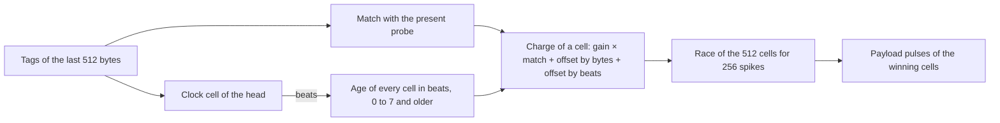

# ShuntFormer v14 model card

The checkpoint is a 34,822,736-parameter spike-only decoder
trained from random weights for 368,640,000 byte targets. It is
the v13 decoder with two changes to its three state reads. The
charges by which a read head addresses earlier bytes are stored
at an eighth of their size, so that one update moves them eight
times as far. And every read head has a clock cell and counts a
second age of each earlier byte, in beats of that cell.

The weights are not in the repository. The file is 140 MB and is
in the `clocks` archive of the release as
`read_clocks/tag8-a8/model.pt.averaged`. It holds the running
average of the weights, which is what the study scores. The
model that runs from a clone is still
[v11](../spiking-byte-lm-v11/README.md).
[Study, measurements and limits](../../docs/READ_CLOCKS.md) ·
[Checkpoint and archive hashes](manifest.json) ·
[Restore and rescore](../../docs/V14_HANDOFF.md)

**The gain is the address rate's.** The same decoder without
clocks is released beside this one as `read_clocks/rate8` and
scores 0.0013 bpb above it, which is less than a second run moves
a decoder. The clock cells of this checkpoint do not mark words.
[What the clocks added](../../docs/READ_CLOCKS.md#three-decoders-of-full-size)

**The decoder runs in windows only.** State reads and race cells
carry no state through a stream. The streaming evaluator, the
native integer decoder, the pulse audit and the streaming
generator refuse this checkpoint. A window generator, new in
this release, [writes text](#write-text) with it.

## Decoder

```mermaid
flowchart LR
    B["Input byte"] --> A["Blocks 0 and 1, race cells after each"]
    A --> C["Block 2, then a state read"]
    C --> D["Block 3, then race cells"]
    D --> E["Block 4, then a state read"]
    E --> G["Block 5, then race cells"]
    G --> H["Block 6, then a state read"]
    H --> F["256 forecast neurons"]
    F -->|surprise| K["Block 7 on the surprise clock"]
    H --> K
    K --> M["Tagged forecast-error bank"]
    M --> V["256 vocabulary neurons"]
```



The blocks, the race cells, the forecast neurons, the error bank
and the surprise clock are those of v13.
[v13 circuit](../spiking-byte-lm-v13/README.md#decoder)

A state read turns the stream at every byte into a tag, a
payload and a probe of 256 channels in four heads. In a head the
present byte's probe meets the tags of the last 512 bytes. Each
of those 512 cells is charged by that match times a learned
gain, plus a learned offset for its age in bytes and one for its
age in beats. The cells race for 256 spikes, and every cell
spike passes that cell's payload pulses on.



A clock cell hears the 256 tag channels of its read through
synapses that start silent, and its spike is a beat. The age of
an earlier byte in beats is the number of beats that fell after
it. The gains and both kinds of offset are the head's address.
With `--read-address-rate 8` their stored values count eight
times.

| Part | Parameters |
|---|---:|
| 8 blocks | 18,112,512 |
| 4 layers of race cells | 11,491,264 |
| 3 state reads | 4,334,736 |
| Input and output synapses | 720,896 |
| Forecast-error bank and recall synapse | 163,328 |
| **Total** | **34,822,736** |

The twelve clock cells and the offsets by beats are 3,192 of the
reads' parameters.

## Measured scope

Every score here is in windows of 512 bytes that start from an
empty state, with 256 unscored bytes before the 256 scored ones.

| Model | Parameters | enwik8 test | PG-19 test |
|---|---:|---:|---:|
| Transformer of the standard shape | 34,752,000 | 1.1822 | 1.4570 |
| Transformer, 256 wide | 34,845,696 | 1.2068 | 1.4821 |
| **This checkpoint** | 34,822,736 | **1.2444** | **1.5338** |
| The same decoder without clocks | 34,819,544 | 1.2457 | 1.5360 |
| v13 decoder | 34,819,544 | 1.2623 | 1.5516 |

The last weights of the same run score 1.2447 on enwik8. The
256-wide Transformer is the reference of v12 and v13. The one of
the standard shape was trained for this study and is 0.062 bpb
ahead of this checkpoint on enwik8 and 0.077 on PG-19. PG-19 is
16 complete test books, each model at a fitted temperature of 1.
[Leaderboard](../../docs/LEADERBOARD.md) ·
[Full results, controls and limits](../../docs/READ_CLOCKS.md#complete-enwik8-test)

The trainer counts 312,239 pulses per byte on validation against
a budget of 310,000. That count is the trainer's own. No native
decoder has audited it.

Both races are computed in closed form and in floating point. A
cell's rate is its softmax share of the budget, and fixed
starting phases turn the rates into whole spikes. A clock cell's
whole beats decide the ages, and its synapses learn from a mean
over clocks that is computed in floating point beside the
spikes. Every number is one seed. The run was resumed once from
its saved state, at 19,500 updates.

Not measured for this checkpoint: a streaming score, a native
integer run, and the held-out web pages, mathematics and source
code of v12.

## Rescore

```bash
python experiments/eval_warmed_windows.py --device cuda --enwik8 data/enwik8 \
  --checkpoint checkpoints/scratch-study/transformer_s20001.pt \
    checkpoints/read_clocks/tag8-a8/model.pt.averaged \
  --json checkpoints/work/test_clock_cells.json
```

The first checkpoint is the v12 Transformer, the reference of
the difference and its interval. `--device mps` scores on an
Apple GPU and `--device cpu` on a CPU.

## Write text

```bash
python experiments/generate_windows.py checkpoints/read_clocks/tag8-a8/model.pt.averaged \
  --prompt 'The first chapter' --bytes 256
```

The window generator runs the last 512 bytes again for every new
byte, which is about eight bytes per second on a laptop CPU. At
its default temperature of 0.8 and seed 0 the checkpoint
continues the prompt with

> of the poem (which is the history of speech towards the end of
> the poet), which contains a very strong man in ethics of an
> object whose anger was in a great original poem, was then
> written by an object which was not a member of the poem from a
> distributio

Another machine can draw other bytes, since the races are
computed in floating point.

[Decoder](../../snnformer/event_lm.py) ·
[Window generator](../../experiments/generate_windows.py) ·
[Evaluator](../../experiments/eval_warmed_windows.py) ·
[Test record](../../results/event_lm/read_clocks/scores/test_clock_cells.json) ·
[Training record](../../results/event_lm/read_clocks/runs/tag8-a8.json)
